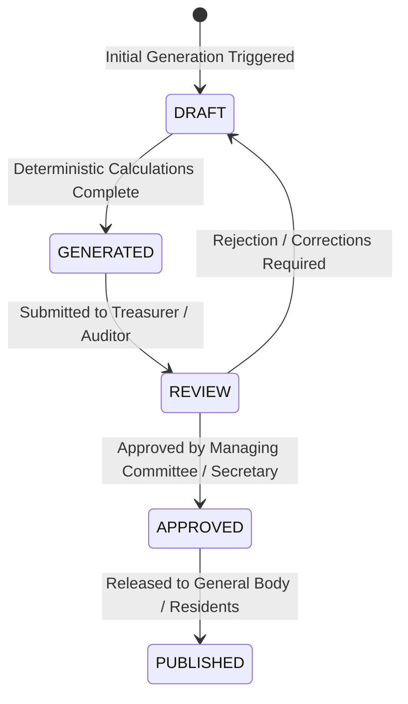

# SocietySphere - Production-Grade Multi-Tenant Apartment Society Management Platform
## System Architecture & Engineering Specification

---

## 1. Executive Summary & Core Principles

**SocietySphere** is an enterprise-grade, multi-tenant Software-as-a-Service (SaaS) platform architected for residential apartment societies, gated communities, and housing cooperatives. It is designed to manage administrative, financial, operational, governance, and physical gate security workflows at scale.

### 1.1 Non-Negotiable Engineering Principles
1. **Long-Term SaaS Horizon**: Built for high maintainability, strict typing, domain clarity, and modularity. No throwaway prototype shortcuts.
2. **Multi-Tenancy From Day One**: Tenant data segregation (`society_id`) is strictly enforced at the application layer, the database layer (via PostgreSQL Row-Level Security), and cache layers.
3. **Defense-in-Depth Authorization**: Backend authorization never trusts client claims. RBAC/ABAC checks occur strictly on the server/domain layer.
4. **API-First Parity**: Web and future Flutter mobile applications consume identical, versioned OpenAPI-compliant backend endpoints.
5. **Zero Frontend Direct Database Access**: All persistence flows exclusively through validated domain services.
6. **Immutable Financial Records**: Financial ledgers, invoices, payment records, and accounting transactions are append-only. Hard deletes are strictly forbidden.
7. **Complete Auditability**: Every sensitive state change, administrative action, visitor pass issue, gate entry, and financial modification writes an immutable audit record.
8. **Inclusivity & "Easy Mode" Accessibility**: Elderly residents, non-tech-savvy owners, and gate staff with low digital literacy are first-class citizens. High contrast, large typography, vernacular language support, and voice assistance are foundational architectural pillars.
9. **Controlled AI Boundaries**: AI assistants and voice interpreters operate in read-only and assisted-intent modes. Autonomous mutation of sensitive data without human confirmation is strictly forbidden.
10. **Extensible Isolation of Deferred Modules**: Resident vehicle management, ANPR, RFID, and EV charging are deferred from the immediate implementation scope but are fully accounted for via dedicated interface boundaries and event hooks.

---

## 2. System Architecture Overview

```
                                  +------------------------------------+
                                  |     Clients & Channels             |
                                  |  - Web Portal (Next.js / React)   |
                                  |  - Future Mobile App (Flutter)     |
                                  |  - Security Guard Tablet/Kiosk     |
                                  +-----------------+------------------+
                                                    |
                                                    | HTTPS / TLS 1.3
                                                    | Subdomain / Tenant Headers
                                                    v
                                  +------------------------------------+
                                  |   Reverse Proxy & API Gateway      |
                                  |   (Nginx / Traefik / Cloudflare)   |
                                  |   - WAF & DDoS Shield              |
                                  |   - SSL Termination & Rate Limits  |
                                  +-----------------+------------------+
                                                    |
                                                    v
                        +------------------------------------------------------+
                        |             Application Backend (NestJS)             |
                        |                                                      |
                        |  [ Tenant Resolver & AsyncLocalStorage Context ]      |
                        |  [ AuthN Guard (JWT/OAuth) + RBAC/ABAC Guard ]       |
                        |  [ Audit & Structured Logging Interceptor ]          |
                        |                                                      |
                        |  +------------------------------------------------+  |
                        |  |             Modular Domain Modules             |  |
                        |  |  * Society & Unit Mgmt     * Billing & Ledger  |  |
                        |  |  * Identity & Users        * Helpdesk/Tickets  |  |
                        |  |  * Gate & Visitors         * Facility Booking  |  |
                        |  |  * Committee & Governance  * Emergency Mgmt    |  |
                        |  |  * Notifications           * AI Voice Gateway  |  |
                        |  +------------------------------------------------+  |
                        +-----------+----------------------+-------------------+
                                    |                      |
                 Prisma / SQL Pool  |                      | Redis Client
                                    v                      v
        +-----------------------------------+   +-----------------------------------+
        |       PostgreSQL 16+ Database     |   |         Redis 7+ (In-Memory)      |
        |  - Row-Level Security (RLS)       |   |  - Session Store / Revocation     |
        |  - Discriminator `society_id`     |   |  - Distributed Rate Limiting      |
        |  - Append-only Financial Ledger   |   |  - BullMQ Background Job Queue    |
        |  - Immutable Audit Log Table      |   |  - Realtime Pub/Sub WebSockets    |
        +-----------------------------------+   +-----------------+-----------------+
                                                                  |
                                                                  v
                                                +-----------------------------------+
                                                |      Background Workers (BullMQ)  |
                                                |  - Email / SMS / WhatsApp / Push  |
                                                |  - Recurring Invoicing Engine     |
                                                |  - Nightly Overdue Penalty Calc   |
                                                |  - PDF Report / Receipt Generator |
                                                +-----------------+-----------------+
                                                                  |
                                                                  v
                                                +-----------------------------------+
                                                |     Object Storage (S3 / MinIO)   |
                                                |  - Society Documents & Invoices   |
                                                |  - Presigned Tenant-Scoped URLs   |
                                                +-----------------------------------+
```

---

## 3. Supported Personas & Role Matrix

The platform models 13 discrete personas with granular, hierarchical, and context-specific privileges:

| # | Persona | Scope & Primary Responsibilities |
|---|---|---|
| 1 | **Super Admin** | Platform SaaS operator. Manages global society onboarding, subscription plans, system health, global configurations. No access to tenant private communications unless authorized for compliance. |
| 2 | **Society Admin** | Society-level executive administrator. Configures society layout, rules, blocks, units, vendor master, amenities, and user assignments. |
| 3 | **Committee Member** | Management committee representative. Participates in governance, resolution approvals, vendor reviews, financial oversight. |
| 4 | **Secretary** | Society officer. Organizes General Body & Committee meetings, drafts agendas/minutes, issues official notices, initiates formal polls. |
| 5 | **Treasurer** | Chief financial officer of the society. Manages bank accounts, issues dues, records offline collections, reviews balance sheets, approves large expenses. |
| 6 | **Resident** | General occupant living in a unit (can be resident owner or tenant). Files complaints, books amenities, invites visitors, receives society broadcasts. |
| 7 | **Owner** | Title deed holder of the unit. Accesses unit ledger, pays capital/maintenance dues, votes in AGM/EGM polls, approves tenant onboarding. |
| 8 | **Tenant** | Lawful lessee of a unit. Accesses day-to-day amenities, files tickets, raises visitor gate passes. Dues payment privileges subject to lease configuration. |
| 9 | **Authorized Delegate / Family** | Designated co-occupant or family member authorized by unit owner/tenant to approve visitors, file tickets, or pay bills. |
| 10 | **Security / Gatekeeper** | Front-gate guard operating on kiosk/mobile. Check-in/check-out of visitors, delivery agents, cabs, daily staff. Emergency broadcast triggers. |
| 11 | **Maintenance Staff** | Electricians, plumbers, facilities technicians. Assigned service tickets, updates work order statuses, logs materials consumed. |
| 12 | **Vendor** | External contractors (e.g., lift AMC, security agency, landscaping). Views contracts, submits work invoices, tracks payment status. |
| 13 | **Visitor** | External person entering premises (guests, delivery, cabs, contractors). Receives temporary digital passes, QR codes, or OTP confirmations. |

---

## 4. Multi-Tenancy Architecture

### 4.1 Tenancy Isolation Pattern
We employ a **Shared Database, Shared Schema with Discriminator Column (`society_id`) and Row-Level Security (RLS)** model:
- **Scalability**: Can effortlessly host thousands of societies without connection pool exhaustion or migration overhead of individual schemas.
- **Tenant Leak Prevention**: Multi-layered enforcement:
  1. **Transport Layer**: Tenant hinted via Subdomain (`society-slug.socapp.com`) or HTTP Header (`X-Society-ID`).
     > **Critical Security Rule**: The `X-Society-ID` header is **only a tenant-context hint**, NOT an authorization mechanism. The backend MUST NOT trust this header without validating the user's verified membership record.
  2. **Application & Authorization Layer**: The backend verifies authenticated user membership in the requested society. Upon successful validation, the tenant context is set in Python async task-local context (`contextvars`).
  3. **Database Layer (RLS)**: PostgreSQL Row-Level Security policy checks `current_setting('app.current_society_id')`. Even if a developer accidentally omits a `WHERE society_id = ...` clause, the database kernel strictly filters out other tenants' data.

### 4.2 Tenant Authorization & Data Protection Pipeline
```
Authenticated User (JWT / Verified Session)
        ↓
User Membership Lookup (Verified against UserSocietyRole in DB/Cache)
        ↓
Authorized Society/Tenant (Validates requested tenant hint against verified memberships)
        ↓
Backend Authorization (RBAC / ABAC / ReBAC capability checks)
        ↓
Database Row-Level Security (Session sets `app.current_society_id`; RLS policy filters tables)
```
- If an authenticated user sends `X-Society-ID: <Tenant-B>` but holds membership only in `<Tenant-A>`, the request is rejected with HTTP 403 (`AUTHORIZATION_ERROR`).
- Zero cross-tenant data leakage is permitted under any circumstances.

---

## 5. Backend Architecture (NestJS / Modular Monolith)

### 5.1 Layered Architecture Pattern
The backend is structured according to Clean Architecture / Domain-Driven Design (DDD) principles:
- **Presentation Layer (Controllers, Resolvers)**: Pure HTTP/WebSocket handling, DTO validation pipes, Swagger decorators.
- **Application Layer (Services, Use Cases)**: Orchestration, transaction management, event dispatching.
- **Domain Layer (Entities, Value Objects, Domain Events)**: Business rules, invariants, immutable calculations.
- **Infrastructure Layer (Repositories, Adapters)**: Prisma ORM, Redis caching, BullMQ queues, S3 storage client, SMS/Email gateways.

### 5.2 Core Module Breakdown
1. `modules/tenancy`: Society registration, subscription tiers, subdomain resolution, society settings.
2. `modules/identity`: User accounts, authentication (JWT/MFA), password reset, profile management, session invalidation.
3. `modules/authorization`: Roles, permissions, unit-scoped memberships (`UserSocietyRole`), permission guards.
4. `modules/society-structure`: Blocks, wings, floors, unit types, units, common areas.
5. `modules/occupancy`: Unit ownerships, tenancies, lease agreements, family delegates, approval workflows.
6. `modules/financial-core`: Decoupled financial architecture containing `billing`, `payments`, `accounting`, `expenses`, `reconciliation`, `reporting`, `financial-periods`, and `audit-history`, integrating through a polymorphic `AccountingProvider` abstraction.
7. `modules/helpdesk`: Ticket categories, service requests, SLA tracking, staff assignments, escalation matrices.
8. `modules/gate-visitor`: Visitor invitations, unexpected visitor approvals, delivery passes, guard kiosk interface, gate logs.
9. `modules/amenities`: Facility catalog, booking rules, time slot allocations, refundable security deposits.
10. `modules/governance`: Committee appointments, meetings, agendas, resolutions, secret ballots, polls.
11. `modules/communication`: Society notices, announcements, emergency alarms, push/SMS/email dispatchers.
12. `modules/audit`: Immutable audit log stream, actor tracking, diff generation.
13. `modules/documents`: Society bye-laws, AGM minutes, invoices, document category trees with presigned S3 URLs.
14. `modules/ai-assistant`: Natural language query parser, voice intent translator, context-bound FAQ agent (strictly sandboxed).

---

## 6. Frontend Architecture (Next.js / React)

### 6.1 Technology Choice & Rationale
- **Next.js 14+ (App Router, TypeScript)**: Server-side rendering for lightning-fast initial loads on 3G/4G connections; strict client boundary isolation.
- **Tailwind CSS + Radix UI (shadcn/ui)**: Headless, unstyled accessible primitives complying with WCAG 2.1 AAA.
- **Zustand & TanStack Query (React Query)**: Granular client-side state management, declarative server-state caching, automatic cache invalidation on mutations.
- **i18next**: Multilingual internationalization supporting English, Hindi, and regional Indian languages.

### 6.2 "Easy Mode" & Low-Digital-Literacy Architecture
Elderly residents and gate staff must never be alienated by dense, compact dashboard designs:
1. **Easy Mode Toggle**: A persistent, prominent one-click switch stored in user preferences.
   - Boosts base font size from 14px to 18px-20px.
   - Enforces high-contrast color ratios (> 7:1 contrast).
   - Simplifies layouts into single-column cards with large touch targets (minimum 48x48px).
   - Eliminates complex nested dropdowns; replaces them with large icon-and-text action tiles.
2. **Kiosk / Guard Mode**:
   - Ultra-simplified UI optimized for 10-inch rugged tablets.
   - Quick one-tap photo capture, QR scanner, number-pad phone lookup.
   - High-decibel audio feedback for gate entry approvals/rejections.
3. **Voice UI & Multilingual Foundations**:
   - Web Speech API integration for voice search and voice-to-text ticket creation.
   - Zero jargon: Plain-language status badges ("Pending Approval" vs "Waiting for Resident Approval").

---

## 7. Database Architecture (PostgreSQL 16+)

### 7.1 Schema Design Principles
- Every tenant table contains `society_id UUID NOT NULL REFERENCES societies(id) ON DELETE RESTRICTED`.
- Every table includes `created_at TIMESTAMPTZ DEFAULT NOW()`, `updated_at TIMESTAMPTZ DEFAULT NOW()`, and `created_by UUID`.
- Soft deletion via `deleted_at TIMESTAMPTZ NULL` is enforced across all core operational records.
- Financial transactions, billing records, gate logs, and audit entries are **strictly append-only** (`deleted_at` column omitted entirely).

### 7.2 Core Entity-Relationship Model
```
[Societies] 1 --- * [Blocks] 1 --- * [Floors] 1 --- * [Units]
     |                                                  |
     | 1                                                | 1
     *                                                  *
[UserSocietyRoles] * --- 1 [Users] <------- * [Occupancies (Owner/Tenant)]
     |                                                  |
     | 1                                                | 1
     *                                                  *
[FinancialAccounts]                                [Invoices] 1 --- * [InvoiceItems]
     |                                                  |
     *                                                  *
[LedgerEntries (Double Entry)] <------------------ [Payments]
     ^
     |
[AuditLogs (Append-Only)]
```

### 7.3 Immutability of Financial Data
Double-entry accounting is modeled natively:
- `chart_of_accounts`: Society ledger heads (Maintenance Dues, Sinking Fund, Water Charges, Late Fee, Bank Account).
- `journal_entries`: Transaction header (reference, society_id, date, status).
- `ledger_lines`: Individual debit and credit legs (`account_id`, `amount`, `direction: DEBIT | CREDIT`). Invariant: $\sum DEBIT = \sum CREDIT$.
- Modifications are never done via `UPDATE`. Corrections are applied through reversing credit/debit notes with explicit audit rationale.

---

## 8. Authentication & Authorization Architecture

### 8.1 Authentication Lifecycle
- **Tokens**: Short-lived JWT Access Tokens (15 minutes) containing `{ sub: userId, email, globalRole }`.
- **Refresh Tokens**: Cryptographically secure, rotating Refresh Tokens (7 days) stored in Redis with fingerprint hashing (`device_id`, `ip_address`).
- **Society Context Token**: Once an authenticated user selects their active Society context, a scoped Context Token or session header carries `{ societyId, activeRole, unitId }`.
- **Revocation**: Instant revocation of all active sessions via Redis user blacklists (e.g., when a tenant moves out or staff is dismissed).

### 8.2 Authorization Enforcement
```
Request Path
  ├── 1. JwtAuthGuard: Verifies signature, expiration, and Redis revocation list
  ├── 2. TenantContextGuard: Validates user membership in requested `society_id`
  ├── 3. RolesGuard: Checks role hierarchy (e.g. `@Roles(Role.TREASURER, Role.SOCIETY_ADMIN)`)
  ├── 4. PermissionsGuard: Fine-grained capability checks (e.g., `BILLING:INVOICE_CREATE`)
  └── 5. Domain Resource Guard: Verifies ownership of unit/complaint/booking
```

---

## 9. API Strategy & Standards

- **Protocol**: RESTful JSON over HTTPS, strict HTTP status codes (200, 201, 204, 400, 401, 403, 404, 409, 422, 500).
- **Versioning**: URI path versioning: `/api/v1/...`.
- **OpenAPI / Swagger Specification**: Auto-generated from NestJS decorators and TypeScript DTOs. Serves as the single source of truth for generating typed Dart/Flutter client SDKs.
- **Pagination Standard**: Cursor-based pagination for high-volume infinite streams (Gate logs, audit trails, chat/announcements); Offset-based pagination with metadata (`page`, `limit`, `totalCount`, `totalPages`) for administrative tables.
- **Idempotency**: All mutating financial and gate operations require an `Idempotency-Key: <UUID>` header cached in Redis for 24 hours to prevent duplicate billings or duplicate gate entries.

---

## 10. Error Handling & Logging Strategy

### 10.1 Error Format (RFC 7807 Problem Details)
All non-2xx responses conform to RFC 7807:
```json
{
  "type": "https://api.societysphere.com/errors/RESOURCE_LOCKED",
  "title": "Facility Already Booked",
  "status": 409,
  "detail": "Clubhouse Hall A is already booked for the selected time slot.",
  "instance": "/api/v1/facilities/clubhouse-hall-a/bookings",
  "errorCode": "BOOKING_SLOT_CONFLICT",
  "timestamp": "2026-10-02T11:00:00.000Z",
  "correlationId": "req-98f2b3e4-41d9-4876-905a"
}
```

### 10.2 Structured Logging & Observability
- **Engine**: Pino with structured JSON output.
- **Traceability**: Every request receives a unique `X-Correlation-ID` header, propagated through asynchronous jobs and database queries.
- **PII Scrubbing**: Automatic redacting of sensitive fields (`password`, `token`, `bank_account_number`, `aadhaar_number`, `phone_number` masked in production logs).

---

## 11. Audit Logging Architecture

An append-only `audit_logs` table records every critical action:
- `id`: UUID (Primary Key).
- `society_id`: UUID (Indexed).
- `actor_id`: UUID (User performing action, NULL for automated cron).
- `actor_role`: String (Role assumed at time of action).
- `ip_address`: String.
- `user_agent`: String.
- `resource_type`: String (e.g., `INVOICE`, `GATE_PASS`, `UNIT_OCCUPANCY`, `RESOLUTION`).
- `resource_id`: UUID.
- `action`: Enum (`CREATE`, `UPDATE`, `SOFT_DELETE`, `STATUS_CHANGE`, `APPROVAL`, `REJECTION`).
- `before_state`: JSONB (Previous state snapshot).
- `after_state`: JSONB (New state snapshot).
- `diff`: JSONB (Explicit computed delta).
- `created_at`: TIMESTAMPTZ (Partitioned monthly for performance).

---

## 12. Notification & Messaging Strategy

- **Multi-Channel Distribution**:
  - **In-App Notifications**: Real-time push via WebSocket / SSE.
  - **Mobile Push Notifications**: Firebase Cloud Messaging (FCM) / Apple APNs.
  - **WhatsApp / SMS**: Transactionary notifications for gate approvals, OTPs, urgent emergency alarms.
  - **Email**: Monthly invoices, receipts, AGM notices via SendGrid/Amazon SES.
- **Asynchronous Decoupling**: Application domain triggers events (`InvoiceGeneratedEvent`, `VisitorArrivalEvent`). BullMQ workers consume events, evaluate user preference channels, and dispatch through rate-limited providers.

---

## 13. File & Document Storage Strategy

- **Storage Engine**: S3-compatible object storage (AWS S3 or self-hosted MinIO for local development).
- **Tenant Path Isolation**: `/{society_id}/{category}/{year}/{resource_id}/{filename}`.
- **Zero Public Buckets**: All buckets are strictly private.
- **Presigned URLs**:
  - **Upload**: Frontend requests a short-lived presigned upload URL (valid for 5 minutes) with strict content-type and maximum file size restrictions (e.g. 10MB).
  - **Download**: Authorized backend endpoint verifies user's permission to view the document before generating a 60-second presigned download URL.

---

## 14. Background Jobs & Worker Architecture

- **Queue Framework**: BullMQ on Redis.
- **Job Types**:
  1. `billing-recurring-generator`: Generates monthly maintenance bills on the 1st of each month per society billing schedule.
  2. `penalty-calculator`: Daily midnight sweep to apply late fees based on society grace period rules.
  3. `notification-dispatcher`: Outbound WhatsApp/SMS/Email/Push queue with exponential backoff retries.
  4. `report-exporter`: Asynchronous generation of large Excel/PDF financial reports and audit dumps.
  5. `gate-pass-expiry`: Sweeps unutilized visitor passes past their validity window.

---

## 15. Testing & Quality Assurance Strategy

- **Unit Testing (Vitest / Jest)**: 100% coverage on financial calculations, penalty logic, date range conflicts, and authorization evaluation logic.
- **Integration Testing (Supertest + Testcontainers PostgreSQL)**: Validates full HTTP API flows, Prisma queries, and multi-tenant RLS isolation.
- **Tenant Leak Security Tests**: Automated test suite that attempts cross-tenant reads and mutations using valid tokens of Society A against resources of Society B. Any leak causes build failure.
- **End-to-End Testing (Playwright)**: Tests critical user journeys: Gate pass issue -> Guard scan -> Resident approval; Invoice creation -> Payment -> Receipt download; Easy Mode toggling and keyboard navigation.
- **Accessibility Testing (Axe Core / Pa11y)**: Automated WCAG 2.1 AA/AAA compliance checks on all frontend views.

---

## 16. Deployment & Infrastructure Strategy

- **Containerization**: Multi-stage `Dockerfile` producing slim, distroless production images for NestJS backend and Next.js frontend.
- **Local Dev Environment**: `docker-compose.yml` orchestrating PostgreSQL 16, Redis 7, MinIO (S3 simulation), and MailHog/Mailpit (local email testing).
- **CI/CD Pipeline (GitHub Actions)**:
  - Step 1: Linting, TypeScript check, unit tests.
  - Step 2: Database migration verification on ephemeral database.
  - Step 3: Multi-tenant security test suite.
  - Step 4: Docker image build, vulnerability scan (Trivy), push to container registry.
  - Step 5: Rolling deployment with zero downtime.

---

## 17. Security Architecture

1. **Zero Trust Network**: Micro-perimeter access controls; database and cache reside in private VPC subnets with no public IP exposure.
2. **OWASP Top 10 Protections**:
   - Injection: Strictly parameterized SQL via Prisma ORM and explicit query builders.
   - Broken Object Level Authorization (BOLA): RLS + mandatory tenant & user ownership guards on every single endpoint.
   - Rate Limiting: Redis sliding-window rate limiters protecting authentication, gate passes, and SMS endpoints.
   - Content Security Policy (CSP): Strict headers preventing XSS and clickjacking.

---

## 18. Scalability & High Availability Strategy

- **Stateless App Servers**: NestJS backend pods are completely stateless and scale horizontally behind a load balancer.
- **Database Scalability**:
  - Primary write database with read-replicas for heavy reporting and dashboard queries.
  - Connection pooling via PgBouncer.
  - Table partitioning by `society_id` or date for high-volume tables (`gate_entries`, `audit_logs`, `notification_logs`).
- **Redis Caching**: Tiered caching for society metadata, user permission sets, and active amenity calendars.

---

## 19. Backup & Disaster Recovery Strategy

- **RPO (Recovery Point Objective)**: < 5 minutes via continuous PostgreSQL Write-Ahead Log (WAL) archiving to off-site S3 storage.
- **RTO (Recovery Time Objective)**: < 30 minutes with automated restore scripts.
- **Daily Snapshots**: Automated full database backups taken at 02:00 UTC, encrypted with AES-256 and replicated across two availability zones.
- **Disaster Drills**: Quarterly automated verification drill restoring database snapshots to an isolated staging sandbox.

---

## 20. Future Mobile Architecture (Flutter)

- **Technology**: Single cross-platform Flutter codebase targeting Android and iOS.
- **API Parity**: Dart client code auto-generated from backend `/api/v1/docs-json` OpenAPI 3.0 specification.
- **State Management**: BLoC or Riverpod with offline-first synchronization for Guard Tablet mode (allowing offline visitor entry queueing during network dropouts).
- **Biometric Security**: Native FaceID / Fingerprint authentication integration using device secure hardware.

---

## 21. Future Vehicle & IoT Module Extension Strategy (Deferred Scope)

While resident vehicle management, ANPR, RFID, and EV charging are deferred from current feature development, the core architecture prepares for them:
1. **Domain Interfaces**: The `gate-visitor` module defines abstract `IVehicleAccessValidator` and `IGateHardwareAdapter` interfaces.
2. **Database Extensibility**: Units maintain a reserved foreign relation `UnitVehicleSlot` for future allocation of assigned parking spots.
3. **Event Hooks**: Gate entry flows emit `GateEntryAttemptEvent` which future ANPR/RFID workers can subscribe to without altering core security visitor logic.


---

## 22. Accounting & Financial Intelligence Architecture

### 22.1 Core Architectural Principles
1. **Independent Financial Core**: The platform's internal financial domain and operational ledger do not depend directly on Tally or any single external proprietary accounting package.
2. **Provider Abstraction**: All external and native accounting engines integrate via a clean, polymorphic `AccountingProvider` interface, allowing plug-and-play support for future systems (e.g., Zoho Books, QuickBooks, SAP, ERPNext) without modifying the financial core.
3. **Deterministic Financial Totals**: All financial calculations, ledgers, tax rules, and statement totals must be computed using deterministic application logic in the backend. **AI is strictly forbidden from calculating or altering financial totals**.
4. **AI Boundaries**: AI is authorized solely to summarize, explain, or draft commentary on verified, structured financial datasets already produced and locked by the deterministic financial engine. AI operates with zero direct database access and strictly through authenticated, role-governed domain APIs.

### 22.2 The Four Supported Accounting Modes
Each society tenant selects its active accounting mode based on its operational governance:
- **Mode 1: Native Application Accounting**: The platform acts as the complete, self-contained book of accounts. Invoicing, collections, general ledger entries, vendor payouts, bank reconciliation, and balance sheets are managed end-to-end within SocietySphere.
- **Mode 2: Tally Integrated Accounting**: SocietySphere handles resident billing, dues calculations, online/offline collections, and member ledger accounts. Journal vouchers, receipts, and vendor expenses are synchronized with an external Tally instance (Tally ERP 9 / TallyPrime), which acts as the statutory book of accounts.
- **Mode 3: Hybrid Accounting**: SocietySphere manages both resident billing/collections and operational expense tracking. Summary journal vouchers and periodic ledger balances are pushed/pulled between SocietySphere and external accounting systems at defined intervals.
- **Mode 4: Import/Export Accounting (CSV/Excel)**: Offline, decoupled accounting operations. Financial vouchers, receipts, and invoices are exported to or imported from standardized spreadsheets (Excel/CSV) with rigorous schema validation, pre-flight staging, and reconciliation verification.

### 22.3 Decoupled Financial Domain Boundaries
The financial architecture is decomposed into eight isolated, cohesive subdomains:
```
+-----------------------------------------------------------------------------------+
|                              FINANCIAL CORE DOMAIN                                |
|                                                                                   |
|  +----------------+  +----------------+  +----------------+  +-----------------+  |
|  |    BILLING     |  |    PAYMENTS    |  |   ACCOUNTING   |  |    EXPENSES     |  |
|  | - Rate Cards   |  | - Gateways     |  | - Chart of Accts|  | - Vendor Bills  |  |
|  | - Invoicing    |  | - Allocations  |  | - General Ledger|  | - Work Orders   |  |
|  | - Debit Notes  |  | - Receipts     |  | - Journal Vouchers - Petty Cash     |  |
|  +----------------+  +----------------+  +----------------+  +-----------------+  |
|                                                                                   |
|  +----------------+  +----------------+  +----------------+  +-----------------+  |
|  | RECONCILIATION |  |   REPORTING    |  |FINANCIAL PERIOD|  |  AUDIT/HISTORY  |  |
|  | - Bank Feeds   |  | - Deterministic|  | - Fiscal Years |  | - Append-only   |  |
|  | - Gateways     |  | - 5-Stage Life |  | - Period Locks |  | - Immutable Log |  |
|  | - Matching     |  | - Versioned    |  | - Year-End Roll|  | - Diffs         |  |
|  +----------------+  +----------------+  +----------------+  +-----------------+  |
+------------------------------------------+----------------------------------------+
                                           |
                                           v
                       +---------------------------------------+
                       |      AccountingProvider Interface     |
                       +-------------------+-------------------+
                                           |
         +--------------------+------------+------------+--------------------+
         |                    |                         |                    |
         v                    v                         v                    v
+------------------+ +------------------+     +-------------------+ +----------------+
| NativeAccounting | |  TallyProvider   |     |ImportExportProvider| | FutureProviders|
|     Provider     | |(Sync Pipeline)   |     |  (CSV / Excel)    | | (Zoho, SAP,..) |
+------------------+ +------------------+     +-------------------+ +----------------+
```

1. **Billing**: Calculation of dues, maintenance tariffs, utility apportionments, late fees, debit adjustments.
2. **Payments**: Payment gateway event ingestion, offline payment capture, payment allocation across invoice lines, credit notes.
3. **Accounting**: Double-entry general ledger, chart of accounts management, journal entry creation, trial balances.
4. **Expenses**: Vendor invoice management, purchase orders, work order payment authorizations, petty cash tracking.
5. **Reconciliation**: Automated and manual matching of bank statements against recorded receipts and disbursements.
6. **Reporting**: Generation, versioning, review, and publication of formal financial statements.
7. **Financial Periods**: Fiscal year configurations, monthly period locks preventing backdated entries, annual roll-forward routines.
8. **Audit & History**: Append-only log of every financial state change, transaction reversal, and reconciliation adjustment.

### 22.4 Accounting Provider Abstraction & SPI
All accounting synchronization and ledger postings adhere to a polymorphic Service Provider Interface:
```typescript
export interface AccountingProvider {
  readonly mode: AccountingMode;
  
  // Chart of Accounts Synchronizer
  syncAccounts(societyId: string, accounts: ChartOfAccountDto[]): Promise<ProviderSyncResult>;
  
  // Transaction Postings
  postJournalEntry(societyId: string, entry: JournalEntryDto): Promise<ProviderPostingResult>;
  postPaymentVoucher(societyId: string, voucher: PaymentVoucherDto): Promise<ProviderPostingResult>;
  postReceiptVoucher(societyId: string, voucher: ReceiptVoucherDto): Promise<ProviderPostingResult>;
  
  // Reconciliation & Status Inquiries
  getBatchStatus(societyId: string, batchId: string): Promise<BatchStatusDto>;
  reconcilePeriod(societyId: string, periodId: string): Promise<ReconciliationResultDto>;
}
```

### 22.5 Tally Synchronization Architecture
When the active provider is `TallyProvider`, synchronization flows through a dedicated, resilient synchronization pipeline with mandatory tracking attributes:
- **`source_system`**: Identifier of the originating system (`SOCIETYSPHERE` or `TALLY`).
- **`source_record_id`**: Primary identifier in the originating system.
- **`sync_batch_id`**: Unique batch UUID for tracking grouped transactions.
- **`idempotency_key`**: Cryptographic payload hash ensuring no voucher is posted twice to Tally.
- **`validation_status`**: Pre-flight verification (ledger head mapping existence, debit/credit parity).
- **`mapping_metadata`**: Cross-reference between SocietySphere Chart of Accounts and Tally Ledger Names.
- **`reconciliation_status`**: Post-sync verification confirming ledger balances match between systems.
- **`sync_status`**: `QUEUED` | `IN_PROGRESS` | `SUCCESS` | `FAILED` | `RECONCILED`.
- **`error_tracking`**: Captured HTTP/XML errors, communication timeouts, and validation failure diagnostics.
- **`audit_trail`**: Complete chronological history of attempts, payloads, and response timestamps.

> **Open Integration Decision**: The physical transport mechanism between SocietySphere and Tally (e.g., Local Windows Agent communicating with Tally XML over HTTP on port 9000, Tally ODBC, or a cloud connector) is formally documented as an open integration decision. It will be validated and confirmed based on customer infrastructure topologies prior to the implementation of the `TallyProvider` adapter. The `AccountingProvider` interface insulates the rest of the application from this decision.

### 22.6 Deterministic Financial Reporting & Lifecycle
All financial reports are generated strictly by deterministic backend calculation services. The platform mandates support for 9 core financial reports:
1. **Income & Expenditure Statement**
2. **Balance Sheet**
3. **Receipts & Payments Statement**
4. **Outstanding Maintenance (Defaulters & Aging Analysis)**
5. **Expense Summary (By Category, Vendor, and Cost Center)**
6. **Vendor Payments Ledger**
7. **Bank Summary & Reconciliation Statement**
8. **Budget vs Actual Variance Report**
9. **Complete Financial Report (Consolidated Annual Audit Package)**

#### Report State Machine:

- **Versioning**: Each report generation run creates a distinct immutable version (`v1`, `v2`, etc.) with a cryptographic SHA-256 content checksum.
- **Audit Trail**: Every state transition records the approving persona (`Treasurer`, `Secretary`, `Society Admin`), timestamp, and review remarks.

### 22.7 Resident Financial Visibility & Configurable Transparency Policy
Resident access to society financials is governed by a combination of RBAC and a configurable tenant-level transparency policy:
- **Private View (Personal Ledger)**: Every owner and tenant always has access to their own unit's billing ledger, invoices, receipts, and breakdown of dues.
- **Society-Wide Transparency Policy Modes**:
  - `STRICT_PRIVATE`: Residents cannot view society-wide financial reports until formal AGM publication. Defaulter lists are restricted to Treasurer and Committee Members.
  - `MODERATE_TRANSPARENCY`: Residents can view published summary Income & Expenditure statements. Outstanding dues are displayed with anonymized unit identifiers.
  - `OPEN_SOCIETY`: Residents have transparent access to approved monthly Income & Expenditure, Receipts & Payments, and official defaulter reports as required under statutory cooperative housing society bye-laws.

### 22.8 AI Financial Intelligence Integration & Guardrails
- **Zero Direct Database Access**: AI query agents do not possess direct connection strings, ORM access, or raw SQL capabilities to financial tables.
- **Authorized Application Facade**: AI interacts solely through authenticated domain endpoints (`FinancialReportingService`, `MemberLedgerService`).
- **Explanation Only**: AI analyzes pre-computed, deterministic report data to answer resident and committee questions (e.g., *"Why did electricity expenses increase in July?"* or *"Summarize the top three vendor expenses for this quarter"*).
- **Zero Calculation Authority**: AI models are forbidden from aggregating raw line items to compute totals or generating numbers independently.

---

## 23. AWS Cloud Production Infrastructure Architecture (Phase 22 Baseline)

The SocietySphere cloud production infrastructure is defined entirely as Infrastructure as Code (OpenTofu v1.9.0 / Terraform >= 1.10.x) targeting the AWS Mumbai region (`ap-south-1`).

### 23.1 High-Level Cloud Architecture Diagram

```
                                       AWS Region: ap-south-1 (Mumbai)
 =================================================================================================================
                                              VPC (10.0.0.0/16)
 -----------------------------------------------------------------------------------------------------------------
   PUBLIC TIER (Internet Facing)
   [AZ-A Public: 10.0.1.0/24]      [AZ-B Public: 10.0.2.0/24]      [AZ-C Public: 10.0.3.0/24]
              │                               │                               │
              └───────────────────────────────┴───────────────────────────────┘
                                              │
                              AWS Application Load Balancer (ALB)
                                              │
   -------------------------------------------│-------------------------------------------------------------------
   PRIVATE APPLICATION TIER (ECS Fargate)     │
   [AZ-A App: 10.0.8.0/22]         [AZ-B App: 10.0.12.0/22]        [AZ-C App: 10.0.16.0/22]
         │                                    │                               │
         ├────────────────────────────────────┼───────────────────────────────┤
         ▼ Path: /* (Default)                 ▼ Path: /api/*                  ▼ Async Event Consumer
   [ Next.js Web Tasks ]              [ FastAPI Backend Tasks ]        [ Async Worker Tasks ]
   - Non-root container               - Non-root container             - Background Job Runner
   - Ingress from ALB sg              - Ingress from ALB sg            - RabbitMQ consumer loop
   -------------------------------------------│-------------------------------------------------------------------
   ISOLATED DATA TIER (Zero Internet Routing) │
   [AZ-A Data: 10.0.20.0/22]       [AZ-B Data: 10.0.24.0/22]       [AZ-C Data: 10.0.28.0/22]
         │                                    │                               │
         ▼                                    ▼                               ▼
   [ Amazon RDS Proxy ]              [ ElastiCache Redis 7.1 ]        [ Amazon MQ RabbitMQ 3.13 ]
   - Port 5432                       - Port 6379                      - AMQPS Port 5671
   - Transaction Pooling             - Multi-AZ Replication Group     - Multi-AZ Cluster (3 AZs)
   - EXCLUDE_VARIABLE_SETS           - In-transit TLS & KMS CMK       - Durable Jobs & DLX Exchanges
         │
         ▼
   [ Amazon RDS PostgreSQL 16 ]
   - Multi-AZ Synchronous Replication
   - KMS CMK Storage Encryption
   - Parameter Group: idle=60s, timeout=30s, SSL=1
   - Enhanced Monitoring (60s) & Performance Insights
 =================================================================================================================
   SERVERLESS PRIVATE STORAGE & ENCRYPTION
   - Amazon S3 Private Documents: SSE-KMS, Object Lock (7-yr compliance), Glacier lifecycle, CORS for presigned URLs
   - AWS KMS: Dedicated Customer Managed Keys with annual rotation
   - AWS Secrets Manager: Automatic database master password rotation, RabbitMQ credentials, zero plaintext secrets
 =================================================================================================================
```

### 23.2 Infrastructure Modularity & Verification
- **Module Breakdown:** 8 modular components (`networking`, `security`, `storage`, `monitoring`, `rds`, `redis`, `rabbitmq`, `ecs`) and `bootstrap`.
- **Environment Isolation:** Dedicated definitions for `dev`, `qa`, `staging`, and `production`.
- **Automated Validation:** 100% compliance across Checkov (144/144 checks passed), Python compliance suite (76/76 tests passed), and dual IaC validation (OpenTofu and Terraform).
- **Detailed Specifications:** See [HANDOVER_GUIDE.md](file:///c:/SocApp/HANDOVER_GUIDE.md), [DEPLOYMENT_GUIDE.md](file:///c:/SocApp/DEPLOYMENT_GUIDE.md), and [PROJECT_ROADMAP.md](file:///c:/SocApp/PROJECT_ROADMAP.md).

---

*(Document approved by Principal Software Architect, Senior Backend Engineer, Senior Frontend Engineer, Security Architect, and QA Lead)*
