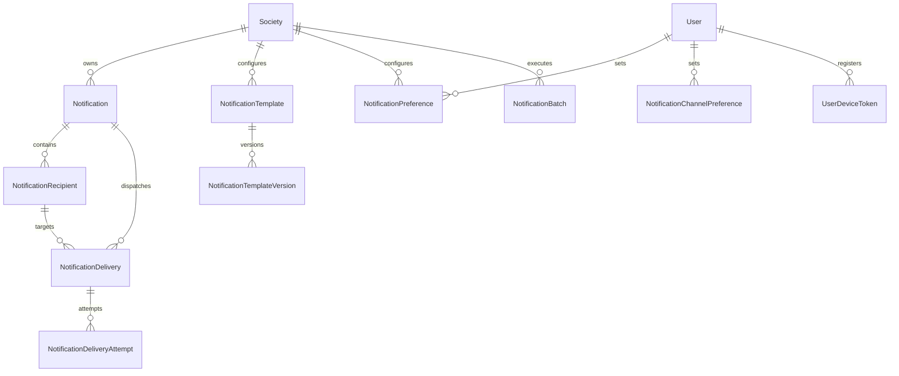

# Phase 20 — Notifications & Communication Delivery Foundation Architecture Specification

## 1. Executive Summary
Phase 20 establishes the centralized, provider-neutral **Notifications & Communication Delivery Foundation** for SocietySphere. It builds upon the decoupled event hooks implemented across locked Phases 1–19 (Announcements, Events, Governance, Emergency Incidents, Billing, Work Orders, Complaints, Visitors) to deliver a unified, multi-tenant notification system supporting In-App Inbox, Email, SMS, WhatsApp, and Mobile Push channels.

---

## 2. Platform Reuse vs. Extend vs. New Matrix

| Component | Existing Codebase Asset | Strategy | Rationale |
|---|---|---|---|
| **Domain Events** | `IncidentDomainHooks`, `GovernanceDomainHooks`, `EventDomainHooks`, `FacilityBookingEventHooks`, `AnnouncementEventHooks` | **REUSE** | Core business logic already emits structured domain event hooks (`logger.info("DOMAIN_EVENT: ...")`). |
| **Audience Targeting** | `AnnouncementAudienceResolver` (`apps/api/src/announcements/audience_resolver.py`) | **EXTEND** | Extend Phase 16 spatial (Block, Floor, Unit) and role-based (Resident, Owner, Tenant) eligibility checks for society-wide notifications. |
| **Tenant Isolation & Context** | `resolve_society_context`, `set_db_tenant_context`, `request.state.tenant_id` | **REUSE** | Multi-tenant context resolution established in Phase 2. |
| **Row-Level Security** | `ENABLE ROW LEVEL SECURITY` + `FORCE ROW LEVEL SECURITY` | **REUSE** | Apply standard RLS policies on all 10 Phase 20 database tables. |
| **Object Storage** | `ObjectStorageClient` (`apps/api/src/storage/s3_client.py`) | **REUSE** | Reuse presigned URL generation for email/notification attachments. |
| **Cache & Rate Limiting** | `RedisClient` (`apps/api/src/cache/redis_client.py`) | **REUSE** | Sliding-window rate limiters per user, per society, and per channel. |
| **Notification Engine** | None | **NEW** | Phase 20 introduces central notification orchestrator, template versioning, delivery tracking, and provider adapters. |

---

## 3. Entity Model & Data Architecture (10 Normalized Entities)



### 10 Entities Definition:
1. `Notification`: Master logical message record (`id`, `society_id`, `notification_number`, `event_type`, `source_domain`, `source_entity_id`, `priority`, `title`, `body`, `created_at`).
2. `NotificationRecipient`: Recipient inbox entry with read receipts (`id`, `society_id`, `notification_id`, `recipient_user_id`, `recipient_role`, `is_read`, `read_at`, `created_at`).
3. `NotificationTemplate`: Template catalog entry (`id`, `society_id`, `category_code`, `name`, `code`, `description`, `is_active`, `created_at`, `updated_at`).
4. `NotificationTemplateVersion`: Immutable versioned content template (`id`, `society_id`, `template_id`, `version_number`, `channel`, `language`, `title_template`, `body_template`, `allowlisted_variables`, `status`, `created_at`).
5. `NotificationPreference`: User category-level communication settings and quiet hours (`id`, `society_id`, `user_id`, `notification_category`, `is_enabled`, `quiet_hours_start`, `quiet_hours_end`, `updated_at`).
6. `NotificationChannelPreference`: Per-channel opt-in/opt-out preferences (`id`, `society_id`, `user_id`, `channel`, `is_enabled`, `updated_at`).
7. `NotificationDelivery`: Channel delivery task execution (`id`, `society_id`, `notification_id`, `recipient_id`, `channel`, `provider_name`, `status`, `scheduled_at`, `sent_at`, `delivered_at`).
8. `NotificationDeliveryAttempt`: Detailed provider attempt log (`id`, `society_id`, `delivery_id`, `attempt_number`, `provider_request_id`, `provider_response_code`, `is_success`, `error_message`, `attempted_at`).
9. `NotificationBatch`: Mass broadcast execution manager (`id`, `society_id`, `batch_number`, `total_recipients`, `processed_count`, `success_count`, `failure_count`, `status`, `created_at`).
10. `UserDeviceToken`: Mobile push token registration (`id`, `society_id`, `user_id`, `device_token`, `platform`, `is_active`, `last_used_at`, `created_at`).

---

## 4. Provider-Neutral Architecture

All channels implement a strict abstract interface:

```python
class CommunicationProvider(ABC):
    @abstractmethod
    async def send_message(self, delivery_context: DeliveryContext) -> ProviderResult:
        pass

    @abstractmethod
    async def verify_webhook_signature(self, request_headers: dict, payload: bytes) -> bool:
        pass
```

Concrete Adapters:
- `InAppProvider`: Direct database persistence to `notification_recipients`.
- `EmailProvider`: Abstract SMTP / SendGrid / AWS SES adapter interface.
- `SMSProvider`: Abstract Twilio / AWS SNS adapter interface.
- `WhatsAppProvider`: Abstract Meta Cloud API / Twilio WhatsApp adapter interface.
- `PushProvider`: Abstract APNs / FCM adapter interface.

Zero provider credentials or vendor SDKs are introduced during Phase 20 architecture.

---

## 5. Security & Threat Model

- **Multi-Tenant RLS**: `ALTER TABLE <table_name> ENABLE ROW LEVEL SECURITY;` + `FORCE ROW LEVEL SECURITY;` on all 10 tables.
- **IDOR Protection**: Endpoint verification enforces `recipient_user_id == current_user.id`.
- **Secret Security**: Zero plaintext provider credentials in database or code.
- **Template Security**: Allowlisted variable substitution preventing code injection.
- **Emergency Priority Override**: `CRITICAL` emergency alerts (Phase 19) bypass quiet hours and channel opt-outs for life safety. Non-critical messages strictly honor user quiet hours.
- **Financial Ledger Isolation**: Zero mutations to Phase 4–6 financial ledgers (`JournalEntry`, `Invoice`, `Payment`).

---

## 6. Migration Plan & Alembic Revision

- Revision ID: `0020_notifications_communication_delivery`
- Revises: `0019_emergency_incident_management`
- Defines 10 tables, FK constraints, B-tree indexes on `(society_id, status)`, `(society_id, created_at)`, and RLS/FORCE RLS policies.
