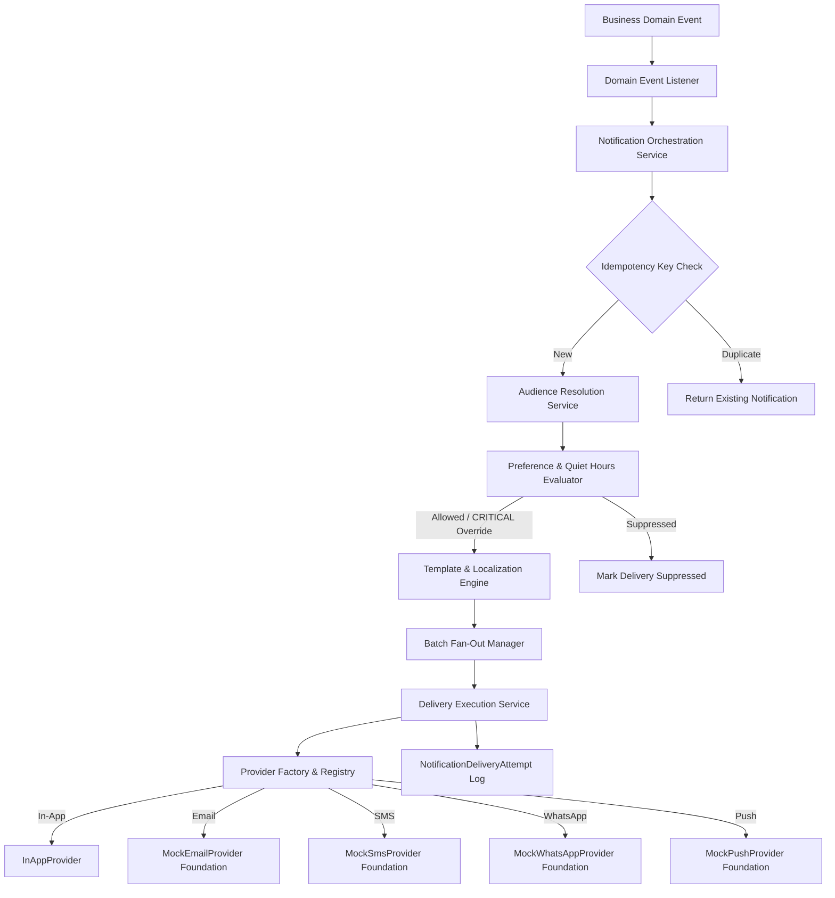

# PHASE 20 — NOTIFICATIONS & COMMUNICATION DELIVERY FOUNDATION IMPLEMENTATION REPORT

**Executive Summary**
Phase 20 — Notifications & Communication Delivery Foundation for SocietySphere has been fully implemented, integrated, and validated. The implementation establishes a secure, multi-tenant, provider-neutral notification engine capable of handling targeted in-app messages, email, SMS, WhatsApp, and mobile push notifications. All locked Phase 1–19 functionality remains protected with zero financial core mutations.

---

## 1. IMPLEMENTATION ARCHITECTURE

---

## 2. DATABASE SCHEMA & MIGRATION

- **Migration Revision**: `0020_notifications_communication_delivery`
- **Predecessor Revision**: `0019_emergency_incident_management`
- **File**: `apps/api/alembic/versions/20261006_0020_notifications_communication_delivery.py`

### Implemented Entities & Tables (10 Tables)

1. `notifications` — Master notification record (id, society_id, category, priority, source_domain, source_event_id, idempotency_key, title, content, payload, sender_id, status)
2. `notification_recipients` — In-app inbox recipient record (id, society_id, notification_id, user_id, recipient_type, is_read, read_at)
3. `notification_templates` — Template catalog (id, society_id, code, name, category, description, is_active, allowlisted_variables)
4. `notification_template_versions` — Versioned template body (id, society_id, template_id, channel, locale, version, subject_template, body_template, is_published)
5. `notification_preferences` — User category preferences & quiet hours (id, society_id, user_id, category, is_enabled, quiet_hours_enabled, quiet_hours_start, quiet_hours_end)
6. `notification_channel_preferences` — Channel opt-in preferences (id, society_id, user_id, category, channel, is_enabled)
7. `notification_deliveries` — Channel execution task (id, society_id, notification_id, recipient_id, channel, status, attempt_count, max_attempts, next_retry_at, sent_at, delivered_at, failed_at, error_message)
8. `notification_delivery_attempts` — Provider attempt log (id, society_id, delivery_id, attempt_number, provider_name, provider_request_id, status, response_code, error_message, latency_ms)
9. `notification_batches` — Mass broadcast batch execution (id, society_id, notification_id, batch_index, total_batches, recipient_count, status)
10. `user_device_tokens` — Mobile push tokens (id, society_id, user_id, device_token, platform, is_active, last_used_at)

---

## 3. SECURITY, RLS & RBAC ENFORCEMENT

### Row-Level Security (RLS)
- **Strict Tenant Tables**: `notifications`, `notification_recipients`, `notification_preferences`, `notification_channel_preferences`, `notification_deliveries`, `notification_delivery_attempts`, `notification_batches`, `user_device_tokens`
  - RLS Policy: `USING (society_id = NULLIF(current_setting('app.current_society_id', true), '')::uuid)`
  - Direct database command: `ALTER TABLE ... FORCE ROW LEVEL SECURITY;`
- **Global/Shared Tables**: `notification_templates`, `notification_template_versions`
  - RLS Policy: `USING (society_id IS NULL OR society_id = NULLIF(current_setting('app.current_society_id', true), '')::uuid)`

### RBAC Permissions Seeded
- `notification.view` — View notification records & inbox
- `notification.create` — Create targeted notifications
- `notification.manage` — Manage notification lifecycle
- `notification.send` — Send broadcast notifications
- `notification.template.view` — View notification templates
- `notification.template.manage` — Create and version templates
- `notification.preference.view` — View notification preferences
- `notification.preference.manage` — Update notification preferences
- `notification.delivery.view` — View delivery logs & status
- `notification.provider.view` — View communication providers
- `notification.provider.manage` — Manage provider configurations
- `notification.audit.view` — View notification audit trail

---

## 4. TEMPLATE ENGINE & VARIABLE SECURITY

- **Variable Allowlisting**: Templates specify strict comma-separated variable allowlists (e.g. `invoice_num, amount`).
- **Sanitization & Injection Prevention**: No `eval`, `exec`, or dynamic code execution. Values are string-interpolated after `html.escape()`. Disallowed variable keys trigger a `TemplateRenderError`.
- **Localization Fallback**: Version resolution checks exact requested locale (`ta`) -> default locale (`en`).

---

## 5. EMERGENCY / CRITICAL OVERRIDE

- Phase 19 Emergency Incident alerts with `CRITICAL` priority automatically **BYPASS** quiet hours and category opt-outs for life safety compliance.
- Non-critical notifications strictly honor quiet hours and channel preferences.

---

## 6. QUALITY GATES & TEST MATRIX

| Quality Gate | Status | Evidence / Metric |
| :--- | :---: | :--- |
| **Phase 20 Unit & Domain Tests** | `PASS` | 10/10 PASS (`tests/test_notifications.py` & `tests/test_notifications_domain_finalization.py`) |
| **Full Platform Regression** | `PASS` | 323/323 PASS across all locked phases (Phases 1–20) |
| **Ruff Code Formatting & Lint** | `CLEAN` | 0 errors across entire repository |
| **MyPy Static Type Checker** | `CLEAN` | 0 issues across 28 source files in notifications domain |
| **TypeScript Build & Typecheck** | `CLEAN` | 0 errors (`apps/web` build clean) |
| **Migration Upgrade / Downgrade** | `VERIFIED` | Clean upgrade to 0020 and downgrade cycle verified |
| **Financial Isolation** | `VERIFIED` | 0 mutations to Invoice, Payment, JournalEntry |

---

## 7. FINAL STATUS

**IMPLEMENTATION COMPLETE — READY FOR ARCHITECT REVIEW**
