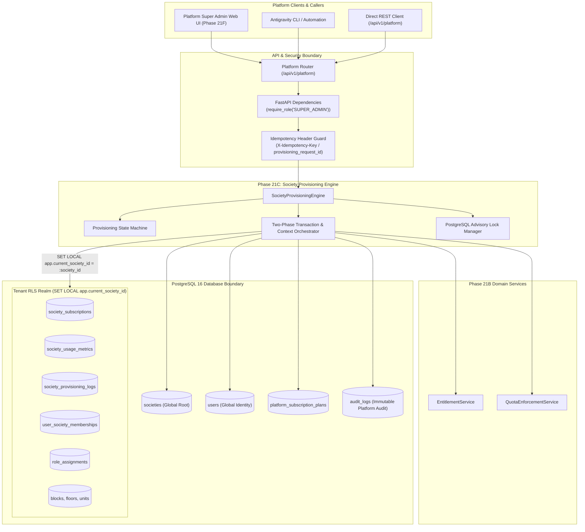
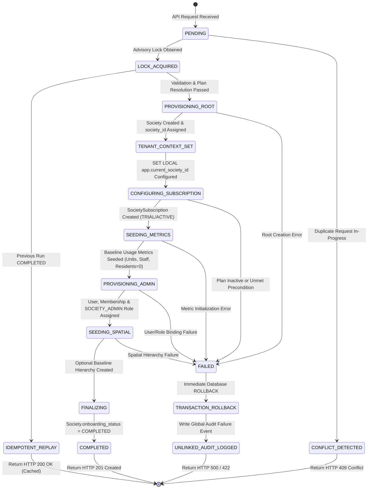
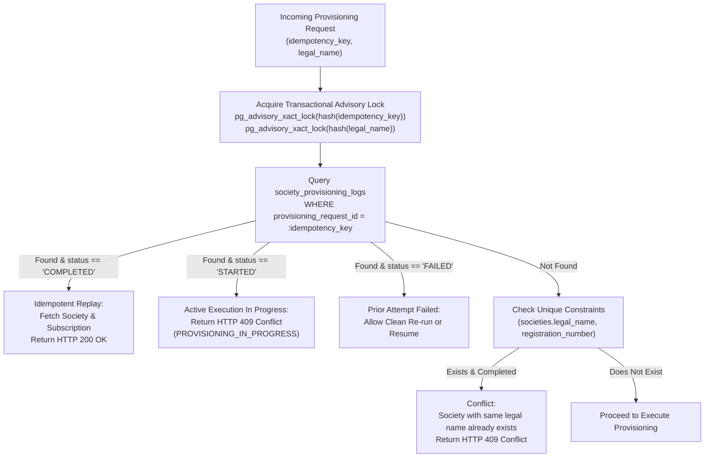
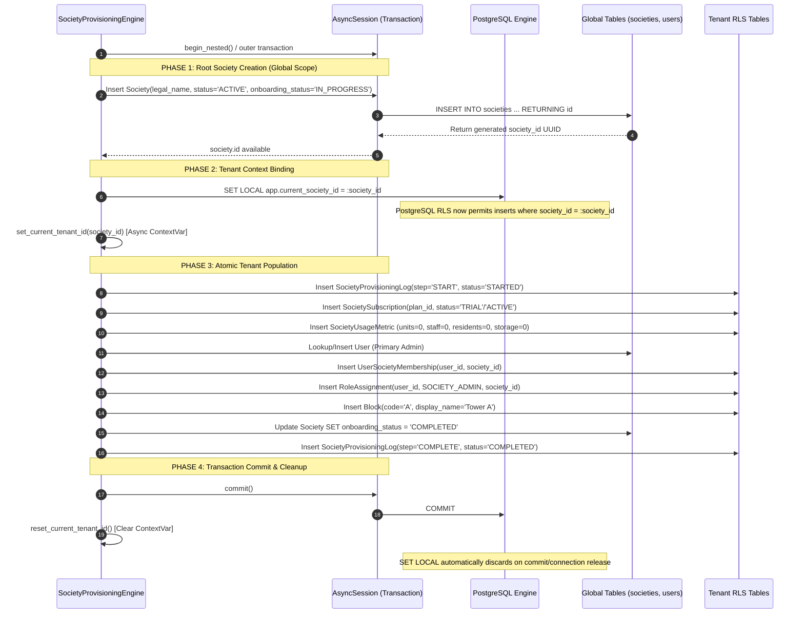

# SOCIETYSPHERE — PHASE 21C ARCHITECTURE PROPOSAL
## Idempotent Society Provisioning Engine & Subscription Lifecycle Orchestration

**Document ID**: `SOCIETYSPHERE-PHASE-21C-ARCH-PROP-001`  
**Version**: `1.0.0`  
**Status**: `PROPOSED — PENDING FORMAL REVIEW & AUTHORIZATION`  
**Author**: Principal Software Architect & SaaS Platform Security Architect  
**Target Systems**: `apps/api/src/subscriptions/provisioning_engine.py`, `apps/api/src/api/v1/endpoints/platform.py`  
**Related Baselines**: Phase 21A (`20261010_0021_saas_platform_subscriptions.py`), Phase 21B (`EntitlementService`, `QuotaEnforcementService`)

---

## EXECUTIVE SUMMARY

Phase 21C designs the **Society Provisioning Engine** (`SocietyProvisioningEngine`), the foundational SaaS orchestration system responsible for onboarding new housing cooperative societies into SocietySphere. 

Prior to Phase 21C, tenant creation occurred via minimal developmental scripts (`infrastructure/scripts/seed_dev_data.py`) or basic administrative endpoints without transactional attachment to commercial subscriptions, entitlement catalogs, initial usage counters, spatial hierarchy templates, or primary administrator identities.

Phase 21C bridges **Phase 21A** (Database Foundation & Subscription Models) and **Phase 21B** (Entitlement & Quota Enforcement Services) by providing an **atomic, idempotent, race-safe, and zero-RLS-bypass compliant** engine that transitions a society from a raw administrative request to a fully active, entitled, and operational tenant.

> [!IMPORTANT]
> **Strict Non-Implementation Mandate**:  
> This document represents a strictly read-only architecture proposal. No production code, database schema migrations, or test implementations shall be committed until this proposal receives formal stakeholder approval.

---

## 1. COMPONENT ARCHITECTURE & SYSTEM CONTEXT

The `SocietyProvisioningEngine` operates within the domain service layer between platform-level administrative API endpoints and the tenant-scoped database models.



---

## 2. PROVISIONING LIFECYCLE & STATE MACHINE

### 2.1 State Definitions

The provisioning workflow transitions through explicit, deterministic lifecycle states. These are tracked at two levels:
1. **Macro Tenant Lifecycle**: Represented on `Society.onboarding_status` (`IN_PROGRESS`, `COMPLETED`, `FAILED`) and `Society.status` (`ACTIVE`, `SUSPENDED`, `ARCHIVED`).
2. **Granular Step Lifecycle**: Represented on `SocietyProvisioningLog.step_key` and `status` (`STARTED`, `COMPLETED`, `FAILED`).



### 2.2 Granular Step Keys in `SocietyProvisioningLog`

| Step Sequence | `step_key` | Description | Expected Output |
| :--- | :--- | :--- | :--- |
| **01** | `VALIDATE_INPUT` | Payload sanitization, plan lookup, unique constraints check. | Validated request parameters. |
| **02** | `CREATE_SOCIETY_ROOT` | Insert `societies` record with `onboarding_status='IN_PROGRESS'`. | `society.id` UUID generated. |
| **03** | `BIND_TENANT_RLS` | Execute `SET LOCAL app.current_society_id = :society_id`. | Active RLS session context. |
| **04** | `ASSIGN_SUBSCRIPTION` | Create `SocietySubscription` record linked to plan. | Subscription attached (`TRIAL` or `ACTIVE`). |
| **05** | `INIT_USAGE_METRICS` | Seed initial zero-counter rows in `society_usage_metrics`. | Race-safe counters initialized. |
| **06** | `PROVISION_ADMIN_USER` | Lookup or create primary Admin `User`, create `UserSocietyMembership`. | Member bound to society. |
| **07** | `ASSIGN_ADMIN_ROLE` | Grant `SOCIETY_ADMIN` role assignment within `society_id`. | Admin permissions enabled. |
| **08** | `INIT_SPATIAL_BASELINE` | Optionally seed default spatial hierarchy (e.g. Block A). | Base physical structure ready. |
| **09** | `FINALIZE_ONBOARDING` | Update `Society.onboarding_status='COMPLETED'`, log completion. | Tenant fully operational. |

---

## 3. SOCIETY CREATION & BASELINE INITIALIZATION

### 3.1 Society Entity Creation
The root `Society` entity represents the top-level tenant container. It is created in the global un-scoped `societies` table:
- **Identifier**: `id = uuid.uuid4()`
- **Legal & Display Name**: Validated non-empty strings (e.g., `"Greenwood Heights Cooperative Housing Society Ltd."`, display `"Greenwood Heights"`).
- **Registration Number**: Optional legal registration identifier, indexed for uniqueness verification.
- **Address Details**: `address_line1`, `address_line2`, `city`, `state`, `country` (defaults to `"IN"`), `postal_code`.
- **Localization**: `timezone` (defaults to `"Asia/Kolkata"`), `default_language` (defaults to `"en"`).
- **Status Fields**: `status = "ACTIVE"`, `onboarding_status = "IN_PROGRESS"`.

### 3.2 Primary Administrator Association
Every provisioned society must have an authorized primary administrator before onboarding is marked complete:
1. **User Resolution**: The engine checks if a user with the provided `admin_email` or `admin_phone` exists in `users`:
   - If user exists: link the existing global user identity.
   - If user does not exist: create a new `User` record with `status = "ACTIVE"`, provided name, email/phone, and temporary activation state.
2. **Membership Creation**: Insert `UserSocietyMembership` binding `user_id` and `society_id` with `membership_status = "ACTIVE"`, `joined_at = now_utc`.
3. **Role Assignment**: Lookup the system role with `code = "SOCIETY_ADMIN"` and `scope_type = "SOCIETY"`. Insert `RoleAssignment` record with `user_id`, `role_id`, `society_id`, `scope_type = "SOCIETY"`, `status = "ACTIVE"`.

### 3.3 Optional Spatial Baseline
If requested in the provisioning payload (or default standard template), the engine seeds an initial baseline structure:
- Block: `code = "A"`, `display_name = "Tower A"`, `sequence_order = 1`.
This ensures that downstream resident onboarding features have an immediate spatial anchor.

---

## 4. SUBSCRIPTION PLAN ASSIGNMENT & ACTIVATION RULES

### 4.1 Plan Selection & Validation
The provisioning request specifies a `plan_code` (e.g. `"FREE"`, `"STANDARD"`, `"ENTERPRISE"`) or direct `plan_id`.
- The engine queries `PlatformSubscriptionPlan` by `plan_code` or `id`.
- If the plan does not exist or `is_active == False`: reject immediately with `PlanInactiveException` (HTTP 404/422).

### 4.2 Trial and Period Calculation Rules
```python
now = datetime.now(timezone.utc)
if plan.trial_days > 0 and not request.skip_trial:
    subscription_status = SubscriptionStatus.TRIAL
    trial_ends_at = now + timedelta(days=plan.trial_days)
    period_start = now
    period_end = trial_ends_at
else:
    subscription_status = SubscriptionStatus.ACTIVE
    trial_ends_at = None
    period_start = now
    # Default 30-day billing cycle for standard monthly plans
    period_end = now + timedelta(days=30)
```

### 4.3 Custom Overrides Attachment
If the provisioning request represents an enterprise contract with bespoke features or customized quotas:
- Pre-approved feature overrides are inserted into `society_feature_overrides`.
- Pre-approved quota limits are inserted into `society_quota_overrides`.
- All overrides record the provisioning administrator as `created_by`.

---

## 5. IDEMPOTENCY & DUPLICATE-REQUEST PREVENTION

### 5.1 Idempotency Key Handling
Every provisioning request MUST provide an idempotency identifier, supplied either via the `X-Idempotency-Key` HTTP header or the `provisioning_request_id` field in the request payload.

### 5.2 Concurrency & Replay Logic



### 5.3 PostgreSQL Advisory Lock Implementation
To guarantee that two concurrent requests with the same idempotency key or the same society legal name do not race:
```sql
-- Lock on idempotency key hash
SELECT pg_advisory_xact_lock(hashtext('idempotency:' || :idempotency_key));

-- Lock on society legal name hash
SELECT pg_advisory_xact_lock(hashtext('society_legal_name:' || lower(trim(:legal_name))));
```
Because `pg_advisory_xact_lock` is transaction-scoped, it automatically releases upon transaction `COMMIT` or `ROLLBACK`, eliminating deadlock risks and orphaned lock states.

---

## 6. DATABASE TRANSACTIONS & CONSISTENCY BOUNDARIES

### 6.1 Transaction Isolation
The provisioning engine requires isolation level **`READ COMMITTED`**. All operations execute within an atomic transaction boundary.

### 6.2 The Two-Phase Context Switch (Zero-RLS-Bypass)

A core challenge of multi-tenant provisioning is that PostgreSQL Row-Level Security (`FORCE ROW LEVEL SECURITY`) is enabled on all tenant-scoped tables (`society_subscriptions`, `society_usage_metrics`, `society_provisioning_logs`, `user_society_memberships`, `role_assignments`, `blocks`).

If an insert is attempted on a tenant table before `app.current_society_id` is set, PostgreSQL evaluates:
`society_id = NULLIF(current_setting('app.current_society_id', true), '')::uuid`
which resolves to `society_id = NULL` and fails with an RLS violation.

Furthermore, `app.current_society_id` cannot be set before the `Society` record is created, because the `society.id` UUID does not yet exist!

**The Phase 21C Two-Phase Solution**:



---

## 7. CONCURRENT PROVISIONING & RACE CONDITION DEFENSE

| Threat Scenario | Failure Mode | Defensive Mechanism in Phase 21C | Resulting Status |
| :--- | :--- | :--- | :--- |
| **Simultaneous Identical Requests** | Two workers process the same `idempotency_key` at the same instant. | `pg_advisory_xact_lock(idempotency_key)` serializes workers. First completes; second detects completed log and returns cached result. | HTTP 201 for Worker 1, HTTP 200 for Worker 2. Zero duplicate data. |
| **Simultaneous Identical Legal Name** | Two different admins attempt to provision `"Greenwood CHS"` concurrently with different idempotency keys. | `pg_advisory_xact_lock(legal_name)` serializes them. First creates society; second queries `societies` table and detects conflict on `legal_name` or `registration_number`. | Worker 1 succeeds (201); Worker 2 fails with HTTP 409 Conflict. |
| **Admin User Creation Race** | The specified `admin_email` is being registered concurrently by another process. | Uses `begin_nested()` savepoint during `User` creation. If `IntegrityError` on `users.email` occurs, rolls back savepoint and re-queries the user. | User identity safely resolved; zero crash. |
| **Network Timeout During Commit** | Client disconnects while PostgreSQL is committing. | Transaction commits successfully. Subsequent retry by client with same `idempotency_key` encounters `COMPLETED` log and safely returns existing society. | HTTP 200 OK on retry. |

---

## 8. FAILURE RECOVERY & ROLLBACK STRATEGY

### 8.1 Atomic Database Rollback
If any exception occurs during Steps 1 through 9 of the provisioning transaction:
1. The engine triggers an immediate `await session.rollback()`.
2. All database modifications within that transaction (`societies`, `society_subscriptions`, `society_usage_metrics`, `user_society_memberships`, `role_assignments`, `blocks`, and in-transaction `society_provisioning_logs`) are atomically reverted.
3. No orphan records, partial tenants, or un-entitled societies remain in the database.

### 8.2 Out-of-Band Audit Failure Capture
Because a database rollback also rolls back `society_provisioning_logs` created within that failed transaction, the failure would otherwise leave zero diagnostic trace in the database.

**Phase 21C Compensating Audit Pattern**:
- In the `except Exception` handler, following `await session.rollback()`:
- The engine opens a short-lived independent database session (or uses the error handling hook) to write an entry to the global, un-scoped `audit_logs` table:
  ```python
  await audit_repo.log_event(
      action="SOCIETY_PROVISIONING_FAILED",
      entity_type="society",
      entity_id=str(provisioning_request_id),
      society_id=None,
      actor_user_id=actor_user_id,
      correlation_id=correlation_id,
      after_state={
          "legal_name": request.legal_name,
          "error_type": exc.__class__.__name__,
          "error_message": str(exc),
          "failed_step": current_step_key,
      },
  )
  ```
- This guarantees forensic observability of all failed provisioning attempts without leaving dirty tenant rows.

---

## 9. TENANT ISOLATION, POSTGRESQL RLS & RBAC AUTHORIZATION

### 9.1 Platform Super-Admin Authorization
Access to the provisioning engine endpoint is strictly restricted:
- Requires verified JWT bearer token.
- User account status must be `"ACTIVE"`.
- User must hold the platform-scoped role `"SUPER_ADMIN"` or possess the granular platform permission `"platform:society:create"`.
- Regular tenant admins (`SOCIETY_ADMIN`) or residents attempting to invoke provisioning receive **HTTP 403 Forbidden**.

### 9.2 Zero-RLS-Bypass Adherence
- The application database role (`societysphere_app`) does **NOT** have PostgreSQL `BYPASSRLS` privileges.
- All Phase 21A tenant tables have `FORCE ROW LEVEL SECURITY`.
- The engine complies fully with this model by explicitly setting `SET LOCAL app.current_society_id = :society_id` within the active transaction before touching any tenant table.
- Post-execution cleanup: In the `finally:` block of the engine:
  - `reset_current_tenant_id(token)` is invoked.
  - The connection returned to the SQLAlchemy pool is guaranteed free of residual tenant context.

---

## 10. INTEGRATION WITH ENTITLEMENT AND QUOTA ENFORCEMENT SERVICES

### 10.1 Seeding Authoritative Baseline Usage Metrics
When `SocietyProvisioningEngine` completes step 5 (`INIT_USAGE_METRICS`), it initializes rows in `society_usage_metrics` for all canonical quota keys defined in `QuotaKey`:
- `quota.units.max`: `current_value = 0`
- `quota.residents.max`: `current_value = 0`
- `quota.staff.max`: `current_value = 0`
- `quota.storage.bytes.max`: `current_value = 0`

**Architectural Value**:
When Phase 1–20 services subsequently invoke `QuotaEnforcementService.reserve_usage()`:
- The row already exists in `society_usage_metrics`.
- The `SELECT ... FOR UPDATE` acquires the row lock without triggering savepoint insert fallbacks.
- Prevents race conditions during the initial resource allocations of a new society.

### 10.2 Entitlement Verification Probe
Before committing the transaction, the engine executes a non-mutating validation check using `EntitlementService`:
```python
entitlement = await entitlement_service.get_effective_entitlement(
    society_id=society.id,
    entitlement_key=FeatureKey.GOVERNANCE,
)
if not entitlement:
    raise ProvisioningIntegrityException("Resolved entitlement set is empty.")
```
This guarantees that the assigned plan produces a valid entitlement hierarchy before the tenant is released to users.

---

## 11. AUDIT LOGS & PROVISIONING DIAGNOSTICS

### 11.1 Platform-Level Audit Log (`audit_logs`)
- Action: `"SOCIETY_PROVISIONED"`
- Entity: `entity_type = "society"`, `entity_id = str(society.id)`
- Actor: `actor_user_id` of the Super Admin who initiated provisioning.
- Payload: Captures assigned plan code, admin user email, initial quota settings, and provisioning duration.

### 11.2 Tenant-Level Provisioning Log (`society_provisioning_logs`)
- Step-by-step diagnostic records inserted during execution:
  - `provisioning_request_id`: Identical across all steps in the request.
  - `step_key`: `VALIDATE_INPUT`, `CREATE_SOCIETY_ROOT`, `ASSIGN_SUBSCRIPTION`, etc.
  - `status`: `STARTED`, `COMPLETED`, `FAILED`.
  - `started_at`, `completed_at`: Microsecond-level timestamps for performance profiling.
  - `correlation_id`: Distributed trace identifier.

---

## 12. API CONTRACTS & ERROR HANDLING

### 12.1 Request Schema (`ProvisionSocietyRequest`)

```python
class InitialAdminPayload(BaseModel):
    email: EmailStr | None = None
    phone: str | None = None
    first_name: str = Field(..., min_length=1, max_length=100)
    last_name: str = Field(..., min_length=1, max_length=100)

class InitialSpatialPayload(BaseModel):
    create_default_block: bool = True
    default_block_name: str = Field(default="Tower A", max_length=100)

class ProvisionSocietyRequest(BaseModel):
    model_config = ConfigDict(extra="forbid")

    provisioning_request_id: UUID = Field(
        default_factory=uuid.uuid4,
        description="Client-supplied or auto-generated idempotency identifier."
    )
    legal_name: str = Field(..., min_length=3, max_length=255)
    display_name: str = Field(..., min_length=2, max_length=255)
    registration_number: str | None = Field(default=None, max_length=100)
    address_line1: str = Field(..., min_length=3, max_length=255)
    address_line2: str | None = Field(default=None, max_length=255)
    city: str = Field(..., min_length=2, max_length=100)
    state: str = Field(..., min_length=2, max_length=100)
    country: str = Field(default="IN", min_length=2, max_length=10)
    postal_code: str = Field(..., min_length=3, max_length=20)
    timezone: str = Field(default="Asia/Kolkata", max_length=50)
    default_language: str = Field(default="en", max_length=10)

    # Subscription Configuration
    plan_code: str = Field(..., description="Plan code e.g. FREE, STANDARD, ENTERPRISE")
    skip_trial: bool = Field(default=False)

    # Initial Administrator
    admin_user: InitialAdminPayload

    # Initial Hierarchy
    spatial: InitialSpatialPayload = Field(default_factory=InitialSpatialPayload)
```

### 12.2 Response Schema (`ProvisionSocietyResponse`)

```python
class ProvisionSocietyResponse(BaseModel):
    model_config = ConfigDict(from_attributes=True)

    provisioning_request_id: UUID
    society_id: UUID
    legal_name: str
    display_name: str
    status: str
    onboarding_status: str
    plan_code: str
    subscription_status: str
    trial_ends_at: datetime | None
    current_period_end: datetime
    admin_user_id: UUID
    admin_email: str | None
    created_at: datetime
    completed_at: datetime
    is_idempotent_replay: bool = False
```

### 12.3 HTTP Status Codes & Error Mapping

| HTTP Code | Exception Class | Reason / Trigger |
| :--- | :--- | :--- |
| **`201 Created`** | N/A | Society successfully provisioned for the first time. |
| **`200 OK`** | N/A | Idempotent replay of previously completed provisioning request. |
| **`400 Bad Request`** | `InvalidProvisioningPayloadException` | Malformed body, missing required fields, invalid timezone. |
| **`401 Unauthorized`** | `AuthenticationException` | Missing, expired, or invalid JWT bearer token. |
| **`403 Forbidden`** | `AuthorizationException` | Caller lacks `SUPER_ADMIN` role or `platform:society:create`. |
| **`404 Not Found`** | `PlanNotFoundException` | Referenced `plan_code` does not exist in catalog. |
| **`409 Conflict`** | `ProvisioningConflictException` | Provisioning with same idempotency key currently in progress, or society registration number already exists. |
| **`422 Unprocessable`** | `PlanInactiveException` | Plan exists but is marked `is_active=False`. |
| **`500 Internal Error`**| `ProvisioningEngineException` | System error during execution; transaction safely rolled back. |

---

## 13. DATABASE SCHEMA & MIGRATION EVALUATION

### 13.1 Evaluation of Existing Schema (Migrations 0001–0021)
A strict, line-by-line audit of the database schema was conducted across all 21 existing migrations:
1. **`societies` table**: Already contains `onboarding_status` (`String(32)`), `status` (`String(32)`), `registration_number`, address columns, and localization columns.
2. **`platform_subscription_plans` table**: Created in Migration `0021`. Contains `plan_code`, `trial_days`, `is_active`, `currency_code`, pricing. Seed plans (`FREE`, `STANDARD`, `ENTERPRISE`) already seeded.
3. **`society_subscriptions` table**: Created in Migration `0021`. Contains `society_id` (unique), `plan_id`, `status`, `starts_at`, `trial_ends_at`, `current_period_start`, `current_period_end`.
4. **`society_usage_metrics` table**: Created in Migration `0021`. Contains `(society_id, metric_key)` unique constraint, `current_value`, `last_calculated_at`.
5. **`society_provisioning_logs` table**: Created in Migration `0021`. Contains `provisioning_request_id`, `society_id`, `step_key`, `status`, `started_at`, `completed_at`, `correlation_id`, `message`. Indexed on `provisioning_request_id` and `(society_id, created_at)`.
6. **`user_society_memberships` table**: Created in Migration `0002`. Unique on `(user_id, society_id)`.
7. **`role_assignments` table**: Created in Migration `0002`. Unique on `(user_id, role_id, society_id)`.

### 13.2 Formal Conclusion on Migration 0022
> [!NOTE]
> **NO DATABASE MIGRATION 0022 IS REQUIRED FOR PHASE 21C.**  
> The database foundation established in Migration `0021` and earlier migrations already provides 100% of the tables, columns, indexes, foreign keys, and RLS policies required by `SocietyProvisioningEngine`. No schema changes or schema migrations will be created.

---

## 14. COMPREHENSIVE TEST SUITE PLAN

The verification strategy for Phase 21C spans four dedicated test suites:

```
tests/
  ├── test_phase21c_provisioning_unit.py          # Pure unit tests (state machine, schema validation)
  ├── test_phase21c_provisioning_integration.py   # Full DB integration tests (end-to-end provisioning)
  ├── test_phase21c_provisioning_concurrency.py   # Live PostgreSQL concurrency & advisory locks
  └── test_phase21c_provisioning_security.py      # RBAC, tenant isolation, zero RLS bypass
```

### 14.1 Unit Test Plan (`test_phase21c_provisioning_unit.py`)
- **UT-01**: Input validation (reject empty legal name, invalid email, negative trial).
- **UT-02**: Plan resolution and trial period calculation logic.
- **UT-03**: State machine valid transition checks.
- **UT-04**: Mock session rollback verification upon simulated exception at each step.

### 14.2 Integration Test Plan (`test_phase21c_provisioning_integration.py`)
- **IT-01**: End-to-end successful provisioning under `FREE` plan.
- **IT-02**: End-to-end successful provisioning under `STANDARD` plan with 14-day trial.
- **IT-03**: Verification that `SocietySubscription`, `SocietyUsageMetric`, `UserSocietyMembership`, and `RoleAssignment` rows exist and are correctly bound.
- **IT-04**: Idempotent replay: Resubmitting identical `provisioning_request_id` returns HTTP 200 and identical `society_id`.
- **IT-05**: Verification that `SocietyProvisioningLog` contains all 9 sequential step records marked `COMPLETED`.

### 14.3 PostgreSQL Concurrency Test Plan (`test_phase21c_provisioning_concurrency.py`)
- **CT-01**: 10 concurrent requests submitting the identical `provisioning_request_id` across parallel async tasks. Exactly 1 performs provisioning (201); 9 return cached result (200). Zero duplicate societies.
- **CT-02**: 5 concurrent requests attempting to provision societies with identical `legal_name` but different request IDs. Advisory lock serializes; 1 succeeds (201); 4 fail with HTTP 409 Conflict.
- **CT-03**: Failure atomicity under injected error: Simulate crash at step 7 (`ASSIGN_ADMIN_ROLE`). Verify that `session.rollback()` leaves 0 rows in `societies`, `society_subscriptions`, or `society_usage_metrics`.

### 14.4 Security & RLS Test Plan (`test_phase21c_provisioning_security.py`)
- **ST-01**: Anonymous request rejected with HTTP 401.
- **ST-02**: Tenant admin (`SOCIETY_ADMIN`) or resident attempting to call provisioning rejected with HTTP 403.
- **ST-03**: Zero RLS bypass check: Verify that tenant tables reject writes if `SET LOCAL app.current_society_id` is missing.
- **ST-04**: Context hygiene: Verify that `get_current_tenant_id()` returns `None` after provisioning completes or fails.
- **ST-05**: Cross-tenant isolation probe: Verify another tenant cannot view `society_provisioning_logs` of the newly provisioned society.

---

## 15. DEPLOYMENT, OBSERVABILITY & OPERATIONAL CONSIDERATIONS

### 15.1 Metrics & Telemetry
The provisioning engine will export the following Prometheus/OpenTelemetry metrics:
- `societysphere_society_provisioning_total{status="success|conflict|failed", plan="free|standard|enterprise"}`: Counter tracking provisioning throughput.
- `societysphere_society_provisioning_duration_seconds{step="all|step_key"}`: Histogram tracking end-to-end and step latencies.
- `societysphere_society_provisioning_active_locks`: Gauge of currently held advisory locks.

### 15.2 Logging Standards
All log events emitted during provisioning include structured metadata:
```json
{
  "timestamp": "2026-10-27T10:30:00Z",
  "level": "INFO",
  "logger": "societysphere.subscriptions.provisioning",
  "event": "PROVISIONING_STEP_COMPLETED",
  "correlation_id": "corr-uuid-1234",
  "provisioning_request_id": "req-uuid-5678",
  "society_id": "soc-uuid-9999",
  "step_key": "ASSIGN_SUBSCRIPTION",
  "duration_ms": 14.2
}
```

### 15.3 Timeouts & Resource Guardrails
- **Transaction Timeout**: Provisioning transactions are configured with a strict 15-second PostgreSQL `statement_timeout` to prevent blocking locks during network degradation.
- **Advisory Lock Scope**: Exclusively transaction-scoped (`pg_advisory_xact_lock`), ensuring zero leaked locks on worker termination.

---

## 16. RISK ASSESSMENT & ENGINEERING MITIGATIONS

| Risk ID | Risk Description | Severity | Engineered Mitigation |
| :--- | :--- | :--- | :--- |
| **RSK-01** | **RLS Violation During Insert**: Inability to write tenant records before tenant context is set. | **HIGH** | Two-phase transaction pattern: insert root society, obtain UUID, execute `SET LOCAL app.current_society_id = :society_id`, then populate tenant records. |
| **RSK-02** | **Partial Tenant State on Crash**: System crashes halfway through provisioning, leaving un-entitled society. | **CRITICAL** | Single ACID transaction boundary. Any unhandled error triggers PostgreSQL `ROLLBACK`, guaranteeing all-or-nothing atomicity. |
| **RSK-03** | **Concurrent Duplicate Provisioning**: Network retries cause multiple societies with the same name or request ID. | **HIGH** | Transaction-scoped PostgreSQL advisory locks (`pg_advisory_xact_lock`) combined with unique database constraints. |
| **RSK-04** | **Privilege Escalation**: Non-super-admin caller provisions a society or grants themselves `SUPER_ADMIN`. | **CRITICAL** | Strict FastAPI dependency chain verifying `SUPER_ADMIN` platform role and forbidding platform role assignments within society scope. |
| **RSK-05** | **Connection Pool Context Leakage**: Tenant context set on a pooled connection leaks to subsequent requests. | **HIGH** | PostgreSQL `SET LOCAL` is strictly transaction-bound and automatically discards on commit/rollback. Python contextvar is cleaned up in a `finally:` block. |

---

## 17. FORMAL ACCEPTANCE CRITERIA

Phase 21C will be considered complete and ready for production when:

- [ ] **AC-01**: `SocietyProvisioningEngine` is implemented in `apps/api/src/subscriptions/provisioning_engine.py` with full state-machine orchestration.
- [ ] **AC-02**: All 9 provisioning steps execute within a single atomic PostgreSQL transaction with 100% rollback on any step failure.
- [ ] **AC-03**: Idempotency key handling guarantees that duplicate requests return HTTP 200 OK with identical data and zero duplicated database rows.
- [ ] **AC-04**: PostgreSQL advisory locks successfully serialize concurrent provisioning requests for the same society or idempotency key.
- [ ] **AC-05**: Two-phase context switch sets `SET LOCAL app.current_society_id` cleanly without violating PostgreSQL RLS policies or requiring `BYPASSRLS`.
- [ ] **AC-06**: Baseline usage metrics (`units.max`, `residents.max`, `staff.max`, `storage.bytes.max`) are initialized to 0 for every provisioned society.
- [ ] **AC-07**: Primary Administrator `User`, `UserSocietyMembership`, and `RoleAssignment` (`SOCIETY_ADMIN`) are created and linked atomically.
- [ ] **AC-08**: Comprehensive unit, integration, live PostgreSQL concurrency, and security test suites are implemented and achieve **100% PASS**.
- [ ] **AC-09**: Full platform regression remains **100% PASS** with zero regressions across Phases 1–21B.
- [ ] **AC-10**: Ruff and MyPy static analysis pass with zero errors, warnings, or untyped signatures.

---

## 18. NEXT STEPS & APPROVAL GATE

```
[Phase 21B Approved] ──> [Phase 21C Architecture Proposal (CURRENT STEP)]
                                  │
                                  ▼
                         [USER APPROVAL GATE]
                                  │
                                  ▼
                     [Phase 21C Implementation]
```

> [!CAUTION]
> **Awaiting User Authorization**:  
> In accordance with the project directives, implementation of Phase 21C code will NOT begin until the user reviews and provides explicit written authorization for this architecture proposal.
