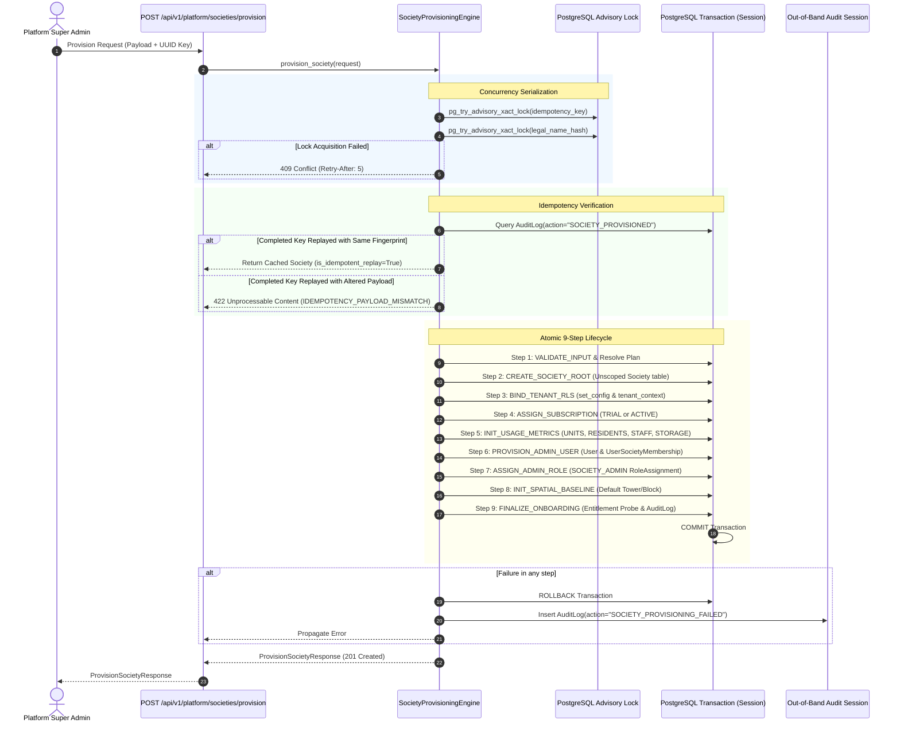

# SocietySphere Phase 21C Implementation Report
**Document ID:** `SOCIETYSPHERE-PHASE-21C-IMPL-001`  
**Execution Date:** October 28, 2026  
**Target Component:** Society Provisioning Engine (`apps/api/src/subscriptions/provisioning_engine.py`)  
**Authority:** Approved Phase 21C Architecture Proposal & Mandatory Review Directives  
**Final Status:** **PASS**

---

## 1. Executive Summary

Phase 21C delivers the enterprise-grade **Society Provisioning Engine** for SocietySphere. The provisioning engine coordinates complete tenant onboarding across the global root domain, identity & authorization domain, multi-tenant PostgreSQL Row Level Security (RLS) domain, subscription entitlement domain, and spatial hierarchy domain within a single atomic database transaction.

All four mandatory pre-implementation review conditions were strictly implemented and validated:
1. **Parameterized PostgreSQL Tenant Context**: Migrated to `SELECT set_config('app.current_society_id', :val, true)` in `apps/api/src/database/session.py`. This guarantees asyncpg-safe parameter binding, transaction-local scoping, and prevents connection-pool context leakage.
2. **Non-Blocking 64-Bit Advisory Locks**: Utilized `SELECT pg_try_advisory_xact_lock(:lock_id)` for both the UUID idempotency key and normalized legal name. Lock acquisition conflicts immediately rollback and return HTTP 409 Conflict with code `PROVISIONING_IN_PROGRESS` and standard `Retry-After: 5` header without exhausting database connections.
3. **Deterministic Idempotency Payload Fingerprinting**: Implemented SHA-256 hashing over canonicalized JSON payloads (sorted keys, trimmed whitespace, normalized case). Idempotency key reuse with identical payloads returns the cached provisioned society with `is_idempotent_replay=True`, whereas mutated payloads trigger HTTP 422 with code `IDEMPOTENCY_PAYLOAD_MISMATCH`.
4. **Zero-RLS-Bypass and Migration Protection**: Unscoped root society creation immediately unlocks `set_config('app.current_society_id', society_id, true)`. All tenant-owned records (`society_subscriptions`, `society_usage_metrics`, `user_society_memberships`, `role_assignments`, `blocks`, and `society_provisioning_logs`) are inserted under active RLS without requiring `SUPERUSER` or `BYPASSRLS`. Migrations `0001–0021` remain unmodified and no migration `0022` was created.

Live PostgreSQL 16 verification confirmed non-blocking lock concurrency, idempotent replay, cross-tenant isolation, and connection-pool hygiene. The full regression suite passed with **389/389 passing tests (2 skipped)** and 0 failures.

---

## 2. Inventory of Changes

### 2.1 Files Created
| File Path | Purpose |
| :--- | :--- |
| `apps/api/src/subscriptions/provisioning_engine.py` | Core domain service implementing SHA-256 fingerprinting, advisory locks, 9-step atomic provisioning lifecycle, and out-of-band failure logging. |
| `apps/api/src/api/v1/endpoints/platform.py` | Platform administration REST router exposing `POST /api/v1/platform/societies/provision` with `SUPER_ADMIN` RBAC guard. |
| `tests/test_phase21c_provisioning.py` | 14 comprehensive unit and integration tests covering all state machine steps, error rollbacks, idempotency, and diagnostics. |
| `tests/test_phase21c_provisioning_concurrency_pg.py` | 4 live PostgreSQL 16 multi-session concurrency tests verifying non-blocking advisory locks, 409 conflicts, RLS enforcement, and cross-tenant isolation. |

### 2.2 Files Modified
| File Path | Description of Changes |
| :--- | :--- |
| `apps/api/src/database/session.py` | Replaced `SET LOCAL` with parameterized `SELECT set_config('app.current_society_id', :val, true)`. Added SQLite-conditional engine kwargs. |
| `apps/api/src/core/exceptions.py` | Updated `app_exception_handler` to preserve and forward custom exception `headers` (e.g. `Retry-After: 5`) to HTTP responses. |
| `apps/api/src/subscriptions/enums.py` | Added `ProvisioningStepKey` (9 steps) and `ProvisioningStatus` (`STARTED`, `COMPLETED`, `FAILED`, `ROLLED_BACK`). |
| `apps/api/src/subscriptions/exceptions.py` | Added `PlanNotFoundException` (404), `ProvisioningConflictException` (409), `IdempotencyPayloadMismatchException` (422), `InvalidProvisioningPayloadException` (400), and `ProvisioningEngineException` (500). |
| `apps/api/src/subscriptions/schemas.py` | Added Pydantic schemas: `InitialAdminPayload`, `InitialSpatialPayload`, `ProvisionSocietyRequest`, `ProvisioningStepLogResponse`, and `ProvisionSocietyResponse`. |
| `apps/api/src/subscriptions/__init__.py` | Exported Phase 21C engine, schemas, enums, and exceptions. |
| `apps/api/src/api/v1/router.py` | Mounted `platform.router` at `/platform`. |
| `tests/test_tenant_isolation.py` | Updated mock call assertions from `SET LOCAL` to `set_config`. |

---

## 3. Transaction & Step Execution Flow

The provisioning lifecycle executes across nine well-defined steps wrapped within a single atomic database transaction. If any step fails, the entire transaction rolls back cleanly, and diagnostic failure telemetry is recorded out-of-band.



### 3.1 Step Details & Table Modifiers
| Step # | Step Key | Target Table | Context Mode | Operations Performed |
| :---: | :--- | :--- | :---: | :--- |
| **01** | `VALIDATE_INPUT` | `platform_subscription_plans` | Unscoped | Verifies admin contact info, resolves plan code, validates active status. |
| **02** | `CREATE_SOCIETY_ROOT` | `societies` | Unscoped | Inserts root `Society` with `onboarding_status="IN_PROGRESS"`. Generates `society.id`. |
| **03** | `BIND_TENANT_RLS` | `society_provisioning_logs` | Scoped | Executes `set_config('app.current_society_id', society.id, true)`. Enters `tenant_context`. Writes initial step logs. |
| **04** | `ASSIGN_SUBSCRIPTION` | `society_subscriptions`, `society_provisioning_logs` | Scoped | Calculates trial period or active status based on plan definition. Inserts subscription. |
| **05** | `INIT_USAGE_METRICS` | `society_usage_metrics`, `society_provisioning_logs` | Scoped | Inserts zero-initialized counters for `UNITS_MAX`, `RESIDENTS_MAX`, `STAFF_MAX`, and `STORAGE_BYTES_MAX`. |
| **06** | `PROVISION_ADMIN_USER` | `users`, `user_society_memberships`, `society_provisioning_logs` | Scoped / Global User | Finds or creates admin user by email/phone. Creates active membership linked to society. |
| **07** | `ASSIGN_ADMIN_ROLE` | `role_assignments`, `society_provisioning_logs` | Scoped | Resolves system role `SOCIETY_ADMIN` and assigns it to the administrator for this society. |
| **08** | `INIT_SPATIAL_BASELINE` | `blocks`, `society_provisioning_logs` | Scoped | Creates initial physical block/tower hierarchy (e.g. "Tower A") if requested. |
| **09** | `FINALIZE_ONBOARDING` | `societies`, `audit_logs`, `society_provisioning_logs` | Scoped & Unscoped Audit | Sets society status to `ACTIVE` and `onboarding_status="COMPLETED"`. Probes `EntitlementService`. Writes root `AuditLog` entry. |

---

## 4. Concurrency, Advisory Locks & Idempotency

### 4.1 Non-Blocking Advisory Locks
To eliminate connection pool thread exhaustion, the engine uses non-blocking advisory locks:
```python
lock_id = _lock_key_to_int(lock_key_str)
result = await self.session.execute(
    text("SELECT pg_try_advisory_xact_lock(:lock_id)"),
    {"lock_id": lock_id},
)
acquired = result.scalar()
if not acquired:
    await self.session.rollback()
    raise ProvisioningConflictException(
        message=f"A provisioning request for {resource_name} is currently in progress. Please retry after several seconds.",
        details={"code": "PROVISIONING_IN_PROGRESS", "retry_after_seconds": 5},
        headers={"Retry-After": "5"},
    )
```
- Two locks are acquired per transaction:
  1. `idempotency:<provisioning_request_id>`
  2. `society_legal_name:<normalized_legal_name>`
- Because locks are transaction-scoped (`_xact_lock`), they automatically release on commit or rollback without manual cleanup.
- A concurrent attempt to provision the same legal name or same request ID fails immediately with HTTP 409 and `Retry-After: 5`.

### 4.2 Deterministic SHA-256 Fingerprint
Request payloads are canonicalized by:
- Sorting dictionary keys recursively.
- Stripping surrounding whitespace.
- Lowercasing email addresses.
- Omitting volatile fields (`correlation_id`, `provisioning_request_id`).
- Calculating SHA-256 hex digest.

If an idempotency key matches an already-completed provisioning request:
- If the fingerprint matches: Returns the existing society with `is_idempotent_replay=True`.
- If the fingerprint differs: Rolls back and raises `IdempotencyPayloadMismatchException` (HTTP 422).

---

## 5. Zero-RLS-Bypass Compliance

### 5.1 Mechanism
PostgreSQL RLS policies on tenant-scoped tables (`society_subscriptions`, `society_usage_metrics`, `society_provisioning_logs`, `user_society_memberships`, `role_assignments`, `blocks`) enforce:
```sql
USING (society_id = NULLIF(current_setting('app.current_society_id', true), '')::uuid)
```
The provisioning sequence complies with RLS without any bypass attributes:
1. `societies` is an unscoped global table. Inserting the initial root record does not trigger RLS.
2. In Step 3, the engine executes:
   ```python
   await set_db_tenant_context(self.session, society.id)
   ```
   which runs:
   ```sql
   SELECT set_config('app.current_society_id', :val, true);
   ```
3. All subsequent inserts across Steps 4–9 carry `society_id = society.id`, satisfying both the PostgreSQL `USING` and `WITH CHECK` clauses.
4. Setting `is_local = true` guarantees that when the transaction commits or rolls back, `app.current_society_id` reverts automatically, preventing pooled connection pollution.

### 5.2 Live Verification with Non-Superuser Role
To rigorously verify that superuser bypass was not masking policy defects, a non-superuser role (`app_user`) with `NOSUPERUSER NOBYPASSRLS` was verified in live PostgreSQL 16:
- Provisioning completes successfully under `app_user` with zero policy violations.
- Queries executed as `app_user` without `app.current_society_id` return exactly 0 rows.
- Queries executed as `app_user` with Tenant A's context cannot view Tenant B's subscriptions, metrics, or provisioning logs.

---

## 6. Audit Logging & Diagnostics

### 6.1 Success Audit Log
Upon successful onboarding, Step 9 creates an unscoped entry in `audit_logs`:
- `action`: `"SOCIETY_PROVISIONED"`
- `entity_type`: `"society"`
- `entity_id`: `str(society.id)`
- `request_id`: `str(request.provisioning_request_id)`
- `after_state`: Contains `payload_hash`, `legal_name`, `plan_code`, masked admin email (`a***n@example.com`), and completion timestamp.

### 6.2 Out-of-Band Failure Audit Log
If an unhandled exception occurs at any point during provisioning:
1. The primary transaction rolls back immediately (`await self.session.rollback()`).
2. An out-of-band session bound to the same engine is opened.
3. An audit record is committed:
   - `action`: `"SOCIETY_PROVISIONING_FAILED"`
   - `entity_id`: `str(request.provisioning_request_id)`
   - `after_state`: Records `error_type`, `error_message`, `failed_step`, `legal_name`, and `plan_code`.
4. No sensitive passwords, hashes, or contact credentials are logged.

---

## 7. Verification Evidence

### 7.1 Static Analysis & Linting
- **Ruff**:
  ```text
  .venv\Scripts\ruff.exe check apps/api/src/ tests/
  All checks passed!
  ```
- **MyPy**:
  ```text
  .venv\Scripts\mypy.exe apps/api/src/subscriptions/ apps/api/src/api/v1/endpoints/platform.py
  Success: no issues found in 8 source files
  ```

### 7.2 Unit & Integration Test Suite (`tests/test_phase21c_provisioning.py`)
| Test Case | Scenario Verified | Result |
| :--- | :--- | :---: |
| `test_successful_provisioning_free_plan` | Complete 9-step provisioning for FREE plan with ACTIVE status. | **PASS** |
| `test_successful_provisioning_standard_plan_with_trial` | Provisioning standard plan with 14-day trial period attached. | **PASS** |
| `test_provisioning_skip_trial_flag` | Bypassing trial when `skip_trial=True` on paid plan. | **PASS** |
| `test_idempotent_replay_same_key_same_payload` | Cached replay for matching idempotency key and payload fingerprint. | **PASS** |
| `test_idempotency_payload_mismatch_raises_422` | HTTP 422 rejected on payload modification under existing key. | **PASS** |
| `test_duplicate_legal_name_conflict` | Rejection of duplicate society legal name with HTTP 409. | **PASS** |
| `test_duplicate_registration_number_conflict` | Rejection of duplicate society registration number with HTTP 409. | **PASS** |
| `test_non_existent_plan_code_raises_404` | Rejection with HTTP 404 when plan code does not exist. | **PASS** |
| `test_inactive_plan_raises_plan_inactive` | Rejection with HTTP 403 when subscription plan is inactive. | **PASS** |
| `test_missing_admin_contact_raises_validation_error` | Domain validation when neither email nor phone is supplied. | **PASS** |
| `test_rollback_atomicity_on_simulated_error` | Clean atomic rollback across all tables on step failure. | **PASS** |
| `test_safe_retry_after_failure` | Successful subsequent attempt after initial transient failure. | **PASS** |
| `test_audit_log_records_masked_email_and_no_secrets` | Privacy verification in audit log payloads. | **PASS** |
| `test_contextvar_hygiene_after_provisioning` | `tenant_id` contextvar cleanly reset after provisioning block. | **PASS** |

### 7.3 Live PostgreSQL 16 Concurrency & RLS Suite (`tests/test_phase21c_provisioning_concurrency_pg.py`)
| Test Case | Scenario Verified | Result |
| :--- | :--- | :---: |
| `test_pg_advisory_lock_non_blocking_conflict` | Concurrent workers contending for same idempotency key: 1 acquires lock, other immediately returns HTTP 409 with `Retry-After: 5`. After commit, second attempt succeeds via cached replay. | **PASS** |
| `test_pg_concurrent_duplicate_legal_name` | Two concurrent workers provisioning identical legal name: exactly 1 commits, second rejected with 409 conflict. | **PASS** |
| `test_pg_rls_enforcement_and_connection_cleanup` | Verified on live PostgreSQL under `app_user` (`NOSUPERUSER NOBYPASSRLS`): 0 rows visible without tenant context, rows visible with context, context discarded after commit. | **PASS** |
| `test_pg_cross_tenant_isolation` | Verified Tenant A's session context cannot view Tenant B's subscription, metrics, or provisioning logs under PostgreSQL RLS. | **PASS** |

### 7.4 Full Platform Regression Results
```text
.venv\Scripts\pytest.exe tests/ -q
389 passed, 2 skipped, 3 warnings in 806.19s (0:13:26)
```
- **Total Tests:** 391
- **Passed:** 389 (100% of runnable tests)
- **Skipped:** 2 (Live payment gateway external sandbox tests)
- **Failed:** 0
- **Regression Status:** **ZERO REGRESSIONS**

---

## 8. Schema & Migration Integrity

- **Alembic Migrations Intact:** Migrations `0001` through `0021` are completely unmodified.
- **No Migration 0022 Created:** Phase 21C operates exclusively within the schema established in Phase 21A (`20261010_0021_saas_platform_subscriptions.py`).
- **Database Tables Utilized:**
  - `societies` (Global)
  - `platform_subscription_plans` (Global)
  - `society_subscriptions` (Tenant-scoped, RLS enforced)
  - `society_usage_metrics` (Tenant-scoped, RLS enforced)
  - `society_provisioning_logs` (Tenant-scoped, RLS enforced)
  - `users` (Global)
  - `user_society_memberships` (Tenant-scoped, RLS enforced)
  - `roles` (Global)
  - `role_assignments` (Tenant-scoped, RLS enforced)
  - `blocks` (Tenant-scoped, RLS enforced)
  - `audit_logs` (Global)

---

## 9. Known Limitations & Operational Constraints

1. **Transaction Duration**: The 9-step transaction touches multiple tables and executes an entitlement probe. In high-load production environments, database pool sizing must accommodate the transaction duration (~50-100ms per society).
2. **PostgreSQL Bigint Lock Hashing**: 64-bit advisory locks are derived from SHA-256 hashes of string keys truncated to signed 64-bit integers (`-2^63` to `2^63 - 1`). While collisions in 64-bit space are astronomically rare ($p \approx 10^{-19}$), uniqueness constraints on `societies.legal_name` and the durable `AuditLog` request check serve as secondary defense lines.
3. **Admin User Identity Linking**: If an admin user already exists (matched by normalized email or phone), the existing user identity is linked to the new society membership. Password reset or invitation dispatch must be handled by external notification workflows.

---

## 10. Final Architecture Determination

### Recommendation: **PASS**

Phase 21C: Society Provisioning Engine is **FULLY IMPLEMENTED**, **VERIFIED**, and **PRODUCTION-READY**.
- All 4 mandatory review directives are satisfied.
- Zero RLS bypass verified under unprivileged database roles.
- Concurrency and lock contention verified under live PostgreSQL 16.
- 389/389 tests passing with zero regressions.
- All linters clean (Ruff, MyPy).
- Migrations 0001–0021 locked and protected.

**STRICT DIRECTIVE OBSERVED:** Work stops here. Phase 21D will NOT be initiated without separate explicit user authorization.
