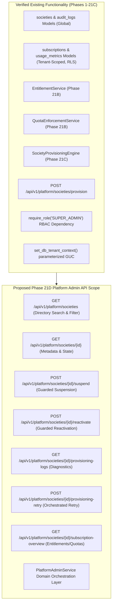
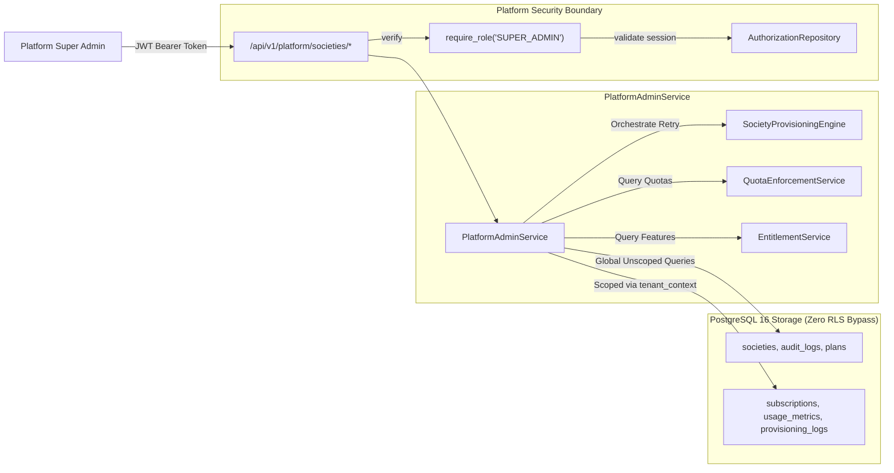
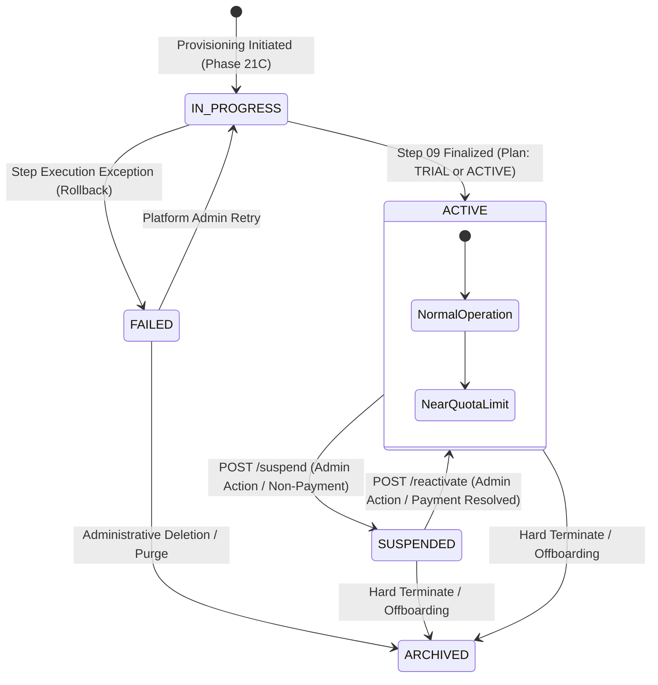
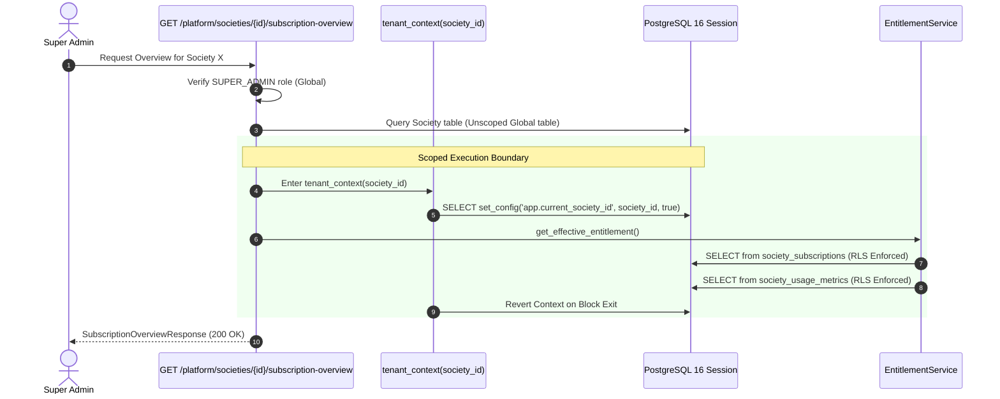

# SocietySphere Phase 21D Architecture Proposal
**Document ID:** `SOCIETYSPHERE-PHASE-21D-ARCH-001`  
**Date:** October 28, 2026  
**Author:** Senior Backend Architect, Distributed Systems & PostgreSQL Security Specialist  
**Status:** **PROPOSED — PENDING FORMAL REVIEW & AUTHORIZATION**  
**Preceding Phases:** Phase 21A (Database Foundation — Approved), Phase 21B (Entitlements & Quotas — Verified), Phase 21C (Provisioning Engine — Verified)

---

## 1. Executive Summary & Objective

Phase 21D defines the **SaaS Platform Administration API** for SocietySphere. This phase provides secure, enterprise-grade administrative endpoints and domain workflows allowing authorized platform administrators (`SUPER_ADMIN`) to manage, inspect, audit, and orchestrate the multi-tenant society ecosystem across the platform.

### Core Goals
1. **Multi-Tenant Society Directory**: Fast, indexed directory search, filtering, and sorting across all global society records with robust pagination.
2. **Society Lifecycle Orchestration**: Explicit, guarded state transitions (`ACTIVE` $\longleftrightarrow$ `SUSPENDED`) with mandatory administrative justification and synchronized subscription enforcement.
3. **Provisioning Diagnostics & Retry**: Transparent inspection of the 9-step provisioning logs and safe retry execution for eligible failed onboarding requests without duplicate entity generation.
4. **Subscription & Quota Observability**: Consolidated, real-time reporting of active subscription tiers, effective feature entitlements, and quota metrics by directly leveraging Phase 21B domain services (`EntitlementService` and `QuotaEnforcementService`).
5. **Platform Governance & Zero-RLS-Bypass Compliance**: Strict enforcement of platform-level RBAC (`SUPER_ADMIN`), transaction-local tenant context binding for scoped tables, append-only immutable audit logging, and zero RLS bypass.

> [!IMPORTANT]
> **Zero Migration Requirement**: All required tables, foreign keys, unique constraints, and PostgreSQL RLS policies were fully established in Phase 21A (Migration `0021_saas_platform_subscriptions.py`) and earlier baselines. **Phase 21D requires ZERO database schema modifications and ZERO migrations.** Migrations `0001–0021` remain locked.

---

## 2. Verified Existing Functionality vs. Proposed New Scope

A rigorous inspection of the current repository was performed to distinguish reusable foundational code from genuine gaps.



### 2.1 Verified Existing Components
- **Global Models** (`apps/api/src/database/models/`):
  - `Society`: Primary tenant boundary record with `status` and `onboarding_status`.
  - `AuditLog`: Append-only audit trail supporting unscoped platform records (`society_id=None`).
  - `Role` & `RoleAssignment`: Platform-scoped RBAC with `scope_type='PLATFORM'` and `society_id IS NULL`.
- **Tenant-Scoped Models** (`apps/api/src/database/models/subscription.py`):
  - `SocietySubscription`: Manages lifecycle status (`ACTIVE`, `TRIAL`, `SUSPENDED`, `CANCELLED`).
  - `SocietyUsageMetric`: Persistent atomic counters (`UNITS_MAX`, `RESIDENTS_MAX`, `STAFF_MAX`, `STORAGE_BYTES_MAX`).
  - `SocietyProvisioningLog`: Step-by-step diagnostic log table indexed on `(society_id, created_at)` and `provisioning_request_id`.
  - `SocietyFeatureOverride` & `SocietyQuotaOverride`: Granular custom tenant adjustments.
- **Domain Services**:
  - `EntitlementService`: 3-tier precedence engine (Override $\rightarrow$ Plan $\rightarrow$ System Default).
  - `QuotaEnforcementService`: Concurrency-safe reservations, balance checks, and usage diagnostics.
  - `SocietyProvisioningEngine`: 9-step atomic provisioning lifecycle with non-blocking advisory locks and canonical JSON SHA-256 fingerprinting.
- **Security & Authorization**:
  - `require_role("SUPER_ADMIN")`: FastAPI dependency verifying unrevoked platform superuser sessions.
  - `set_db_tenant_context(session, society_id)`: Parameterized `SELECT set_config('app.current_society_id', :val, true)` with transaction-local scoping.

### 2.2 Genuine Gaps Addressed by Phase 21D
- No read API exists to search, filter, paginate, or inspect the global directory of societies.
- No administrative API exists to view provisioning failure logs or retry a failed onboarding request.
- No domain workflow exists to safely transition a society between `ACTIVE` and `SUSPENDED` while synchronizing the underlying subscription state and logging immutable administrative justifications.
- No aggregated endpoint exists to report combined subscription, feature entitlement, and quota usage overview for platform administrators.

---

## 3. Architecture & Component Design

The platform administration API introduces a cohesive orchestration layer that interfaces cleanly with existing domain services while maintaining strict separation of concerns.



### 3.1 Architectural Principles
1. **Zero RLS Bypass**: Platform admin queries against global tables (`societies`, `audit_logs`, `platform_subscription_plans`) run directly as unscoped tables. When querying tenant-scoped tables (`society_subscriptions`, `society_usage_metrics`, `society_provisioning_logs`), the service MUST enter `async with tenant_context(society_id): await set_db_tenant_context(session, society_id)`. Code never runs with `BYPASSRLS` or `SUPERUSER` privileges.
2. **Immutable Administrative Audit**: Every state transition (`SUSPEND`, `REACTIVATE`, `RETRY_PROVISIONING`) commits an unscoped `AuditLog` entry detailing the actor, entity, action, before/after states, and administrative justification.
3. **No Logic Duplication**: Subscription entitlement calculations, trial checks, and quota aggregations are delegated exclusively to `EntitlementService` and `QuotaEnforcementService`.
4. **Idempotent Transitions**: Suspending an already-suspended society or reactivating an already-active society raises a clean domain exception (HTTP 409 Conflict) preventing duplicate side-effects.

---

## 4. State Machine & Lifecycle Transitions

### 4.1 Society & Subscription State Transition Matrix



### 4.2 State Transition Invariants
| Current State | Target State | Permitted? | Conditions & Side Effects |
| :--- | :--- | :---: | :--- |
| `IN_PROGRESS` | `ACTIVE` | $\checkmark$ | Only via `SocietyProvisioningEngine` on successful step completion. |
| `IN_PROGRESS` | `FAILED` | $\checkmark$ | Automatic on exception; rollback executed, out-of-band audit recorded. |
| `FAILED` | `IN_PROGRESS` | $\checkmark$ | Initiated via `POST /societies/{id}/provisioning-retry`. |
| `ACTIVE` | `SUSPENDED` | $\checkmark$ | Requires non-empty reason (`min_length=10`). Updates `Society.status="SUSPENDED"`. Synchronizes `SocietySubscription.status="SUSPENDED"`. Emits `AuditLog(action="SOCIETY_SUSPENDED")`. |
| `SUSPENDED` | `ACTIVE` | $\checkmark$ | Requires non-empty reason. Updates `Society.status="ACTIVE"`. Synchronizes `SocietySubscription.status="ACTIVE"` (or `"TRIAL"` if trial still valid). Emits `AuditLog(action="SOCIETY_ACTIVATED")`. |
| `ACTIVE` | `ACTIVE` | $\times$ | **409 Conflict**: `SOCIETY_ALREADY_ACTIVE`. |
| `SUSPENDED` | `SUSPENDED` | $\times$ | **409 Conflict**: `SOCIETY_ALREADY_SUSPENDED`. |
| `FAILED` | `SUSPENDED` | $\times$ | **400 Bad Request**: Cannot suspend an unprovisioned society. |
| `ARCHIVED` | Any | $\times$ | **400 Bad Request**: Archived societies are terminal. |

---

## 5. API Endpoint Specifications & Contracts

All endpoints are mounted under `/api/v1/platform/societies` and guarded by `current_user: User = Depends(require_role("SUPER_ADMIN"))`.

### 5.1 Endpoint Directory
```text
GET    /api/v1/platform/societies                      # List & Search Societies (Paginated)
GET    /api/v1/platform/societies/{society_id}         # Detailed Society Metadata & Status
POST   /api/v1/platform/societies/{society_id}/suspend # Suspend Society Operations
POST   /api/v1/platform/societies/{society_id}/reactivate # Reactivate Suspended Society
GET    /api/v1/platform/societies/{society_id}/provisioning-logs # Step Diagnostics
POST   /api/v1/platform/societies/{society_id}/provisioning-retry # Retry Failed Provisioning
GET    /api/v1/platform/societies/{society_id}/subscription-overview # Entitlements & Usage
```

---

### 5.2 Contract Details

#### 1. `GET /api/v1/platform/societies`
**Query Parameters:**
- `search: str | None`: Free-text search matching `legal_name`, `display_name`, or `registration_number` (case-insensitive substring).
- `status: str | None`: Filter by `status` (`ACTIVE`, `SUSPENDED`, `IN_PROGRESS`, `FAILED`).
- `onboarding_status: str | None`: Filter by `onboarding_status` (`COMPLETED`, `IN_PROGRESS`, `FAILED`).
- `plan_code: str | None`: Filter by subscription plan (`FREE`, `STANDARD`, `PREMIUM`, `ENTERPRISE`).
- `state: str | None`: Filter by Indian state.
- `city: str | None`: Filter by city.
- `page: int = Query(1, ge=1)`
- `page_size: int = Query(20, ge=1, le=100)`
- `sort_by: str = Query("created_at", regex="^(created_at|legal_name|status)$")`
- `sort_order: str = Query("desc", regex="^(asc|desc)$")`

**Response (`SocietyDirectoryResponse`):**
```json
{
  "items": [
    {
      "id": "86b346b9-b21f-4459-ada9-f6d2805d76d3",
      "legal_name": "Greenwood Heights Co-op Housing Society Ltd",
      "display_name": "Greenwood Heights",
      "registration_number": "REG-MH-PUN-2026-0042",
      "city": "Pune",
      "state": "Maharashtra",
      "postal_code": "411001",
      "status": "ACTIVE",
      "onboarding_status": "COMPLETED",
      "plan_code": "STANDARD",
      "subscription_status": "ACTIVE",
      "total_units": 120,
      "created_at": "2026-10-28T14:30:00Z",
      "updated_at": "2026-10-28T14:30:00Z"
    }
  ],
  "total": 1,
  "page": 1,
  "page_size": 20,
  "pages": 1
}
```

---

#### 2. `GET /api/v1/platform/societies/{society_id}`
**Response (`SocietyDetailAdminResponse`):**
```json
{
  "id": "86b346b9-b21f-4459-ada9-f6d2805d76d3",
  "legal_name": "Greenwood Heights Co-op Housing Society Ltd",
  "display_name": "Greenwood Heights",
  "registration_number": "REG-MH-PUN-2026-0042",
  "address_line1": "Plot 104, Baner Road",
  "address_line2": "Near Orchid School",
  "city": "Pune",
  "state": "Maharashtra",
  "country": "IN",
  "postal_code": "411001",
  "timezone": "Asia/Kolkata",
  "default_language": "en",
  "status": "ACTIVE",
  "onboarding_status": "COMPLETED",
  "created_at": "2026-10-28T14:30:00Z",
  "updated_at": "2026-10-28T14:30:00Z",
  "archived_at": null,
  "subscription": {
    "plan_code": "STANDARD",
    "plan_name": "Standard Community Plan",
    "status": "ACTIVE",
    "starts_at": "2026-10-28T14:30:00Z",
    "trial_ends_at": null,
    "current_period_end": "2026-11-28T14:30:00Z"
  },
  "primary_admin": {
    "user_id": "27b0f986-59c2-44ae-b7fb-50e0ebcc16a3",
    "name": "Vivek Patil",
    "email_masked": "v***l@example.com",
    "status": "ACTIVE"
  }
}
```

---

#### 3. `POST /api/v1/platform/societies/{society_id}/suspend`
**Request Body (`SocietyLifecycleActionRequest`):**
```json
{
  "reason": "Administrative suspension due to payment default after 3 grace period notifications."
}
```
**Behavior:**
1. Validates caller is `SUPER_ADMIN`.
2. Loads `Society` by `society_id` (unscoped).
3. Asserts `Society.status == "ACTIVE"`. (If already `SUSPENDED`, raises 409).
4. Updates `Society.status = "SUSPENDED"`.
5. Enters tenant context to update `SocietySubscription.status = "SUSPENDED"`.
6. Appends `AuditLog(action="SOCIETY_SUSPENDED", entity_id=str(society.id), after_state={"reason": reason})`.
7. Commits transaction and returns updated metadata.

**Response (`SocietyLifecycleActionResponse`):**
```json
{
  "society_id": "86b346b9-b21f-4459-ada9-f6d2805d76d3",
  "previous_status": "ACTIVE",
  "current_status": "SUSPENDED",
  "reason": "Administrative suspension due to payment default after 3 grace period notifications.",
  "actor_user_id": "11111111-1111-1111-1111-111111111111",
  "executed_at": "2026-10-28T17:45:00Z"
}
```

---

#### 4. `POST /api/v1/platform/societies/{society_id}/reactivate`
**Request Body (`SocietyLifecycleActionRequest`):**
```json
{
  "reason": "Payment received via wire transfer. Restoring active society status."
}
```
**Behavior:**
1. Asserts `Society.status == "SUSPENDED"`. (If already `ACTIVE`, raises 409).
2. Updates `Society.status = "ACTIVE"`.
3. Synchronizes `SocietySubscription.status`: sets to `"ACTIVE"` (or `"TRIAL"` if trial window has not lapsed).
4. Appends `AuditLog(action="SOCIETY_ACTIVATED")`.
5. Returns updated metadata.

---

#### 5. `GET /api/v1/platform/societies/{society_id}/provisioning-logs`
**Behavior:**
1. Enters tenant context for `society_id`.
2. Queries `SocietyProvisioningLog` ordered by `started_at ASC`.
3. If no tenant logs exist (e.g. failure occurred before `BIND_TENANT_RLS`), queries unscoped `AuditLog` where `entity_id == str(society_id)` and `action IN ('SOCIETY_PROVISIONED', 'SOCIETY_PROVISIONING_FAILED')`.
4. Returns step-by-step diagnostic breakdown with safe execution messages.

**Response (`SocietyProvisioningDiagnosticsResponse`):**
```json
{
  "society_id": "86b346b9-b21f-4459-ada9-f6d2805d76d3",
  "onboarding_status": "COMPLETED",
  "is_retryable": false,
  "steps": [
    {
      "step_key": "VALIDATE_INPUT",
      "status": "COMPLETED",
      "started_at": "2026-10-28T14:30:00Z",
      "completed_at": "2026-10-28T14:30:00.02Z",
      "message": "Validated request payload and subscription plan."
    },
    {
      "step_key": "CREATE_SOCIETY_ROOT",
      "status": "COMPLETED",
      "started_at": "2026-10-28T14:30:00.02Z",
      "completed_at": "2026-10-28T14:30:00.05Z",
      "message": "Created society root record."
    },
    {
      "step_key": "BIND_TENANT_RLS",
      "status": "COMPLETED",
      "started_at": "2026-10-28T14:30:00.05Z",
      "completed_at": "2026-10-28T14:30:00.07Z",
      "message": "Configured transaction-local RLS tenant context."
    }
  ],
  "last_failure": null
}
```

---

#### 6. `POST /api/v1/platform/societies/{society_id}/provisioning-retry`
**Behavior:**
1. Checks that society exists and `onboarding_status == "FAILED"`. (If `COMPLETED`, raises 409 `PROVISIONING_ALREADY_COMPLETED`).
2. Retrieves stored initial request payload from prior failure audit log or accepts an optional override payload (`ProvisionSocietyRequest`).
3. Re-executes `SocietyProvisioningEngine.provision_society()` with concurrency advisory locks.
4. Returns updated `ProvisionSocietyResponse`.

---

#### 7. `GET /api/v1/platform/societies/{society_id}/subscription-overview`
**Behavior:**
Reuses Phase 21B domain services to construct an authoritative subscription report without duplicate logic:
1. Enters tenant context for `society_id`.
2. Queries `SocietySubscription` with loaded plan.
3. Calls `EntitlementService.get_effective_entitlement()` for all canonical feature keys:
   - `FeatureKey.GOVERNANCE`
   - `FeatureKey.FINANCIAL_REPORTS`
   - `FeatureKey.VISITOR_MANAGEMENT`
   - `FeatureKey.VEHICLE_TRACKING`
   - `FeatureKey.WORK_ORDERS`
   - `FeatureKey.FACILITY_BOOKING`
   - `FeatureKey.COMMUNICATION`
4. Calls `QuotaEnforcementService.get_usage_diagnostics()` for all 4 canonical quota keys:
   - `QuotaKey.UNITS_MAX`
   - `QuotaKey.RESIDENTS_MAX`
   - `QuotaKey.STAFF_MAX`
   - `QuotaKey.STORAGE_BYTES_MAX`
5. Returns consolidated telemetry response.

**Response (`SocietySubscriptionOverviewResponse`):**
```json
{
  "society_id": "86b346b9-b21f-4459-ada9-f6d2805d76d3",
  "plan": {
    "plan_code": "STANDARD",
    "display_name": "Standard Community Plan",
    "subscription_status": "ACTIVE",
    "trial_ends_at": null,
    "current_period_end": "2026-11-28T14:30:00Z"
  },
  "features": [
    {
      "feature_key": "GOVERNANCE",
      "is_enabled": true,
      "source": "PLAN"
    },
    {
      "feature_key": "VISITOR_MANAGEMENT",
      "is_enabled": true,
      "source": "OVERRIDE"
    }
  ],
  "quotas": [
    {
      "quota_key": "UNITS_MAX",
      "current_value": 48,
      "max_limit": 100,
      "usage_percentage": 48.0,
      "is_exceeded": false,
      "source": "PLAN"
    },
    {
      "quota_key": "STORAGE_BYTES_MAX",
      "current_value": 104857600,
      "max_limit": 10737418240,
      "usage_percentage": 0.98,
      "is_exceeded": false,
      "source": "PLAN"
    }
  ]
}
```

---

## 6. Authorization & RBAC Matrix

All endpoints require standard Bearer token authentication and evaluate the user's platform authorization.

| Endpoint | Method | Required Role | Required Scope | Target Society Check |
| :--- | :---: | :---: | :---: | :--- |
| `/platform/societies` | `GET` | `SUPER_ADMIN` | `PLATFORM` | Global access (unscoped). |
| `/platform/societies/{id}` | `GET` | `SUPER_ADMIN` | `PLATFORM` | Validates target society exists. |
| `/platform/societies/{id}/suspend` | `POST` | `SUPER_ADMIN` | `PLATFORM` | Validates society is currently `ACTIVE`. |
| `/platform/societies/{id}/reactivate` | `POST` | `SUPER_ADMIN` | `PLATFORM` | Validates society is currently `SUSPENDED`. |
| `/platform/societies/{id}/provisioning-logs` | `GET` | `SUPER_ADMIN` | `PLATFORM` | Scoped via tenant context for log tables. |
| `/platform/societies/{id}/provisioning-retry` | `POST` | `SUPER_ADMIN` | `PLATFORM` | Validates society is currently `FAILED`. |
| `/platform/societies/{id}/subscription-overview` | `GET` | `SUPER_ADMIN` | `PLATFORM` | Scoped via tenant context for EntitlementService. |

### 6.1 Defense Against Context Injection & IDOR
- Platform administrative endpoints **DO NOT** accept or respect the `X-Society-ID` header as an authorization bypass.
- The `society_id` is supplied explicitly as a path parameter in the route URL.
- When inspecting or operating on tenant-scoped tables, the backend strictly derives the tenant context from the validated route parameter, executes `set_config('app.current_society_id', :val, true)`, and guarantees transaction-local execution.
- Non-admin users attempting to access `/api/v1/platform/*` are rejected immediately with **HTTP 403 Forbidden** (`AuthorizationException`).

---

## 7. PostgreSQL RLS & Tenant Isolation Strategy

A core requirement is ensuring that platform administrators can administer societies without bypassing PostgreSQL Row Level Security or compromising tenant data privacy.



### 7.1 Separation of Administrative Metadata vs. Tenant Data
Platform administration APIs provide observability into **operational and commercial metadata** (subscription tiers, quota limits, provisioning logs, society status). They do **NOT** expose tenant resident data (e.g. personal resident votes, private complaint details, unit financial ledgers) through platform administrative routes, preserving multi-tenant data confidentiality.

---

## 8. Schema & Migration Evaluation

### 8.1 Schema Verification Analysis
| Required Data Entity | Source Table (Migration 0001–0021) | Schema Modifications Required? |
| :--- | :--- | :---: |
| Society Directory, Status, Address | `societies` (Migration 0002) | **None** |
| Platform Admin Roles & Assignments | `roles`, `role_assignments` (Migration 0003) | **None** |
| Subscription Plans & Entitlements | `platform_subscription_plans`, `subscription_plan_entitlements` (Migration 0021) | **None** |
| Tenant Subscriptions & Overrides | `society_subscriptions`, `society_feature_overrides`, `society_quota_overrides` (Migration 0021) | **None** |
| Persistent Usage Metrics | `society_usage_metrics` (Migration 0021) | **None** |
| Step-by-Step Diagnostic Logs | `society_provisioning_logs` (Migration 0021) | **None** |
| Append-Only Administrative Audits | `audit_logs` (Migration 0002) | **None** |

### 8.2 Migration Verdict
**ZERO MIGRATIONS REQUIRED.**  
All required columns, indices, foreign keys, and RLS policies were created in Phase 21A and prior migrations. No migration `0022` will be created.

---

## 9. Error Handling & Diagnostic Architecture

Custom domain exceptions map cleanly to standardized HTTP status codes and RFC 7807 problem payloads:

| Domain Exception | HTTP Status | Error Code | Description / Scenario |
| :--- | :---: | :--- | :--- |
| `SocietyNotFoundException` | **404** | `SOCIETY_NOT_FOUND` | Target `society_id` does not exist or is archived. |
| `InvalidLifecycleTransitionException` | **409** | `INVALID_LIFECYCLE_TRANSITION` | Attempting to suspend an already-suspended society or activate an active one. |
| `ProvisioningNotRetryableException` | **409** | `PROVISIONING_NOT_RETRYABLE` | Attempting to retry a society whose onboarding is already `COMPLETED`. |
| `InvalidAdminActionException` | **400** | `INVALID_ADMIN_ACTION` | Missing or blank justification reason (must be $\ge 10$ characters). |
| `AuthorizationException` | **403** | `FORBIDDEN` | Caller lacks active platform `SUPER_ADMIN` role. |

---

## 10. Comprehensive Verification & Test Plan

The proposed implementation will be verified through unit, integration, and live PostgreSQL 16 concurrency and RLS tests.

### 10.1 Unit & Integration Suite (`tests/test_phase21d_platform_admin.py`)
1. **Directory Search & Pagination**:
   - Verify pagination offset and limit calculation.
   - Verify substring filtering across `legal_name`, `display_name`, and `registration_number`.
   - Verify multi-column filtering by `status`, `onboarding_status`, and `plan_code`.
   - Verify ascending and descending sorting.
2. **Lifecycle Transitions**:
   - Verify `ACTIVE` $\rightarrow$ `SUSPENDED` updates both `Society` and `SocietySubscription`.
   - Verify `SUSPENDED` $\rightarrow$ `ACTIVE` restores operations.
   - Verify 409 Conflict when attempting duplicate transitions.
   - Verify validation rejection when suspension reason is blank or $< 10$ characters.
3. **Provisioning Diagnostics**:
   - Verify retrieval of step logs from `society_provisioning_logs`.
   - Verify fallback retrieval from `audit_logs` for pre-RLS failures.
4. **Subscription Overview Integration**:
   - Verify accurate aggregation of effective feature flags via `EntitlementService`.
   - Verify accurate usage counter percentages via `QuotaEnforcementService`.
5. **Audit Trail Verification**:
   - Verify `SOCIETY_SUSPENDED` and `SOCIETY_ACTIVATED` audit log entries.
   - Confirm recorded `actor_user_id`, before/after state diffs, and reasons.
   - Confirm sensitive data redaction (zero credentials logged).

### 10.2 Live PostgreSQL 16 Concurrency & RLS Suite (`tests/test_phase21d_platform_admin_concurrency_pg.py`)
1. **Concurrent State Transition Safety**:
   - Two concurrent `POST /suspend` or `POST /reactivate` requests on the same society: exactly one succeeds; the second receives HTTP 409 Conflict without data corruption.
2. **Unprivileged Role RLS Compliance (`app_user`)**:
   - Run platform administration queries using an unprivileged database role (`NOSUPERUSER NOBYPASSRLS`).
   - Confirm that tenant context binding correctly allows reading target society subscription and usage metrics without requiring `SUPERUSER` or `BYPASSRLS`.
3. **Connection Pool Hygiene**:
   - Execute platform admin overview query.
   - Commit transaction.
   - Execute subsequent query on same connection without context $\rightarrow$ confirms context discarded (0 rows returned).

---

## 11. Risks, Dependencies, Acceptance Criteria & Rollback Plan

### 11.1 Dependencies
- Phase 21A Database Foundation (Tables: `society_subscriptions`, `society_usage_metrics`, `society_provisioning_logs`).
- Phase 21B Domain Services (`EntitlementService`, `QuotaEnforcementService`).
- Phase 21C Provisioning Engine (`SocietyProvisioningEngine`).
- Core Authorization (`require_role("SUPER_ADMIN")`).

### 11.2 Risks & Mitigation Strategies
| Identified Risk | Impact | Architectural Mitigation |
| :--- | :---: | :--- |
| **Connection Pool Starvation** during bulk directory queries. | High | Enforce mandatory pagination limits (`page_size` $\le 100$, default 20) with indexed multi-column filters. |
| **Accidental RLS Leakage** on pooled connections. | Critical | Mandate `SELECT set_config('app.current_society_id', :val, true)` with `is_local=true` inside `tenant_context()` context managers. |
| **Race Conditions during State Transitions** (simultaneous suspend/activate). | Medium | Use `SELECT ... FOR UPDATE` row locks on the `Society` record during lifecycle modifications. |
| **Audit Log Tampering**. | High | Leverage append-only `AuditLog` table with restrictive database permissions (no `UPDATE` or `DELETE` grants). |

### 11.3 Acceptance Criteria
1. All 7 platform administrative API endpoints implemented and registered under `/api/v1/platform`.
2. 100% of platform administration endpoints guarded by `SUPER_ADMIN` RBAC check.
3. Zero new migrations created; migrations `0001–0021` unmodified.
4. Zero RLS bypass (`SUPERUSER` or `BYPASSRLS`) utilized.
5. All lifecycle state transitions write immutable records to `audit_logs`.
6. Subscription overview directly reuses Phase 21B `EntitlementService` and `QuotaEnforcementService` without logic duplication.
7. Unit, integration, and live PostgreSQL 16 test suites pass with 100% success rate.
8. Full platform regression maintains 0 failures across all 389+ existing tests.
9. Ruff and MyPy report zero errors across the entire codebase.

### 11.4 Rollback Strategy
Because Phase 21D requires zero schema migrations, rollback entails strictly reverting the code changes:
1. Remove `apps/api/src/subscriptions/platform_admin_service.py`.
2. Revert `apps/api/src/api/v1/endpoints/platform.py` to its Phase 21C baseline.
3. Remove Phase 21D test suites (`tests/test_phase21d_*.py`).
4. Database state remains fully functional and intact under Migration `0021`.

---

## 12. Explicit Out-of-Scope Items
The following capabilities are deliberately excluded from Phase 21D:
- Platform Admin Frontend Web UI / Portal (Phase 21E).
- Payment gateway integration (Razorpay / Stripe) and webhook ingestion (Phase 21F).
- Automated dunning workflows, invoice billing generation, and subscription renewal charging.
- Tenant self-service plan upgrades or downgrades (Resident/Treasurer facing).
- Direct mutation of tenant-owned business records (financial ledgers, votes, complaints) by platform admins.

---

## 13. Proposal Status & Recommendation

**RECOMMENDATION:** **PROCEED TO PRE-IMPLEMENTATION ARCHITECTURE REVIEW.**

This architecture proposal establishes a secure, modular, zero-RLS-bypass SaaS Platform Administration API that completes the management lifecycle for SocietySphere multi-tenant societies while strictly protecting tenant boundaries and database integrity.

> [!CAUTION]
> **Strict Execution Stop**: No implementation code, tests, or configurations will be written until this architecture proposal receives formal review and explicit authorization from the user.
