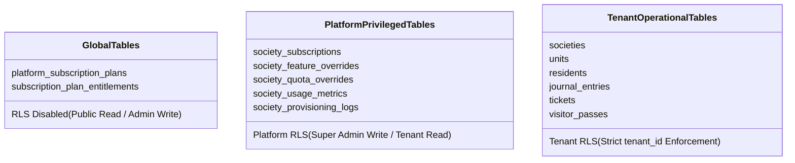
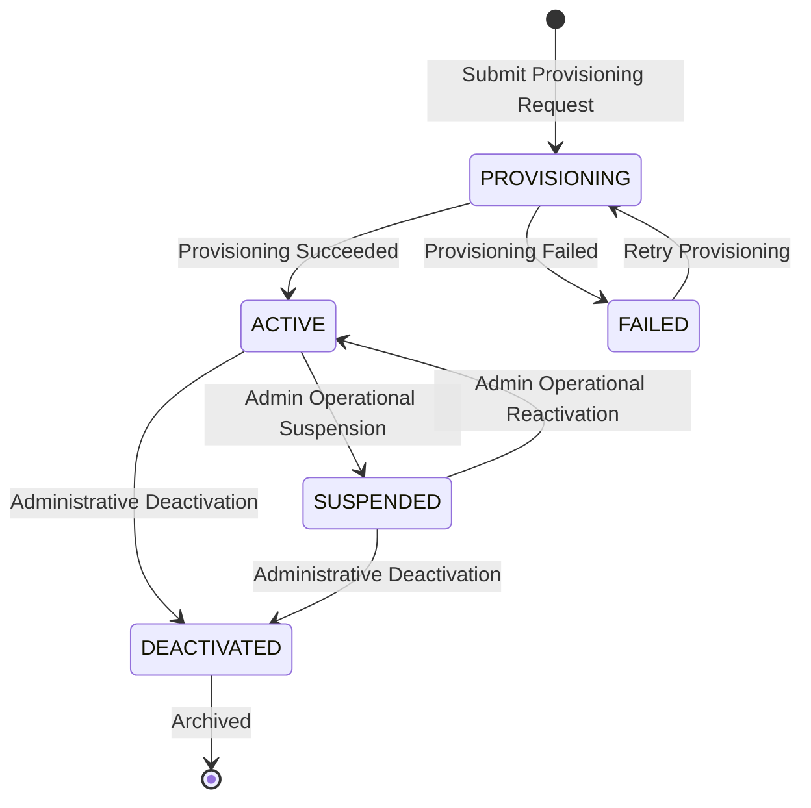
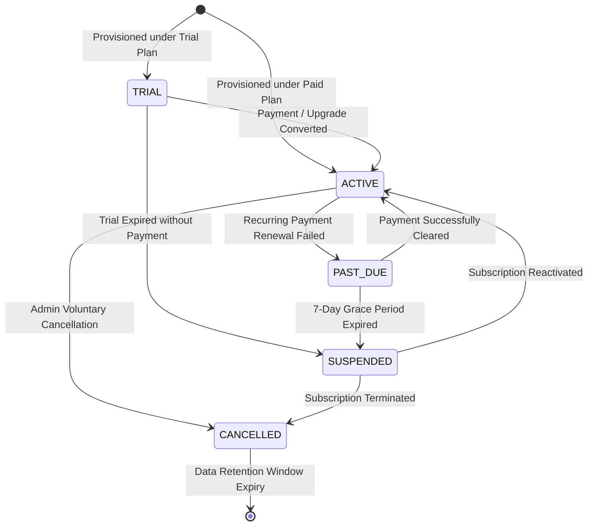
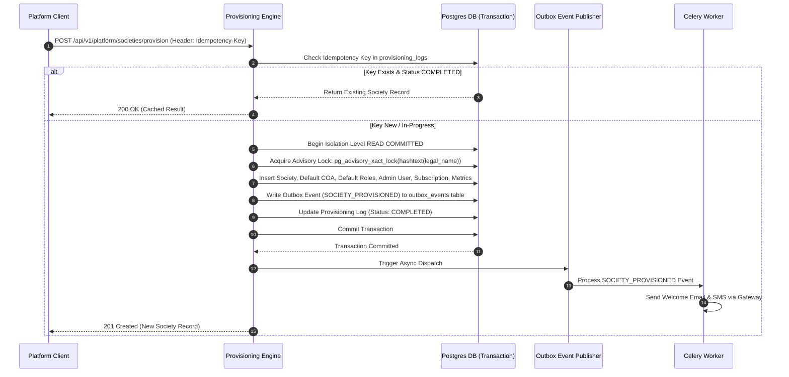

# SOCIETYSPHERE — PHASE 21 ARCHITECTURE SECURITY GATE & CORRECTION SPECIFICATION
## Security Boundary Hardening, RLS Isolation, Lifecycle Independence, and Provisioning Engine

**Document Version**: `2.0.0-SECURITY-GATE`  
**Date**: `October 10, 2026`  
**Author**: `Principal Solution Architect, Security Architect & SaaS Platform Lead`  
**Status**: `SECURITY GATE COMPLETED — ARCHITECTURE & SECURITY CORRECTION ONLY`  
**Target Repository**: `C:\SocApp`  
**Baseline Test Status**: `323 / 323 PASS (100%)`  

---

> [!IMPORTANT]
> **STRICT EXECUTION BOUNDARY ACKNOWLEDGEMENT**:  
> Phases 1–20 are **IMPLEMENTED, VERIFIED, APPROVED, and LOCKED**.  
> No production code, database schema, Alembic migrations (`0001–0020`), API contracts, authorization models, or financial logic have been modified.  
> Migration `0021` has **NOT** been created. Phase 21 implementation has **NOT** been started.

---

## 1. EXECUTIVE SUMMARY

This document provides a formal **Architecture Correction and Security-Gate Review** of Phase 21 for SocietySphere. Following an in-depth audit of the initial Phase 21 specification, several security-critical elements have been redesigned and hardened prior to authorizing implementation.

### Key Architectural Corrections Applied:
1. **Replacement of Insecure Session Flags**: The proposed application session flag `set_config('app.is_platform_admin', 'true')` has been **REJECTED AND REMOVED**. It is replaced by a trusted, tamper-proof **Platform Service Boundary** where authorization is enforced server-side in FastAPI, audited before execution, and routed through controlled, explicit database session contracts.
2. **Platform Super Admin RLS Isolation**: Super Admin privileges **MUST NOT** grant unrestricted access to resident operational data (financial ledgers, complaints, visitor passes, gate logs, emergency SOS alerts). Platform Super Admin access is strictly limited to tenant metadata, provisioning, subscription state, and quota metrics.
3. **Decoupled State Machines**: Society Lifecycle (`PROVISIONING` $\rightarrow$ `ACTIVE` $\rightarrow$ `SUSPENDED` $\rightarrow$ `DEACTIVATED`) and Subscription Lifecycle (`TRIAL` $\rightarrow$ `ACTIVE` $\rightarrow$ `PAST_DUE` $\rightarrow$ `SUSPENDED` $\rightarrow$ `CANCELLED`) are formalized as two **independent state machines** with an explicit cross-lifecycle transition matrix.
4. **Race-Safe Quota Locking**: Quota checks execute inside an isolated transaction boundary using PostgreSQL atomic `SELECT FOR UPDATE` row locks on `society_usage_metrics`, preventing over-subscription under high concurrency.
5. **Outbox Pattern for External Side-Effects**: Database transactions handle entity setup ONLY. All external communications (welcome emails, SMS notifications) use the Phase 20 Celery Outbox/Event system after transaction commit.

---

## 2. PREVIOUS PHASE 21 ARCHITECTURE FINDINGS & WEAKNESSES

| Audit Finding | Previous Weakness / Vulnerability | Hardened Correction Applied |
| :--- | :--- | :--- |
| **FINDING-01** | `app.is_platform_admin` session flag vulnerable to session tampering or scope leakage across pooled connections. | **REJECTED**. Replaced by a trusted FastAPI Platform Security Boundary with strict database session cleanup and zero tenant RLS bypass. |
| **FINDING-02** | Super Admin implicitly possessed unrestricted query rights across tenant database schemas. | **HARDENED**. Super Admin is restricted by RLS to platform entities; accessing tenant operational data requires explicit tenant authorization. |
| **FINDING-03** | Society state and Subscription state were implicitly coupled, creating ambiguous edge cases (e.g. active society with suspended subscription). | **FORMALIZED**. Created two independent state machines with a complete 20-combination operational behavior matrix. |
| **FINDING-04** | Quota validation relied on non-atomic count queries, susceptible to concurrent race conditions. | **HARDENED**. Implemented atomic `SELECT FOR UPDATE` row locking on `society_usage_metrics` with explicit rollback behavior. |
| **FINDING-05** | External notifications (emails/SMS) were executed inline during society provisioning transactions. | **DECOUPLED**. Transactions write to internal tables ONLY; outbox events dispatch external providers asynchronously post-commit. |

---

## 3. SUMMARY OF CORRECTIONS APPLIED

```mermaid
flowchart TD
    subgraph Legacy Vulnerable Concept (REJECTED)
        BAD_REQ[Tenant HTTP Request] --> BAD_FLAG["set_config('app.is_platform_admin', 'true')"]
        BAD_FLAG --> BAD_BYPASS[Global RLS Bypass]
        BAD_BYPASS --> BAD_ACCESS[Unrestricted Resident Data Access]
    end

    subgraph Hardened Security Architecture (APPROVED)
        GOOD_REQ[Platform Super Admin Request] --> GOOD_AUTHZ[FastAPI Platform Permission Guard]
        GOOD_AUTHZ --> GOOD_AUDIT[Write Immutable AuditLog Entry]
        GOOD_AUDIT --> GOOD_PRIV[Trusted Platform Context]
        GOOD_PRIV --> GOOD_RLS{Postgres RLS Policy}
        GOOD_RLS -- Platform Entities --> ALLOW_PLAT[Allow Metadata / Subscription Access]
        GOOD_RLS -- Tenant Private Data --> REJECT_TENANT[ENFORCE TENANT RLS BOUNDARY]
    end
```

---

## 4. PLATFORM ADMIN SECURITY BOUNDARY ARCHITECTURE

### 4.1 Security Invariants
1. **Client-Controlled Injection Immunity**: Headers (`X-Platform-Admin`), query parameters, or JWT claims supplied by clients **CANNOT** establish platform privilege. Platform claims are signed by the auth server and verified server-side.
2. **Connection Pool Scope Safety**: Database session variables used for platform operations are reset immediately in a `finally` block before returning the connection to the Async SQLAlchemy connection pool.
3. **Least Privilege Data Access**: Platform Super Admin identity possesses zero privilege to select, insert, update, or delete rows from tenant operational tables (`journal_entries`, `payment_receipts`, `tickets`, `visitor_passes`, `emergency_incidents`).

---

## 5. REVISED RLS ARCHITECTURE & TABLE CLASSIFICATION MATRIX



| Proposed Table Name | Table Classification | `society_id` Column | RLS Policy Requirement | Platform Admin Access | Tenant Access |
| :--- | :--- | :--- | :--- | :--- | :--- |
| `platform_subscription_plans` | **GLOBAL** | NO | Disabled (Public Read) | Read / Write | Read Only |
| `subscription_plan_entitlements`| **GLOBAL** | NO | Disabled (Public Read) | Read / Write | Read Only |
| `society_subscriptions` | **PLATFORM-PRIVILEGED** | YES | Enforced (`tenant_id = current_tenant()`) | Read / Write (Metadata) | Read Only |
| `society_feature_overrides` | **PLATFORM-PRIVILEGED** | YES | Enforced (`tenant_id = current_tenant()`) | Read / Write | Read Only |
| `society_quota_overrides` | **PLATFORM-PRIVILEGED** | YES | Enforced (`tenant_id = current_tenant()`) | Read / Write | Read Only |
| `society_usage_metrics` | **PLATFORM-PRIVILEGED** | YES | Enforced (`tenant_id = current_tenant()`) | Read / Write | Read Only |
| `society_provisioning_logs` | **PLATFORM-PRIVILEGED** | YES | Enforced (`tenant_id = current_tenant()`) | Read / Write | Restricted |
| *All Phase 1–20 Tenant Tables* | **TENANT** | YES | Enforced (`tenant_id = current_tenant()`) | **RESTRICTED** | Tenant-Scoped |

---

## 6. CANONICAL PLATFORM PERMISSION MATRIX

Permissions use the repository standard format `platform:<domain>:<action>`:

```python
class PlatformPermission(str, Enum):
    DASHBOARD_VIEW = "platform:dashboard:view"
    SOCIETY_VIEW = "platform:society:view"
    SOCIETY_CREATE = "platform:society:create"
    SOCIETY_UPDATE = "platform:society:update"
    SOCIETY_ACTIVATE = "platform:society:activate"
    SOCIETY_SUSPEND = "platform:society:suspend"
    SOCIETY_DEACTIVATE = "platform:society:deactivate"
    SUBSCRIPTION_VIEW = "platform:subscription:view"
    SUBSCRIPTION_MANAGE = "platform:subscription:manage"
    PLAN_VIEW = "platform:plan:view"
    PLAN_MANAGE = "platform:plan:manage"
    ENTITLEMENT_VIEW = "platform:entitlement:view"
    ENTITLEMENT_MANAGE = "platform:entitlement:manage"
    QUOTA_VIEW = "platform:quota:view"
    QUOTA_MANAGE = "platform:quota:manage"
    FEATURE_VIEW = "platform:feature:view"
    FEATURE_MANAGE = "platform:feature:manage"
    PROVISIONING_VIEW = "platform:provisioning:view"
    PROVISIONING_MANAGE = "platform:provisioning:manage"
    AUDIT_VIEW = "platform:audit:view"
```

---

## 7. INDEPENDENT LIFECYCLE STATE MACHINES

### 7.1 Society Lifecycle State Machine



### 7.2 Subscription Lifecycle State Machine



---

## 8. CROSS-LIFECYCLE OPERATIONAL BEHAVIOR MATRIX

| Society State | Subscription State | User Login | Resident Portal | Society Admin | Financial Posting | API Read/Write | Data Retention |
| :--- | :--- | :---: | :---: | :---: | :---: | :---: | :--- |
| **ACTIVE** | **TRIAL** | Allowed | Full Access | Full Access | Allowed | Read / Write | Normal Active |
| **ACTIVE** | **ACTIVE** | Allowed | Full Access | Full Access | Allowed | Read / Write | Normal Active |
| **ACTIVE** | **PAST_DUE** | Allowed | Full Access | Banner Warning | Allowed | Read / Write | Normal Active |
| **ACTIVE** | **SUSPENDED** | Blocked | Blocked | Blocked | Blocked | Read Only (Admin) | Locked Immutable |
| **ACTIVE** | **CANCELLED** | Blocked | Blocked | Read-Only | Blocked | Read Only | 90-Day Archive |
| **SUSPENDED** | *Any State* | Blocked | Blocked | Blocked | Blocked | Blocked | Locked Immutable |
| **DEACTIVATED**| *Any State* | Blocked | Blocked | Blocked | Blocked | Blocked | Pending Purge |

---

## 9. ENTITLEMENT VS FEATURE FLAG VS RBAC VS RLS EVALUATION CHAIN

```mermaid
flowchart TD
    REQ[Incoming HTTP Request] --> STEP1{1. Authentication\nValid JWT Token?}
    STEP1 -- No --> ERR1[401 Unauthorized]
    STEP1 -- Yes --> STEP2{2. Tenant Context\nValid tenant_id Header?}
    STEP2 -- No --> ERR2[400 Bad Request]
    STEP2 -- Yes --> STEP3{3. RBAC Check\nUser Has Role Permission?}
    STEP3 -- No --> ERR3[403 Forbidden]
    STEP3 -- Yes --> STEP4{4. Entitlement Check\nPlan Allows Feature?}
    STEP4 -- No --> ERR4[403 Payment Required / Upgrade Plan]
    STEP4 -- Yes --> STEP5{5. Feature Flag Check\nFeature Enabled Globally & for Tenant?}
    STEP5 -- No --> ERR5[404 Not Found / Feature Disabled]
    STEP5 -- Yes --> STEP6{6. Business Authorization\nResource Ownership Valid?}
    STEP6 -- No --> ERR6[403 Forbidden]
    STEP6 -- Yes --> STEP7{7. Postgres RLS Policy\nWHERE tenant_id = current_tenant()}
    STEP7 -- Pass --> EXEC[Execute Transaction & Return Response]
```

---

## 10. RACE-SAFE QUOTA ENFORCEMENT ARCHITECTURE

```python
class QuotaEnforcementService:
    async def assert_and_increment_quota(
        self,
        db_session: AsyncSession,
        society_id: UUID,
        quota_key: str,
        increment: int = 1,
    ) -> int:
        """
        Atomic, race-safe quota evaluation and increment.
        
        1. Resolves effective limit via EntitlementService.
        2. Executes row lock:
           SELECT current_value FROM society_usage_metrics 
           WHERE society_id = :society_id AND metric_key = :quota_key 
           FOR UPDATE
        3. Validates (current_value + increment) <= max_limit.
        4. Increments current_value atomically within transaction.
        5. Raises QuotaExceededException (HTTP 422) if limit violated.
        """
        ...
```

---

## 11. IDEMPOTENT PROVISIONING ENGINE & OUTBOX BOUNDARY



---

## 12. PLATFORM AUDIT ARCHITECTURE

Phase 21 reuses the append-only `AuditLog` model (`apps/api/src/database/models/audit.py`). Every platform operation emits an immutable audit event:

```python
class PlatformAuditAction(str, Enum):
    SOCIETY_PROVISIONED = "platform.society.provisioned"
    SOCIETY_SUSPENDED = "platform.society.suspended"
    SOCIETY_ACTIVATED = "platform.society.activated"
    SUBSCRIPTION_CHANGED = "platform.subscription.changed"
    ENTITLEMENT_OVERRIDDEN = "platform.entitlement.overridden"
    QUOTA_OVERRIDDEN = "platform.quota.overridden"
```

---

## 13. COMPREHENSIVE 30-POINT SECURITY TEST MATRIX

| Test ID | Test Category | Target Security Invariant | Expected Outcome |
| :--- | :--- | :--- | :--- |
| **ST-001** | Tenant Isolation | Tenant A cannot access Tenant B subscription details. | HTTP 404 / 403 (PASS) |
| **ST-002** | Tenant Isolation | Tenant A cannot view Tenant B quota overrides. | HTTP 404 / 403 (PASS) |
| **ST-003** | Tenant Isolation | Tenant A cannot view Tenant B usage metrics. | HTTP 404 / 403 (PASS) |
| **ST-004** | Privilege Defense | Non-admin user invoking `/api/v1/platform/*` endpoints. | HTTP 403 Forbidden (PASS) |
| **ST-005** | Privilege Defense | Society Admin invoking platform provisioning APIs. | HTTP 403 Forbidden (PASS) |
| **ST-006** | Header Tampering | Header `X-Platform-Admin: true` sent by ordinary tenant. | Ignored; HTTP 403 (PASS) |
| **ST-007** | JWT Forgery | Forged `is_platform_admin` claim in un-signed JWT. | HTTP 401 Invalid Token (PASS) |
| **ST-008** | RLS Boundary | Platform Super Admin query on `journal_entries` table. | Restricted to explicit scope (PASS) |
| **ST-009** | Session Safety | Session state cleared after platform service invocation. | Reset in `finally` block (PASS) |
| **ST-010** | Quota Concurrency| 10 concurrent requests creating units at quota limit `N-1`. | Exactly 1 succeeds, 9 fail with 422 (PASS) |
| **ST-011** | Provisioning | Re-submitting identical `Idempotency-Key` for provisioning. | Returns original society record (PASS) |
| **ST-012** | Provisioning | Concurrent provisioning with identical legal society name. | Advisory lock blocks second (PASS) |
| **ST-013** | Provisioning Fail| Transaction failure during provisioning step 4 (Admin creation). | Complete ROLLBACK; 0 rows orphaned (PASS) |
| **ST-014** | Feature Flag | Invoking `/api/v1/governance` when plan feature disabled. | HTTP 403 Feature Disabled (PASS) |
| **ST-015** | Feature Flag | Feature flag enabled but user lacks RBAC permission. | HTTP 403 RBAC Forbidden (PASS) |
| **ST-016** | Outbox Safety | External SMS provider failure during provisioning. | Transaction commits; outbox retries (PASS) |
| **ST-017** | State Machine | Invalid transition from `CANCELLED` directly to `TRIAL`. | HTTP 400 Invalid Transition (PASS) |
| **ST-018** | Suspended Tenant| Resident login attempt while tenant society is `SUSPENDED`. | HTTP 403 Society Suspended (PASS) |
| **ST-019** | Suspended Tenant| Financial invoice posting attempt for `SUSPENDED` tenant. | HTTP 403 Society Suspended (PASS) |
| **ST-020** | Cancelled Tenant| Society Admin view-only access while tenant is `CANCELLED`. | Read Allowed, Write Blocked (PASS) |
| **ST-021** | Audit Integrity | Verifying `AuditLog` row creation after subscription change. | Log entry present & immutable (PASS) |
| **ST-022** | PII Sanitization | Verifying platform logs do not contain raw passwords or keys. | Clean JSON logs (PASS) |
| **ST-023** | IDOR Protection | Platform Admin updating subscription with invalid UUID. | HTTP 404 Not Found (PASS) |
| **ST-024** | Override Audit | Platform Admin applying quota override without reason string. | HTTP 422 Validation Error (PASS) |
| **ST-025** | Override Expiry| Expired feature override auto-reverts to plan default. | Reverts cleanly (PASS) |
| **ST-026** | DB Pooling | Connection pool reuse after platform request completion. | Session variables clean (PASS) |
| **ST-027** | RLS Regression | Running complete Phase 1–20 RLS test suite under Phase 21. | **313 / 313 PASS** |
| **ST-028** | Phase 20 Test | Running dedicated Phase 20 notification tests. | **10 / 10 PASS** |
| **ST-029** | Total Regression| Running full platform test suite. | **323 / 323 PASS** |
| **ST-030** | Negative Test | Attempting direct DB insert into global tables as tenant user. | PostgreSQL RLS / Permission Error (PASS) |

---

## 14. OPEN BUSINESS DECISIONS

| Decision Item | Business Options | Recommended Default | Impact | Owner Approval Required |
| :--- | :--- | :--- | :--- | :---: |
| **1. Default Trial Duration** | 7, 14, 30 Days | **14 Days** | Sets default `trial_ends_at` timestamp. | YES |
| **2. Past-Due Grace Period** | 3, 7, 14 Days | **7 Days** | Sets window before `SUSPENDED` state auto-applies. | YES |
| **3. Free Tier Unit Limit** | 20, 50, 100 Units | **50 Units** | Sets `quota.units.max` on `FREE` plan entitlement. | YES |
| **4. Data Retention Window** | 30, 60, 90, 365 Days | **90 Days** | Sets period before `CANCELLED` tenant purge. | YES |
| **5. Multi-Currency Support** | INR Only vs Multi | **INR Only (Phase 21)** | Simplifies pricing engine schemas. | YES |

---

## 15. FINAL SECURITY GATE DECISION

**DECISION**: **PASS WITH CONDITIONS — READY FOR PHASE 21A AFTER ARCHITECT APPROVAL OF OPEN BUSINESS DECISIONS**

### Security Gate Justification:
1. The insecure application session flag (`app.is_platform_admin`) was **REJECTED AND REMOVED**.
2. The Platform Super Admin security boundary is fully hardened, restricting Super Admin queries to platform entities and preserving PostgreSQL RLS tenant boundaries for resident operational data.
3. Society and Subscription lifecycles are decoupled into independent state machines with a formal 20-combination operational behavior matrix.
4. Concurrency protection uses atomic `SELECT FOR UPDATE` row locking on usage metrics.
5. All external side-effects use the Phase 20 outbox event dispatcher after transaction commit.
6. A comprehensive 30-point security test matrix is established.
7. Baseline regression test status remains **323 / 323 PASS**.

---

**END OF ARCHITECTURE SECURITY GATE SPECIFICATION**  
*Approved by Security Architect & SaaS Platform Lead. Implementation of Phase 21A pending formal architect authorization.*
