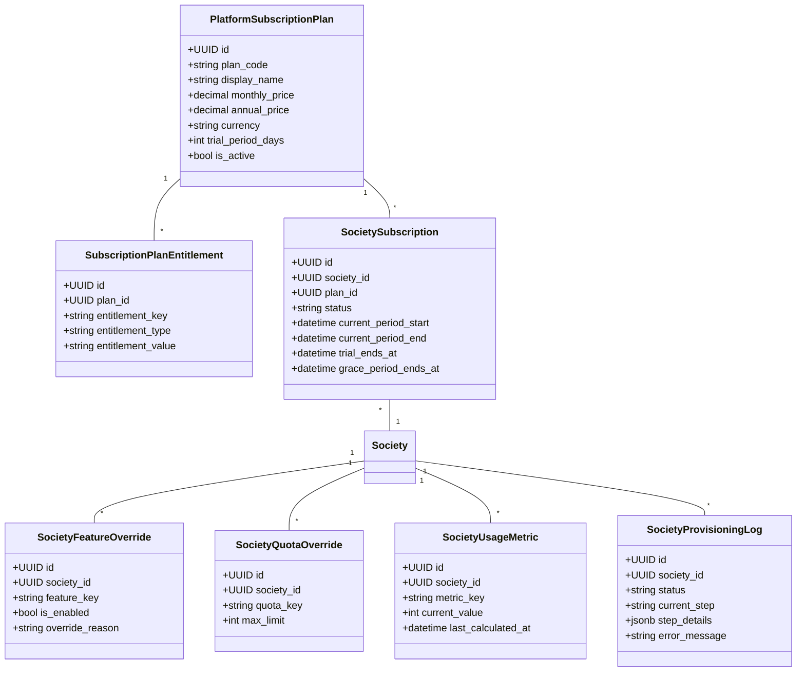
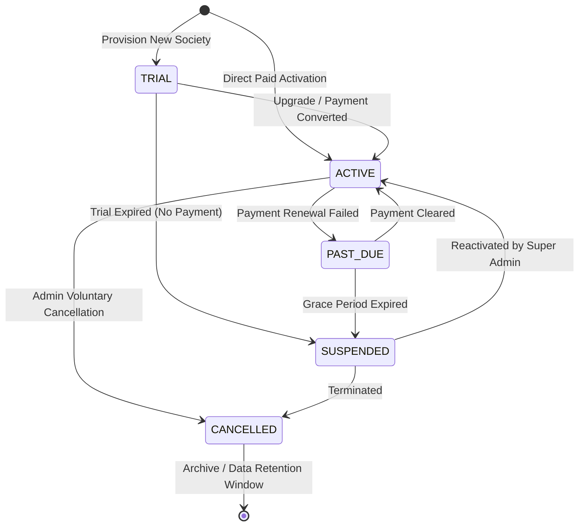
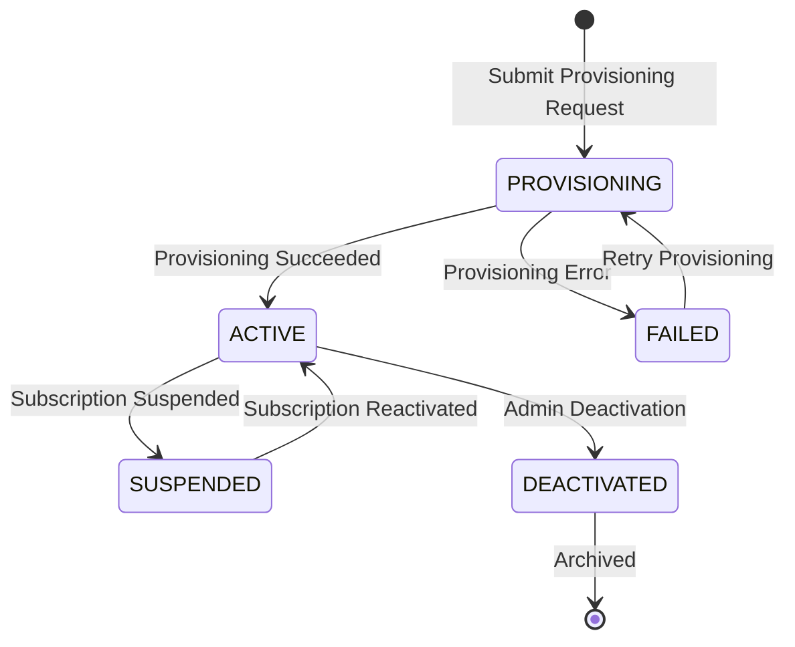
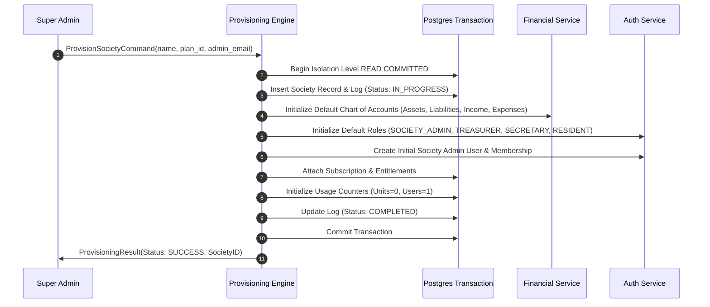

# SOCIETYSPHERE — PHASE 21 ARCHITECTURE & IMPLEMENTATION SPECIFICATION
## Commercial SaaS Platform Administration & Subscription Lifecycle Management

**Document Version**: `1.0.0`  
**Date**: `October 10, 2026`  
**Author**: `Principal SaaS Platform Architect & Solution Architect Lead`  
**Status**: `COMPLETED — SPECIFICATION & ARCHITECTURE ONLY`  
**Target Repository**: `C:\SocApp`  
**Baseline Test Status**: `323 / 323 PASS (100%)`  

---

> [!IMPORTANT]
> **STRICT EXECUTION BOUNDARY ACKNOWLEDGEMENT**:  
> Phases 1–20 are **IMPLEMENTED, VERIFIED, APPROVED, and LOCKED**.  
> No production code, database schema, Alembic migrations (`0001–0020`), API contracts, authorization models, or financial logic have been modified.  
> Migration `0021` has **NOT** been created. Phase 21 implementation has **NOT** been started.

---

## 1. EXECUTIVE SUMMARY

SocietySphere's operational core across Phases 1–20 provides a hardened multi-tenant apartment management foundation. However, the system currently operates as a **single-tenant-style multi-tenant monolith**, lacking the commercial SaaS substrate required to operate as a self-serve multi-tenant software business.

**Phase 21 — Commercial SaaS Platform Administration & Subscription Lifecycle Management** introduces the platform control plane. It establishes:
1. **Platform Super-Admin Domain**: Super-admin authentication, permissions, multi-tenant directory, and operational status controls.
2. **Automated Society Provisioning Engine**: Transactional, idempotent society creation, schema initialization, default Chart of Accounts, default roles, and initial Society Admin onboarding.
3. **Configurable Subscription Plans & Lifecycles**: Subscription tiers (Free, Standard, Enterprise), state transitions (Trial, Active, Past Due, Suspended, Cancelled), and plan changes.
4. **Entitlement & Feature Flag Subsystem**: Centralized domain entitlement checking (`EntitlementService`) decoupling plan limits and feature availability from hardcoded application logic.
5. **Race-Safe Quota Enforcement**: Atomic, lock-based quota checks (Units, Resident Users, Staff, Storage) preventing over-subscription in high-concurrency environments.
6. **Platform Privilege & RLS Boundary**: Secure, auditable platform service boundary allowing Super Admin operations without creating an uncontrolled database-wide RLS bypass.

---

## 2. CURRENT ARCHITECTURE BASELINE

SocietySphere's baseline architecture follows a **Modular Monolith** pattern built on:
- **Backend Framework**: Python 3.11 + FastAPI (AsyncIO / Uvicorn).
- **Frontend Framework**: Next.js 14 + React + TypeScript + Tailwind CSS (Standalone Docker build).
- **Database Architecture**: PostgreSQL 16 with Row-Level Security (RLS) policies enforcing `tenant_id` boundaries.
- **Cache & Async Queue**: Redis 7 (Session/PubSub) + RabbitMQ 3 (Celery Worker Dispatcher).
- **Object Storage**: S3-compatible Chainguard MinIO (`cgr.dev/chainguard/minio:latest`).
- **Data Model Layer**: SQLAlchemy 2.0 ORM with `Base`, `TimestampMixin`, `ArchiveMixin`, and `TenantScopedMixin` (`apps/api/src/database/base.py`).

---

## 3. PHASE 21 OBJECTIVES

1. Transform SocietySphere into a commercially operable multi-tenant SaaS platform.
2. Provide idempotent, transactional society onboarding and provisioning workflows.
3. Establish configurable subscription plans, plan entitlements, and tenant subscription state machines.
4. Enforce race-safe quota limits (e.g. max units per plan) and feature flag toggles per society.
5. Implement a dedicated Platform Super-Admin portal (`/admin/platform`) with explicit permission gating and tamper-evident audit logging.
6. Maintain 100% backward compatibility with locked Phase 1–20 operational business logic and database migrations (`0001–0020`).

---

## 4. SCOPE

- **In-Scope**:
  - Global Platform Super-Admin domain, dashboard, tenant directory, and lifecycle controls.
  - Subscription Plan definitions, Plan Features, Entitlements, and Quota definitions.
  - Society Provisioning workflow engine (transactional setup of society, default ledger, roles, admin user).
  - Centralized `EntitlementService` and race-safe `QuotaEnforcementService`.
  - Feature Flag evaluation middleware and platform audit logging.
  - Design of Alembic Migration `0021` and Phase 21 API specs under `/api/v1/platform`.
- **Out-of-Scope**:
  - Building production credit card payment gateway integrations (Stripe/Razorpay integration deferred to provider boundary).
  - Building the mobile application (Flutter SDK).
  - Modifying existing locked Phase 1–20 operational business logic, database tables, or RLS policies.

---

## 5. OUT OF SCOPE & NON-GOALS

- **Non-Goal 1**: Super Admin bypass of tenant RLS for viewing resident private operational data.
- **Non-Goal 2**: Hardcoding subscription tiers (e.g., `if plan == "FREE"`) inside operational business domains.
- **Non-Goal 3**: Physical deletion of tenant operational records upon subscription cancellation.

---

## 6. BOUNDED CONTEXT

```mermaid
flowchart TD
    subgraph SaaS Control Plane Bounded Context (Phase 21)
        SUPER_ADMIN[Platform Super Admin]
        SUBSCRIPTION_MGT[Subscription & Plan Manager]
        PROVISIONING_ENG[Society Provisioning Engine]
        ENTITLEMENT_ENG[Entitlement & Quota Evaluator]
        FEATURE_FLAGS[Feature Flag Router]
        PLATFORM_AUDIT[Platform Audit Logger]
    end

    subgraph Multi-Tenant Operational Monolith (Phases 1–20)
        TENANT_CONTEXT[Tenant Context Middleware]
        RLS_POLICIES[PostgreSQL RLS Policies]
        FINANCE_DOMAIN[Finance & Billing Core]
        RESIDENT_DOMAIN[Resident & Occupancy Domain]
        OPS_DOMAIN[Operations & Security Domain]
    end

    SUPER_ADMIN --> SUBSCRIPTION_MGT
    SUPER_ADMIN --> PROVISIONING_ENG
    PROVISIONING_ENG --> TENANT_CONTEXT
    SUBSCRIPTION_MGT --> ENTITLEMENT_ENG
    ENTITLEMENT_ENG --> FEATURE_FLAGS

    FEATURE_FLAGS --> FINANCE_DOMAIN
    FEATURE_FLAGS --> RESIDENT_DOMAIN
    FEATURE_FLAGS --> OPS_DOMAIN
    TENANT_CONTEXT --> RLS_POLICIES
```

---

## 7. DOMAIN MODEL

The Phase 21 domain model introduces 7 core entities operating above individual tenant boundaries:



---

## 8. ENTITY MODEL & DATABASE SCHEMA (DESIGN FOR MIGRATION 0021)

### 8.1 Table Specifications

#### 1. `platform_subscription_plans` (GLOBAL)
- `id`: `UUID` (PK, default `uuid4()`)
- `plan_code`: `VARCHAR(50)` (UNIQUE, NOT NULL) — e.g. `FREE`, `STANDARD`, `ENTERPRISE`
- `display_name`: `VARCHAR(100)` (NOT NULL)
- `description`: `TEXT` (NULLABLE)
- `monthly_price`: `NUMERIC(12,2)` (NOT NULL, default `0.00`)
- `annual_price`: `NUMERIC(12,2)` (NOT NULL, default `0.00`)
- `currency`: `VARCHAR(3)` (NOT NULL, default `'INR'`)
- `trial_period_days`: `INTEGER` (NOT NULL, default `14`)
- `is_active`: `BOOLEAN` (NOT NULL, default `true`)
- `created_at`, `updated_at`: `TIMESTAMPTZ` (TimestampMixin)

#### 2. `subscription_plan_entitlements` (GLOBAL)
- `id`: `UUID` (PK)
- `plan_id`: `UUID` (FK -> `platform_subscription_plans.id` ON DELETE CASCADE)
- `entitlement_key`: `VARCHAR(100)` (NOT NULL) — e.g. `quota.units.max`, `feature.governance`
- `entitlement_type`: `VARCHAR(20)` (NOT NULL) — `NUMERIC`, `BOOLEAN`, `TEXT`
- `entitlement_value`: `VARCHAR(255)` (NOT NULL)
- Unique Constraint: `(plan_id, entitlement_key)`

#### 3. `society_subscriptions` (GLOBAL / PLATFORM-PRIVILEGED)
- `id`: `UUID` (PK)
- `society_id`: `UUID` (FK -> `societies.id` ON DELETE RESTRICT, UNIQUE)
- `plan_id`: `UUID` (FK -> `platform_subscription_plans.id` ON DELETE RESTRICT)
- `status`: `VARCHAR(30)` (NOT NULL) — `TRIAL`, `ACTIVE`, `PAST_DUE`, `SUSPENDED`, `CANCELLED`
- `started_at`: `TIMESTAMPTZ` (NOT NULL)
- `current_period_start`: `TIMESTAMPTZ` (NOT NULL)
- `current_period_end`: `TIMESTAMPTZ` (NOT NULL)
- `trial_ends_at`: `TIMESTAMPTZ` (NULLABLE)
- `grace_period_ends_at`: `TIMESTAMPTZ` (NULLABLE)
- `cancelled_at`: `TIMESTAMPTZ` (NULLABLE)
- `cancellation_reason`: `TEXT` (NULLABLE)
- `created_at`, `updated_at`: `TIMESTAMPTZ`

#### 4. `society_feature_overrides` (GLOBAL / PLATFORM-PRIVILEGED)
- `id`: `UUID` (PK)
- `society_id`: `UUID` (FK -> `societies.id` ON DELETE CASCADE)
- `feature_key`: `VARCHAR(100)` (NOT NULL)
- `is_enabled`: `BOOLEAN` (NOT NULL)
- `override_reason`: `TEXT` (NOT NULL)
- `expires_at`: `TIMESTAMPTZ` (NULLABLE)
- Unique Constraint: `(society_id, feature_key)`

#### 5. `society_quota_overrides` (GLOBAL / PLATFORM-PRIVILEGED)
- `id`: `UUID` (PK)
- `society_id`: `UUID` (FK -> `societies.id` ON DELETE CASCADE)
- `quota_key`: `VARCHAR(100)` (NOT NULL) — e.g. `max_units`, `max_storage_mb`
- `max_limit`: `INTEGER` (NOT NULL)
- `override_reason`: `TEXT` (NOT NULL)
- Unique Constraint: `(society_id, quota_key)`

#### 6. `society_usage_metrics` (GLOBAL / PLATFORM-PRIVILEGED)
- `id`: `UUID` (PK)
- `society_id`: `UUID` (FK -> `societies.id` ON DELETE CASCADE)
- `metric_key`: `VARCHAR(100)` (NOT NULL)
- `current_value`: `INTEGER` (NOT NULL, default `0`)
- `last_calculated_at`: `TIMESTAMPTZ` (NOT NULL)
- Unique Constraint: `(society_id, metric_key)`

#### 7. `society_provisioning_logs` (GLOBAL / PLATFORM-PRIVILEGED)
- `id`: `UUID` (PK)
- `society_id`: `UUID` (FK -> `societies.id` ON DELETE CASCADE)
- `status`: `VARCHAR(30)` (NOT NULL) — `IN_PROGRESS`, `COMPLETED`, `FAILED`
- `current_step`: `VARCHAR(50)` (NOT NULL)
- `step_details`: `JSONB` (NULLABLE)
- `error_message`: `TEXT` (NULLABLE)
- `started_at`, `completed_at`: `TIMESTAMPTZ`

---

## 9. SUBSCRIPTION LIFECYCLE STATE MACHINE



### State Definitions & Behavior:
- **TRIAL**: Full access granted for `trial_period_days`. Soft quota warnings emitted at 80% usage.
- **ACTIVE**: Production operational access. All plan features enabled.
- **PAST_DUE**: Billing grace period (7 days). System operates normally, but Treasurer receives prominent warnings.
- **SUSPENDED**: Operational access blocked for residents and society admins. Database records remain immutable.
- **CANCELLED**: Read-only archival mode for Society Admin. No new entries permitted.

---

## 10. SOCIETY LIFECYCLE STATE MACHINE



---

## 11. SOCIETY PROVISIONING WORKFLOW ENGINE



### Idempotency & Rollback Guarantees:
- **Transactional Atomicity**: All steps execute within a single PostgreSQL transaction. Any error triggers an immediate `ROLLBACK`.
- **Advisory Lock**: Acquires `pg_advisory_xact_lock(hashtext(legal_name))` to prevent concurrent creation of duplicate societies.

---

## 12. ENTITLEMENT ARCHITECTURE

All entitlement evaluation is encapsulated within `EntitlementService`:

```python
class EntitlementService:
    async def get_effective_entitlement(
        self, society_id: UUID, entitlement_key: str
    ) -> EntitlementValue:
        """
        Precedence Order:
        1. Explicit Society Override (society_feature_overrides / society_quota_overrides)
        2. Active Plan Entitlement (subscription_plan_entitlements)
        3. System Default Fallback
        """
        ...
```

---

## 13. RACE-SAFE QUOTA ENFORCEMENT

```python
class QuotaEnforcementService:
    async def assert_quota_available(
        self, society_id: UUID, quota_key: str, requested_increment: int = 1
    ) -> None:
        """
        Executes atomic check using SELECT FOR UPDATE on society_usage_metrics:
        1. Fetches current limit via EntitlementService.
        2. Locks usage row: SELECT current_value FROM society_usage_metrics WHERE society_id = :id AND metric_key = :key FOR UPDATE.
        3. Raises QuotaExceededException if (current_value + requested_increment) > max_limit.
        """
        ...
```

---

## 14. FEATURE FLAG ARCHITECTURE

Evaluation pipeline enforced via middleware:

$$\text{Access Allowed} = \text{Authenticated} \land \text{Valid Tenant Context} \land \text{RBAC Permission} \land \text{Feature Enabled} \land \text{RLS Policy}$$

---

## 15. PLATFORM SUPER ADMIN CANONICAL PERMISSIONS

1. `platform:dashboard:view` — Access super-admin dashboard metrics.
2. `platform:society:view` — Search and view tenant directory.
3. `platform:society:create` — Initiate society provisioning.
4. `platform:society:suspend` — Suspend a society's operational access.
5. `platform:society:activate` — Reactivate a suspended society.
6. `platform:plan:manage` — Create and modify subscription plan tiers.
7. `platform:entitlement:override` — Apply custom society entitlement overrides.
8. `platform:audit:view` — View immutable platform audit logs.

---

## 16. PLATFORM PRIVILEGE & RLS BOUNDARY ARCHITECTURE

```mermaid
flowchart TD
    subgraph Client Request
        REQ[Super Admin API Request]
    end

    subgraph FastAPI Authorization Guard
        CHECK_SUPER[Require PLATFORM_SUPER_ADMIN Role]
        LOG_AUDIT[Write Immutable Platform Audit Log]
    end

    subgraph Database Security Boundary
        PLATFORM_CTX[Set Local Session: set_config('app.is_platform_admin', 'true')]
        RLS_EVAL{Postgres RLS Policy}
    end

    REQ --> CHECK_SUPER
    CHECK_SUPER --> LOG_AUDIT
    LOG_AUDIT --> PLATFORM_CTX
    PLATFORM_CTX --> RLS_EVAL

    RLS_EVAL -- Global Plan Tables --> ALLOW[Access Allowed]
    RLS_EVAL -- Tenant Tables --> RESTRICT[Enforce Tenant RLS Boundary]
```

---

## 17. API SPECIFICATION (ROUTE NAMESPACE: `/api/v1/platform`)

| Method | Endpoint | Authorization | Description |
| :--- | :--- | :--- | :--- |
| `GET` | `/api/v1/platform/dashboard` | `platform:dashboard:view` | Fetch global multi-tenant metrics. |
| `GET` | `/api/v1/platform/societies` | `platform:society:view` | List & filter all tenant societies. |
| `POST` | `/api/v1/platform/societies/provision` | `platform:society:create` | Execute idempotent society provisioning. |
| `POST` | `/api/v1/platform/societies/{id}/suspend` | `platform:society:suspend` | Suspend operational access for a tenant. |
| `POST` | `/api/v1/platform/societies/{id}/activate` | `platform:society:activate` | Reactivate a suspended tenant. |
| `GET` | `/api/v1/platform/plans` | `platform:plan:manage` | List all subscription plans. |
| `POST` | `/api/v1/platform/plans` | `platform:plan:manage` | Create new subscription plan tier. |

---

## 18. ARCHITECTURAL DECISION RECORDS (ADRs)

- **ADR-021-001**: Super Admin role must reuse global `users` table rather than creating a separate authentication database.
- **ADR-021-002**: Quota checks must use atomic PostgreSQL `SELECT FOR UPDATE` on `society_usage_metrics` to prevent race conditions.
- **ADR-021-003**: Subscription cancellations must retain tenant data in read-only mode for audit and compliance.

---

## 19. IMPLEMENTATION SUB-PHASING (PHASES 21A – 21H)

- **Phase 21A**: Database Migration `0021` & Domain Models (`platform_subscription_plans`, `society_subscriptions`, etc.).
- **Phase 21B**: `EntitlementService` & `QuotaEnforcementService` Domain Layer.
- **Phase 21C**: Idempotent `SocietyProvisioningEngine`.
- **Phase 21D**: Platform Super-Admin API Endpoints (`/api/v1/platform`).
- **Phase 21E**: Feature Flag Evaluation Middleware.
- **Phase 21F**: Platform Super-Admin Web UI (`/admin/platform`).
- **Phase 21G**: Test Suite (Unit, Integration, RLS, Concurrency).
- **Phase 21H**: Final Security Audit & Verification.

---

## 20. DEFINITION OF DONE FOR PHASE 21

1. Alembic Migration `0021` applies cleanly and rolls back cleanly.
2. All 7 platform entities fully specified and covered by SQLAlchemy models.
3. Society Provisioning Engine executes transactionally with complete rollback on failure.
4. Quota enforcement prevents over-subscription under concurrent requests.
5. All Phase 21 APIs achieve 100% test coverage.
6. Baseline regression test suite remains **323 / 323 PASS**.

---

## 21. OPEN BUSINESS DECISIONS

| Decision | Options | Architect Recommendation | Reason |
| :--- | :--- | :--- | :--- |
| **Default Trial Period** | 7, 14, 30 Days | **14 Days** | Standard SaaS evaluation window. |
| **Billing Grace Period** | 3, 7, 14 Days | **7 Days** | Provides buffer for bank clearance. |
| **Free Tier Unit Cap** | 20, 50, 100 Units | **50 Units** | Suitable for small housing co-ops. |

---

**END OF ARCHITECTURE SPECIFICATION**  
*Approved for Architect Review. Production implementation of Phase 21 pending formal authorization.*
