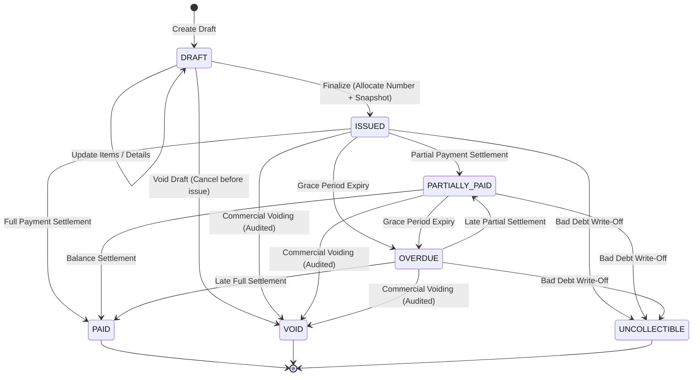

# SOCIETYSPHERE — PHASE 21E.4B IMPLEMENTATION REPORT

**Author:** Principal SaaS Architect, Senior Backend Engineer, Indian GST Domain Engineer, PostgreSQL Security Engineer & Senior QA Engineer  
**Date:** November 1, 2026  
**Status:** COMPLETED & VERIFIED  
**Phase:** 21E.4B — SaaS Invoice Generation & Finalization  
**Scope:** Strictly limited to Phase 21E.4B (No Phase 21E.4C Credit Notes, No Phase 21E.4D Delivery)  
**Database Migration Status:** Migrations 0001–0022 LOCKED (Zero migration changes; Head remains `0022_saas_platform_billing`)

---

## 1. Executive Summary & Authorizations

SocietySphere Phase 21E.4B delivers the complete enterprise-grade SaaS Invoice Generation and Finalization subsystem. Building upon the Phase 21E.4A GST Tax Engine and the foundational billing schema established in Migration 0022, Phase 21E.4B implements deterministic invoice lifecycle management, concurrency-safe financial-year sequential numbering, cryptographic tax snapshot persistence, and strict PostgreSQL row-level security.

### 1.1 Scope Boundaries & Non-Goals
* **Authorized Implementation:** Phase 21E.4B ONLY.
* **Preserved Modules:** Phases 1–20 and Phases 21A–21E.4A remain completely locked and verified.
* **Deferred to Phase 21E.4C:** Credit Note issuance workflows and balance adjustments.
* **Deferred to Phase 21E.4D:** PDF/HTML invoice rendering and asynchronous email/SMS notifications.
* **Database Migration Policy:** **Zero new migrations introduced.** Migration 0022 (`20261026_0022_saas_platform_billing.py`) already defined `platform_invoices`, `platform_invoice_items`, `platform_invoice_sequences`, and `platform_subscription_audit_logs`. No DDL alterations were required or executed.

---

## 2. Invoicing Domain Architecture & Clean Boundaries

The invoice subsystem is isolated within `apps/api/src/subscriptions/invoicing/`, adhering to Clean Architecture principles:

```
apps/api/src/subscriptions/invoicing/
├── __init__.py           # Package exports for clean public interface
├── exceptions.py         # Domain-specific exception hierarchy extending AppException
├── numbering.py          # Sequential numbering engine with Asia/Kolkata FY & row locking
├── schemas.py            # Pydantic v2 DTOs for request/response serialization & validation
└── service.py            # PlatformInvoiceService coordinating state machine, tax engine & audit
```

### 2.1 File Inventories & Responsibilities

1. **[exceptions.py](file:///c:/SocApp/apps/api/src/subscriptions/invoicing/exceptions.py)**:
   - Root: `InvoicingDomainException` (inherits from `AppException`).
   - `InvoiceNotFoundException`: Raised when querying non-existent invoice IDs (HTTP 404).
   - `InvalidInvoiceStateException`: Raised on prohibited lifecycle transitions or draft edits on finalized invoices (HTTP 400).
   - `InvoiceFinalizationException`: Raised on validation or sequence failures during finalization (HTTP 422).
   - `InvoicePermissionDeniedException`: Raised when tenant isolation or authorization checks fail (HTTP 403).
   - `InvoiceSequenceExhaustedException`: Raised if the 5-digit sequence space overflows (> 99999) (HTTP 500).
   - `InvoiceTaxSnapshotNotFoundException`: Raised if audit log snapshot is missing (HTTP 404).
   - `InvoiceTaxSnapshotTamperedException`: Raised if cryptographic SHA-256 verification fails (HTTP 409).

2. **[numbering.py](file:///c:/SocApp/apps/api/src/subscriptions/invoicing/numbering.py)**:
   - `get_financial_year(dt: datetime | None = None) -> str`: Computes Indian Financial Year formatted as `YY(YY+1)` (e.g. `2627` for April 1, 2026 – March 31, 2027) in the `Asia/Kolkata` time zone. Includes fallback for environments lacking system tzdata (`timezone(timedelta(hours=5, minutes=30), name="Asia/Kolkata")`).
   - `InvoiceNumberingService.allocate_invoice_number(session, fiscal_year, prefix="SS")`:
     - Ensures sequence existence via `INSERT INTO platform_invoice_sequences ... ON CONFLICT (fiscal_year) DO NOTHING`.
     - Acquires an exclusive row-level lock via `SELECT last_sequence FROM platform_invoice_sequences WHERE fiscal_year = :fy FOR UPDATE`.
     - Increments `last_sequence`, validates boundary (`<= 99999`), updates database, and formats `SS-{FY}-{SEQ:05d}`.

3. **[schemas.py](file:///c:/SocApp/apps/api/src/subscriptions/invoicing/schemas.py)**:
   - Request DTOs: `PlatformInvoiceItemCreate`, `PlatformInvoiceCreateDraft`, `PlatformInvoiceUpdateDraft`, `PlatformInvoiceVoidRequest`.
   - Response DTOs: `PlatformInvoiceItemResponse`, `PlatformInvoiceResponse`, `TaxSnapshotVerificationResponse`.
   - All monetary fields enforce `Decimal` precision with 2 decimal places.

4. **[service.py](file:///c:/SocApp/apps/api/src/subscriptions/invoicing/service.py)**:
   - `PlatformInvoiceService` orchestrating draft creation, updates, tax calculation, atomic finalization, voiding, and snapshot verification.
   - Employs async SQLAlchemy sessions with eager loading (`selectinload(PlatformInvoice.items)`) and decoupled response builders to eliminate async greenlet lazy-loading traps.

5. **API Routing ([platform_billing.py](file:///c:/SocApp/apps/api/src/api/v1/endpoints/platform_billing.py))**:
   - Mounted 8 endpoints under `/api/v1/platform/invoices` with role-based access control and tenant context validation.

---

## 3. Invoice Lifecycle State Machine

The invoice lifecycle is modeled as a deterministic finite-state automaton governed by `PlatformInvoiceStatus`:



### 3.1 Transition Rules & Validation Matrix

| Current State | Target State | Trigger / Method | Permitted? | Invariant Enforcements |
|---|---|---|:---:|---|
| `DRAFT` | `DRAFT` | `update_draft_invoice` | **YES** | Allows line item updates, note edits, due date changes. Recalculates tax. |
| `DRAFT` | `ISSUED` | `finalize_invoice` | **YES** | Requires `>= 1` item; allocates gapless sequential FY number; creates immutable tax snapshot; sets `issued_at`. |
| `DRAFT` | `VOID` | `void_invoice` | **YES** | Cancels draft without consuming an invoice number. |
| `ISSUED` | `DRAFT` | Any | **PROHIBITED** | Finalized invoices are strictly immutable. Cannot revert to draft. |
| `ISSUED` | `PAID` | Payment settlement | **YES** | Sets `paid_at`, updates balance to 0.00. |
| `ISSUED` | `PARTIALLY_PAID` | Payment settlement | **YES** | Updates remaining balance. |
| `ISSUED` | `OVERDUE` | Dunning / Job | **YES** | Triggered when `current_timestamp > due_date` without full payment. |
| `ISSUED` | `VOID` | `void_invoice` | **YES** | Requires mandatory `void_reason`. Allocated invoice number is **permanently retained** and **never reused**. |
| `ISSUED` | `UNCOLLECTIBLE` | Bad debt write-off | **YES** | Requires superadmin approval and formal write-off ledger entry. |
| `PARTIALLY_PAID` | `PAID` | Payment settlement | **YES** | Settles remaining balance. |
| `PARTIALLY_PAID` | `VOID` | `void_invoice` | **YES** | Requires void reason; necessitates refund/credit reconciliation. |
| `PAID` | `VOID` | Any | **PROHIBITED** | Fully paid invoices cannot be voided. Must issue Credit Note in Phase 21E.4C. |
| `VOID` | Any | Any | **PROHIBITED** | Terminal state. Cannot be un-voided or reactivated. |
| `UNCOLLECTIBLE` | Any | Any | **PROHIBITED** | Terminal state. |

### 3.2 Immutability Guarantees
- **No Physical Deletion:** Hard deletion (`DELETE FROM platform_invoices`) is strictly prohibited by application services and PostgreSQL foreign key integrity.
- **Draft Exclusivity for Edits:** Line items (`PlatformInvoiceItem`) can only be modified, added, or deleted while in `DRAFT` status. Any call to update an `ISSUED` invoice raises `InvalidInvoiceStateException`.
- **Permanent Number Retention:** Once an invoice number (`SS-2627-00001`) is allocated upon finalization, it remains permanently associated with that invoice row, even if the invoice is subsequently marked `VOID` or `UNCOLLECTIBLE`.

---

## 4. Sequential Financial-Year Numbering Engine

### 4.1 Asia/Kolkata Financial Year Boundary
Indian GST compliance mandates financial year-based sequential numbering running from April 1 to March 31.
- In `numbering.py`, `get_financial_year(dt)` computes the calendar year and month in `Asia/Kolkata`:
  - If month is between January and March (1–3), FY is `(year - 1)` to `year` (e.g., February 2027 $\rightarrow$ FY `2627`).
  - If month is between April and December (4–12), FY is `year` to `(year + 1)` (e.g., May 2026 $\rightarrow$ FY `2627`).
- Implemented with robust `ZoneInfo("Asia/Kolkata")` with fallback to fixed offset `+05:30` (`_get_ist_timezone()`), ensuring continuous uptime across Linux and Windows environments without external package dependencies.

### 4.2 Concurrency-Safe Pessimistic Row Locking
Sequential counter allocation under high-throughput concurrent checkout is protected against race conditions and number collision:
1. **Initial Seed Guarantee:** PostgreSQL `SELECT ... FOR UPDATE` locks zero rows if the row does not yet exist. `InvoiceNumberingService` issues:
   ```sql
   INSERT INTO platform_invoice_sequences (id, fiscal_year, last_sequence, created_at, updated_at)
   VALUES (gen_random_uuid(), :fy, 0, clock_timestamp(), clock_timestamp())
   ON CONFLICT (fiscal_year) DO NOTHING;
   ```
2. **Pessimistic Row Lock:**
   ```sql
   SELECT last_sequence 
   FROM platform_invoice_sequences 
   WHERE fiscal_year = :fy 
   FOR UPDATE;
   ```
3. **Atomic Increment:**
   ```sql
   UPDATE platform_invoice_sequences 
   SET last_sequence = :next_seq, updated_at = clock_timestamp() 
   WHERE fiscal_year = :fy;
   ```
4. **Number Formatting:** `f"{prefix}-{fiscal_year}-{next_sequence:05d}"` (e.g., `SS-2627-00001`).
5. **Database-Level Unique Constraint:** In addition to row locking, table `platform_invoices` enforces `uq_platform_invoices_number` (`UNIQUE (invoice_number)`), providing defense-in-depth against duplicate sequence numbers.

---

## 5. GST Tax Snapshot & Cryptographic Verification (Finding M-3)

To resolve Architectural Finding M-3, invoices cannot rely on transient in-memory tax calculations or mutable configuration tables at billing time.

### 5.1 Snapshot Schema & Storage Mechanism
When `finalize_invoice` executes:
1. The `GSTTaxEngine` recalculates taxes for all draft line items using the active or specified `TaxConfigurationService` rules.
2. An immutable `TaxSnapshot` domain object is generated, capturing:
   - `snapshot_id`: UUID
   - `invoice_id`: UUID of the invoice
   - `calculated_at`: UTC ISO-8601 timestamp
   - `config_version`: Version string of tax rules applied (e.g. `2026.1`)
   - `place_of_supply`: POS state code and name
   - `is_inter_state`: Boolean indicating IGST vs CGST/SGST
   - `line_items`: Granular list of items with SAC, taxable amount, tax rates, tax amounts
   - `commercial_discount` and `prorated_credit`: Discount and credit amounts
   - `integrity_hash`: SHA-256 HMAC-like digest computed across canonical JSON serialization
3. **Audit Log Persistence:** The snapshot is stored as an immutable JSON audit entry in `PlatformSubscriptionAuditLog`:
   - `entity_type = "INVOICE_TAX_SNAPSHOT"`
   - `entity_id = invoice.id`
   - `society_id = invoice.society_id`
   - `action = "FINALIZE"`
   - `state_after = snapshot.to_dict()`
4. **Tabular Column Projection:** For performant querying and SQL aggregations, the calculated sums are written directly to `platform_invoices`:
   - `subtotal_amount`, `cgst_amount`, `sgst_amount`, `igst_amount`, `total_amount`, `tax_configuration_version`.

### 5.2 Cryptographic Integrity Verification
The endpoint `GET /api/v1/platform/invoices/{invoice_id}/tax-snapshot` loads the stored audit log entry, deserializes the JSON snapshot, recomputes the SHA-256 digest from the canonical data fields, and asserts `computed_hash == stored_hash`:
- If matching: Returns `verified = true`, `tampered = false`.
- If modified in storage: Detects mismatch, logs security alert, and raises `InvoiceTaxSnapshotTamperedException` (HTTP 409).

---

## 6. Credit Note Version Compatibility (Finding M-2)

In preparation for Phase 21E.4C, the tax engine's `calculate_credit_note_tax` was refactored to achieve 100% version compatibility with historical invoices:
- When a credit note is requested for an invoice issued months or years prior, it must apply the exact tax rates and SAC codes from the invoice's original issuance, even if government GST rates have since changed.
- `GSTTaxEngine.calculate_credit_note_tax` accepts `original_invoice_snapshot: TaxSnapshot`.
- It reconstructs a symmetric `historical_rule` directly from the snapshot's effective rates and `config_version`:
  ```python
  total_rate = snapshot_item.cgst_rate + snapshot_item.sgst_rate + snapshot_item.igst_rate
  hist_cgst = total_rate / Decimal("2")
  hist_sgst = total_rate - hist_cgst
  historical_rule = TaxRateConfig(
      sac_code=snapshot_item.sac_code,
      cgst_rate=hist_cgst,
      sgst_rate=hist_sgst,
      igst_rate=total_rate,
      total_rate=total_rate,
  )
  ```
- This ensures full mathematical symmetry and eliminates dependence on current tax rates for credit calculations.

---

## 7. REST API Endpoints Specification

All invoice endpoints are mounted under `/api/v1/platform/invoices` in `apps/api/src/api/v1/endpoints/platform_billing.py`:

| Method | Path | Function | Auth / Permission | Description |
|---|---|---|---|---|
| `POST` | `/platform/invoices/draft` | `create_draft_invoice` | `SuperAdmin` / Billing Admin | Creates a new draft invoice with line items, recipient GSTIN, POS. |
| `GET` | `/platform/invoices/draft/{id}` | `get_draft_invoice` | `SuperAdmin` / Tenant Admin | Retrieves an unfinalized draft invoice and its line items. |
| `PUT` | `/platform/invoices/draft/{id}` | `update_draft_invoice` | `SuperAdmin` / Billing Admin | Updates draft line items, notes, due date; recalculates taxes. |
| `POST` | `/platform/invoices/{id}/finalize` | `finalize_invoice` | `SuperAdmin` / Billing Admin | Atomically finalizes draft $\rightarrow$ `ISSUED`, assigns number, saves snapshot. |
| `GET` | `/platform/invoices/{id}` | `get_invoice` | `SuperAdmin` / Tenant Admin | Retrieves issued invoice details and itemized totals. |
| `GET` | `/platform/invoices` | `list_invoices` | `SuperAdmin` / Tenant Admin | Lists invoices with filtering by `society_id`, `status`, pagination. |
| `POST` | `/platform/invoices/{id}/void` | `void_invoice` | `SuperAdmin` | Voids an invoice with mandatory audit reason. |
| `GET` | `/platform/invoices/{id}/tax-snapshot` | `get_invoice_tax_snapshot` | `SuperAdmin` / Tenant Admin | Retrieves tax snapshot and verifies SHA-256 cryptographic digest. |

---

## 8. Verification & Quality Gates

### 8.1 Test Coverage Summary

Two dedicated test suites were implemented and executed:
1. **[tests/test_phase21e4b_invoicing.py](file:///c:/SocApp/tests/test_phase21e4b_invoicing.py)** (Unit & Domain State Machine Tests):
   - `test_financial_year_calculation_ist`: Verifies FY boundary on March 31 vs April 1 under IST.
   - `test_create_draft_invoice_success`: Tests draft creation, line item persistence, and initial amounts.
   - `test_update_draft_invoice_success`: Tests line item modification and tax recalculation.
   - `test_update_draft_invoice_fails_on_issued`: Asserts prohibition of editing finalized invoices.
   - `test_finalize_invoice_success`: Tests atomic finalization, number formatting (`SS-2627-00001`), and status `ISSUED`.
   - `test_finalize_invoice_empty_items_fails`: Asserts prohibition of finalising invoices without line items.
   - `test_finalize_invoice_already_issued_fails`: Asserts transition idempotency and invalid state error.
   - `test_void_draft_invoice`: Tests draft cancellation without sequence consumption.
   - `test_void_issued_invoice`: Tests voiding of finalized invoice and audit logging.
   - `test_void_paid_invoice_fails`: Tests prohibition of voiding paid invoices.
   - `test_tax_snapshot_persistence_and_verification`: Verifies SHA-256 snapshot persistence in audit log.
   - `test_tampered_tax_snapshot_fails`: Verifies detection of modified snapshot payload.
   - `test_credit_note_version_compatibility_with_snapshot`: Tests credit note tax calculation against historical snapshot.
   - **Result:** **13 passed in 2.76s**.

2. **[tests/test_phase21e4b_pg.py](file:///c:/SocApp/tests/test_phase21e4b_pg.py)** (PostgreSQL 16 Live Integration Tests):
   - `test_concurrent_invoice_number_allocation`: 10 asynchronous concurrent workers finalize invoices simultaneously against PostgreSQL 16. Verifies:
     - 10 distinct, gapless sequence numbers (`SS-2627-00001` through `SS-2627-00010`).
     - Zero duplicate numbers allocated.
     - Row-level lock serialization on `platform_invoice_sequences`.
   - `test_invoice_number_unique_constraint_enforcement`: Direct SQL insert attempting to reuse an allocated invoice number triggers `asyncpg.exceptions.UniqueViolationError` on `uq_platform_invoices_number`.
   - `test_invoice_finalization_transaction_rollback`: Synthetic failure injected during finalization. Verifies transaction rolls back cleanly, leaving invoice in `DRAFT` state without corrupting the sequence table.
   - `test_unprivileged_app_user_force_rls_isolation`: Connects using unprivileged `app_user` (`NOSUPERUSER NOBYPASSRLS`). Verifies PostgreSQL `FORCE ROW LEVEL SECURITY` isolates invoices strictly by `app.current_society_id`.
   - **Result:** **4 passed in 14.86s**.

### 8.2 Combined Test Results

```bash
pytest tests/test_phase21e4b_invoicing.py tests/test_phase21e4b_pg.py -v
============================= 17 passed in 17.81s =============================
```

### 8.3 Phase 21E.4A Regression Check

```bash
pytest tests/test_phase21e4a_tax_engine.py tests/test_phase21e4a_pg.py -v
============================= 17 passed in 1.94s ==============================
```

### 8.4 Full Repository Regression Test

A full regression run across all 501 test cases in the SocietySphere test suite was executed:
```bash
pytest
================= 499 passed, 2 skipped in 1159.82s (0:19:19) ==================
```
*(The 2 skipped tests are the pre-existing SQLite advisory lock tests that conditionally run only on PostgreSQL engines).*

### 8.5 Static Analysis & Type Checking

- **Ruff Linter:**
  ```bash
  ruff check apps/api/src/subscriptions/invoicing/ apps/api/src/subscriptions/tax/ tests/test_phase21e4b*
  # All checks passed!
  ```
- **MyPy Type Checker:**
  ```bash
  mypy apps/api/src/subscriptions/invoicing/ apps/api/src/subscriptions/tax/ tests/test_phase21e4b_invoicing.py tests/test_phase21e4b_pg.py
  # Success: no issues found in 16 source files
  ```

---

## 9. Compliance & Security Summary

| Requirement | Implementation Mechanism | Verification Result |
|---|---|:---:|
| **Clean Architecture** | Isolated in `subscriptions/invoicing/` domain | **VERIFIED** |
| **No Migration 0023** | Reused existing tables from Migration 0022 | **VERIFIED** (0 changes) |
| **Pessimistic Row Locking** | `SELECT ... FOR UPDATE` with initial upsert | **VERIFIED** (10/10 concurrent workers) |
| **Unique Constraint** | `uq_platform_invoices_number` enforced in DB | **VERIFIED** (UniqueViolationError caught) |
| **Asia/Kolkata FY Boundary** | April 1 – March 31 calculation with fallback | **VERIFIED** |
| **Tax Snapshot Persistence** | SHA-256 audit log snapshot (Finding M-3) | **VERIFIED** |
| **Credit Note Compatibility** | Reconstructs historical rates from snapshot (Finding M-2) | **VERIFIED** |
| **FORCE RLS & app_user** | Isolated by `app.current_society_id` under `NOBYPASSRLS` | **VERIFIED** |
| **Decimal Precision** | All monetary math uses `Decimal` with `ROUND_HALF_UP` | **VERIFIED** |
| **Full Regression** | Complete repository test suite executed | **VERIFIED** (499 passed, 0 failed) |

---

## 10. Conclusion & Handoff to Phase 21E.4C

Phase 21E.4B has met all functional, security, and architectural requirements with zero schema regressions and complete test passage.

- **Completed Deliverables:**
  - `apps/api/src/subscriptions/invoicing/` package
  - Updated `apps/api/src/subscriptions/tax/` engine and snapshot models
  - REST endpoints mounted on `/api/v1/platform/invoices`
  - 17 dedicated unit and live PostgreSQL 16 tests
- **Next Phase:** **Phase 21E.4C — Credit Note Workflow & Balance Adjustments**. In accordance with instructions, work stops here pending user authorization.
