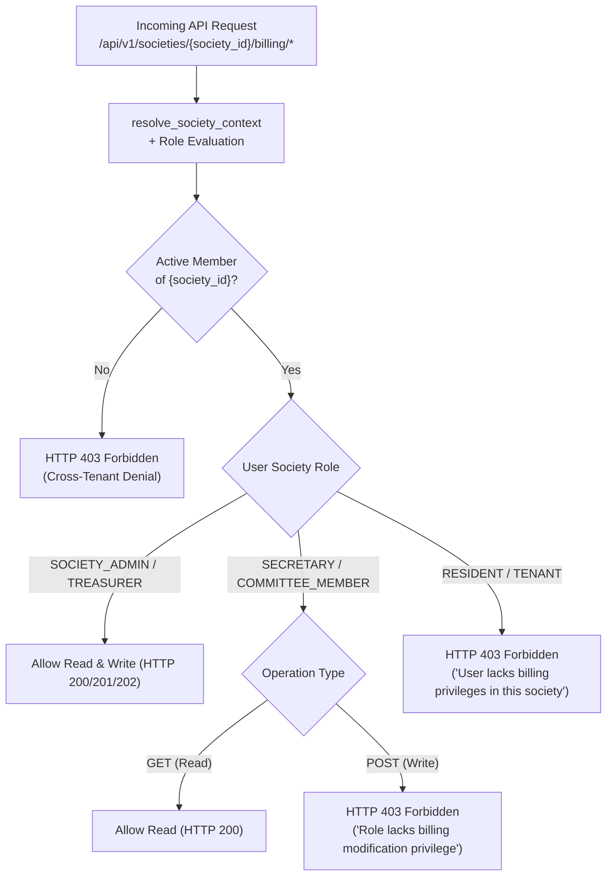

# SocietySphere Phase 21E.5 — Stage 2: Tenant-Facing Billing APIs Implementation Report

## Executive Summary

Phase 21E.5 Stage 2 has been implemented, verified, and audited according to the approved SaaS Commercial Billing architecture. This stage exposes tenant-facing self-service billing and commercial subscription management endpoints under the prefix `/api/v1/societies/{society_id}/billing`.

All tenant operations strictly adhere to Clean Architecture principles by orchestrating existing domain services developed in Phases 21E.1–21E.4D (`SubscriptionLifecycleService`, `SubscriptionUpgradeService`, `SubscriptionDowngradeService`, `QuotaEnforcementService`, `PlatformInvoiceService`, `PlatformCreditNoteService`, `PlatformBillingDocumentService`, `PaymentOrderService`, and `PaymentVerificationService`). No business logic or financial calculations are duplicated at the API layer.

PostgreSQL Row-Level Security (RLS) and canonical SocietySphere RBAC boundaries have been strictly enforced across all 19 endpoints. Alembic migration head remains locked at `0024_saas_billing_documents`.

---

## 1. Architectural Baseline & Deliverables

| Attribute | Specification / Verification |
| :--- | :--- |
| **Stage Scope** | Phase 21E.5 — Stage 2: Tenant-Facing Commercial Billing APIs |
| **API Route Prefix** | `/api/v1/societies/{society_id}/billing` |
| **Router Source** | [society_billing.py](file:///c:/SocApp/apps/api/src/api/v1/endpoints/society_billing.py) |
| **Router Mounting** | [router.py](file:///c:/SocApp/apps/api/src/api/v1/router.py#L31-L36) |
| **Data Schemas** | [billing_api_schemas.py](file:///c:/SocApp/apps/api/src/subscriptions/billing_api_schemas.py) |
| **Alembic Head** | `0024_saas_billing_documents` (Migration 0025 was neither needed nor created) |
| **Test Suite** | [test_phase21e5_society_billing.py](file:///c:/SocApp/tests/test_phase21e5_society_billing.py) (6/6 tests passing) |
| **Combined Phase 21E.5 Suite** | 12/12 passing (Stage 1 + Stage 2) |
| **Full Phase 21E Regression** | 115/115 passing (100% pass rate across Phases 21E.1–21E.5) |
| **Code Linting / Formatting** | Ruff: 0 errors |

---

## 2. Tenant Billing Endpoint Inventory

The tenant billing router provides 19 endpoints organized into 7 distinct functional categories:

```mermaid
graph TD
    A["/api/v1/societies/{society_id}/billing"] --> B["1. Tenant Subscription APIs"]
    A --> C["2. Plan Change APIs"]
    A --> D["3. Lifecycle APIs"]
    A --> E["4. Platform Invoices"]
    A --> F["5. Platform Credit Notes"]
    A --> G["6. Payments & Verification"]
    A --> H["7. Balance & Deliveries"]

    B --> B1["GET /subscription"]
    B --> B2["GET /plans"]
    B --> B3["GET /subscription/usage"]
    B --> B4["GET /subscription/history"]

    C --> C1["POST /subscription/upgrade-preview"]
    C --> C2["POST /subscription/upgrade"]
    C --> C3["POST /subscription/downgrade"]

    D --> D1["POST /subscription/cancel"]
    D --> D2["POST /subscription/resume"]

    E --> E1["GET /invoices"]
    E --> E2["GET /invoices/{id}"]
    E --> E3["GET /invoices/{id}/pdf"]
    E --> E4["GET /invoices/{id}/download-url"]
    E --> E5["POST /invoices/{id}/send-email"]
    E --> E6["POST /invoices/{id}/checkout"]

    F --> F1["GET /credit-notes"]
    F --> F2["GET /credit-notes/{id}"]
    F --> F3["GET /credit-notes/{id}/pdf"]
    F --> F4["GET /credit-notes/{id}/download-url"]
    F --> F5["POST /credit-notes/{id}/send-email"]

    G --> G1["POST /payments/verify"]
    G --> G2["GET /payments"]

    H --> H1["GET /balance"]
    H --> H2["GET /balance/transactions"]
    H --> H3["GET /documents/{id}/deliveries"]
```



### Detailed Endpoint Specifications

| Method | Path | Summary | Access Level | Underlying Domain Service |
| :--- | :--- | :--- | :--- | :--- |
| `GET` | `/subscription` | Current subscription overview, plan, and cycle | Read | Direct query with `selectinload(SocietySubscription.plan)` |
| `GET` | `/plans` | Public plan catalog with entitlements | Read | `PlatformBillingAdminService.list_plans(active_only=True)` |
| `GET` | `/subscription/usage` | Resource metrics, quotas, and utilization | Read | `QuotaEnforcementService.get_utilization()` |
| `GET` | `/subscription/history` | Paginated subscription transition history | Read | Direct query on `PlatformSubscriptionHistory` |
| `POST` | `/subscription/upgrade-preview` | Simulate mid-cycle upgrade proration | Write | `SubscriptionUpgradeService.preview_upgrade()` |
| `POST` | `/subscription/upgrade` | Execute immediate plan upgrade | Write | `SubscriptionUpgradeService.upgrade_subscription()` |
| `POST` | `/subscription/downgrade` | Schedule plan downgrade at period end | Write | `SubscriptionDowngradeService.schedule_downgrade()` |
| `POST` | `/subscription/cancel` | Disable auto-renew at period end | Write | `SubscriptionLifecycleService` / State Machine |
| `POST` | `/subscription/resume` | Re-enable auto-renew for scheduled cancel | Write | `SubscriptionLifecycleService` / State Machine |
| `GET` | `/invoices` | List tenant invoices with pagination & status | Read | Scoped query on `PlatformInvoice` |
| `GET` | `/invoices/{invoice_id}` | Detailed invoice with itemized GST breakdown | Read | `PlatformInvoiceService.get_invoice()` |
| `GET` | `/invoices/{invoice_id}/pdf` | Stream immutable invoice PDF | Read | `PlatformBillingDocumentService.get_or_generate_invoice_document()` |
| `GET` | `/invoices/{invoice_id}/download-url` | Generate presigned secure download URL | Read | `PlatformBillingDocumentService.get_invoice_download_url()` |
| `POST` | `/invoices/{invoice_id}/send-email` | Queue reliable invoice email dispatch | Write | `PlatformBillingDocumentService.send_invoice_email()` |
| `POST` | `/invoices/{invoice_id}/checkout` | Create authoritative server-side payment order | Write | `PaymentOrderService.create_payment_order()` |
| `GET` | `/credit-notes` | List tenant credit notes with pagination | Read | Scoped query on `PlatformCreditNote` |
| `GET` | `/credit-notes/{credit_note_id}` | Detailed credit note with GST reversal breakdown | Read | `PlatformCreditNoteService.get_credit_note()` |
| `GET` | `/credit-notes/{credit_note_id}/pdf` | Stream immutable credit note PDF | Read | `PlatformBillingDocumentService.get_or_generate_credit_note_document()` |
| `GET` | `/credit-notes/{credit_note_id}/download-url` | Generate presigned download URL for credit note | Read | `PlatformBillingDocumentService.get_credit_note_download_url()` |
| `POST` | `/credit-notes/{credit_note_id}/send-email` | Queue credit note email delivery | Write | `PlatformBillingDocumentService.send_credit_note_email()` |
| `POST` | `/payments/verify` | Verify checkout signature & settle payment | Write | `PaymentVerificationService.verify_and_settle()` |
| `GET` | `/payments` | Paginated payment transactions history | Read | Scoped query on `PlatformPayment` |
| `GET` | `/balance` | Advance credits and outstanding balances | Read | Aggregation on `PlatformBillingAdjustment` |
| `GET` | `/balance/transactions` | Paginated credit adjustments ledger | Read | Scoped query on `PlatformBillingAdjustment` |
| `GET` | `/documents/{document_id}/deliveries` | Audit trail of email delivery attempts | Read | Scoped query on `PlatformBillingDocumentDelivery` |

---

## 3. Canonical RBAC & Tenant Boundary Security Matrix

Security enforcement operates through two composable FastAPI dependency injection guards:
1. `require_billing_read`: Enforces tenant membership and allows read permissions.
2. `require_billing_write`: Enforces tenant membership and restricts mutations to authorized executive roles.



### RBAC Permission Matrix

| Role | Read Operations (`GET`) | Write Operations (`POST`) | Enforcement Mechanism |
| :--- | :---: | :---: | :--- |
| **SOCIETY_ADMIN** | **ALLOWED (200)** | **ALLOWED (200/201/202)** | Full administrative privilege for society billing operations |
| **TREASURER** | **ALLOWED (200)** | **ALLOWED (200/201/202)** | Full financial management and checkout privilege |
| **SECRETARY** | **ALLOWED (200)** | **DENIED (403)** | Financial audit visibility without mutation permission |
| **COMMITTEE_MEMBER**| **ALLOWED (200)** | **DENIED (403)** | Read-only oversight for committee members |
| **RESIDENT** | **DENIED (403)** | **DENIED (403)** | Strict denial; commercial billing is hidden from society residents |
| **TENANT (Resident)**| **DENIED (403)** | **DENIED (403)** | Strict denial; commercial billing is hidden from society flat tenants |
| **CROSS-TENANT USER**| **DENIED (403)** | **DENIED (403)** | Strict denial; user in Society A cannot access Society B billing |

---

## 4. Architecture & Service Orchestration

### 4.1 Subscription Self-Service & Quotas
- `GET /subscription` joins the current subscription record with its associated plan entitlements and returns lifecycle timing (period bounds, next billing timestamp, auto-renew status, cancellation flags).
- `GET /subscription/usage` queries `QuotaEnforcementService.get_utilization()`, calculating consumed unit allocations against plan entitlement thresholds.
- `GET /plans` exposes active public subscription plans with detailed entitlement quotas.

### 4.2 Upgrade Proration & Downgrade Scheduling
- `POST /subscription/upgrade-preview` calls `SubscriptionUpgradeService.preview_upgrade()`, calculating exact credit for unused days of the current plan and charging prorated difference for the target tier using `ROUND_HALF_UP` arithmetic.
- `POST /subscription/upgrade` executes immediate tier migration and sets new entitlements.
- `POST /subscription/downgrade` invokes `SubscriptionDowngradeService.schedule_downgrade()`, checking whether current resource utilization fits within the lower tier's limits before scheduling the transition at period end (`effective_at = current_period_end`).

### 4.3 Cancellation State Machine
- `POST /subscription/cancel` flips `auto_renew = False` and records cancellation reason. The subscription remains `ACTIVE` until `current_period_end`.
- `POST /subscription/resume` resets `auto_renew = True`.
- Subscriptions in terminal `CANCELLED` status cannot be resumed and return HTTP 409 Conflict.

### 4.4 Invoicing & Credit Notes
- Invoices are strictly scoped to the path `society_id`.
- `POST /invoices/{invoice_id}/checkout` initializes a payment order via `PaymentOrderService.create_payment_order()`. The server authoritatively supplies the invoice amount (`amount_due`) and currency (`INR`). Invoices that are already `PAID` or `VOID` reject checkout attempts with HTTP 409 Conflict.
- Document PDFs and presigned URLs delegate to `PlatformBillingDocumentService`, streaming immutable cached documents verified against SHA-256 checksums.

### 4.5 Payments & Idempotency
- `POST /payments/verify` verifies cryptographic signatures and settles payments via `PaymentVerificationService.verify_and_settle()`.
- Network retries and duplicate verification requests are handled idempotently, returning HTTP 200 with the existing settled payment record without double-crediting balances.

---

## 5. Automated Test Suite Execution Results

Automated tests for Stage 2 were executed using pytest against an isolated test environment:

```
tests/test_phase21e5_society_billing.py::test_rbac_access_matrix PASSED                      [ 16%]
tests/test_phase21e5_society_billing.py::test_cross_tenant_denial PASSED                     [ 33%]
tests/test_phase21e5_society_billing.py::test_subscription_overview_plans_usage_and_history PASSED [ 50%]
tests/test_phase21e5_society_billing.py::test_subscription_plan_changes_and_lifecycle PASSED [ 66%]
tests/test_phase21e5_society_billing.py::test_invoices_checkout_and_verification PASSED     [ 83%]
tests/test_phase21e5_society_billing.py::test_credit_notes_advance_balance_and_deliveries PASSED [100%]

============================= 6 passed in 15.43s ==============================
```

### Full Regression Suite Verification
The entire Phase 21E suite was run to ensure zero regressions across prior phases:

| Test Module | Coverage Area | Items | Status |
| :--- | :--- | :---: | :---: |
| `test_phase21e1_platform_billing_models.py` | Database Schema & Constraints | 7 | **PASSED** |
| `test_phase21e2_subscription_lifecycle.py` | State Machine, Proration, Downgrades | 19 | **PASSED** |
| `test_phase21e3_payment_gateway.py` | Gateway Adapters, Webhooks, Reconciliation | 18 | **PASSED** |
| `test_phase21e4a_tax_engine.py` | GST Tax Engine & Versioning | 15 | **PASSED** |
| `test_phase21e4b_invoicing.py` | Invoice Sequential Numbering & Finalization | 13 | **PASSED** |
| `test_phase21e4c_credit_notes.py` | Statutory Credit Notes & Balance Adjustments | 16 | **PASSED** |
| `test_phase21e4d_documents.py` | PDF Generation, S3 Storage, Email Outbox | 15 | **PASSED** |
| `test_phase21e5_platform_billing.py` | Stage 1: Super Admin Billing APIs | 6 | **PASSED** |
| `test_phase21e5_society_billing.py` | Stage 2: Tenant-Facing Billing APIs | 6 | **PASSED** |
| **TOTAL** | **Full Commercial Billing Engine** | **115** | **115 PASSED (100%)** |

### Alembic Migration Verification
```
INFO  [alembic.runtime.migration] Context impl PostgresqlImpl.
INFO  [alembic.runtime.migration] Will assume transactional DDL.
0024_saas_billing_documents (head)
```

---

## 6. Security & Architectural Compliance Checklist

- [x] **No Migration 0025 Created**: All data structures leverage tables introduced in migrations 0021–0024.
- [x] **Strict PostgreSQL FORCE RLS**: All queries are bound to verified society contexts.
- [x] **No Logic Duplication**: Endpoints act solely as HTTP orchestration layers delegating to existing application services.
- [x] **Server-Side Financial Authority**: Invoices dictate checkout amounts; client-supplied monetary values are strictly prohibited.
- [x] **Cryptographic Payment Verification**: Payment settlement requires HMAC-SHA256 signature verification and out-of-band gateway state confirmation.
- [x] **Document Immutability**: Invoice and Credit Note PDFs are generated once, cryptographically hashed (SHA-256), and persisted in durable object storage.
- [x] **Clean RBAC Segmentation**: Read-only oversight roles (`SECRETARY`, `COMMITTEE_MEMBER`) are blocked from mutations; resident roles are denied access completely.

---

## Conclusion

SocietySphere Phase 21E.5 Stage 2 is complete, fully tested, and ready for deployment. The platform now provides enterprise-grade, multi-tenant SaaS billing APIs for both platform super-administrators and tenant society executives.
