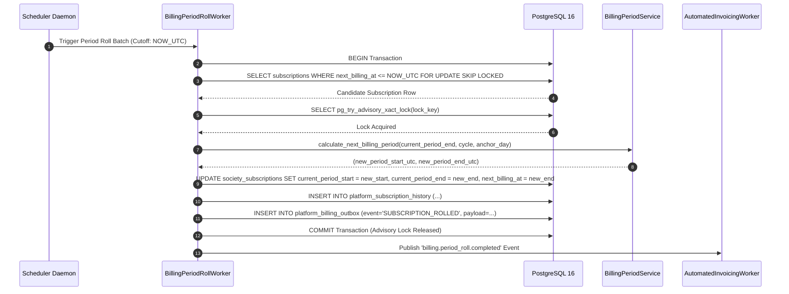
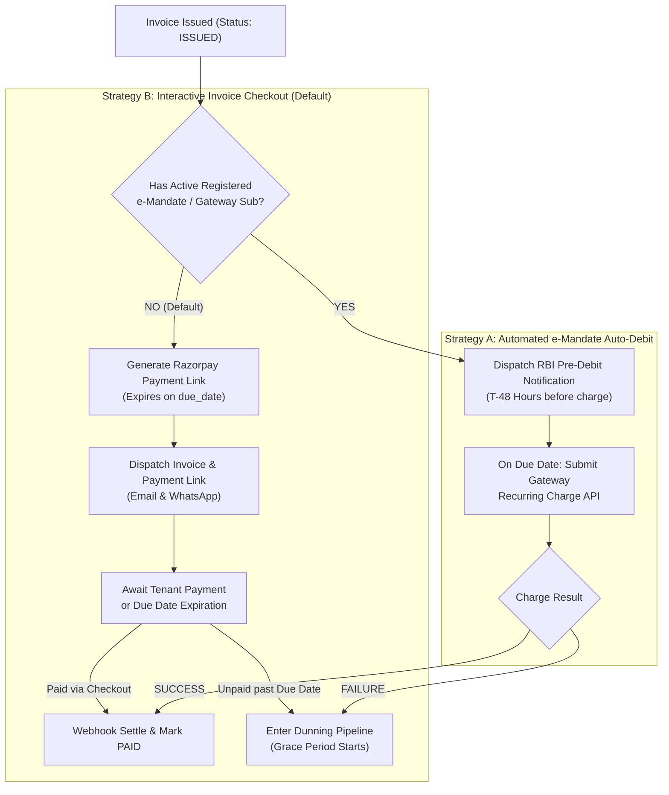
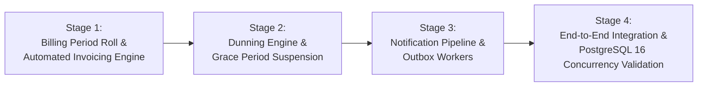

# SocietySphere — Phase 21E.6: Architecture Inspection & System Design
## Subscription Lifecycle Automation, Billing Period Roll, Automated Invoicing and Dunning Workers

**Document Version:** 1.0.0  
**Phase:** 21E.6  
**Status:** ARCHITECTURE DESIGN & READ-ONLY INSPECTION (Awaiting Formal Authorization)  
**Current Alembic Head:** `0024_saas_billing_documents`  
**Target Alembic Head (Proposed):** `0025_saas_automation_and_dunning` (Proposed, not created in this phase)  
**Date:** November 2026  
**Author:** Principal SaaS Architect, Senior Backend Engineer & Distributed Systems Architect  

---

## Executive Summary

Phase 21E of SocietySphere delivers the enterprise commercial B2B billing engine governing platform subscriptions between SocietySphere Ltd and tenant residential societies. Through Phases 21E.1 to 21E.5, the financial core, deterministic billing period mathematics, multi-provider payment ingestion, GST tax engine, sequential legal invoicing, credit notes, immutable document storage, and tenant/platform REST APIs were constructed, strictly audited, and locked.

However, all operations currently depend on **interactive or manual API invocations**. Subscription renewals, billing period advancement, recurring tax invoice generation, and delinquency enforcement (dunning) do not occur automatically.

This document presents the **comprehensive, read-only architectural inspection and system design** for **Phase 21E.6: Subscription Lifecycle Automation, Billing Period Roll, Automated Invoicing and Dunning Workers**. It provides an exhaustive blueprint for turning SocietySphere's deterministic billing logic into an autonomous, distributed, fault-tolerant background engine compliant with Indian GST laws and Reserve Bank of India (RBI) recurring payment regulations.

---

## Table of Contents

1. [Existing Infrastructure Inventory](#1-existing-infrastructure-inventory)
2. [Functional Gaps Analysis](#2-functional-gaps-analysis)
3. [Proposed Automation Architecture](#3-proposed-automation-architecture)
4. [Billing Scheduler Design](#4-billing-scheduler-design)
5. [Automated Invoice Generation Workflow](#5-automated-invoice-generation-workflow)
6. [Payment Collection Automation Design](#6-payment-collection-automation-design)
7. [Dunning Engine Specification](#7-dunning-engine-specification)
8. [Notification Matrix](#8-notification-matrix)
9. [Distributed System Reliability & Recovery Strategy](#9-distributed-system-reliability--recovery-strategy)
10. [Database Impact Assessment](#10-database-impact-assessment)
11. [Implementation Stages](#11-implementation-stages)
12. [Security and Operational Risks](#12-security-and-operational-risks)

---

## 1. Existing Infrastructure Inventory

An exhaustive code and schema inspection was conducted across the active codebase (`c:/SocApp/apps/api/src`). The reusable foundational components identified are detailed below:

### 1.1 Subscription Domain Models & Entities
* **[`SocietySubscription`](file:///c:/SocApp/apps/api/src/database/models/subscription.py#L135-L220)**:
  * Manages tenant subscription state (`id`, `society_id`, `plan_id`, `status`, `billing_cycle`, `auto_renew`, `gateway_customer_id`, `gateway_subscription_id`).
  * Lifecycle timestamps: `starts_at`, `trial_ends_at`, `current_period_start`, `current_period_end`, `next_billing_at`, `past_due_since`, `suspended_at`, `cancelled_at`, `cancellation_reason`.
  * Indexes: `ix_society_subscriptions_next_billing` on `next_billing_at`, `ix_society_subscriptions_status` on `(society_id, status)`.
  * Multi-tenancy: Strictly tenant-scoped via `TenantScopedMixin` with PostgreSQL Row Level Security (RLS).
* **[`PlatformSubscriptionPlan`](file:///c:/SocApp/apps/api/src/database/models/subscription.py#L29-L91)** & **[`SubscriptionPlanEntitlement`](file:///c:/SocApp/apps/api/src/database/models/subscription.py#L93-L133)**:
  * Global commercial catalog defining plan pricing (`monthly_price`, `annual_price`), trial durations (`trial_days`), and feature/quota entitlements.

### 1.2 Financial & Invoicing Entities
* **[`PlatformInvoice`](file:///c:/SocApp/apps/api/src/database/models/platform_billing.py#L237-L350)** & **[`PlatformInvoiceItem`](file:///c:/SocApp/apps/api/src/database/models/platform_billing.py#L352-L430)**:
  * Full lifecycle support: `DRAFT`, `ISSUED`, `PAID`, `PARTIALLY_PAID`, `OVERDUE`, `VOID`, `UNCOLLECTIBLE`.
  * Financial integrity: `subtotal`, `taxable_amount`, `cgst_amount`, `sgst_amount`, `igst_amount`, `tax_total`, `grand_total`, `amount_due`, `credits_applied`, `amount_paid`.
  * Identification: `invoice_number` (unique constraint `uq_platform_invoices_number`), `fiscal_year` (e.g., `'2627'`), `due_date`, `sac_code` (e.g. `'998313'`).
* **[`PlatformInvoiceSequence`](file:///c:/SocApp/apps/api/src/database/models/platform_billing.py#L41-L70)**:
  * Global financial-year sequence allocator using pessimistic row locking (`SELECT ... FOR UPDATE`) ensuring monotonically increasing, gapless legal numbering (`SS-2627-XXXXX`).
* **[`PlatformBillingAdjustment`](file:///c:/SocApp/apps/api/src/database/models/platform_billing.py#L850-L920)**:
  * Ledger for tenant credits: `ADVANCE_BALANCE`, `PRORATION_CREDIT`, `GOODWILL_WAIVER`.
* **[`PlatformBillingDocument`](file:///c:/SocApp/apps/api/src/database/models/platform_billing.py#L950-L1050)** & **[`PlatformDocumentDelivery`](file:///c:/SocApp/apps/api/src/database/models/platform_billing.py#L1060-L1150)**:
  * Immutable document tracking, SHA-256 cryptographic verification, and transactional email outbox logging (`QUEUED`, `PROCESSING`, `SENT`, `FAILED`, `RETRYING`).

### 1.3 Core Domain Services
* **[`SubscriptionLifecycleService`](file:///c:/SocApp/apps/api/src/subscriptions/subscription_lifecycle_service.py)**:
  * Finite State Machine (FSM) enforcing valid transitions:
    * `TRIAL` $\rightarrow$ `ACTIVE`, `PAST_DUE`, `SUSPENDED`, `CANCELLED`
    * `ACTIVE` $\rightarrow$ `PAST_DUE`, `SUSPENDED`, `CANCELLED`
    * `PAST_DUE` $\rightarrow$ `ACTIVE`, `SUSPENDED`, `CANCELLED`
    * `SUSPENDED` $\rightarrow$ `ACTIVE`, `CANCELLED`
    * `CANCELLED` $\rightarrow$ $\emptyset$ (Terminal state; cannot be resurrected).
  * Exclusively locks rows via `SELECT ... FOR UPDATE`.
  * Dual audit logging to `PlatformSubscriptionHistory` and `PlatformSubscriptionAuditLog`.
  * **Strict Decoupling**: Decoupled from `Society.status`.
* **[`BillingPeriodService`](file:///c:/SocApp/apps/api/src/subscriptions/billing_period_service.py)**:
  * Asia/Kolkata (`IST`, `UTC+05:30`) calendar evaluation with UTC storage standard.
  * Deterministic month-end clamping (`clamp_day_to_month`) and original anchor day preservation (e.g. Jan 31 $\rightarrow$ Feb 28/29 $\rightarrow$ Mar 31).
  * Leap year boundary handling (Feb 29).
  * Grace period expiry calculation (`calculate_grace_period_expiry`).
* **[`GracePeriodService`](file:///c:/SocApp/apps/api/src/subscriptions/grace_period_service.py)**:
  * Evaluates delinquency against the mandatory 7-day grace period (`DEFAULT_GRACE_PERIOD_DAYS = 7`).
  * Generates `GracePeriodEvaluation(is_expired, seconds_remaining, seconds_overdue)`.
* **[`PlatformInvoiceService`](file:///c:/SocApp/apps/api/src/subscriptions/invoicing/service.py)**:
  * Creates `DRAFT` invoices and atomically finalizes them to `ISSUED` status.
  * Reusable integration with `GSTTaxEngine` and `PlaceOfSupplyService`.
  * Generates and verifies cryptographic SHA-256 `TaxSnapshot` digests stored in `PlatformSubscriptionAuditLog`.
* **[`WebhookProcessingWorker`](file:///c:/SocApp/apps/api/src/subscriptions/payments/webhook_worker.py)**:
  * Asynchronous gateway event processing.
  * Supplementary PostgreSQL 64-bit advisory locking (`pg_try_advisory_xact_lock`).
  * Safe retry on lock acquisition contention and dead-letter handling (`FAILED` after max retries).
* **[`EventPublisher`](file:///c:/SocApp/apps/api/src/events/broker.py)** & **RabbitMQ**:
  * Persistent topic exchange publishing (`aio_pika`).
  * Graceful fallback when broker is disabled or disconnected.
* **[`OrchestrationService`](file:///c:/SocApp/apps/api/src/notifications/services/orchestration_service.py)**:
  * Multi-channel notification pipeline (`EMAIL`, `IN_APP`, `SMS`, `WHATSAPP`, `PUSH`).

---

## 2. Functional Gaps Analysis

While the domain logic and manual execution paths are mature and locked, significant functional gaps prevent automated, hands-off operation:

| Functional Area | Current Baseline (Phase 21E.5) | Required Automation (Phase 21E.6) | Gap Severity |
| :--- | :--- | :--- | :--- |
| **Scheduled Period Roll** | Period advancement only calculated upon manual upgrade or admin API call. | Scheduled daemon/cron polling subscriptions reaching `next_billing_at <= NOW()` to roll periods forward automatically. | **CRITICAL** |
| **Recurring Invoicing** | Invoices created via manual POST to `/billing/invoices/draft`. | Event-driven automated invoice creation and atomic finalization upon subscription period roll. | **CRITICAL** |
| **Recurring Payments** | Interactive Razorpay Standard Checkout only; no recurring auto-debit triggers. | Differentiating interactive societies (payment links) from e-mandate registered societies (RBI pre-debit notice + recurring charge). | **CRITICAL** |
| **Dunning & Grace Tracking** | `GracePeriodService` evaluates grace on demand; no automatic status transitions. | Background worker evaluating unpaid invoices, transitioning to `PAST_DUE` on due date, and automatically transitioning to `SUSPENDED` upon 7-day grace expiry. | **CRITICAL** |
| **Notification Triggers** | Notifications triggered only for specific resident/incident events. | Automated dispatch of 10 commercial billing and dunning lifecycle events (renewal notices, invoices, warnings, receipts). | **HIGH** |
| **Distributed Concurrency** | Webhooks use advisory locks; no batch scheduler lock or task worker queue. | Distributed task worker with `SELECT ... FOR UPDATE SKIP LOCKED` and advisory locks preventing double-billing under horizontal scaling. | **CRITICAL** |
| **Administrative Decoupling in Recovery** | `SubscriptionLifecycleService` restores subscription to `ACTIVE` on payment. | Safeguard ensuring subscription recovery to `ACTIVE` does **NOT** revive an administratively suspended `Society` (`Society.status == 'SUSPENDED'`). | **HIGH** |
| **Job Execution Tracking** | Only application logs and audit logs track operations. | Dedicated job run ledger (`platform_billing_job_runs`) and dunning audit table (`platform_dunning_attempts`) for operational monitoring. | **MEDIUM** |

---

## 3. Proposed Automation Architecture

The automation architecture follows a **decoupled, event-driven, distributed worker model** backed by PostgreSQL 16 transactional guarantees, RabbitMQ message queuing, and Redis for distributed timing/rate-limiting.

```mermaid
flowchart TD
    subgraph SchedulerTier ["1. Scheduler Tier (APScheduler / Cron / Celery Beat)"]
        SCHED_ROLL["Billing Roll Trigger\n(Hourly at :05)"]
        SCHED_DUN["Dunning Trigger\n(Every 2 Hours)"]
        SCHED_REM["Reminder Trigger\n(Daily at 08:00 IST)"]
    end

    subgraph BrokerTier ["2. Message Broker Tier (RabbitMQ Topic Exchange)"]
        EX_BILLING["Exchange: societysphere.billing.topic"]
        Q_ROLL["Queue: billing.period_roll"]
        Q_INV["Queue: billing.invoice_generation"]
        Q_DUN["Queue: billing.dunning"]
        Q_NOTIF["Queue: billing.notifications"]
        Q_DLQ["Queue: billing.dlq (Dead Letter)"]
    end

    subgraph WorkerTier ["3. Distributed Worker Tier (Asynchronous Python Workers)"]
        W_ROLL["BillingPeriodRollWorker\n(SKIP LOCKED + Advisory Lock)"]
        W_INV["AutomatedInvoicingWorker\n(Draft -> GST Tax -> Finalize)"]
        W_DUN["DunningExecutionWorker\n(Grace Eval -> Suspend -> Outbox)"]
        W_NOTIF["BillingNotificationWorker\n(Multi-channel Dispatch + Outbox)"]
    end

    subgraph DataTier ["4. Persistent Storage & Transactional Layer (PostgreSQL 16)"]
        DB_SUB["society_subscriptions\n(Status, next_billing_at)"]
        DB_INV["platform_invoices\n(ISSUED, OVERDUE, PAID)"]
        DB_SEQ["platform_invoice_sequences\n(FOR UPDATE Counter)"]
        DB_JOB["platform_billing_job_runs\n(Scheduler Auditing)"]
        DB_DUN["platform_dunning_attempts\n(Retry Log)"]
        DB_OUTBOX["platform_document_deliveries\n(Transactional Outbox)"]
    end

    SCHED_ROLL -->|Publish Job Token| EX_BILLING
    SCHED_DUN -->|Publish Job Token| EX_BILLING
    SCHED_REM -->|Publish Job Token| EX_BILLING

    EX_BILLING --> Q_ROLL
    EX_BILLING --> Q_INV
    EX_BILLING --> Q_DUN
    EX_BILLING --> Q_NOTIF

    Q_ROLL --> W_ROLL
    Q_INV --> W_INV
    Q_DUN --> W_DUN
    Q_NOTIF --> W_NOTIF

    W_ROLL -->|Lock & Advance Period| DB_SUB
    W_ROLL -->|Publish Invoice Event| EX_BILLING
    W_INV -->|Lock Counter & Create Invoice| DB_SEQ
    W_INV -->|Persist Invoice & Snapshot| DB_INV
    W_INV -->|Enqueue Notification| DB_OUTBOX

    W_DUN -->|Evaluate Grace & Update Status| DB_SUB
    W_DUN -->|Log Dunning Attempt| DB_DUN
    W_DUN -->|Enqueue Suspension Alert| DB_OUTBOX

    W_NOTIF -->|Deliver & Mark Sent| DB_OUTBOX

    W_ROLL -.->|On Max Failures| Q_DLQ
    W_INV -.->|On Max Failures| Q_DLQ
    W_DUN -.->|On Max Failures| Q_DLQ
```



### Architectural Principles
1. **At-Least-Once Delivery with Strict Idempotency**: Network messages can be re-delivered; all workers must verify preconditions and record deterministic idempotency keys before executing state changes.
2. **PostgreSQL Row-Level Locking (`SKIP LOCKED`)**: When workers query candidate batches, `SELECT ... FOR UPDATE SKIP LOCKED` guarantees zero contention and zero duplicated processing across worker replicas.
3. **Supplementary 64-Bit Advisory Locking**: Before performing mutations on a society's subscription or billing state, workers acquire a transaction-scoped advisory lock (`pg_try_advisory_xact_lock(hash(society_id))`).
4. **Transactional Outbox Pattern**: State mutations (e.g., period rolled, invoice issued, subscription suspended) and outgoing notification intents are written to the database in the **same atomic transaction**. The notification dispatcher reads from this durable outbox, eliminating dual-write loss.
5. **Fail-Safe Decoupling**: If the message broker is unreachable, workers can operate directly in fallback polling mode without architectural failure.

---

## 4. Billing Scheduler Design

### 4.1 Chronological Execution Interval
* **Evaluation Frequency**: Runs hourly at minute 5 (`05 * * * *`), with a specialized daily reconciliation pass at `00:05 IST` (`18:35 UTC`).
* **Candidate Selection Query**:
  ```sql
  SELECT s.id, s.society_id, s.plan_id, s.billing_cycle, s.current_period_end, s.next_billing_at
  FROM society_subscriptions s
  WHERE s.status IN ('ACTIVE', 'TRIAL')
    AND s.auto_renew = TRUE
    AND s.next_billing_at <= :cutoff_utc
  ORDER BY s.next_billing_at ASC
  LIMIT :batch_size
  FOR UPDATE OF s SKIP LOCKED;
  ```

### 4.2 Timezone & Calendar Boundary Mechanics
All subscription timestamps are stored as timezone-naive UTC in PostgreSQL. However, commercial billing in SocietySphere aligns with **Indian Standard Time (IST, UTC+05:30)**:
1. **IST Conversion**: Before calculating calendar intervals, UTC timestamps are converted to IST using `BillingPeriodService.to_ist()`.
2. **Anchor Day Preservation**:
   * For monthly subscriptions, an initial start on the 31st of January sets `original_anchor_day = 31`.
   * When rolling to February: `clamp_day_to_month(2027, 2, 31)` returns `28` (or `29` in leap years).
   * When rolling from February to March: The anchor day `31` is re-applied, calculating March 31st, **not** March 28th.
3. **Leap Year Exactness**:
   * February 29th leap year renewals clamp to February 28th in subsequent common years for annual subscriptions, but preserve the 29th when advancing within leap cycles.
4. **Re-conversion to UTC**: The resulting period boundaries are converted back to UTC via `BillingPeriodService.to_utc()`.

### 4.3 Deterministic Roll Flow


---

## 5. Automated Invoice Generation Workflow

Upon successful advancement of a subscription period, the `AutomatedInvoicingWorker` executes statutory invoice generation:

### 5.1 End-to-End Invoice Creation Pipeline

1. **Pre-condition & Duplicate Check**:
   * Verify that no invoice already exists for `(subscription_id, period_start, period_end)` with status not in `('VOID')`.
   * Formulate deterministic idempotency key: `inv_gen:{subscription_id}:{period_start.isoformat()}`.
2. **Line Item & Pricing Composition**:
   * Query `PlatformSubscriptionPlan` for active pricing (`monthly_price` or `annual_price`).
   * Set primary SAC code: `998313` (*Information Technology Software Services*).
   * Line Item Description: e.g., `"SocietySphere SaaS Platform Subscription — Standard Plan (Monthly: 01 Nov 2026 – 30 Nov 2026)"`.
3. **Adjustment & Advance Balance Deduction**:
   * Query `PlatformBillingAdjustment` for unallocated tenant credits (`ADVANCE_BALANCE` or `PRORATION_CREDIT`).
   * Apply available credits up to the pre-tax or post-tax invoice amount as authorized by accounting policies.
4. **Draft Invoice Creation**:
   * Invoke `PlatformInvoiceService.create_draft_invoice()`.
   * Status is initialized to `DRAFT`. `invoice_number` remains `NULL`.
5. **Server-Side Statutory GST Calculation**:
   * Invoke `GSTTaxEngine.calculate_tax()` via `PlaceOfSupplyService`.
   * Determine supplier state (`Karnataka`, code 29) vs. customer state (e.g., `Maharashtra`, code 27 $\rightarrow$ IGST 18%, or `Karnataka`, code 29 $\rightarrow$ CGST 9% + SGST 9%).
   * Calculate precise amounts with Banker's rounding (`ROUND_HALF_UP`) quantized to 2 decimal places.
6. **Atomic Invoice Finalization**:
   * Invoke `PlatformInvoiceService.finalize_invoice()` under row lock:
     * Allocate legal sequence via `InvoiceNumberingService` (`PlatformInvoiceSequence`) $\rightarrow$ generates `SS-2627-XXXXX`.
     * Construct immutable `TaxSnapshot` with deterministic SHA-256 digest.
     * Persist snapshot in `PlatformSubscriptionAuditLog` with `entity_type = 'INVOICE_TAX_SNAPSHOT'`.
     * Transition invoice status to `ISSUED`.
7. **Document Generation & Storage**:
   * Enqueue job for `PlatformBillingDocumentService` to render immutable PDF and store in S3/MinIO with SHA-256 checksum persistence.
8. **Outbox Notification Enqueueing**:
   * Enqueue transactional email with PDF link to Society Admin and Treasurer.

---

## 6. Payment Collection Automation Design

### 6.1 Indian Regulatory Reality: RBI Recurring Payment Directive
In India, automated recurring card debit (auto-debit / e-mandate) is strictly governed by the **Reserve Bank of India (RBI) Directive on Processing of e-Mandates for Recurring Transactions**:
* **Mandatory Explicit Registration**: An e-mandate must be explicitly registered by the customer with Additional Factor of Authentication (AFA/2FA) during the initial transaction.
* **Pre-Debit Notification Requirement**: A pre-debit SMS/email notification must be dispatched to the cardholder at least **24 to 48 hours prior** to the actual debit.
* **Transaction Limit Thresholds**: Transactions above ₹15,000 (recently raised for specific categories) require per-transaction OTP authentication.

### 6.2 Dual Collection Strategy
SocietySphere Phase 21E.6 implements a robust **dual collection pipeline**:



### 6.3 Gateway Webhook Reconciliation Idempotency
All gateway payment responses (Razorpay/Stripe) are reconciled through the existing `PlatformWebhookEvent` table:
* Primary deduplication: `UniqueConstraint("gateway_provider", "event_id")`.
* Concurrency serialization: Advisory lock on `lock_key = crc32(provider + event_id)`.
* Upon `payment.captured` or `order.paid`:
  * Invokes `PaymentSettlementService.settle_payment()`.
  * Invoice transitions `ISSUED` $\rightarrow$ `PAID`. `amount_due` set to `0.00`.
  * If the subscription was `PAST_DUE`, it transitions `PAST_DUE` $\rightarrow$ `ACTIVE`.
  * If the subscription was `SUSPENDED` due to non-payment, it recovers `SUSPENDED` $\rightarrow$ `ACTIVE`.

---

## 7. Dunning Engine Specification

The dunning engine enforces revenue collection and handles failed payments while adhering to the statutory **7-day grace period** (`DEFAULT_GRACE_PERIOD_DAYS = 7`).

### 7.1 Dunning Schedule Timeline

```mermaid
gantt
    title SocietySphere 7-Day Dunning & Grace Period Timeline
    dateFormat  X
    axisFormat Day %d

    section Invoicing
    Invoice Due Date / Renewal Due      :milestone, m1, 0, 0
    section Grace Window
    Grace Period Window (7 Days)        :active, g1, 0, 7
    section Dunning Actions
    Day 0: Mark PAST_DUE & Notice 1     :crit, d0, 0, 1
    Day 2: Payment Retry & Reminder 2   :d2, 2, 3
    Day 5: Urgent Warning (48h left)    :crit, d5, 5, 6
    Day 7: Grace Expiry & SUSPENSION    :milestone, m2, 7, 7
    section Post-Suspension
    Suspended Restricted State          :crit, s1, 7, 30
    Day 30: Admin Review / Cancellation :milestone, m3, 30, 30
```

1. **Day 0 (Due Date / Failed Charge)**:
   * Condition: Invoice unpaid at `due_date` or recurring charge failed.
   * Action:
     * Transition subscription: `ACTIVE` $\rightarrow$ `PAST_DUE` via `SubscriptionLifecycleService`.
     * Set `past_due_since = NOW_UTC`.
     * Update invoice: `status = 'OVERDUE'`.
     * Record Dunning Attempt #1 in `platform_dunning_attempts`.
     * Notification: **Grace Period Started & Invoice Overdue**.
2. **Day 2 (Grace Day 2 — 5 Days Remaining)**:
   * Action:
     * Automated payment retry (if e-mandate present) or payment reminder dispatched.
     * Record Dunning Attempt #2.
     * Notification: **Payment Reminder (5 Days Remaining in Grace)**.
3. **Day 5 (Grace Day 5 — 48 Hours Remaining)**:
   * Action:
     * High-priority warning dispatched to all Society Admins and Treasurers.
     * Record Dunning Attempt #3.
     * Notification: **Urgent: Service Suspension in 48 Hours**.
4. **Day 7 (Grace Day 7 — 0 Days Remaining)**:
   * Condition: `GracePeriodService.is_grace_period_expired(past_due_since, 7) == True`.
   * Action:
     * Transition subscription: `PAST_DUE` $\rightarrow$ `SUSPENDED`.
     * Set `suspended_at = NOW_UTC`.
     * Society access restricted: Tenant members lose operational write access; redirected to Billing/Payment page.
     * Record Dunning Attempt #4 (Terminal Grace Action).
     * Notification: **Subscription Suspended for Non-Payment**.
5. **Day 30 (Post-Suspension Delinquency)**:
   * Condition: Subscription remains `SUSPENDED` for 30 consecutive days.
   * Action:
     * Generate Platform Super Admin delinquency ticket for manual recovery or formal contract termination.
     * Optional transition: `SUSPENDED` $\rightarrow$ `CANCELLED` (Terminal state).

### 7.2 Recovery Safeguard: Decoupling from Administrative Suspension

> [!IMPORTANT]
> **CRITICAL RECOVERY ARCHITECTURAL SAFEGUARD**:  
> Society operational status (`Society.status`) and subscription billing status (`SocietySubscription.status`) are strictly decoupled.  
> If a society was **administratively suspended** by a Platform Super Admin (e.g. for legal disputes, KYC fraud, or regulatory violations, where `Society.status == 'SUSPENDED'`), the automated payment recovery worker **MUST NEVER** reactivate the society:
> 
> ```python
> # Recovery Safeguard Logic inside Payment Settlement
> if sub.status == SubscriptionStatus.SUSPENDED:
>     # 1. Recover Subscription Billing State
>     await lifecycle_service.transition_subscription(
>         society_id=society_id,
>         request=SubscriptionTransitionRequest(
>             to_status=SubscriptionStatus.ACTIVE,
>             reason="Payment recovered via settled invoice",
>             actor_type="SYSTEM",
>         ),
>     )
> 
>     # 2. Inspect Administrative Society Status
>     society = await session.get(Society, society_id)
>     if society.status == "SUSPENDED":
>         logger.warning(
>             "Society %s subscription recovered to ACTIVE, but Society.status remains "
>             "SUSPENDED due to prior administrative lock. Society operational access NOT restored.",
>             society_id,
>         )
>         # Audit log administrative retention
>         audit_log_admin_retention(session, society_id)
> ```

---

## 8. Notification Matrix

The background workers orchestrate 10 dedicated commercial lifecycle notifications via the `OrchestrationService`:

| # | Event Key | Trigger Condition | Recipient Audience | Channels | Template Identifier | Idempotency Key Pattern | Priority |
| :--- | :--- | :--- | :--- | :--- | :--- | :--- | :--- |
| **1** | `BILLING_UPCOMING_RENEWAL` | T-7 & T-3 days before period end | `SOCIETY_ADMIN`, `TREASURER` | `EMAIL`, `IN_APP` | `tpl_billing_upcoming_renewal` | `notif:renew:{sub_id}:{period_end}` | `NORMAL` |
| **2** | `BILLING_INVOICE_ISSUED` | Invoice transitioned to `ISSUED` | `SOCIETY_ADMIN`, `TREASURER` | `EMAIL`, `IN_APP`, `WHATSAPP` | `tpl_billing_invoice_issued` | `notif:inv_iss:{invoice_id}` | `HIGH` |
| **3** | `BILLING_PAYMENT_INITIATED` | Auto-debit / pre-debit queued | `TREASURER` | `EMAIL`, `SMS` | `tpl_billing_payment_initiated` | `notif:pay_init:{attempt_id}` | `NORMAL` |
| **4** | `BILLING_PAYMENT_SUCCESS` | Payment captured & invoice paid | `SOCIETY_ADMIN`, `TREASURER` | `EMAIL`, `IN_APP`, `WHATSAPP` | `tpl_billing_payment_success` | `notif:pay_succ:{payment_id}` | `HIGH` |
| **5** | `BILLING_PAYMENT_FAILED` | Gateway auto-debit failure | `SOCIETY_ADMIN`, `TREASURER` | `EMAIL`, `IN_APP`, `SMS` | `tpl_billing_payment_failed` | `notif:pay_fail:{attempt_id}` | `HIGH` |
| **6** | `BILLING_GRACE_PERIOD_STARTED`| Subscription moved to `PAST_DUE` | `SOCIETY_ADMIN`, `TREASURER` | `EMAIL`, `IN_APP` | `tpl_billing_grace_started` | `notif:grace_start:{sub_id}:{past_due_date}` | `HIGH` |
| **7** | `BILLING_SUSPENSION_WARNING` | Grace day 5 (48h before suspension)| `ALL_COMMITTEE_MEMBERS` | `EMAIL`, `IN_APP`, `SMS`, `WHATSAPP`| `tpl_billing_suspension_warning`| `notif:susp_warn:{sub_id}:{due_date}` | `CRITICAL` |
| **8** | `BILLING_SUBSCRIPTION_SUSPENDED`| Grace expired $\rightarrow$ `SUSPENDED`| `ALL_COMMITTEE_MEMBERS`, `SUPER_ADMIN` | `EMAIL`, `IN_APP`, `SMS` | `tpl_billing_subscription_suspended`| `notif:sub_susp:{sub_id}:{suspended_at}`| `CRITICAL` |
| **9** | `BILLING_PAYMENT_RECOVERED` | Payment cleared during suspension | `SOCIETY_ADMIN`, `TREASURER` | `EMAIL`, `IN_APP` | `tpl_billing_payment_recovered` | `notif:pay_recov:{payment_id}` | `HIGH` |
| **10**| `BILLING_SUBSCRIPTION_RENEWED` | Renewal period rolled & paid | `SOCIETY_ADMIN`, `TREASURER` | `EMAIL`, `IN_APP` | `tpl_billing_sub_renewed` | `notif:sub_renew:{sub_id}:{new_period_start}` | `NORMAL` |

---

## 9. Distributed System Reliability & Recovery Strategy

### 9.1 Concurrency & Anti-Duplication Controls
* **PostgreSQL Row Locks (`SKIP LOCKED`)**:
  When workers fetch batches of due subscriptions or overdue invoices, they use `FOR UPDATE SKIP LOCKED`. Multiple worker processes running simultaneously on different hosts consume disjoint subsets of subscriptions, achieving horizontal scalability with zero collision.
* **Deterministic 64-bit Advisory Locks**:
  Before processing a tenant society, workers execute:
  ```python
  res = await session.execute(
      text("SELECT pg_try_advisory_xact_lock(:lock_key)"),
      {"lock_key": crc32(f"billing:{society_id}")}
  )
  if not res.scalar():
      # Skip; another worker is currently handling this society
      return
  ```
  The lock is bound to the transaction life-cycle (`_xact_lock`) and automatically releases upon `COMMIT` or `ROLLBACK`.

### 9.2 Transactional Outbox Pattern
To prevent dual-write anomalies (e.g., subscription state rolled in database but network dies before publishing to RabbitMQ or email provider):
1. The domain state mutation and the outbox records (`PlatformDocumentDelivery` and `PlatformBillingOutboxMessage`) are inserted within the **same PostgreSQL transaction**.
2. A lightweight outbox dispatcher process polls the outbox table and publishes events to RabbitMQ / email providers.
3. Once confirmed sent, outbox records are updated to `SENT`.

### 9.3 Dead-Letter Queue (DLQ) & Poison Pill Isolation
* Every message has a header `x-retry-count`.
* On unexpected exception or transient gateway outage, message is re-queued with exponential backoff ($2^n \times 30\text{ seconds}$ with $\pm 20\%$ jitter).
* Upon reaching `MAX_RETRIES = 3`, the message is routed to `societysphere.billing.dlq` and an operational alert is raised.
* Unprocessable entities are marked `FAILED` in the database with sanitized error diagnostics.

### 9.4 Worker Crash Recovery & Watchdog
* If a worker container abruptly crashes while holding a row in `PROCESSING` state:
  * Transaction-scoped advisory locks automatically release upon TCP connection termination.
  * A periodic **Watchdog Job** runs every 15 minutes checking for job runs with `status = 'PROCESSING'` and `heartbeat_at < NOW() - INTERVAL '15 minutes'`.
  * The watchdog logs the crash, increments retry counts, and resets the job status to `PENDING` for recovery.

---

## 10. Database Impact Assessment

### 10.1 Existing Schema Readiness (0001–0024)
The current schema (Alembic head `0024_saas_billing_documents`) contains nearly all columns required for automated lifecycle execution:
* `society_subscriptions` has `next_billing_at`, `past_due_since`, `suspended_at`, `cancelled_at`, `auto_renew`, and status constraints.
* `platform_invoices` has full lifecycle statuses (`DRAFT`, `ISSUED`, `PAID`, `OVERDUE`, `VOID`).
* `platform_document_deliveries` serves as a reliable document outbox.

### 10.2 Proposed Schema Additions (Migration 0025 Proposal)
To achieve complete observability, auditability, and dedicated job tracking, **Migration 0025** is proposed (for future implementation upon authorization):

1. **Table: `platform_billing_job_runs`** (Global Platform Ledger):
   * Purpose: Tracks every scheduler batch run, worker heartbeat, execution duration, and itemized success/failure counters.
   * Columns: `id` (UUID PK), `job_type` (`PERIOD_ROLL`, `DUNNING_EVAL`, `REMINDER_DISPATCH`), `started_at`, `completed_at`, `status` (`RUNNING`, `COMPLETED`, `FAILED`), `records_processed`, `records_failed`, `diagnostics` (JSONB).
   * Not tenant-scoped (Platform Admin only).
2. **Table: `platform_dunning_attempts`** (Tenant-Scoped Dunning Audit):
   * Purpose: Detailed history of every dunning attempt, reminder sent, grace period day evaluation, and payment link generated.
   * Columns: `id` (UUID PK), `society_id` (UUID FK), `subscription_id` (UUID FK), `invoice_id` (UUID FK), `attempt_number` (INT), `attempted_at` (TIMESTAMPTZ), `grace_days_remaining` (INT), `action_taken` (`REMINDER_SENT`, `PAYMENT_ATTEMPTED`, `SUSPENDED`), `gateway_response_code` (VARCHAR), `notes` (TEXT).
   * Multi-tenancy: Strictly tenant-scoped with `ENABLE ROW LEVEL SECURITY` and `FORCE ROW LEVEL SECURITY`.
3. **Database Indexes**:
   * Composite index: `CREATE INDEX ix_society_subscriptions_sched_roll ON society_subscriptions (status, auto_renew, next_billing_at) WHERE status IN ('ACTIVE', 'TRIAL');`
   * Composite index: `CREATE INDEX ix_platform_invoices_dunning ON platform_invoices (status, due_date) WHERE status = 'ISSUED';`

> [!NOTE]
> In accordance with instructions, **Migration 0025 is NOT created in this phase**. The schema design above is submitted for architectural approval.

---

## 11. Implementation Stages

To ensure low risk and verifiable progress, Phase 21E.6 should be divided into **four independently reviewable stages**:



### Stage 1: Billing Period Roll & Automated Invoicing Engine
* Implement `BillingPeriodRollService` and `AutomatedInvoicingService`.
* Connect `BillingPeriodService` period advancement with `PlatformInvoiceService` draft creation and statutory finalization.
* Verify month-end clamping (Jan 31 $\rightarrow$ Feb 28 $\rightarrow$ Mar 31) and anchor day preservation.
* Deliver comprehensive unit tests for period rolling and sequential invoicing under row locks.

### Stage 2: Dunning Engine & Grace Period Suspension Automation
* Implement `DunningExecutionService`.
* Automate `ACTIVE` $\rightarrow$ `PAST_DUE` transition on invoice due date.
* Automate 7-day grace evaluation using `GracePeriodService`.
* Automate `PAST_DUE` $\rightarrow$ `SUSPENDED` upon grace expiry.
* Implement administrative suspension safeguard (never revives `Society.status == 'SUSPENDED'`).
* Unit tests for dunning state machine transitions and recovery flows.

### Stage 3: Notification Pipeline & Outbox Workers
* Implement the 10 commercial billing event listeners in `DomainEventListener`.
* Connect lifecycle triggers to `OrchestrationService` and `PlatformBillingDocumentService`.
* Create email and in-app templates for upcoming renewals, overdue warnings, and suspension notices.
* Unit tests for notification triggering, template rendering, and outbox persistence.

### Stage 4: End-to-End Integration & Concurrency Validation
* Implement background scheduler runners and RabbitMQ worker consumers.
* Perform live PostgreSQL 16 tests with multi-worker concurrent execution using `SKIP LOCKED` and advisory locks.
* Verify zero duplicate period rolls and zero duplicate invoice numbers under load.
* Full integration test suite execution with 100% pass rate.

---

## 12. Security and Operational Risks

| Risk Identifier | Description | Mitigation Strategy |
| :--- | :--- | :--- |
| **SEC-01: Race Conditions on Concurrent Workers** | Multiple worker instances picking up the same subscription at renewal time, generating duplicate invoices. | Strict query constraint with `SELECT ... FOR UPDATE SKIP LOCKED` combined with transactional 64-bit PostgreSQL advisory locks (`pg_try_advisory_xact_lock`). |
| **SEC-02: Webhook Forgery & Signature Tampering** | Malicious actors forging payment success webhooks to prevent dunning suspension or recover suspended subscriptions. | Cryptographic verification of HMAC-SHA256 signatures via `PlatformPaymentGatewayConfig` secrets before webhook ingestion; verification of actual payment captures via gateway GET APIs. |
| **SEC-03: Statutory GST Tax Inaccuracy** | Automated invoices generated with stale or miscalculated GST rates, violating Indian tax regulations. | All invoices must pass through the approved, immutable `GSTTaxEngine` and `PlaceOfSupplyService`; cryptographic SHA-256 `TaxSnapshot` stored in immutable audit logs. |
| **SEC-04: Accidental Administrative Reactivation** | An administratively suspended society (e.g. for legal/KYC fraud) paying an overdue bill and inadvertently being reactivated. | Hardcoded domain check asserting that payment recovery only mutates `SocietySubscription.status`, leaving `Society.status` untouched if administratively suspended. |
| **SEC-05: RBI Regulatory Non-Compliance** | Recurring card charges initiated without required pre-debit notifications, risking payment processor bans. | Explicit dual-track system: Standard subscriptions rely on interactive payment links; e-mandate accounts require verified 24-48h pre-debit notifications before recurring charge submission. |
| **SEC-06: Outbox Poison Pills / Worker Stalling** | A malformed invoice causing background workers to crash in an infinite retry loop. | Transaction rollback, retry counter bound to `MAX_RETRIES = 3`, routing to Dead Letter Queue (`billing.dlq`), and sanitized error logging. |

---

## Conclusion & Architectural Recommendation

The SocietySphere codebase possesses a high-quality, locked foundational architecture for billing calculations, tax snapshots, sequential numbering, and document generation. Phase 21E.6 will transform these on-demand capabilities into an automated, distributed, enterprise-grade subscription engine.

**Recommendation**: Proceed with **Stage 1 (Billing Period Roll & Automated Invoicing Engine)** upon receipt of formal architectural authorization.

---
*(End of Architecture Inspection Document)*
