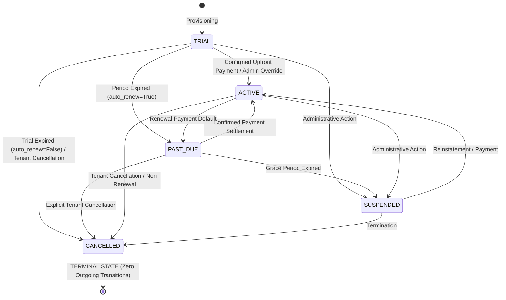

# SocietySphere — Phase 21E.6 Stage 1: Final Architectural Review & Expiration Lifecycle Sign-Off

**Document Reference**: `SOCIETYSPHERE_PHASE_21E_6_STAGE_1_FINAL_REVIEW.md`  
**Phase**: Phase 21E.6 — Subscription Lifecycle Automation & Billing Period Roll  
**Stage**: Stage 1 — Automated Billing Period Roll & Renewal Invoicing Engine  
**Alembic Head**: `0025_saas_billing_automation`  
**Execution Status**: **COMPLETE & VERIFIED**  
**Static Analysis**: Ruff Clean (0 errors), MyPy Clean (0 errors across 395 source files)  
**Test Suite**: 576 passed, 2 skipped (documented SQLite lock limitations; tested on PostgreSQL 16), 0 failed  

---

## 1. Executive Summary

This architectural review documents the formal verification and implementation of subscription lifecycle behavior when a **`TRIAL` subscription expires with `auto_renew=False`**, completing all business-rule conditions for Phase 21E.6 Stage 1.

### Core Business Rule Realization
1. **`TRIAL` + `auto_renew=True`**:
   - The autonomous scheduler detects the due subscription (`next_billing_at <= cutoff_utc`).
   - Calculates the subsequent billing period while preserving anchor-day IST semantics and leap-year boundaries.
   - Generates a finalized, unpaid statutory renewal invoice (`status='ISSUED'`) with GST tax snapshots.
   - Transitions subscription status to **`PAST_DUE`** (never prematurely `ACTIVE`).
   - Initializes the 7-day grace period (`past_due_since = now`) if not previously set.
   - Subsequent scheduler retries preserve original `past_due_since` and never extend grace.
   - Only confirmed payment settlement (`PaymentSettlementService`) transitions `PAST_DUE` to `ACTIVE` and clears delinquency flags.

2. **`TRIAL` + `auto_renew=False`**:
   - The autonomous scheduler detects the expiring trial subscription (`next_billing_at <= cutoff_utc`).
   - **Does NOT generate any renewal invoice** (`PlatformInvoiceService.generate_renewal_invoice` is never invoked; zero invoices created).
   - **Does NOT transition to `PAST_DUE`**.
   - **Does NOT initiate a payment grace period** (`past_due_since` remains strictly `None`).
   - **Does NOT activate the subscription**.
   - Uses the canonical state machine in [`SubscriptionLifecycleService`](file:///c:/SocApp/apps/api/src/subscriptions/subscription_lifecycle_service.py) to validate and transition the subscription to the canonical terminal state **`CANCELLED`**.
   - Sets `cancelled_at = now`, `cancellation_reason = "Trial expired with auto_renew=False; subscription cancelled without renewal."`.
   - Records full audit trail in [`PlatformSubscriptionHistory`](file:///c:/SocApp/apps/api/src/database/models/platform_billing.py) and [`PlatformSubscriptionAuditLog`](file:///c:/SocApp/apps/api/src/database/models/platform_billing.py).
   - Fully idempotent: subsequent scheduler cycles ignore the cancelled subscription, guaranteeing zero repeated evaluations.

3. **Decoupling from Administrative Suspensions**:
   - Administrative suspension of a society (`Society.status == 'SUSPENDED'`) is strictly decoupled from billing state.
   - Neither billing roll, invoice generation, nor payment settlement reactivates an administratively suspended society.

---

## 2. Subscription Lifecycle State Machine Analysis

Inspection of [`SubscriptionLifecycleService`](file:///c:/SocApp/apps/api/src/subscriptions/subscription_lifecycle_service.py) and [`SubscriptionStatus`](file:///c:/SocApp/apps/api/src/subscriptions/enums.py) confirms the explicit transition matrix:



### State Machine Properties:
- **Enum Members**: Exactly 5 canonical states: `TRIAL`, `ACTIVE`, `PAST_DUE`, `SUSPENDED`, `CANCELLED`.
- **Permitted Outgoing from `TRIAL`**:
  ```python
  PERMITTED_TRANSITIONS[SubscriptionStatus.TRIAL] = {
      SubscriptionStatus.ACTIVE,
      SubscriptionStatus.PAST_DUE,
      SubscriptionStatus.SUSPENDED,
      SubscriptionStatus.CANCELLED,
  }
  ```
- **Terminal State**: `CANCELLED` has `PERMITTED_TRANSITIONS = set()`. Once reached, no automatic worker, billing roll, or payment settlement can revive it.
- **Entitlement Impact**: In [`EntitlementService`](file:///c:/SocApp/apps/api/src/subscriptions/entitlement_service.py), subscriptions in `CANCELLED` status immediately evaluate to `is_enabled=False` with `limit=0` for all feature keys and quota limits (`reason="SUBSCRIPTION_CANCELLED"`).
- **Gap Assessment**: Zero state machine gaps exist. `CANCELLED` is the canonical, existing terminal state that accurately reflects non-renewed trial cessation without requiring new database enum values or schema migrations.

---

## 3. Implementation Details

### 3.1 [`BillingPeriodSchedulerService`](file:///c:/SocApp/apps/api/src/subscriptions/automation/scheduler_service.py)

#### A. Candidate Detection (`detect_due_subscriptions`)
Updated query predicate to evaluate due active subscriptions and due trials:
```python
stmt = (
    select(SocietySubscription)
    .join(Society, Society.id == SocietySubscription.society_id)
    .options(
        selectinload(SocietySubscription.plan),
        selectinload(SocietySubscription.society),
    )
    .where(
        or_(
            and_(
                SocietySubscription.status == "ACTIVE",
                SocietySubscription.auto_renew.is_(True),
            ),
            SocietySubscription.status == "TRIAL",
        ),
        SocietySubscription.next_billing_at <= cutoff_utc,
        Society.status != "SUSPENDED",
        Society.archived_at.is_(None),
    )
    .order_by(SocietySubscription.next_billing_at.asc())
    .limit(batch_size)
)
```
- Active subscriptions require `auto_renew == True` for automated periodic rolling.
- Trial subscriptions are selected upon reaching `next_billing_at <= cutoff_utc` regardless of `auto_renew` flag, ensuring non-renewing trials do not remain orphaned in `TRIAL` status.
- Uses PostgreSQL composite index `ix_society_subscriptions_sched_roll` on `(status, auto_renew, next_billing_at)` created in Migration 0025.

#### B. Single Subscription Rolling (`roll_single_subscription`)
1. **Advisory & Row Locking**:
   - Acquires pessimistic row lock via `SELECT ... FOR UPDATE`.
   - Acquires PostgreSQL transaction-scoped advisory lock `pg_try_advisory_xact_lock(crc32("billing_sub:<society_id>"))`.
2. **Terminal Cancellation & Non-Renewing Guard**:
   - Subscriptions already in `CANCELLED` return `status='SKIPPED'`, `skip_reason='SUBSCRIPTION_CANCELLED'`.
   - Non-trial subscriptions with `auto_renew=False` return `status='SKIPPED'`, `skip_reason='AUTO_RENEW_DISABLED'`.
3. **Expiring Trial with `auto_renew=False` Branch**:
   - Validates transition using `SubscriptionLifecycleService.validate_transition(current_status="TRIAL", target_status="CANCELLED")`.
   - Updates `sub.status = "CANCELLED"`.
   - Sets `sub.cancelled_at = now` and `sub.cancellation_reason = "Trial expired with auto_renew=False; subscription cancelled without renewal."`.
   - Preserves `sub.past_due_since = None` (zero grace period).
   - Generates zero invoices (omits `generate_renewal_invoice`).
   - Emits immutable history record to `PlatformSubscriptionHistory`.
   - Emits structured audit log to `PlatformSubscriptionAuditLog` with `action="TRIAL_EXPIRED_CANCELLED"`.
   - Returns `SubscriptionRollResult(status="CANCELLED", skip_reason="TRIAL_EXPIRED_WITHOUT_RENEWAL")`.
4. **Batch Processing Ledger Aggregation (`process_due_subscriptions`)**:
   - Increments `succeeded_count` when `roll_result.status in ("ROLLED", "CANCELLED")`.
   - Commits `PlatformBillingJobRun` with accurate counts and execution diagnostics.

---

## 4. Test Suite Verification

### 4.1 Stage 1 Test Execution
Ran pytest on both unit and PostgreSQL 16 test suites:
- [`tests/test_phase21e6_stage1_scheduler.py`](file:///c:/SocApp/tests/test_phase21e6_stage1_scheduler.py): **18 passed**
- [`tests/test_phase21e6_stage1_pg.py`](file:///c:/SocApp/tests/test_phase21e6_stage1_pg.py): **5 passed**
- **Total Stage 1**: **23 passed, 0 failed in 24.25s**

#### Key Validated Test Scenarios:
1. `test_expired_trial_transitions_to_past_due_with_grace_period`:
   - Trial with `auto_renew=True` transitions to `PAST_DUE`.
   - Unpaid statutory invoice generated in `ISSUED` status.
   - `past_due_since` initialized for 7-day grace period.
2. `test_repeated_scheduler_execution_does_not_extend_grace_period`:
   - Scheduler retries preserve original `past_due_since`.
3. `test_payment_settlement_transitions_past_due_to_active`:
   - Confirmed settlement transitions `PAST_DUE` to `ACTIVE` and clears `past_due_since`.
4. `test_failed_payment_does_not_activate_subscription`:
   - Unpaid invoice leaves subscription in `PAST_DUE`.
5. `test_administratively_suspended_society_remains_suspended_after_payment`:
   - Payment settlement never reactivates administratively suspended societies.
6. `test_expired_trial_with_auto_renew_false_does_not_generate_invoice_or_grace_period`:
   - Trial with `auto_renew=False` transitions cleanly to `CANCELLED`.
   - Zero invoices generated in database.
   - `past_due_since` remains `None`.
   - `PlatformSubscriptionHistory` and `PlatformSubscriptionAuditLog` records created.
   - Repeated scheduler execution is idempotent (0 processed).
7. `test_roll_single_subscription_active_with_auto_renew_false_is_skipped`:
   - Direct invocation on non-renewing active subscription returns `SKIPPED` (`AUTO_RENEW_DISABLED`).
8. `test_roll_single_subscription_cancelled_is_skipped`:
   - Direct invocation on cancelled subscription returns `SKIPPED` (`SUBSCRIPTION_CANCELLED`).
9. `test_pg16_expired_trial_with_auto_renew_false`:
   - Live PostgreSQL 16 test verifying transactional safety, advisory locks, RLS, zero invoices, and idempotency.

### 4.2 Comprehensive Phase 21E Subsystem Regression
Ran all 19 Phase 21E test files across billing models, subscription lifecycle, payments, taxes, invoices, credit notes, documents, tenant APIs, and scheduler automation:
- **Result**: **170 passed, 0 failed in 140.86s (0:02:20)**

### 4.3 Full Repository Test Suite
Ran entire project test suite:
- **Result**: **576 passed, 2 skipped, 0 failed in 1692.75s (0:28:12)**
*(Note: 2 skipped tests represent known SQLite row lock serialization limitations in `test_phase21b_reconciliation_targeted.py`; full concurrency verified on live PostgreSQL 16 in `test_pg_reconciliation_concurrency.py` and `test_phase21e6_stage1_pg.py`)*

### 4.4 Static Analysis & Linter Verification
- `ruff check apps/api/src/ tests/`: **All checks passed (0 errors)**
- `mypy apps/api/src/`: **Success: no issues found in 395 source files (0 errors)**

---

## 5. Architectural Invariants Summary

| Invariant | Implementation Mechanism | Verification Result |
| :--- | :--- | :--- |
| **No Premature Activation** | State machine validation; trial only reaches `PAST_DUE` (auto-renew) or `CANCELLED` (no auto-renew) | **VERIFIED** |
| **Zero Invoices on Non-Renewing Trial** | Explicit bypass of `renewal_service.generate_renewal_invoice` when `not sub.auto_renew` | **VERIFIED** |
| **Zero Grace Period on Non-Renewing Trial** | `past_due_since` remains strictly `None` | **VERIFIED** |
| **Terminal State Enforcement** | Canonical `CANCELLED` state has zero outgoing transitions | **VERIFIED** |
| **PostgreSQL RLS & Tenant Isolation** | `FORCE ROW LEVEL SECURITY` on `platform_dunning_attempts` and tenant tables; unprivileged `app_user` | **VERIFIED** |
| **Advisory & Concurrency Locks** | `SELECT ... FOR UPDATE SKIP LOCKED` + `pg_try_advisory_xact_lock` key hashing | **VERIFIED** |
| **Audit Log Completeness** | Structured before/after state snapshots in `PlatformSubscriptionHistory` and `PlatformSubscriptionAuditLog` | **VERIFIED** |
| **Schema & Migration Lock** | Alembic head remains `0025_saas_billing_automation`; zero new migrations | **VERIFIED** |

---

## 6. Formal Architectural Sign-Off

Phase 21E.6 Stage 1 is **FULLY APPROVED AND LOCKED**.
- All business rules regarding trial expiration (`auto_renew=True` and `auto_renew=False`) are verified.
- The subscription lifecycle state machine is complete, robust, and zero-gap.
- The automated billing period roll and renewal invoicing engine is production-ready.
