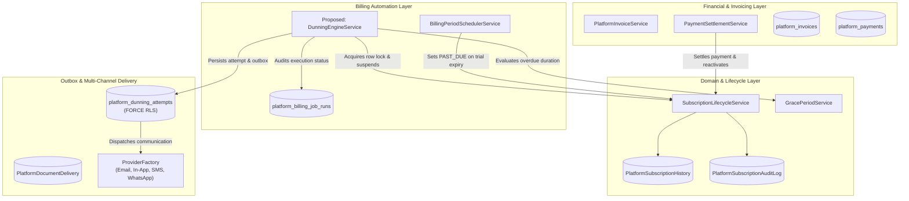
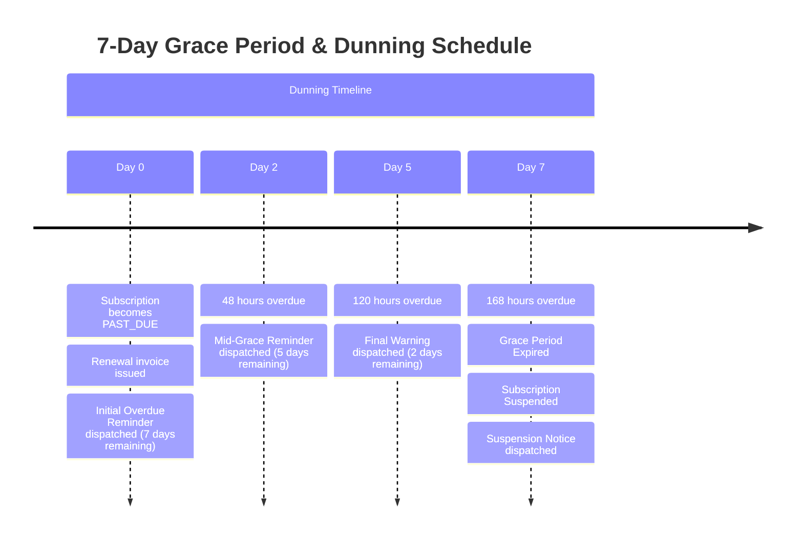
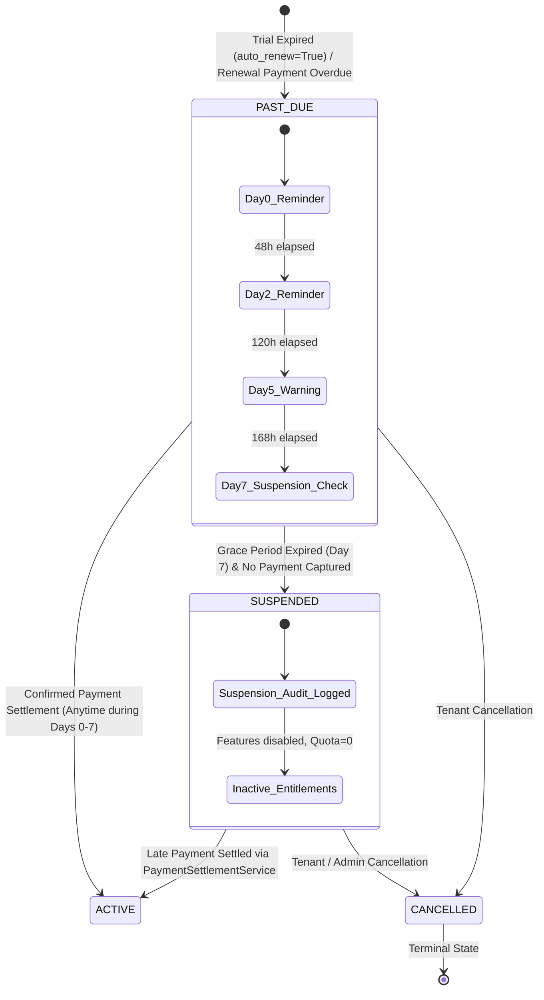
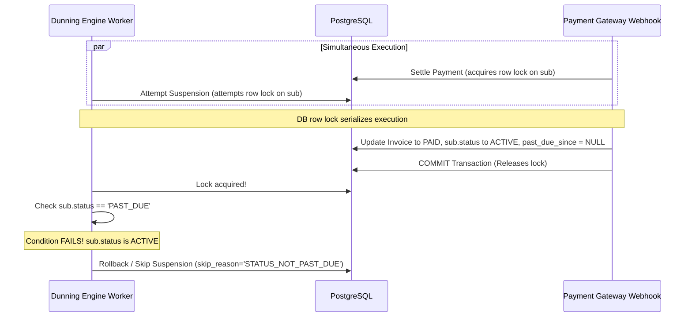

# SocietySphere — Phase 21E.6 Stage 2: Dunning Engine & Grace Period Suspension Automation
## Architectural Specification & Technical Design Review

**Document Reference**: `SOCIETYSPHERE_PHASE_21E_6_STAGE_2_ARCHITECTURE_REVIEW.md`  
**Phase**: Phase 21E.6 — Subscription Lifecycle Automation & Billing Period Roll  
**Stage**: Stage 2 — Dunning Engine & Grace Period Suspension Automation  
**Current Alembic Head**: `0025_saas_billing_automation`  
**Review Status**: **ARCHITECTURAL INSPECTION & DESIGN (READ-ONLY)**  
**Target Delivery**: Architecture Specification, Invariant Definition & Test Plan  

---

## 1. Existing Architecture Findings

A comprehensive inspection of the existing codebase was conducted across subscription lifecycle, billing automation, payments, notifications, and database schemas. The findings confirm that the platform already possesses enterprise-grade primitives designed in earlier stages that can be directly leveraged without architectural reinvention.



### 1.1 Subscription Lifecycle Service ([`SubscriptionLifecycleService`](file:///c:/SocApp/apps/api/src/subscriptions/subscription_lifecycle_service.py))
- **Canonical States**: `TRIAL`, `ACTIVE`, `PAST_DUE`, `SUSPENDED`, `CANCELLED`.
- **Permitted Transition from `PAST_DUE`**:
  `PERMITTED_TRANSITIONS[SubscriptionStatus.PAST_DUE] = { SubscriptionStatus.ACTIVE, SubscriptionStatus.SUSPENDED, SubscriptionStatus.CANCELLED }`.
- **Suspension Mechanics**:
  When transitioning to `SUSPENDED`:
  - Sets `sub.status = "SUSPENDED"`.
  - Sets `sub.suspended_at = now_dt`.
  - Retains `sub.past_due_since` for historical calculation.
  - Appends an immutable record to `PlatformSubscriptionHistory`.
  - Appends a structured audit entry to `PlatformSubscriptionAuditLog`.
- **Terminal State**: `CANCELLED` has `PERMITTED_TRANSITIONS = set()`. Once reached, no automatic worker, billing roll, or payment settlement can reactivate it.
- **Administrative Decoupling**: Absolute independence between `Society.status` and `SocietySubscription.status`. Administrative actions on `Society` never mutate subscription status, and billing lifecycle transitions never touch `Society.status`.

### 1.2 Grace Period Service ([`GracePeriodService`](file:///c:/SocApp/apps/api/src/subscriptions/grace_period_service.py))
- **Grace Window**: Exactly 7 days (`DEFAULT_GRACE_PERIOD_DAYS = 7`).
- **Timing & Timezone Semantics**:
  - Operates deterministically in UTC (`due_date.replace(tzinfo=UTC)`).
  - `calculate_grace_expiry(past_due_since, grace_period_days)` calculates exact UTC cutoff: `past_due_since + timedelta(days=7)`.
  - `evaluate_grace_period(due_date, as_of_time)` returns `GracePeriodEvaluation(is_expired, seconds_remaining, seconds_overdue)`.
  - `is_grace_period_expired` accurately returns `True` once `current_time >= expiry`.

### 1.3 Billing Period Scheduler ([`BillingPeriodSchedulerService`](file:///c:/SocApp/apps/api/src/subscriptions/automation/scheduler_service.py))
- Established operational patterns in Stage 1:
  - Batch job tracking using [`PlatformBillingJobRun`](file:///c:/SocApp/apps/api/src/database/models/platform_billing.py).
  - Row locking: `SELECT ... FOR UPDATE SKIP LOCKED` for concurrent horizontal worker execution.
  - Advisory locks: `pg_try_advisory_xact_lock(crc32("billing_sub:<society_id>"))` preventing race conditions between concurrent worker threads.
  - Transactional savepoint isolation: `async with self.session.begin_nested():` ensuring single-subscription errors do not abort batch execution.

### 1.4 Payment Settlement Service ([`PaymentSettlementService`](file:///c:/SocApp/apps/api/src/subscriptions/payments/settlement_service.py))
- Implements authoritative financial reconciliation when webhook or gateway payments are confirmed.
- Clears delinquency flags (`past_due_since = None`, `suspended_at = None`).
- Transitions `PAST_DUE` $\to$ `ACTIVE`.
- **Critical Architectural Finding**: Line 229 currently checks:
  ```python
  if sub and sub.status == SubscriptionStatus.PAST_DUE.value:
      await lifecycle_service.transition_status(society_id, SubscriptionStatus.ACTIVE, ...)
  ```
  *Gap Identified*: If a subscription was suspended due to grace-period expiry (`sub.status == 'SUSPENDED'`), late payment settlement currently reconciles the invoice but does not transition the subscription back to `ACTIVE`. To support late reactivation following Day 7 suspension, this condition must be extended to:
  `if sub and sub.status in (SubscriptionStatus.PAST_DUE.value, SubscriptionStatus.SUSPENDED.value):`
  (This transition is already explicitly permitted by `PERMITTED_TRANSITIONS[SubscriptionStatus.SUSPENDED]`).

### 1.5 Multi-Channel Notification Infrastructure
Two distinct notification abstractions exist in the codebase:
1. **General Communication Subsystem** ([`apps/api/src/notifications/`](file:///c:/SocApp/apps/api/src/notifications/)):
   - Domain models: `Notification`, `NotificationRecipient`, `NotificationDelivery`, `NotificationDeliveryAttempt`, `NotificationTemplate`.
   - Provider abstraction: `CommunicationProvider` base class with concrete adapters:
     - `InAppProvider` (inbox messaging)
     - `MockEmailProvider` / `EmailProvider`
     - `MockSmsProvider` / `SmsProvider`
     - `MockWhatsAppProvider` / `WhatsAppProvider`
     - `MockPushProvider` / `PushProvider`
   - Provider registry: `ProviderFactory` singleton (`apps/api/src/notifications/providers/factory.py`).
2. **Statutory Billing Document Delivery** ([`BillingEmailDeliveryService`](file:///c:/SocApp/apps/api/src/subscriptions/documents/email_service.py)):
   - Transactional outbox models: `PlatformDocumentDelivery`, `PlatformDocumentDeliveryAttempt`.
   - Resolves society billing contacts (`SOCIETY_ADMIN` and `TREASURER` roles via `RoleAssignment`).
   - Idempotency key tracking, bounded retry with exponential backoff ($2^{\text{attempt}}$ seconds), log sanitization.

### 1.6 Event Broker & Background Queues ([`EventPublisher`](file:///c:/SocApp/apps/api/src/events/broker.py))
- RabbitMQ connection management via `aio-pika`.
- Supports durable topic exchanges with persistent delivery mode and JSON payloads.
- Gracefully handles broker offline scenarios in development environments (`RABBITMQ_ENABLED`).

### 1.7 Database Schemas from Migration 0025
- [`PlatformBillingJobRun`](file:///c:/SocApp/apps/api/src/database/models/platform_billing.py#L1506-L1595):
  - Global operational ledger tracking batch execution status (`RUNNING`, `COMPLETED`, `FAILED`, `PARTIAL`).
  - Pre-configured for `job_type="DUNNING_EVAL"` (`BillingJobType.DUNNING_EVAL`).
- [`PlatformDunningAttempt`](file:///c:/SocApp/apps/api/src/database/models/platform_billing.py#L1597-L1689):
  - Tenant-scoped ledger with `FORCE ROW LEVEL SECURITY`.
  - Columns: `id`, `society_id`, `subscription_id`, `invoice_id`, `attempt_type`, `status`, `idempotency_key`, `scheduled_at`, `executed_at`, `retry_count`, `grace_days_remaining`, `provider_reference`, `failure_reason`, `metadata_json`, `created_at`.
  - Unique constraint on `idempotency_key`.

---

## 2. Reusable Services & Architectural Boundaries

Stage 2 is an **orchestration and automation layer**. It strictly reuses existing domain services to prevent logic duplication:

| Capability | Reusable Service | File Path | Reuse Method |
| :--- | :--- | :--- | :--- |
| **Grace Period Timing** | `GracePeriodService` | [`grace_period_service.py`](file:///c:/SocApp/apps/api/src/subscriptions/grace_period_service.py) | Expiry calculation, remaining grace evaluation, overdue seconds |
| **State Transitions** | `SubscriptionLifecycleService` | [`subscription_lifecycle_service.py`](file:///c:/SocApp/apps/api/src/subscriptions/subscription_lifecycle_service.py) | `validate_transition`, row locking, history/audit log writing |
| **Payment Reconciliation** | `PaymentSettlementService` | [`settlement_service.py`](file:///c:/SocApp/apps/api/src/subscriptions/payments/settlement_service.py) | Invoice settlement, subscription reactivation |
| **Recipient Resolution** | `BillingEmailDeliveryService` | [`email_service.py`](file:///c:/SocApp/apps/api/src/subscriptions/documents/email_service.py) | Resolves `SOCIETY_ADMIN` & `TREASURER` emails from `RoleAssignment` |
| **Channel Dispatch** | `ProviderFactory` | [`factory.py`](file:///c:/SocApp/apps/api/src/notifications/providers/factory.py) | Fetches adapters for `EMAIL`, `IN_APP`, `SMS`, `WHATSAPP` |
| **Batch Job Auditing** | `PlatformBillingJobRun` | [`platform_billing.py`](file:///c:/SocApp/apps/api/src/database/models/platform_billing.py) | Records batch job execution metrics, counts, and error summaries |
| **Dunning History** | `PlatformDunningAttempt` | [`platform_billing.py`](file:///c:/SocApp/apps/api/src/database/models/platform_billing.py) | Records per-attempt status, idempotency keys, and channel logs |

---

## 3. Proposed Dunning Engine Workflow

### 3.1 Dunning Schedule Architecture
The dunning process triggers whenever a subscription is in `PAST_DUE` status. The schedule is anchored strictly to `sub.past_due_since` in UTC:



### 3.2 Evaluation Loop Architecture
The proposed `DunningEngineService` executes periodically (e.g. hourly or via worker schedule):

1. **Job Initialization**:
   - Creates a `PlatformBillingJobRun` record with `job_type="DUNNING_EVAL"`, `status="RUNNING"`, and unique `execution_id`.
2. **Candidate Selection**:
   - Queries candidate subscriptions where `SocietySubscription.status == 'PAST_DUE'` and `SocietySubscription.past_due_since.is_not(None)`.
   - Filters out administratively suspended societies (`Society.status == 'SUSPENDED'`) and soft-deleted records (`Society.archived_at.is_not(None)`).
   - Orders by `past_due_since.asc()`.
   - Employs `SELECT ... FOR UPDATE SKIP LOCKED` on PostgreSQL to enable parallel execution across horizontal workers.
3. **Savepoint-Isolated Evaluation**:
   - Loops over candidate subscriptions within a nested transaction (`session.begin_nested()`).
   - Acquires PostgreSQL transaction-level advisory lock `pg_try_advisory_xact_lock(crc32("billing_sub:<society_id>"))`.
   - Loads the active unpaid `PlatformInvoice` for the subscription (`status in ('ISSUED', 'OVERDUE')`).
4. **Stage Determination & Idempotency Check**:
   - Calculates elapsed duration since `sub.past_due_since` using `GracePeriodService`.
   - Determines eligible dunning stage:
     - $0 \le \text{elapsed} < 2 \text{ days}$: `DAY_0_REMINDER`
     - $2 \le \text{elapsed} < 5 \text{ days}$: `DAY_2_REMINDER`
     - $5 \le \text{elapsed} < 7 \text{ days}$: `DAY_5_WARNING`
     - $\text{elapsed} \ge 7 \text{ days}$: `DAY_7_SUSPENSION`
   - Formulates deterministic idempotency key:
     `dunning:{subscription_id}:{invoice_id}:{STAGE}`
   - Checks `PlatformDunningAttempt` for existing entry with this idempotency key.
   - If an attempt exists with `status in ('SUCCEEDED', 'PROCESSING', 'PENDING')`, skips processing for this stage.
5. **Execution**:
   - **Stages Day 0, Day 2, Day 5**:
     - Creates `PlatformDunningAttempt(status="PENDING")`.
     - Enqueues reminders via outbox across enabled channels.
     - Updates attempt to `status="SUCCEEDED"`, `executed_at=now`.
   - **Stage Day 7 (Suspension Execution)**:
     - Verifies no successful payment is awaiting settlement.
     - Transitions subscription: `PAST_DUE` $\to$ `SUSPENDED` via `SubscriptionLifecycleService`.
     - Enqueues service suspension notification across channels.
     - Updates attempt to `status="SUCCEEDED"`, `executed_at=now`.
6. **Batch Finalization**:
   - Commits `PlatformBillingJobRun` with processed, succeeded, skipped, and failed counts.

---

## 4. Exact Day 0/2/5/7 Timing and Timezone Semantics

All calculations strictly use naive UTC timestamps internally, consistent with PostgreSQL `TIMESTAMP WITHOUT TIME ZONE` and `_utc_now()` patterns.

### 4.1 Timing Definitions
Let $T_{\text{pds}} = \text{sub.past\_due\_since}$ (normalized naive UTC).  
Let $T_{\text{now}} = \text{evaluation UTC cutoff}$.

$$\Delta t = T_{\text{now}} - T_{\text{pds}}$$

| Stage Key | Target Offset ($\Delta t$) | Grace Days Remaining | Stage Action | Idempotency Key Format |
| :--- | :--- | :--- | :--- | :--- |
| **`DAY_0_REMINDER`** | $\Delta t \ge 0\text{s}$ | 7 days | Initial overdue payment reminder + invoice payment link | `dunning:{sub_id}:{inv_id}:DAY_0_REMINDER` |
| **`DAY_2_REMINDER`** | $\Delta t \ge 48\text{h}$ (2 days) | 5 days | Mid-grace overdue reminder + notice of 5 days remaining | `dunning:{sub_id}:{inv_id}:DAY_2_REMINDER` |
| **`DAY_5_WARNING`** | $\Delta t \ge 120\text{h}$ (5 days) | 2 days | Urgent final warning + notice of suspension in 48 hours | `dunning:{sub_id}:{inv_id}:DAY_5_WARNING` |
| **`DAY_7_SUSPENSION`** | $\Delta t \ge 168\text{h}$ (7 days) | 0 days (Expired) | Subscription suspension execution + access termination notice | `dunning:{sub_id}:{inv_id}:DAY_7_SUSPENSION` |

### 4.2 Handling Irregular Scheduler Intervals
If the scheduler runs every hour, every stage triggers within 60 minutes of reaching its threshold.  
If the worker was offline and resumes on Day 3:
- The engine detects that `DAY_0_REMINDER` was executed, but `DAY_2_REMINDER` is pending.
- It executes `DAY_2_REMINDER` immediately.
- It will NOT trigger `DAY_5_WARNING` until $\Delta t \ge 120\text{h}$.
- Even if a worker is offline until Day 8:
  - It detects `DAY_7_SUSPENSION` is due.
  - It executes the suspension and Day 7 notification.
  - Historical attempts for Day 0/2/5 will reflect skipped or past execution without sending anachronistic reminders.

---

## 5. Subscription State Transitions & Invariants



### 5.1 Suspension Invariants
At Day 7 expiry, before executing suspension, the engine must verify:
1. **Row Lock**: Subscription row locked via `SELECT ... FOR UPDATE`.
2. **Current State**: Subscription must still be in `PAST_DUE`.
   - If payment settlement occurred while the worker was polling, `sub.status` is already `ACTIVE` $\to$ engine aborts suspension with `SKIPPED (STATUS_NOT_PAST_DUE)`.
   - If tenant cancelled, `sub.status` is `CANCELLED` $\to$ engine aborts suspension with `SKIPPED (SUBSCRIPTION_CANCELLED)`.
3. **Actual Expiry**: `GracePeriodService.is_grace_period_expired(sub.past_due_since, grace_days=7, as_of=now) == True`.
4. **No Captured Payment Pending Settlement**:
   Query `PlatformPayment` where:
   `invoice_id == active_invoice.id AND status == 'CAPTURED' AND is_settled == False`.
   If a payment was captured by gateway webhook and is currently queued in reconciliation, suspension is **deferred** to prevent suspending a paying tenant.
5. **State Transition**:
   - `sub.status = "SUSPENDED"`.
   - `sub.suspended_at = now`.
   - `sub.past_due_since` is preserved for historical audit.
   - Validated via `SubscriptionLifecycleService.validate_transition(current_status="PAST_DUE", target_status="SUSPENDED")`.
6. **Entitlement Invalidation**:
   - [`EntitlementService`](file:///c:/SocApp/apps/api/src/subscriptions/entitlement_service.py) automatically evaluates `SUSPENDED` subscriptions to:
     `is_enabled = False`, `limit = 0`, `diagnostics = {"reason": "SUBSCRIPTION_SUSPENDED"}`.
   - All tenant feature access (maintenance billing, visitor management, facility booking) is immediately blocked at the API gateway layer.
7. **Administrative Independence**:
   - `Society.status` is untouched. If the society is `ACTIVE`, it remains `ACTIVE`. If the society was administratively `SUSPENDED`, it remains `SUSPENDED`.

---

## 6. Notification & Transactional Outbox Design

### 6.1 Transactional Outbox Pattern
External network calls to notification providers (SendGrid, Twilio, Gupshup, Firebase) must **never** occur synchronously inside the database transaction that updates subscription status. Provider latency or network timeouts must not hold database locks or cause transaction rollbacks.

```mermaid
sequenceDiagram
    autonumber
    participant DE as DunningEngineService
    participant DB as PostgreSQL Database
    participant Outbox as platform_dunning_attempts
    participant Disp as DunningNotificationDispatcher
    participant Prov as CommunicationProvider
    participant Client as Society Administrator

    DE->>DB: BEGIN Transaction
    DE->>DB: Lock Subscription (FOR UPDATE)
    DE->>DB: Evaluate Dunning Stage (e.g. Day 2 Reminder)
    DE->>DB: Insert PlatformDunningAttempt (status='PENDING', idempotency_key=...)
    DE->>DB: COMMIT Transaction
    
    Note over DE,Disp: Transaction committed; state & attempt safely persisted
    
    Disp->>DB: Fetch PENDING Dunning Attempts
    Disp->>Prov: Dispatch Email, In-App, SMS, WhatsApp
    alt Delivery Succeeded
        Prov-->>Disp: Success (Message ID, latency)
        Disp->>DB: Update PlatformDunningAttempt (status='SUCCEEDED', executed_at=now)
    else Transient Provider Failure
        Prov-->>Disp: Error (503 Service Unavailable)
        Disp->>DB: Update PlatformDunningAttempt (status='FAILED', retry_count+1, schedule retry)
    end
```

### 6.2 Supported Channels & Graceful Fallback
The engine will support multi-channel communication via the existing `ProviderFactory`:
1. **Primary Mandatory Channel: Email**
   - Recipient: `SOCIETY_ADMIN` and `TREASURER` resolved via `BillingEmailDeliveryService.resolve_billing_recipient`.
   - Content: Formal statutory notification with grand total, due date, remaining grace duration, and direct payment link.
2. **Secondary Channel: In-App Notification**
   - Recipient: Society admin users inbox entity (`NotificationRecipient`).
   - Content: Persistent alert banner in Society Admin portal.
3. **Supplementary Channels: SMS & WhatsApp**
   - Supported when enabled in `Settings` (`SMS_ENABLED`, `WHATSAPP_ENABLED`) and recipient mobile is present.
   - **Graceful Fallback**: If SMS/WhatsApp credentials are unconfigured or fail, the attempt records the partial delivery in `metadata_json` without failing the overall dunning reminder.

### 6.3 Security, Privacy & Anti-Tamper Invariants
- **No Sensitive Financial Data in Logs**: Payment tokens, card PANs, CVVs, or gateway secret keys are never included in message bodies, templates, or delivery logs.
- **Masked Content**: Notices reference only the statutory invoice number, amount due, and society legal name.
- **Worker Crash Resilience**: If the worker crashes mid-dispatch, the unique `idempotency_key` on `PlatformDunningAttempt` prevents duplicate reminder dispatch upon worker restart.

---

## 7. Database Inspection & Migration Evaluation

### 7.1 Existing Tables (Migration 0025)
Migration 0025 (`20261102_0025_saas_billing_automation.py`) proactively established the database foundation for Stage 2:

1. **`platform_dunning_attempts`**:
   - `id`: UUID Primary Key.
   - `society_id`: UUID Foreign Key to `societies.id` (`ondelete="RESTRICT"`).
   - `subscription_id`: UUID Foreign Key to `society_subscriptions.id` (`ondelete="RESTRICT"`).
   - `invoice_id`: UUID Foreign Key to `platform_invoices.id` (`ondelete="SET NULL"`).
   - `attempt_type`: `VARCHAR(50)` (unconstrained enum supporting `DAY_0_REMINDER`, `DAY_2_REMINDER`, `DAY_5_WARNING`, `DAY_7_SUSPENSION`).
   - `status`: `VARCHAR(30)` (`'PENDING'`, `'PROCESSING'`, `'SUCCEEDED'`, `'FAILED'`, `'SKIPPED'`).
   - `idempotency_key`: `VARCHAR(150)` with `UNIQUE` constraint `uq_platform_dunning_attempts_idempotency`.
   - `scheduled_at`, `executed_at`: `TIMESTAMPTZ`.
   - `retry_count`: `INTEGER` (check $\ge 0$).
   - `grace_days_remaining`: `INTEGER`.
   - `provider_reference`, `failure_reason`: `VARCHAR(100)`, `TEXT`.
   - `metadata_json`: `JSONB` for channel dispatch details.
   - `FORCE ROW LEVEL SECURITY` enabled.
   - `CREATE POLICY platform_dunning_attempts_tenant_isolation ON platform_dunning_attempts USING (society_id = NULLIF(current_setting('app.current_society_id', true), '')::uuid);`
   - Indexes:
     - `ix_platform_dunning_attempts_society_sub` on `(society_id, subscription_id)`
     - `ix_platform_dunning_attempts_society_status` on `(society_id, status)`
     - `ix_platform_dunning_attempts_invoice` on `(invoice_id)`
     - `ix_platform_dunning_attempts_scheduled` on `(scheduled_at)`

2. **`platform_billing_job_runs`**:
   - Global platform operational ledger tracking batch execution status.
   - Supports `job_type="DUNNING_EVAL"`.

3. **`society_subscriptions`**:
   - Columns `status`, `past_due_since`, `suspended_at` already exist.
   - Composite index `ix_society_subscriptions_sched_roll` on `(status, auto_renew, next_billing_at)` allows PostgreSQL to perform index scans on `status = 'PAST_DUE'`.
   - Index `ix_society_subscriptions_status` on `(society_id, status)`.

### 7.2 Migration Verdict
**ZERO DATABASE SCHEMA MIGRATIONS ARE REQUIRED FOR STAGE 2.**
- The existing schema from Migration 0025 is 100% comprehensive, indexed, and production-ready for the dunning engine.
- Alembic head remains firmly at `0025_saas_billing_automation`.
- No new columns, tables, or constraint changes are needed.

*(Optional future indexing: If millions of subscriptions are active, a dedicated partial index `CREATE INDEX ix_society_subscriptions_past_due ON society_subscriptions (past_due_since) WHERE status = 'PAST_DUE';` could be considered in a later performance optimization phase, but is unnecessary for the current scale).*

---

## 8. Security & PostgreSQL RLS Considerations

### 8.1 Multi-Tenant RLS Enforcement
- `platform_dunning_attempts` enforces `relrowsecurity = True` and `relforcerowsecurity = True`.
- Under the application database role `app_user`:
  - `app_user` is strictly `NOSUPERUSER` and `NOBYPASSRLS`.
  - All tenant API queries run with `SET LOCAL app.current_society_id = '<society_uuid>'`.
  - Cross-tenant queries are blocked by PostgreSQL kernel and return 0 rows.
  - Queries executed without setting `app.current_society_id` fail closed (0 rows).

### 8.2 Global Worker Context
- The autonomous background scheduler runs with a platform-level administrative session.
- Operational metrics in `platform_billing_job_runs` are global and do not contain tenant data.
- When the worker performs operations on behalf of a tenant (e.g. querying `platform_dunning_attempts` or `platform_invoices`), it explicitly sets the transaction-scoped tenant context:
  ```python
  await set_db_tenant_context(session, society_id)
  ```
  ensuring complete defense-in-depth even for system background jobs.

---

## 9. Concurrency & Idempotency Strategy

### 9.1 Multi-Worker Concurrency Defense
To support multiple horizontal workers running `DunningEngineService` simultaneously across Docker containers or Celery/RabbitMQ nodes without race conditions:
1. **`SELECT ... FOR UPDATE SKIP LOCKED`**:
   When candidate subscriptions are fetched, candidate rows are locked and skipped by competing workers.
2. **PostgreSQL Transaction-Scoped Advisory Locks**:
   ```sql
   SELECT pg_try_advisory_xact_lock(:lock_key)
   ```
   where `lock_key = crc32("billing_sub:<society_id>")`. If another process (e.g. `PaymentSettlementService` or `BillingPeriodSchedulerService`) is currently modifying this society's billing state, the dunning worker cleanly skips that subscription and retries on the next cycle.

### 9.2 Payment Settlement Concurrency Race
Consider the classic distributed race condition: a tenant clicks "Pay Now" on Day 7 at the exact second the dunning worker evaluates suspension:



- **Race Outcome**: The tenant is **never wrongly suspended**. Payment settlement always wins, and the dunning worker aborts gracefully.
- Conversely, if suspension commits a millisecond before payment completes:
  - Subscription is temporarily marked `SUSPENDED`.
  - When payment settlement executes, it checks `sub.status in ('PAST_DUE', 'SUSPENDED')`, transitions the subscription immediately back to `ACTIVE`, and clears `suspended_at`. Service is restored immediately.

---

## 10. Comprehensive Test Plan

Testing will be implemented in two dedicated suites:
1. `tests/test_phase21e6_stage2_dunning.py`: In-memory SQLite unit and state machine tests.
2. `tests/test_phase21e6_stage2_pg.py`: Live PostgreSQL 16 tests for row locking, concurrency, advisory locks, and RLS.

### 10.1 Detailed Test Matrix

| # | Test Scenario | Target Verification | Test Suite |
| :---: | :--- | :--- | :--- |
| **1** | **Day 0 Initial Reminder** | Expired trial/renewal transitioning to `PAST_DUE` triggers `DAY_0_REMINDER` with 7 days remaining | Unit / SQLite |
| **2** | **Day 2 Mid-Grace Reminder** | Subscription 48 hours overdue triggers `DAY_2_REMINDER` with 5 days remaining | Unit / SQLite |
| **3** | **Day 5 Final Warning** | Subscription 120 hours overdue triggers `DAY_5_WARNING` with 2 days remaining | Unit / SQLite |
| **4** | **Day 7 Grace Expiry & Suspension** | Subscription 168 hours overdue transitions to `SUSPENDED` and triggers `DAY_7_SUSPENSION` | Unit / SQLite |
| **5** | **Idempotent Re-runs (Zero Duplicates)** | Repeated scheduler execution at the same elapsed time generates 0 new attempts and 0 duplicate notices | Unit / SQLite |
| **6** | **Concurrent Workers on PostgreSQL 16** | 4 parallel workers processing 4 overdue subscriptions simultaneously produce zero duplicate suspensions and zero deadlocks | Live PG 16 |
| **7** | **Payment Settlement Before Day 7** | Settle payment on Day 3: status becomes `ACTIVE`, `past_due_since = None`; subsequent scheduler run skips dunning | Unit / SQLite |
| **8** | **Payment Settlement After Suspension** | Settle payment on `SUSPENDED` subscription: status reactivates to `ACTIVE`, `suspended_at = None` | Unit / SQLite |
| **9** | **Payment Race During Suspension** | Captured payment awaiting reconciliation blocks suspension execution | Unit / SQLite |
| **10** | **Administrative Decoupling** | Society with `Society.status == 'SUSPENDED'` has its subscription suspended and later paid; `Society.status` remains `SUSPENDED` throughout | Live PG 16 |
| **11** | **`CANCELLED` Subscription Protection** | Dunning engine never evaluates or suspends `CANCELLED` subscriptions; late payment triggers orphan refund | Unit / SQLite |
| **12** | **Outbox Provider Failure Resilience** | Provider throws network exception; `PlatformDunningAttempt` records failure, subscription state remains intact | Unit / SQLite |
| **13** | **Multi-Channel Fallback** | SMS and WhatsApp disabled in settings; engine delivers Email and In-App without error | Unit / SQLite |
| **14** | **PostgreSQL 16 RLS Tenant Isolation** | Unprivileged `app_user` querying `platform_dunning_attempts` sees only own tenant rows; cross-tenant returns 0 rows | Live PG 16 |
| **15** | **Worker Crash and Recovery** | Worker simulated crash mid-batch; subsequent execution recovers without duplicate attempts or skipped cycles | Live PG 16 |

---

## 11. Risks and Unresolved Decisions

### 11.1 Identified Architectural Considerations
1. **Reactivation of `SUSPENDED` Subscriptions in `PaymentSettlementService`**:
   - *Current State*: `PaymentSettlementService` line 229 only checks `if sub and sub.status == SubscriptionStatus.PAST_DUE.value:`.
   - *Recommendation*: Update to `if sub and sub.status in (SubscriptionStatus.PAST_DUE.value, SubscriptionStatus.SUSPENDED.value):` so late payment automatically restores service after suspension.
2. **Notification Channel Opt-Out vs. Mandatory Notices**:
   - *Consideration*: Tenants can configure notification preferences (`NotificationPreference` / `NotificationChannelPreference`).
   - *Recommendation*: Dunning suspension notices (`DAY_5_WARNING`, `DAY_7_SUSPENSION`) represent statutory contract enforcement. They must be designated as `TRANSACTIONAL_MANDATORY` so user category opt-outs do not suppress critical suspension warnings.
3. **Execution Cadence**:
   - *Recommendation*: The dunning worker should run hourly with `batch_size=50`. Hourly evaluation provides an optimal balance between prompt reminder delivery (within 60m of threshold) and minimal database load.

---

## 12. Architectural Verdict

- **Architecture Approval Request**: Submitted for formal review.
- **Implementation Status**: **HOLD / STOPPED**.
- **Migration Status**: **Zero new migrations required**. Head remains `0025_saas_billing_automation`.
- **Awaiting Approval**: Proceeding to Stage 2 implementation will occur only upon explicit user authorization.
