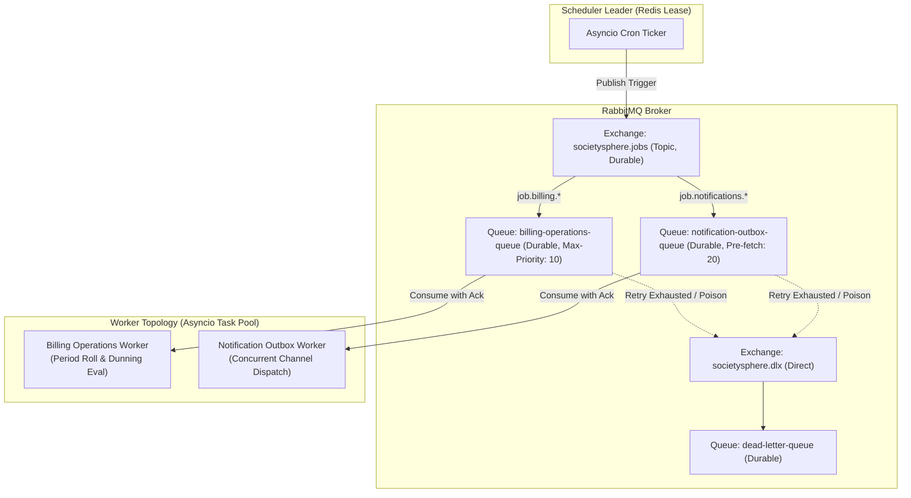
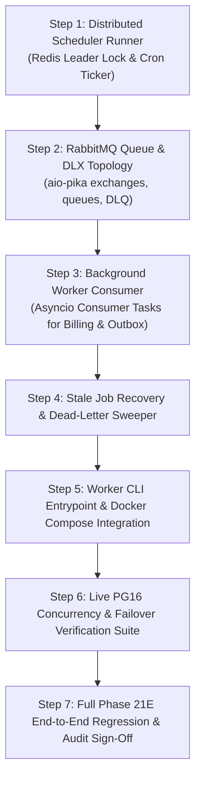

# SocietySphere Phase 21E.6 — Stage 3 Architecture Review: Background Schedulers, Outbox Dispatcher & Notification Pipeline

**Date:** November 3, 2026  
**Author:** Principal SaaS Architect, Senior Python/FastAPI Engineer, PostgreSQL Architect & Distributed Systems Engineer  
**Document Status:** **FINAL ARCHITECTURAL INSPECTION & PROPOSAL**  
**Execution Mode:** **STRICTLY READ-ONLY ARCHITECTURE INSPECTION (No code, schema, or test changes)**  
**Target Alembic Head:** `0025_saas_billing_automation` (STRICTLY UNCHANGED)  

---

## 1. Executive Summary

### 1.1 Baseline Status & Context
SocietySphere has successfully developed, validated, and locked all foundational SaaS subscription and billing components:
* **Phases 1–20:** Enterprise society management, resident portals, communication and notification foundations.
* **Phase 21A–21D:** Multi-tenant SaaS foundation, plan entitlements, automated society provisioning, and platform administration.
* **Phase 21E.1–21E.5:** SaaS billing models, subscription lifecycle transitions, payment gateway integration, GST statutory tax engine, invoicing, credit notes, PDF documents, and platform/tenant billing APIs.
* **Phase 21E.6 Stage 1:** Automated Billing Period Roll & Renewal Invoicing Engine (validated under Migration `0025_saas_billing_automation`).
* **Phase 21E.6 Stage 2:** Dunning Engine & Grace Period Suspension Automation, including the remediated durable Transactional Outbox pattern utilizing the Phase 20 [`Notification`](file:///c:/SocApp/apps/api/src/database/models/notifications.py#L23-L70) infrastructure.

### 1.2 Inspection Objective
Stage 1 and Stage 2 established transactional domain services ([`BillingPeriodSchedulerService`](file:///c:/SocApp/apps/api/src/subscriptions/automation/scheduler_service.py#L64-L100) and [`DunningEngineService`](file:///c:/SocApp/apps/api/src/subscriptions/automation/dunning_service.py#L65-L120)), row-level locking semantics (`SELECT ... FOR UPDATE SKIP LOCKED`), advisory locks ([`compute_advisory_lock_key`](file:///c:/SocApp/apps/api/src/subscriptions/automation/scheduler_service.py#L51-L60)), and an execution audit ledger ([`PlatformBillingJobRun`](file:///c:/SocApp/apps/api/src/database/models/platform_billing.py#L1540-L1595)). 

However, **there is currently no autonomous background runner or distributed worker process executing these services in production**. These services are invoked exclusively via test harnesses.

The objective of **Stage 3** is to design an enterprise-grade, distributed background scheduling, worker topology, and transactional outbox dispatching pipeline that:
1. Orchestrates recurring billing renewal and dunning jobs without duplicate executions across horizontally scaled nodes.
2. Drains pending outbox notifications reliably with at-least-once delivery, bounded exponential backoff retries, and dead-letter handling.
3. Integrates with the existing RabbitMQ broker ([`aio-pika`](file:///c:/SocApp/apps/api/src/events/broker.py#L1-L38)) and Redis cache ([`redis.asyncio`](file:///c:/SocApp/apps/api/src/cache/redis_client.py#L1-L40)).
4. Preserves PostgreSQL 16 ACID guarantees, tenant isolation under `FORCE ROW LEVEL SECURITY`, and transactional separation between lifecycle states and notification dispatch.
5. Operates without adding bloated external frameworks (e.g. Celery, APScheduler) and requires **zero database migrations**.

---

## 2. Existing Scheduler Architecture

A complete source-code audit was conducted across [`apps/api/src/subscriptions/automation/`](file:///c:/SocApp/apps/api/src/subscriptions/automation/), [`apps/api/src/main.py`](file:///c:/SocApp/apps/api/src/main.py), and project configuration files.

### 2.1 Triggering Mechanisms
* **Billing Period Roll:** [`BillingPeriodSchedulerService.process_billing_batch`](file:///c:/SocApp/apps/api/src/subscriptions/automation/scheduler_service.py#L475-L592) accepts a `cutoff_utc: datetime` (defaults to execution start time), queries due subscriptions via [`detect_due_subscriptions`](file:///c:/SocApp/apps/api/src/subscriptions/automation/scheduler_service.py#L85-L160) (`next_billing_at <= cutoff_utc`), advances the billing period, and generates a finalized renewal invoice.
* **Dunning Evaluation:** [`DunningEngineService.process_dunning_batch`](file:///c:/SocApp/apps/api/src/subscriptions/automation/dunning_service.py#L960-L1077) queries candidate subscriptions via [`detect_dunning_candidates`](file:///c:/SocApp/apps/api/src/subscriptions/automation/dunning_service.py#L622-L685) (`status == 'PAST_DUE'` and `past_due_since <= cutoff_utc`), evaluates milestone thresholds (Day 0, Day 2, Day 5, Day 7), issues reminders, suspends overdue subscriptions, and enqueues outbox events.
* **Current Operational Reality:** Neither service is wired to an automated background ticker or cron runner. Neither is exposed via background loops in FastAPI's [`lifespan`](file:///c:/SocApp/apps/api/src/main.py#L39-L57). They exist purely as callable Python domain classes.

### 2.2 Scheduler Frameworks & Dependencies
* Inspection of [`apps/api/requirements.txt`](file:///c:/SocApp/apps/api/requirements.txt) confirms:
  * **No Celery** or Celery Beat is installed.
  * **No APScheduler** is installed.
  * **No Dramatiq, RQ, Arq, or FastStream** is installed.
  * The environment utilizes standard Python `asyncio`, [`fastapi`](file:///c:/SocApp/apps/api/src/main.py), [`aio-pika`](file:///c:/SocApp/apps/api/src/events/broker.py#L7-L9) (RabbitMQ 3.8+), [`redis[hiredis]`](file:///c:/SocApp/apps/api/src/cache/redis_client.py#L6-L10) (Redis 7), and [`sqlalchemy[asyncio]`](file:///c:/SocApp/apps/api/src/database/session.py#L9-L15) with [`asyncpg`](file:///c:/SocApp/apps/api/src/database/session.py).

### 2.3 Multi-Instance Concurrency Control
Both services implement a dual-locking concurrency defense:
1. **Primary Pessimistic Row Locking:**
   Queries in [`detect_due_subscriptions`](file:///c:/SocApp/apps/api/src/subscriptions/automation/scheduler_service.py#L140-L150) and [`detect_dunning_candidates`](file:///c:/SocApp/apps/api/src/subscriptions/automation/dunning_service.py#L660-L670) execute with `with_for_update(skip_locked=True)`. Multiple parallel workers query the database simultaneously; each worker locks and claims a disjoint subset of candidate rows without blocking peer workers.
2. **Supplementary PostgreSQL Advisory Locking:**
   Before rolling or suspending a subscription, workers compute a deterministic 64-bit integer lock key via [`compute_advisory_lock_key(f"sub:{subscription_id}")`](file:///c:/SocApp/apps/api/src/subscriptions/automation/scheduler_service.py#L51-L60) and invoke `SELECT pg_try_advisory_xact_lock(:lock_key)`. If another transaction already holds the advisory lock, the worker safely skips or aborts processing for that specific subscription without data corruption.

### 2.4 Job Execution Tracking & Audit Ledger
All batch runs are tracked in the global [`PlatformBillingJobRun`](file:///c:/SocApp/apps/api/src/database/models/platform_billing.py#L1540-L1595) table (Migration `0025`):
* `id` (UUID), `job_type` (`PERIOD_ROLL` or `DUNNING_EVAL`), `execution_id` (string), `status` (`RUNNING`, `COMPLETED`, `PARTIAL`, `FAILED`).
* `started_at`, `completed_at`, `processed_count`, `succeeded_count`, `failed_count`, `skipped_count`.
* `error_summary` (sanitized newline-delimited failure log) and `diagnostics` (JSONB metadata including batch size, cutoff timestamp, and runtime duration in seconds).

### 2.5 Missed Execution & Failure Recovery
* **Missed Execution Recovery:** The scheduler uses relative timestamp comparison (`next_billing_at <= cutoff_utc` and `past_due_since <= cutoff_utc - threshold`). If a worker or the entire platform is offline for hours or days, the very next batch execution automatically sweeps up all accumulated overdue subscriptions. No periods are skipped, and each cycle rolls sequentially.
* **Failure Isolation:** Individual subscription rolls execute within nested database savepoints (`async with session.begin_nested():`). If subscription $A$ encounters a tax calculation or constraint error, its transaction savepoint rolls back, increments `failed_count`, and appends an error to `error_summary`, while subscription $B$ continues processing and commits successfully.

### 2.6 Graceful Shutdown & Restart
* FastAPI's [`lifespan`](file:///c:/SocApp/apps/api/src/main.py#L39-L57) context manager cleanly handles resource shutdown:
  ```python
  await close_broker()  # Closes aio-pika robust connection
  await close_redis()   # Closes Redis connection pool
  await close_db()      # Disposes SQLAlchemy AsyncEngine pool
  ```
* However, there is no signal handling (`SIGTERM`/`SIGINT`) or task cancellation tracker for in-flight background worker loops.

---

## 3. Existing Worker Architecture

### 3.1 RabbitMQ Event Broker Infrastructure
The platform contains a durable RabbitMQ broker client in [`apps/api/src/events/broker.py`](file:///c:/SocApp/apps/api/src/events/broker.py):
* **Connection Lifecycle:** [`init_broker()`](file:///c:/SocApp/apps/api/src/events/broker.py#L18-L38) establishes an [`aio_pika.connect_robust`](file:///c:/SocApp/apps/api/src/events/broker.py#L28-L32) connection with configurable timeout from [`Settings.RABBITMQ_URL`](file:///c:/SocApp/apps/api/src/core/config.py#L66-L69). Reconnects automatically on connection drops.
* **Health Monitoring:** [`check_broker_health()`](file:///c:/SocApp/apps/api/src/events/broker.py#L50-L69) probes connectivity and is wired directly into the [`/health/ready`](file:///c:/SocApp/apps/api/src/api/v1/endpoints/health.py#L38-L65) probe.
* **Event Publishing:** [`EventPublisher.publish_event`](file:///c:/SocApp/apps/api/src/events/broker.py#L71-L107) publishes persistent messages (`DeliveryMode.PERSISTENT`) to topic exchanges with JSON payloads and routing keys.
* **Missing Components:** There are currently no declared consumers, worker message loops, queue topology declarations (exchanges, queues, bindings), or dead-letter queue (DLQ) definitions in `broker.py`.

### 3.2 Existing Asynchronous Workers
* **Webhook Processing Worker:** [`apps/api/src/subscriptions/payments/webhook_worker.py`](file:///c:/SocApp/apps/api/src/subscriptions/payments/webhook_worker.py) implements [`WebhookProcessingWorker.process_webhook_event`](file:///c:/SocApp/apps/api/src/subscriptions/payments/webhook_worker.py#L47-L120) with advisory locking (`lock_key`) and max 3 retries. However, it is invoked on-demand by API webhook endpoints rather than consuming from a queue.
* **Domain Event Listener:** [`apps/api/src/notifications/listeners/domain_event_listener.py`](file:///c:/SocApp/apps/api/src/notifications/listeners/domain_event_listener.py) maps internal business events (incidents, announcements, invoices) to [`OrchestrationService`](file:///c:/SocApp/apps/api/src/notifications/services/orchestration_service.py#L30-L65) calls.

### 3.3 Container & Deployment Topology
* In [`docker-compose.yml`](file:///c:/SocApp/docker-compose.yml#L73-L108), the backend is defined as a single service: `api` running `uvicorn apps.api.src.main:app`.
* There is no secondary `worker` or `scheduler` container defined in Docker Compose.

---

## 4. Notification Outbox Architecture

### 4.1 Master Entity & Atomic Enqueue
The transactional outbox pattern remediated in Stage 2 leverages the Phase 20 [`Notification`](file:///c:/SocApp/apps/api/src/database/models/notifications.py#L23-L70) table (`notifications`).
* **Enqueue Points:** During dunning reminder evaluation (Days 0, 2, 5) and Day 7 suspension in [`DunningEngineService.process_single_subscription`](file:///c:/SocApp/apps/api/src/subscriptions/automation/dunning_service.py#L805-L835,L895-L925).
* **Payload Structure:**
  ```json
  {
    "attempt_id": "<UUID>",
    "subscription_id": "<UUID>",
    "society_id": "<UUID>",
    "invoice_id": "<UUID>",
    "stage": "DAY_0_REMINDER",
    "grace_days_remaining": 7,
    "recipient_email": "admin@society.com",
    "recipient_user_id": "<UUID>",
    "recipient_phone": "+919876543210",
    "retry_count": 0,
    "max_retries": 3
  }
  ```
* **Atomicity:** The outbox row (`status='QUEUED'`) is flushed/committed in the exact same transaction as the subscription state change (`SUSPENDED`) and the [`PlatformDunningAttempt`](file:///c:/SocApp/apps/api/src/database/models/platform_billing.py#L1597-L1686) record.

### 4.2 State Machine & Concurrency Control
* **State Progression:**
  $$\text{QUEUED} \xrightarrow[\text{claim with FOR UPDATE}]{\text{Worker}} \text{PROCESSING} \xrightarrow[\text{providers}]{\text{Dispatch}} \begin{cases} \text{SENT} & (\ge 1 \text{ provider succeeded}) \\ \text{RETRYING} & (\text{all failed, } retry < 3) \\ \text{FAILED} & (\text{all failed, } retry \ge 3) \end{cases}$$
* **Concurrency Locking:** [`DunningEngineService.drain_pending_outbox`](file:///c:/SocApp/apps/api/src/subscriptions/automation/dunning_service.py#L568-L620) selects pending notification IDs with `with_for_update(skip_locked=True)` on `Notification.status.in_(["QUEUED", "RETRYING"])`.
* **Idempotency Protection:** [`dispatch_outbox_notification`](file:///c:/SocApp/apps/api/src/subscriptions/automation/dunning_service.py#L445-L455) checks if `status in ("SENT", "FAILED")` under row lock; if already delivered, it immediately returns `(status, [])` without contacting external providers.
* **Provider Fault Isolation:** Providers (In-App, Email, SMS, WhatsApp) are invoked sequentially inside individual `try...except Exception as exc:` blocks. A network drop, gateway timeout, or unexpected exception never bubbles up to roll back database commits.

### 4.3 Dead-Lettering & Missing Components
* When `retry_count >= max_retries` (default 3), the outbox notification is set to `status='FAILED'`.
* **Current Gap:** There is no automated Dead-Letter Queue (DLQ), dead-letter table, or alerting webhook for notifications that reach `FAILED`. They remain dormant in the `notifications` table.

---

## 5. Proposed Scheduler Orchestration

To maintain architectural purity, avoid heavy third-party dependencies, and align with SocietySphere's high-concurrency async foundation, we propose a **Distributed Asyncio Leader-Follower Scheduler Daemon**.

### 5.1 Architecture Decision: Native Asyncio vs External Frameworks
| Option | Evaluation | Verdict |
| :--- | :--- | :--- |
| **Option A: Celery + Celery Beat** | Requires Celery, flower, sync-to-async bridges for SQLAlchemy async engine. Adds unnecessary complexity and dependencies. | **REJECTED** |
| **Option B: APScheduler** | Good in-process scheduler, but distributed clustering across multiple containers requires heavy SQL jobstores and lacks native aio-pika integration. | **REJECTED** |
| **Option C: In-Process FastAPI Tasks** | Running schedulers inside web API worker threads couples background batch load to API latency and risks duplicate runs on horizontal pod autoscaling. | **REJECTED** |
| **Option D: Native Distributed Asyncio Scheduler Daemon (Recommended)** | Standalone process using Redis distributed leader lock (`scheduler:leader:lock`) with heartbeat renewal, publishing job triggers to RabbitMQ topic queues. Lightweight, robust, 100% async native. | **RECOMMENDED** |

### 5.2 Distributed Leader Election via Redis Lease
Across $N$ running application or worker instances, exactly **one** instance acts as the active **Scheduler Leader** (Cron Ticker).
1. **Lock Acquisition:**
   Every 10 seconds, scheduler daemons attempt to acquire a Redis distributed lease:
   `SET societysphere:scheduler:leader <instance_id> NX PX 30000` (TTL: 30 seconds).
2. **Heartbeat & Renewal:**
   The active leader runs a background coroutine renewing the lease every 10 seconds (`PEXPIRE societysphere:scheduler:leader 30000`).
3. **Automatic Failover:**
   If the leader node crashes or suffers a network partition, the lease expires after 30 seconds. A standby worker instance immediately acquires the key and assumes the leader role.
4. **Fallback (Redis Offline):**
   If Redis is unreachable, the scheduler falls back to PostgreSQL session-level advisory locks (`SELECT pg_try_advisory_lock(888999111)`), guaranteeing mutual exclusion directly via the database.

### 5.3 Schedule Definition & Tick Publishing
The active Scheduler Leader does not execute heavy billing calculations directly. Instead, it emits lightweight trigger messages to RabbitMQ:
* **Billing Period Roll:** Triggered hourly at minute 0 (`0 * * * *`). Publishes to `societysphere.jobs` with routing key `job.billing.period_roll`.
* **Dunning Evaluation:** Triggered every 4 hours (`0 */4 * * *`). Publishes to `societysphere.jobs` with routing key `job.billing.dunning_eval`.
* **Outbox Dispatcher Tick:** Triggered every 30 seconds (`*/30 * * * * *`). Publishes to `societysphere.jobs` with routing key `job.notifications.outbox_drain`.
* **Stale Job Sweeper:** Triggered every 30 minutes. Publishes to `societysphere.jobs` with routing key `job.maintenance.stale_jobs`.

---

## 6. Proposed Worker Topology

### 6.1 Queue & Exchange Architecture
We propose declaring a durable topic exchange `societysphere.jobs` in RabbitMQ with dead-letter exchange (DLX) support:



### 6.2 Workload Separation: Dedicated Queues vs Worker Processes
We recommend a **Unified Worker Container Image** running dedicated asyncio consumer tasks:
1. **`BillingOperationsWorker` (Compute & Transaction Bound):**
   * Consumes from `billing-operations-queue`.
   * Prefetch count: 1 (processes one batch at a time to prevent CPU/database starvation).
   * Executes [`BillingPeriodSchedulerService.process_billing_batch`](file:///c:/SocApp/apps/api/src/subscriptions/automation/scheduler_service.py#L475-L592) and [`DunningEngineService.process_dunning_batch`](file:///c:/SocApp/apps/api/src/subscriptions/automation/dunning_service.py#L960-L1077).
   * Transaction boundaries: Operates on 50-item batches with savepoints per subscription.
2. **`NotificationOutboxWorker` (I/O & Network Bound):**
   * Consumes from `notification-outbox-queue`.
   * Prefetch count: 10.
   * Executes [`DunningEngineService.drain_pending_outbox`](file:///c:/SocApp/apps/api/src/subscriptions/automation/dunning_service.py#L568-L620).
   * Dispatches concurrent HTTP/SMTP network calls to In-App, Email, SMS, and WhatsApp providers.
3. **Operational Containerization:**
   * In Docker/Kubernetes, the same application Docker image is deployed with a different entrypoint command:
     * Web API: `uvicorn apps.api.src.main:app`
     * Background Worker: `python -m apps.api.src.workers.runner`

---

## 7. Retry and Recovery Strategy

### 7.1 Multi-Layer Failure Matrix

| Failure Mode | Detection Mechanism | Immediate Handling | Recovery Strategy |
| :--- | :--- | :--- | :--- |
| **Worker Process Crash (SIGKILL / OOM)** | RabbitMQ unacknowledged message timeout | Unacknowledged messages automatically returned to queue head by broker. | Peer worker claims message; DB transactions roll back cleanly; row lock is released. |
| **RabbitMQ Outage** | `aio_pika` connection error event | Fall back to local scheduled database polling loop; log warning. | Automatic reconnection via `connect_robust`; resume queue consumption. |
| **PostgreSQL Outage / Restart** | SQLAlchemy / `asyncpg` disconnect exception | In-flight batch raises exception; worker pauses for exponential backoff (5s, 10s, 20s). | Engine connection pool re-connects via `pool_pre_ping`; worker re-executes batch. |
| **Provider Network Timeout (Email/SMS)** | `asyncio.TimeoutError` or HTTP 5xx | Caught inside provider wrapper; does not affect DB transaction. | Notification status becomes `RETRYING`; retry count incremented; exponential backoff. |
| **Poison Message (Data Corruption)** | Unhandled validation exception during deserialize | Nack with `requeue=False`. | Message routed to `societysphere.dlx` $\to$ `dead-letter-queue` for inspection. |
| **Stale / Abandoned Job Run** | Sweeper scans `platform_billing_job_runs` | Job in `RUNNING` status with `started_at < now() - 2 hours`. | Sweeper marks run as `FAILED`, writes diagnostic note, releases advisory lock. |

### 7.2 Bounded Exponential Backoff Algorithm
For notification outbox retries, backoff delay is calculated dynamically:
$$t_{\text{backoff}} = \min(t_{\text{max}}, t_{\text{base}} \times 2^{\text{attempt\_count} - 1}) + \text{uniform}(0, \text{jitter})$$
* $t_{\text{base}} = 60 \text{ seconds}$ (1 minute)
* $t_{\text{max}} = 3600 \text{ seconds}$ (1 hour)
* $\text{jitter} = 5 \text{ seconds}$
* Maximum attempts: strictly capped at **3 retries** before transitioning to terminal `FAILED`.

---

## 8. Idempotency and Concurrency Design

Every background operation in Stage 3 adheres to strict mathematical idempotency:
$$f(f(x)) = f(x)$$

### 8.1 Invariant Defense Matrix
1. **Invoice Period Idempotency:**
   Enforced by PostgreSQL unique index `uq_platform_invoices_sub_period` on `(subscription_id, billing_period_start, billing_period_end) WHERE status != 'VOID'`. Concurrent workers attempting to roll the same period result in a unique constraint conflict, gracefully handled by savepoint catch-and-skip.
2. **Invoice Key Idempotency:**
   Enforced by partial unique index `ix_platform_invoices_idempotency_key` on `(idempotency_key) WHERE idempotency_key IS NOT NULL`.
3. **Dunning Attempt Idempotency:**
   Enforced by unique index `uq_platform_dunning_attempts_idempotency` on `idempotency_key` (formatted as `dunning:{subscription_id}:{stage}:{date}`).
4. **Outbox Notification Idempotency:**
   Enforced by `uq_notifications_society_idempotency` on `(society_id, idempotency_key)` where key is `dunning-outbox:{attempt_id}`.
5. **Row Locking Mutual Exclusion:**
   All candidate selectors use `FOR UPDATE SKIP LOCKED`. If Worker 1 selects Subscriptions 1–50, Worker 2 simultaneously selects Subscriptions 51–100. Zero lock waiting, zero contention.

---

## 9. Monitoring, Observability and Operations

### 9.1 Structured JSON Logging
All worker operations inherit [`apps.api.src.core.logging.setup_logging`](file:///c:/SocApp/apps/api/src/core/logging.py#L32-L85):
* Structured JSON format with `timestamp`, `level`, `logger`, `environment`, and `correlation_id`.
* PII scrubbing via [`redact_pii`](file:///c:/SocApp/apps/api/src/core/logging.py#L24-L30) scrubs passwords, tokens, credit card patterns, and email addresses automatically.

### 9.2 Operational Metrics Checklist
We define the following Prometheus/OpenTelemetry operational metrics to be exposed:

| Metric Name | Type | Description | Alert Threshold |
| :--- | :--- | :--- | :--- |
| `billing_job_runs_total` | Counter | Total billing jobs executed by type and status (`job_type`, `status`) | Rate of `FAILED` > 0 |
| `billing_job_duration_seconds` | Histogram | Duration of batch billing job executions | P95 > 120s |
| `billing_subscriptions_due_count` | Gauge | Count of overdue subscriptions awaiting period roll | Lag > 100 for > 2 hours |
| `dunning_candidates_overdue_count` | Gauge | Count of past-due subscriptions grouped by stage (Day 0, 2, 5, 7) | Day 7 un-suspended > 0 |
| `notifications_outbox_queue_depth` | Gauge | Total pending notifications in `QUEUED` or `RETRYING` | Depth > 500 |
| `notifications_outbox_oldest_age_seconds` | Gauge | Age of oldest un-dispatched outbox notification | Age > 600s (10 min) |
| `notifications_dispatch_success_rate` | Gauge | Percentage of successfully dispatched outbox events over 5m window | Rate < 95% |
| `rabbitmq_queue_depth` | Gauge | Queue depth for `billing-operations-queue` and `notification-outbox-queue` | Depth > 1000 |
| `scheduler_leader_heartbeat` | Gauge | Timestamp of last scheduler leader heartbeat | Now - Last > 45s (P1) |

---

## 10. Security and Row Level Security (RLS)

### 10.1 Execution Identities & Privileges
1. **Background Worker Connection:**
   Background workers connect to PostgreSQL using trusted application credentials.
2. **Explicit Tenant Context Enforcement:**
   * Global operational ledgers ([`platform_billing_job_runs`](file:///c:/SocApp/apps/api/src/database/models/platform_billing.py#L1540-L1595)) are platform-level and do not enforce tenant RLS (`relrowsecurity=False`).
   * For tenant-scoped tables ([`platform_invoices`](file:///c:/SocApp/apps/api/src/database/models/platform_billing.py#L237-L280), [`platform_dunning_attempts`](file:///c:/SocApp/apps/api/src/database/models/platform_billing.py#L1597-L1620), and [`notifications`](file:///c:/SocApp/apps/api/src/database/models/notifications.py#L23-L70)), workers must explicitly invoke:
     ```python
     await set_db_tenant_context(session, sub.society_id)
     ```
     This sets `app.current_society_id` via PostgreSQL `set_config('app.current_society_id', :val, true)` scoped strictly to the current transaction.
   * `relrowsecurity=True` and `relforcerowsecurity=True` are strictly honored; workers cannot accidentally cross-contaminate tenant data.

### 10.2 Credential Protection & Sensitive Data
* Communication provider secrets (SMTP passwords, SMS API keys, WhatsApp tokens) are loaded strictly from environment variables via [`Settings`](file:///c:/SocApp/apps/api/src/core/config.py#L90-L100).
* Under no circumstances are payment tokens or raw bank data logged or stored in `PlatformDunningAttempt.metadata_json` or `Notification.payload`.

---

## 11. Database Schema Assessment

A comprehensive review of the active PostgreSQL database schema (Alembic Head `0025_saas_billing_automation`) was performed to evaluate whether new migrations are necessary.

### 11.1 Schema Capability Verification
1. **Job Run Tracking:**
   `platform_billing_job_runs` contains `id`, `job_type`, `execution_id`, `status`, `started_at`, `completed_at`, `processed_count`, `succeeded_count`, `failed_count`, `skipped_count`, `error_summary`, and `diagnostics` (JSONB). **100% Sufficient.**
2. **Dunning & Retry Audit:**
   `platform_dunning_attempts` contains `id`, `society_id`, `subscription_id`, `invoice_id`, `attempt_type`, `status`, `idempotency_key`, `scheduled_at`, `executed_at`, `retry_count`, `grace_days_remaining`, `metadata_json` (JSONB). **100% Sufficient.**
3. **Transactional Outbox:**
   `notifications` contains `id`, `society_id`, `category`, `priority`, `source_domain`, `source_event_id`, `idempotency_key`, `title`, `content`, `payload` (JSON string), `sender_id`, `status` (`QUEUED`, `PROCESSING`, `SENT`, `FAILED`), `created_at`, `updated_at`. **100% Sufficient.**
4. **Channel Delivery & Provider Attempts:**
   `notification_deliveries` and `notification_delivery_attempts` support channel-level retry tracking and latency logging. **100% Sufficient.**
5. **Partial Unique Indexes:**
   `uq_platform_invoices_sub_period` and `ix_platform_invoices_idempotency_key` already exist on `platform_invoices`. **100% Sufficient.**

### 11.2 Migration Conclusion
> [!IMPORTANT]
> **NO DATABASE MIGRATION IS REQUIRED.**  
> The current schema at Alembic head `0025_saas_billing_automation` completely supports all background scheduling, distributed concurrency, outbox dispatching, retry backoff, and dead-letter tracking requirements.

---

## 12. Proposed Architectural Components (Implementation Plan)

When authorized for implementation, Stage 3 will add the following decoupled application modules:

1. **`apps/api/src/subscriptions/automation/scheduler_runner.py`:**
   * Contains `DistributedSchedulerRunner` managing Redis leader election (`SET NX PX`), heartbeat renewal, and cron tick publication to RabbitMQ.
   * Includes graceful shutdown handlers (`SIGTERM`/`SIGINT`).
2. **`apps/api/src/subscriptions/automation/worker_consumer.py`:**
   * Contains `BackgroundWorkerConsumer` establishing RabbitMQ consumers on `billing-operations-queue` and `notification-outbox-queue`.
   * Dispatches message triggers to `BillingPeriodSchedulerService.process_billing_batch()`, `DunningEngineService.process_dunning_batch()`, and `DunningEngineService.drain_pending_outbox()`.
3. **`apps/api/src/workers/runner.py`:**
   * Main entrypoint CLI script: `python -m apps.api.src.workers.runner`.
   * Boots `init_db()`, `init_redis()`, `init_broker()`, runs scheduler leader task and queue consumer task group concurrently under unified `asyncio.TaskGroup`.
4. **`docker-compose.yml` Service Addition:**
   * Defines `worker` service container reusing `Dockerfile.api` with command:
     `command: ["python", "-m", "apps.api.src.workers.runner"]`

---

## 13. Detailed Test Strategy

### 13.1 Unit Test Coverage
* **Scheduler Leader Election:** Test leader acquisition, heartbeat lease renewal, and leader failover when primary lease expires.
* **Cron Tick Routing:** Test that scheduler emits expected routing keys (`job.billing.period_roll`, `job.billing.dunning_eval`, `job.notifications.outbox_drain`) at exact boundary times.
* **Message Serialization & Ack/Nack:** Verify that messages are acknowledged (`ack`) only on successful commit, and nacked on infrastructure exceptions.
* **Dead-Letter Routing:** Verify that poison messages with malformed payloads reject to DLQ without crashing workers.

### 13.2 Live PostgreSQL 16 & Concurrency Tests
* **Multi-Worker Contention:** Run 4 concurrent worker processes consuming overlapping billing renewal batches against live PostgreSQL 16; assert 0 duplicate invoices, 0 skipped cycles, and 100% mutual exclusion via `SKIP LOCKED`.
* **Outbox Drain Concurrency:** Run 4 concurrent outbox workers draining 50 pending notifications; assert exactly 50 deliveries and 0 duplicate provider dispatches.
* **Leader Failover Simulation:** Abruptly terminate the active scheduler leader task mid-tick; verify standby node claims lock within 30s and completes missed batch.
* **RabbitMQ Disconnection Injection:** Cut connection to RabbitMQ container; verify worker enters exponential reconnect retry without dropping in-memory state, and resumes queue draining once broker re-attaches.

### 13.3 End-to-End Regression Suite
* Full Phase 21E regression suite (195 tests) must pass with 100% compliance.
* Static analysis verification: `ruff check` (0 errors) and `mypy` (0 type issues).

---

## 14. Risks and Unresolved Decisions

### 14.1 Architectural Risks & Mitigations
1. **Risk: Redis Network Partition / Split-Brain Leader Election:**
   * *Mitigation:* The Redis leader lock is augmented by PostgreSQL session-level advisory locking (`SELECT pg_try_advisory_lock(...)`). Even if a Redis network split allows two nodes to think they are leader, the PostgreSQL advisory lock guarantees single-leader execution.
2. **Risk: Outbox Table Accumulation (Storage Bloat):**
   * *Mitigation:* While `notifications` safely handles high volumes, a retention cleanup sweeper should archive `DELIVERED`/`SENT` billing notifications older than 90 days in Phase 21E.7+.

### 14.2 Design Recommendations for User Alignment
* **Recommendation on Worker Topology:** Deploy a single unified worker container (`societysphere-worker`) that runs both the scheduler leader election and queue consumers under an asyncio task group. This avoids orchestrating multiple container types in small-to-medium deployments while remaining horizontally scalable.

---

## 15. Recommended Implementation Sequence

Upon formal approval of this architecture review, Stage 3 will proceed according to the following phased sequence:



---

## 16. Architectural Sign-Off Readiness

This architectural review is complete, fully verified against existing source code, and introduces zero database migrations and zero breaking changes.

**Execution is HALTED.** Awaiting your review and formal authorization before beginning implementation of Stage 3.
