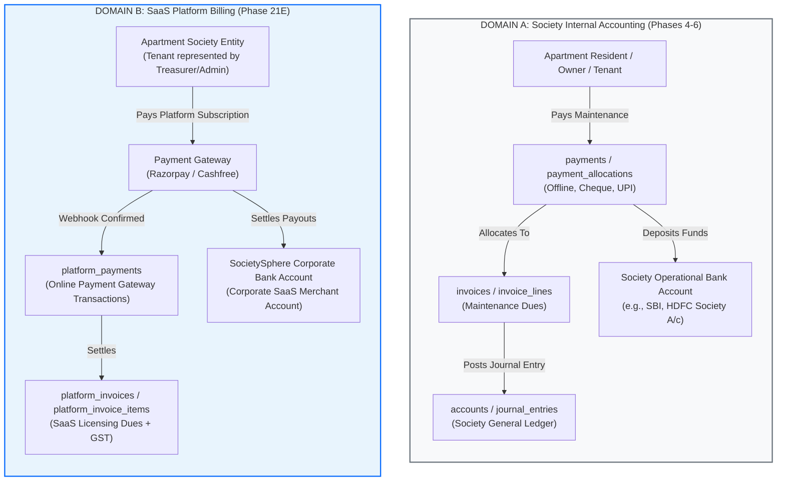
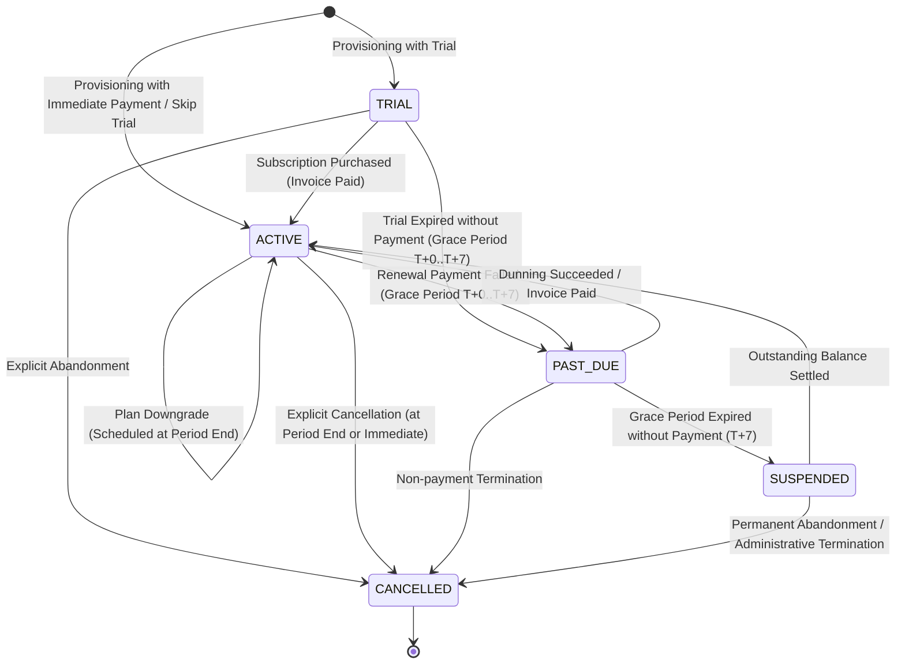
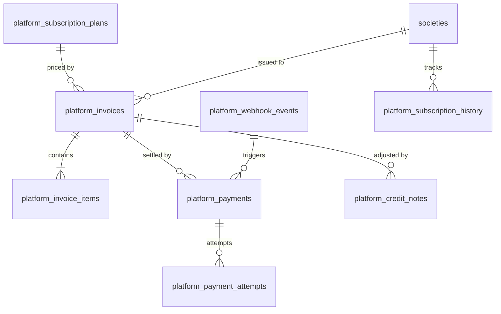
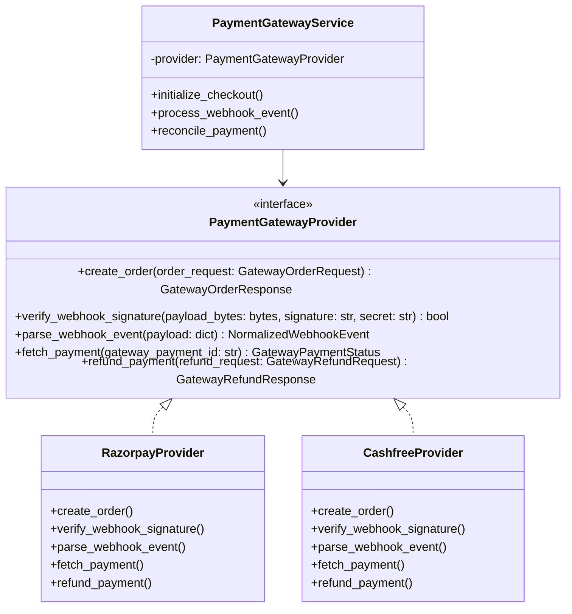
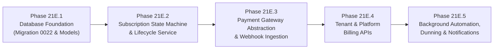

# SOCIETYSPHERE — PHASE 21E ARCHITECTURE SPECIFICATION
## SaaS Billing & Subscription Lifecycle Management: Architectural Blueprint

**Project**: SocietySphere SaaS Enterprise Platform  
**Target Phase**: Phase 21E — SaaS Billing & Subscription Lifecycle Management  
**Role**: Principal SaaS Architect, FinTech Platform Architect & Senior Backend Engineer  
**Status**: ARCHITECTURE PROPOSAL (READ-ONLY REVIEW)  
**Date**: October 30, 2026  
**Document Ref**: `SOCIETYSPHERE_PHASE_21E_ARCHITECTURE.md`  

---

## 1. Executive Summary

Phase 21E defines the production-grade **SaaS Billing and Subscription Lifecycle Management Engine** for SocietySphere. While Phases 21A–21D established the foundation (commercial database catalog, entitlement resolution, quota enforcement, atomic society provisioning, and platform administration APIs), SocietySphere currently lacks automated SaaS revenue collection, recurring subscription renewals, payment gateway integration, dunning/grace-period lifecycle enforcement, and SaaS customer invoicing.

The objective of Phase 21E is to implement an enterprise, audit-compliant, multi-tenant billing infrastructure that allows SocietySphere to:
1. Issue legally compliant B2B SaaS tax invoices (with Indian Goods & Services Tax / GST) to apartment societies.
2. Collect subscription licensing fees seamlessly via Indian payment gateways (Razorpay, Cashfree) using order-based checkout and webhook verification.
3. Manage the full automated subscription lifecycle (`TRIAL` $\rightarrow$ `ACTIVE` $\rightarrow$ `PAST_DUE` $\rightarrow$ `SUSPENDED` $\rightarrow$ `CANCELLED`) with strict decoupling from tenant society operational status.
4. Execute non-blocking, concurrency-safe recurring billing runs, pro-rated plan upgrades, and downgrade eligibility validations.
5. Provide society treasurers and administrators with a self-service billing portal while providing platform super-administrators with global revenue analytics and payment reconciliation tools.

### Architectural Core Guardrails

> [!IMPORTANT]
> 1. **Zero Financial Domain Contamination**: Society Internal Accounting (resident maintenance, vendor expenses, society general ledger) and SaaS Platform Billing (society subscription fees paid to SocietySphere) are completely separate financial domains. They must **never** share tables, accounts, or journal entries.
> 2. **Never Trust the Client**: Frontend payment-success callbacks (e.g. modal handlers, redirect query params) are purely informational UX triggers. Subscription state changes occur **only** upon authoritative backend webhook verification (HMAC signature validated) or direct server-to-server gateway polling.
> 3. **Exact Decimal Monetary Representation**: Zero floating-point arithmetic. All monetary values are calculated in Python `Decimal` with fixed rounding (`ROUND_HALF_UP`) and stored in PostgreSQL `NUMERIC(12, 2)` or integer gateway currency units (paise).
> 4. **PostgreSQL FORCE RLS & NOBYPASSRLS**: All tenant-scoped billing tables (`platform_invoices`, `platform_payments`) enforce `FORCE ROW LEVEL SECURITY`. Application queries run under the unprivileged `app_user` role with zero RLS bypass.
> 5. **Lifecycle Decoupling Preserved**: `Society.status` (`ACTIVE`, `SUSPENDED`) and `SocietySubscription.status` (`TRIAL`, `ACTIVE`, `PAST_DUE`, `SUSPENDED`, `CANCELLED`) remain strictly independent state machines.

---

## 2. Existing Architecture Inspection & Reusable Components

A comprehensive, strictly read-only audit of the existing codebase (`apps/api/src/`) and migrations (`0001`–`0021`) was conducted to identify reusable components and establish integration touchpoints.

### 2.1 Existing Components Inspected

| Component / File | Current Scope & Capabilities | Phase 21E Reuse & Integration |
| :--- | :--- | :--- |
| [`PlatformSubscriptionPlan`](file:///C:/SocApp/apps/api/src/database/models/subscription.py#L29-L91) | Global catalog of subscription plans (e.g., `FREE`, `STANDARD`, `ENTERPRISE`), monthly/annual prices, trial duration, currency. | Direct reuse as the authoritative billing price catalog. |
| [`SubscriptionPlanEntitlement`](file:///C:/SocApp/apps/api/src/database/models/subscription.py#L93-L133) | Entitlements linked to plans (boolean features, numeric quotas). | Reused to evaluate plan value and feature tiers during upgrades/downgrades. |
| [`SocietySubscription`](file:///C:/SocApp/apps/api/src/database/models/subscription.py#L135-L197) | Tenant subscription record (`status`, `starts_at`, `trial_ends_at`, `current_period_start`, `current_period_end`, `past_due_since`, `suspended_at`, `cancelled_at`). | Reused as the central state machine entity for subscription lifecycle management. |
| [`SocietyUsageMetric`](file:///C:/SocApp/apps/api/src/database/models/subscription.py#L292-L325) | High-concurrency usage counters for units, residents, staff, storage. | Reused to validate quota downgrade eligibility before allowing lower-tier plans. |
| [`EntitlementService`](file:///C:/SocApp/apps/api/src/subscriptions/entitlement_service.py) | Evaluates effective feature availability based on subscription status and precedence rules (`OVERRIDE` $\rightarrow$ `PLAN` $\rightarrow$ `DEFAULT`). | Automatically gates application features when subscription enters `PAST_DUE`, `SUSPENDED`, or `CANCELLED`. |
| [`QuotaEnforcementService`](file:///C:/SocApp/apps/api/src/subscriptions/quota_enforcement_service.py) | Atomic usage reservations (`reserve_usage`) and reconciliations (`reconcile_usage`). | Evaluates whether current society usage fits within proposed downgrade plan limits. |
| [`SocietyProvisioningEngine`](file:///C:/SocApp/apps/api/src/subscriptions/provisioning_engine.py) | 9-step atomic society onboarding; creates initial `SocietySubscription` in `TRIAL` or `ACTIVE` status. | Integrates with Phase 21E to generate initial subscription invoice and link checkout order. |
| [`PlatformAdminService`](file:///C:/SocApp/apps/api/src/subscriptions/platform_admin_service.py) | Global society directory, administrative suspend/reactivate with row locking, subscription overview. | Extended with platform billing endpoints (invoice inspection, manual credit notes, reconciliation). |
| [`AuditLog`](file:///C:/SocApp/apps/api/src/database/models/audit.py) & Repository | Immutable event log with before/after state snapshots, actor user ID, correlation ID. | Emits audit events for all billing operations (`INVOICE_GENERATED`, `PAYMENT_SETTLED`, `SUBSCRIPTION_RENEWED`). |
| [`tenant_context`](file:///C:/SocApp/apps/api/src/core/tenant_context.py) & [`set_db_tenant_context`](file:///C:/SocApp/apps/api/src/database/session.py) | Context-variable and parameterized `SELECT set_config('app.current_society_id', :val, true)` RLS binding. | Used for all tenant society billing queries and webhook session boundaries. |
| [`notifications`](file:///C:/SocApp/apps/api/src/notifications/) (Phase 20) | Multi-channel notification engine (Email, SMS, Push, In-App) with audience and template resolution. | Reused to dispatch invoice notifications, payment receipts, dunning warnings, and grace-period alerts. |
| [`events.broker`](file:///C:/SocApp/apps/api/src/events/broker.py) (RabbitMQ) | Asynchronous messaging broker using `aio-pika`. | Reused for background recurring billing runs, webhook queueing, and PDF generation workers. |

---

## 3. Define Billing Boundaries: Society Accounting vs. SaaS Platform Billing

A fundamental architectural principle of SocietySphere is the strict physical, logical, and financial separation between **Society Accounting (Domain A)** and **SaaS Platform Billing (Domain B)**.



### Detailed Domain Separation Matrix

| Architectural Attribute | Domain A: Society Internal Accounting | Domain B: SaaS Platform Billing (Phase 21E) |
| :--- | :--- | :--- |
| **Creditor / Invoicing Entity** | The Apartment Housing Society (e.g. Palm Meadows CHS) | SocietySphere SaaS Platform Ltd. |
| **Debtor / Customer** | Individual flat owner, resident, or tenant (`unit_id`, `resident_id`) | The Apartment Society legal entity (`society_id`) |
| **Billed Services** | Monthly society maintenance, sinking fund, water charges, clubhouse booking | Software subscription licensing (Base fee, unit tier, add-ons) |
| **Tax Invoicing & Code** | Society-specific maintenance tax exemptions or local society GST | SaaS Software Services (HSN/SAC `998313`, 18% GST: CGST+SGST/IGST) |
| **Primary Tables** | `invoices`, `invoice_lines`, `billing_periods`, `payments`, `receipts` | `platform_invoices`, `platform_invoice_items`, `platform_payments`, `platform_webhook_events` |
| **Payment Ingestion** | Manual bank transfer, cheque, cash, NEFT (recorded by Society Treasurer) | Automated payment gateway checkout (Razorpay, Cashfree orders & webhooks) |
| **Funds Destination** | Apartment Society's local bank account | SocietySphere's corporate merchant/escrow bank account |
| **General Ledger Posting** | Posts to tenant society Chart of Accounts (`accounts`, `journal_entries`) | Does NOT touch tenant COA; recorded in platform revenue accounting |
| **Foreign Keys Permitted** | References `units.id`, `financial_periods.id`, `billing_periods.id` | References `societies.id`, `platform_subscription_plans.id` |

> [!CAUTION]
> **Prohibited Coupling**: The existing `invoices` table requires non-null `unit_id`, `responsible_user_id`, and `billing_period_id`. Modifying or overloading `invoices` for SaaS billing would destroy tenant database normalization, violate Row-Level Security, and corrupt resident financial ledgers. Domain B **must** use dedicated `platform_*` tables.

---

## 4. Subscription Lifecycle State Machine

The commercial status of a tenant society subscription is governed by the `SocietySubscription.status` state machine.



### 4.1 Permitted State Transitions

| From State | To State | Trigger Event | Guard / Preconditions | State Side Effects & Invariants | Emitted Audit Action |
| :--- | :--- | :--- | :--- | :--- | :--- |
| `TRIAL` | `ACTIVE` | Initial checkout invoice paid | Valid payment webhook received, payment amount $\ge$ invoice total | Set `current_period_start = now`, `current_period_end = now + interval`, `trial_ends_at = None`. Entitlements switch to full paid plan. | `SUBSCRIPTION_ACTIVATED` |
| `TRIAL` | `PAST_DUE` | Trial period expired | `trial_ends_at < now`, no active paid invoice | Set `past_due_since = now`. Start 7-day grace period. Dispatch trial expiration notice to society admin. | `TRIAL_EXPIRED` |
| `ACTIVE` | `ACTIVE` | Recurring renewal invoice paid | Payment verified before or during renewal | Advance `current_period_start = old_end`, `current_period_end = old_end + interval`. Reset `past_due_since = None`. | `SUBSCRIPTION_RENEWED` |
| `ACTIVE` | `ACTIVE` | Plan upgrade checkout settled | New plan price $>$ current plan price, invoice paid | Immediate plan switch (`plan_id = new_plan_id`). Pro-rate remaining credit from prior plan. Recalculate entitlements instantly. | `SUBSCRIPTION_UPGRADED` |
| `ACTIVE` | `PAST_DUE` | Recurring renewal failed / unpaid | `current_period_end < now`, invoice unpaid | Set `past_due_since = now`. Features remain active during 7-day grace period with warning banner. Initiate dunning sequence. | `PAYMENT_OVERDUE` |
| `PAST_DUE` | `ACTIVE` | Dunning payment settled | Outstanding invoice paid in full | Clear `past_due_since = None`. Maintain existing period boundaries. Restore full good standing. | `DUNNING_RESOLVED` |
| `PAST_DUE` | `SUSPENDED` | Grace period expired | `now > past_due_since + grace_period_days` (7 days) | Set `suspended_at = now`. `EntitlementService` deactivates features (`SubscriptionInactiveException`). Access restricted to billing portal. | `SUBSCRIPTION_SUSPENDED` |
| `SUSPENDED`| `ACTIVE` | Outstanding invoice paid | Full outstanding balance settled via portal checkout | Clear `suspended_at = None`, `past_due_since = None`. Set new period end. Instant feature reactivation. | `SUBSCRIPTION_REACTIVATED`|
| `ACTIVE` | `CANCELLED`| Voluntary cancellation requested | Society admin requests cancellation | Set `cancelled_at = now`, `cancellation_reason = reason`. Effective immediately or at `current_period_end`. | `SUBSCRIPTION_CANCELLED` |
| `PAST_DUE` | `CANCELLED`| Termination for non-payment | Platform admin or automated dunning exhaustion (30 days) | Set `cancelled_at = now`. Features terminated. Historical invoices remain marked `OVERDUE`. | `SUBSCRIPTION_TERMINATED` |

### 4.2 Prohibited State Transitions

1. **`CANCELLED` $\rightarrow$ `ACTIVE` (Direct Jump)**: Prohibited. A cancelled subscription cannot jump to active without creating a new subscription or order. Returns HTTP `409 Conflict`.
2. **`SUSPENDED` $\rightarrow$ `TRIAL`**: Prohibited. A suspended society cannot reset itself into a free trial. Returns HTTP `409 Conflict`.
3. **`ACTIVE` $\rightarrow$ `SUSPENDED` (Direct Jump bypassing `PAST_DUE`)**: Prohibited for billing failures. All non-payment events must pass through `PAST_DUE` with grace period. (Administrative suspension of society access operates on `Society.status`, not `SocietySubscription.status`).

### 4.3 Society.status vs. SocietySubscription.status Independence

As verified in Phase 21D, `Society.status` and `SocietySubscription.status` are decoupled:
- If a society is administratively suspended (`Society.status = "SUSPENDED"`) due to legal/compliance violations, its subscription retains its commercial state (`ACTIVE`, `PAST_DUE`, or `CANCELLED`).
- If a subscription becomes `SUSPENDED` due to non-payment (`SocietySubscription.status = "SUSPENDED"`), `Society.status` remains `"ACTIVE"`, but application features are blocked by `EntitlementService` (`SUBSCRIPTION_INACTIVE`), redirecting the tenant to settle invoices.
- Reactivating a suspended society (`Society.status = "ACTIVE"`) **never** reactivates a `CANCELLED` subscription or forgives `PAST_DUE` balances.

---

## 5. Proposed Billing Data Model (Phase 21E Schema)

To maintain absolute database normalization, financial auditability, and tenant isolation, Phase 21E proposes **8 new tables** in migration `20261031_0022_saas_platform_billing.py`.



### 5.1 Proposed Tables Specification

#### 1. `platform_invoices` (Tenant-Scoped with FORCE RLS)
Stores B2B SaaS invoices issued by SocietySphere to apartment societies.

```sql
CREATE TABLE platform_invoices (
    id UUID PRIMARY KEY DEFAULT gen_random_uuid(),
    society_id UUID NOT NULL REFERENCES societies(id) ON DELETE RESTRICT,
    invoice_number VARCHAR(50) NOT NULL,
    status VARCHAR(20) NOT NULL DEFAULT 'DRAFT', -- 'DRAFT', 'ISSUED', 'PAID', 'OVERDUE', 'VOID', 'CANCELLED'
    billing_reason VARCHAR(30) NOT NULL DEFAULT 'SUBSCRIPTION_RENEWAL', -- 'INITIAL_PURCHASE', 'SUBSCRIPTION_RENEWAL', 'PLAN_UPGRADE', 'PLAN_DOWNGRADE', 'AD_HOC'
    currency VARCHAR(3) NOT NULL DEFAULT 'INR',
    subtotal NUMERIC(12, 2) NOT NULL DEFAULT 0.00,
    discount_total NUMERIC(12, 2) NOT NULL DEFAULT 0.00,
    tax_total NUMERIC(12, 2) NOT NULL DEFAULT 0.00,
    grand_total NUMERIC(12, 2) NOT NULL DEFAULT 0.00,
    paid_amount NUMERIC(12, 2) NOT NULL DEFAULT 0.00,
    outstanding_amount NUMERIC(12, 2) NOT NULL DEFAULT 0.00,
    period_start TIMESTAMP WITHOUT TIME ZONE NOT NULL,
    period_end TIMESTAMP WITHOUT TIME ZONE NOT NULL,
    due_date DATE NOT NULL,
    paid_at TIMESTAMP WITHOUT TIME ZONE,
    finalized_at TIMESTAMP WITHOUT TIME ZONE,
    voided_at TIMESTAMP WITHOUT TIME ZONE,
    void_reason TEXT,
    billing_address JSONB NOT NULL DEFAULT '{}',
    customer_gstin VARCHAR(15),
    tax_rate NUMERIC(5, 2) NOT NULL DEFAULT 18.00,
    is_interstate BOOLEAN NOT NULL DEFAULT FALSE,
    cgst_amount NUMERIC(12, 2) NOT NULL DEFAULT 0.00,
    sgst_amount NUMERIC(12, 2) NOT NULL DEFAULT 0.00,
    igst_amount NUMERIC(12, 2) NOT NULL DEFAULT 0.00,
    pdf_storage_key VARCHAR(255),
    created_at TIMESTAMP WITHOUT TIME ZONE NOT NULL DEFAULT (now() AT TIME ZONE 'UTC'),
    updated_at TIMESTAMP WITHOUT TIME ZONE NOT NULL DEFAULT (now() AT TIME ZONE 'UTC'),
    CONSTRAINT uq_platform_invoices_number UNIQUE (invoice_number),
    CONSTRAINT ck_platform_invoice_positive_amounts CHECK (
        subtotal >= 0 AND tax_total >= 0 AND grand_total >= 0 AND paid_amount >= 0
    )
);

CREATE INDEX ix_platform_invoices_society_status ON platform_invoices (society_id, status);
CREATE INDEX ix_platform_invoices_due_date ON platform_invoices (due_date) WHERE status = 'ISSUED';
ALTER TABLE platform_invoices ENABLE ROW LEVEL SECURITY;
ALTER TABLE platform_invoices FORCE ROW LEVEL SECURITY;

CREATE POLICY platform_invoices_tenant_isolation ON platform_invoices
    FOR ALL TO public
    USING (society_id = (NULLIF(current_setting('app.current_society_id', true), ''))::uuid);
```

#### 2. `platform_invoice_items` (Tenant-Scoped with FORCE RLS)
Detailed line items for a platform SaaS invoice.

```sql
CREATE TABLE platform_invoice_items (
    id UUID PRIMARY KEY DEFAULT gen_random_uuid(),
    society_id UUID NOT NULL REFERENCES societies(id) ON DELETE RESTRICT,
    invoice_id UUID NOT NULL REFERENCES platform_invoices(id) ON DELETE CASCADE,
    line_number INTEGER NOT NULL,
    item_type VARCHAR(30) NOT NULL DEFAULT 'BASE_PLAN', -- 'BASE_PLAN', 'UNIT_OVERAGE', 'ADD_ON_FEATURE', 'DISCOUNT', 'ADJUSTMENT'
    description VARCHAR(255) NOT NULL,
    hsn_sac VARCHAR(10) NOT NULL DEFAULT '998313',
    quantity NUMERIC(10, 2) NOT NULL DEFAULT 1.00,
    unit_price NUMERIC(12, 2) NOT NULL,
    gross_amount NUMERIC(12, 2) NOT NULL,
    discount_amount NUMERIC(12, 2) NOT NULL DEFAULT 0.00,
    taxable_amount NUMERIC(12, 2) NOT NULL,
    tax_amount NUMERIC(12, 2) NOT NULL,
    total_amount NUMERIC(12, 2) NOT NULL,
    created_at TIMESTAMP WITHOUT TIME ZONE NOT NULL DEFAULT (now() AT TIME ZONE 'UTC'),
    CONSTRAINT uq_platform_invoice_items_number UNIQUE (invoice_id, line_number)
);

CREATE INDEX ix_platform_invoice_items_invoice ON platform_invoice_items (invoice_id);
ALTER TABLE platform_invoice_items ENABLE ROW LEVEL SECURITY;
ALTER TABLE platform_invoice_items FORCE ROW LEVEL SECURITY;

CREATE POLICY platform_invoice_items_tenant_isolation ON platform_invoice_items
    FOR ALL TO public
    USING (society_id = (NULLIF(current_setting('app.current_society_id', true), ''))::uuid);
```

#### 3. `platform_payments` (Tenant-Scoped with FORCE RLS)
Authoritative successful or captured payments received through external gateways.

```sql
CREATE TABLE platform_payments (
    id UUID PRIMARY KEY DEFAULT gen_random_uuid(),
    society_id UUID NOT NULL REFERENCES societies(id) ON DELETE RESTRICT,
    invoice_id UUID NOT NULL REFERENCES platform_invoices(id) ON DELETE RESTRICT,
    payment_method VARCHAR(30) NOT NULL, -- 'UPI', 'CREDIT_CARD', 'DEBIT_CARD', 'NETBANKING', 'NACH_MANDATE', 'MANUAL_OFFLINE'
    gateway_provider VARCHAR(30) NOT NULL, -- 'RAZORPAY', 'CASHFREE', 'MANUAL'
    gateway_payment_id VARCHAR(100) NOT NULL,
    gateway_order_id VARCHAR(100),
    amount NUMERIC(12, 2) NOT NULL,
    currency VARCHAR(3) NOT NULL DEFAULT 'INR',
    status VARCHAR(20) NOT NULL DEFAULT 'CAPTURED', -- 'PENDING', 'CAPTURED', 'FAILED', 'REFUNDED', 'PARTIALLY_REFUNDED'
    captured_at TIMESTAMP WITHOUT TIME ZONE NOT NULL,
    fee_deducted NUMERIC(12, 2) DEFAULT 0.00,
    tax_deducted NUMERIC(12, 2) DEFAULT 0.00,
    gateway_response JSONB DEFAULT '{}',
    receipt_number VARCHAR(50),
    created_at TIMESTAMP WITHOUT TIME ZONE NOT NULL DEFAULT (now() AT TIME ZONE 'UTC'),
    CONSTRAINT uq_platform_payments_gateway_id UNIQUE (gateway_provider, gateway_payment_id),
    CONSTRAINT ck_platform_payments_positive_amount CHECK (amount > 0)
);

CREATE INDEX ix_platform_payments_invoice ON platform_payments (invoice_id);
ALTER TABLE platform_payments ENABLE ROW LEVEL SECURITY;
ALTER TABLE platform_payments FORCE ROW LEVEL SECURITY;

CREATE POLICY platform_payments_tenant_isolation ON platform_payments
    FOR ALL TO public
    USING (society_id = (NULLIF(current_setting('app.current_society_id', true), ''))::uuid);
```

#### 4. `platform_payment_attempts` (Tenant-Scoped with FORCE RLS)
Tracks individual checkout attempts and orders created with payment gateways.

```sql
CREATE TABLE platform_payment_attempts (
    id UUID PRIMARY KEY DEFAULT gen_random_uuid(),
    society_id UUID NOT NULL REFERENCES societies(id) ON DELETE RESTRICT,
    invoice_id UUID NOT NULL REFERENCES platform_invoices(id) ON DELETE CASCADE,
    gateway_provider VARCHAR(30) NOT NULL,
    gateway_order_id VARCHAR(100) NOT NULL,
    amount NUMERIC(12, 2) NOT NULL,
    status VARCHAR(20) NOT NULL DEFAULT 'CREATED', -- 'CREATED', 'PROCESSING', 'SUCCEEDED', 'FAILED', 'EXPIRED'
    failure_code VARCHAR(50),
    failure_reason TEXT,
    idempotency_key VARCHAR(100) NOT NULL,
    created_at TIMESTAMP WITHOUT TIME ZONE NOT NULL DEFAULT (now() AT TIME ZONE 'UTC'),
    updated_at TIMESTAMP WITHOUT TIME ZONE NOT NULL DEFAULT (now() AT TIME ZONE 'UTC'),
    CONSTRAINT uq_platform_payment_attempts_order UNIQUE (gateway_provider, gateway_order_id),
    CONSTRAINT uq_platform_payment_attempts_idempotency UNIQUE (society_id, idempotency_key)
);

ALTER TABLE platform_payment_attempts ENABLE ROW LEVEL SECURITY;
ALTER TABLE platform_payment_attempts FORCE ROW LEVEL SECURITY;

CREATE POLICY platform_payment_attempts_tenant_isolation ON platform_payment_attempts
    FOR ALL TO public
    USING (society_id = (NULLIF(current_setting('app.current_society_id', true), ''))::uuid);
```

#### 5. `platform_credit_notes` (Tenant-Scoped with FORCE RLS)
Credit notes for overbilling, service disruptions, or pro-rated plan downgrades.

```sql
CREATE TABLE platform_credit_notes (
    id UUID PRIMARY KEY DEFAULT gen_random_uuid(),
    society_id UUID NOT NULL REFERENCES societies(id) ON DELETE RESTRICT,
    invoice_id UUID NOT NULL REFERENCES platform_invoices(id) ON DELETE RESTRICT,
    credit_note_number VARCHAR(50) NOT NULL,
    amount NUMERIC(12, 2) NOT NULL,
    reason TEXT NOT NULL,
    status VARCHAR(20) NOT NULL DEFAULT 'ISSUED', -- 'ISSUED', 'ALLOCATED', 'REFUNDED', 'VOID'
    issued_at TIMESTAMP WITHOUT TIME ZONE NOT NULL DEFAULT (now() AT TIME ZONE 'UTC'),
    created_by UUID REFERENCES users(id) ON DELETE SET NULL,
    created_at TIMESTAMP WITHOUT TIME ZONE NOT NULL DEFAULT (now() AT TIME ZONE 'UTC'),
    CONSTRAINT uq_platform_credit_notes_number UNIQUE (credit_note_number),
    CONSTRAINT ck_platform_credit_note_positive CHECK (amount > 0)
);

ALTER TABLE platform_credit_notes ENABLE ROW LEVEL SECURITY;
ALTER TABLE platform_credit_notes FORCE ROW LEVEL SECURITY;

CREATE POLICY platform_credit_notes_tenant_isolation ON platform_credit_notes
    FOR ALL TO public
    USING (society_id = (NULLIF(current_setting('app.current_society_id', true), ''))::uuid);
```

#### 6. `platform_webhook_events` (Global Platform Table — NO Tenant RLS)
Durable, idempotent log of raw inbound webhook events from payment gateways.

```sql
CREATE TABLE platform_webhook_events (
    id UUID PRIMARY KEY DEFAULT gen_random_uuid(),
    gateway_provider VARCHAR(30) NOT NULL, -- 'RAZORPAY', 'CASHFREE'
    event_id VARCHAR(100) NOT NULL,
    event_type VARCHAR(100) NOT NULL,
    payload JSONB NOT NULL,
    signature_header VARCHAR(255) NOT NULL,
    status VARCHAR(20) NOT NULL DEFAULT 'RECEIVED', -- 'RECEIVED', 'PROCESSING', 'PROCESSED', 'FAILED', 'IGNORED'
    attempts INTEGER NOT NULL DEFAULT 0,
    processing_error TEXT,
    received_at TIMESTAMP WITHOUT TIME ZONE NOT NULL DEFAULT (now() AT TIME ZONE 'UTC'),
    processed_at TIMESTAMP WITHOUT TIME ZONE,
    CONSTRAINT uq_platform_webhook_events_gateway_event UNIQUE (gateway_provider, event_id)
);

CREATE INDEX ix_platform_webhook_events_status ON platform_webhook_events (status, received_at);
-- Not tenant-scoped; platform infrastructure table accessed by background workers.
```

#### 7. `platform_subscription_history` (Tenant-Scoped with FORCE RLS)
Immutable chronological audit ledger of every subscription lifecycle state jump.

```sql
CREATE TABLE platform_subscription_history (
    id UUID PRIMARY KEY DEFAULT gen_random_uuid(),
    society_id UUID NOT NULL REFERENCES societies(id) ON DELETE RESTRICT,
    from_plan_id UUID REFERENCES platform_subscription_plans(id),
    to_plan_id UUID NOT NULL REFERENCES platform_subscription_plans(id),
    from_status VARCHAR(30) NOT NULL,
    to_status VARCHAR(30) NOT NULL,
    transition_reason VARCHAR(100) NOT NULL, -- 'TRIAL_EXPIRY', 'INITIAL_PURCHASE', 'RENEWAL_SUCCESS', 'PAYMENT_FAILURE', 'GRACE_EXPIRED', 'UPGRADE', 'DOWNGRADE', 'CANCELLATION', 'ADMIN_OVERRIDE'
    effective_at TIMESTAMP WITHOUT TIME ZONE NOT NULL DEFAULT (now() AT TIME ZONE 'UTC'),
    actor_user_id UUID REFERENCES users(id) ON DELETE SET NULL,
    metadata JSONB DEFAULT '{}',
    created_at TIMESTAMP WITHOUT TIME ZONE NOT NULL DEFAULT (now() AT TIME ZONE 'UTC')
);

CREATE INDEX ix_platform_subscription_history_soc ON platform_subscription_history (society_id, created_at);
ALTER TABLE platform_subscription_history ENABLE ROW LEVEL SECURITY;
ALTER TABLE platform_subscription_history FORCE ROW LEVEL SECURITY;

CREATE POLICY platform_subscription_history_tenant_isolation ON platform_subscription_history
    FOR ALL TO public
    USING (society_id = (NULLIF(current_setting('app.current_society_id', true), ''))::uuid);
```

#### 8. `platform_payment_gateway_configs` (Global Platform Table — NO Tenant RLS)
Secure storage for active gateway credentials and environment settings.

```sql
CREATE TABLE platform_payment_gateway_configs (
    id UUID PRIMARY KEY DEFAULT gen_random_uuid(),
    gateway_provider VARCHAR(30) NOT NULL UNIQUE, -- 'RAZORPAY', 'CASHFREE'
    is_active BOOLEAN NOT NULL DEFAULT FALSE,
    is_test_mode BOOLEAN NOT NULL DEFAULT TRUE,
    api_key_encrypted TEXT NOT NULL,
    api_secret_encrypted TEXT NOT NULL,
    webhook_secret_encrypted TEXT NOT NULL,
    merchant_id VARCHAR(100),
    created_at TIMESTAMP WITHOUT TIME ZONE NOT NULL DEFAULT (now() AT TIME ZONE 'UTC'),
    updated_at TIMESTAMP WITHOUT TIME ZONE NOT NULL DEFAULT (now() AT TIME ZONE 'UTC')
);
-- Global table restricted exclusively to platform SUPER_ADMIN; no tenant access permitted.
```

---

## 6. Payment Provider Abstraction

Phase 21E designs an extensible, provider-independent payment gateway integration layer using the Strategy and Factory design patterns.



### 6.1 Provider Interface Contract

```python
class PaymentGatewayProvider(ABC):
    """Abstract contract for Indian and international payment gateway integrations."""

    @abstractmethod
    async def create_order(self, request: GatewayOrderRequest) -> GatewayOrderResponse:
        """Create a server-side order with the gateway to initiate checkout."""
        pass

    @abstractmethod
    def verify_webhook_signature(
        self,
        payload_bytes: bytes,
        signature: str,
        secret: str,
        timestamp: str | None = None,
    ) -> bool:
        """Verify HMAC-SHA256 signature on inbound webhook payloads."""
        pass

    @abstractmethod
    def parse_webhook_event(self, raw_payload: dict[str, Any]) -> NormalizedWebhookEvent:
        """Normalize gateway-specific webhook events into canonical platform events."""
        pass

    @abstractmethod
    async def fetch_payment(self, gateway_payment_id: str) -> GatewayPaymentStatus:
        """Direct server-to-server query to verify payment status."""
        pass

    @abstractmethod
    async def refund_payment(self, request: GatewayRefundRequest) -> GatewayRefundResponse:
        """Initiate full or partial refund against a captured payment."""
        pass
```

### 6.2 Comparison: Razorpay vs. Cashfree (Initial Indian Gateway Candidates)

| Feature / Criteria | Razorpay | Cashfree Payments | Architectural Assessment |
| :--- | :--- | :--- | :--- |
| **API Architecture** | REST API with basic auth (Key ID / Key Secret) | REST API with App ID and Secret Key headers | Both support clean async Python integration. |
| **Checkout Experience** | Standard checkout modal / iframe (`Razorpay.open`) | Hosted checkout URL / drop-in Web SDK | Cashfree Hosted Checkout avoids injecting third-party JS onto the host page. |
| **Payment Modes** | UPI (Collect, Intent, QR), RuPay, Netbanking, Cards | UPI, Netbanking (50+ banks), Cards, NACH | Both support all required Indian consumer & corporate payment methods. |
| **Webhook Validation** | HMAC-SHA256 of raw request body using webhook secret | HMAC-SHA256 of signature header using secret & timestamp | Cashfree includes timestamp validation preventing replay attacks. |
| **Recurring / Mandates** | Razorpay Subscriptions / Autopay | Cashfree Subscriptions / e-Mandate | Both support RBI-compliant e-mandates (AFA for $> \text{Rs } 15,000$). |
| **Refund Processing** | Instant / Normal refunds via REST API | Instant / Standard refunds via REST API | Both support partial and full refunds with idempotency keys. |
| **Sandbox Environment** | Excellent test mode with simulated card/UPI flows | Dedicated sandbox environment with test bank simulators | Both provide robust automated testing capabilities. |

### 6.3 Anti-Fraud & Ingestion Rules

1. **Never Trust the Client**: Frontend JavaScript callbacks (`handler(response)`) only inform the UI to display a *"Payment Processing..."* spinner. The backend **never** marks an invoice as `PAID` based on client input.
2. **Authoritative Webhook Verification**: State transitions occur only when the backend verifies the gateway's cryptographic signature.
3. **Idempotent Webhook Processing**:
   - Inbound webhooks are immediately inserted into `platform_webhook_events` with `status = 'RECEIVED'`.
   - The unique constraint `(gateway_provider, event_id)` rejects duplicates at the database level with HTTP 200 (acknowledging receipt without re-processing).
   - Processing acquires a non-blocking advisory lock on `hash(event_id)` to prevent race conditions from duplicate deliveries.
4. **Fallback Polling Reconciliation**: A background worker polls the gateway for any `platform_payment_attempts` that remain in `PROCESSING` status for $> 15$ minutes without receiving a webhook.

---

## 7. Financial Integrity & Indian Taxation (GST)

SocietySphere's SaaS billing engine must comply with Indian commercial accounting standards and the Central Goods and Services Tax (CGST) Act, 2017.

### 7.1 Monetary Arithmetic and Precision
- All monetary calculations use Python `Decimal` with `ROUND_HALF_UP` rounding. Floating-point numbers (`float`) are strictly forbidden.
- In PostgreSQL, currency balances are stored as `NUMERIC(12, 2)` (up to ₹9,999,999,999.99).
- When interacting with Razorpay or Cashfree APIs, amounts are converted to integer **paise** ($1 \text{ INR} = 100 \text{ paise}$):
  $$\text{amount\_paise} = \text{int}((\text{amount\_decimal} \times 100).\text{quantize}(\text{Decimal}('1'), \text{rounding}=\text{ROUND\_HALF\_UP}))$$

### 7.2 Legal Sequential Invoice Numbering
Invoices must follow an immutable, gapless sequential numbering format compliant with Rule 46 of the CGST Rules:
$$\text{SS-INV-YYYY-XXXXX}$$
- `SS`: SocietySphere platform identifier.
- `INV`: Document type (Invoice). Credit notes use `SS-CRN-YYYY-XXXXX`.
- `YYYY`: Indian Financial Year (e.g. `2026-27`).
- `XXXXX`: Monotonically increasing zero-padded sequence number generated via PostgreSQL sequence `platform_invoice_seq_2026`.

### 7.3 Indian Goods and Services Tax (GST) Calculations

| Tax Component | SAC Code | Rate | Applicability Condition |
| :--- | :--- | :--- | :--- |
| **CGST + SGST** | `998313` (SaaS IT Services) | 9% + 9% (18% Total) | **Intra-state**: SocietySphere legal operating entity state == Society billing state (e.g. Karnataka to Karnataka). |
| **IGST** | `998313` (SaaS IT Services) | 18% Total | **Inter-state**: SocietySphere legal operating entity state != Society billing state (e.g. Karnataka to Maharashtra). |

**Tax Calculation Formulas**:
$$\text{Taxable Amount} = \text{Subtotal} - \text{Discount}$$
- **Intra-state**:
  $$\text{CGST} = (\text{Taxable Amount} \times 0.09).\text{quantize}(\text{Decimal}('0.01'))$$
  $$\text{SGST} = (\text{Taxable Amount} \times 0.09).\text{quantize}(\text{Decimal}('0.01'))$$
  $$\text{Tax Total} = \text{CGST} + \text{SGST}$$
- **Inter-state**:
  $$\text{IGST} = (\text{Taxable Amount} \times 0.18).\text{quantize}(\text{Decimal}('0.01'))$$
  $$\text{Tax Total} = \text{IGST}$$
$$\text{Grand Total} = \text{Taxable Amount} + \text{Tax Total}$$

### 7.4 B2B Tax Credit and GSTIN Validation
- Apartment Societies registered under GST can input their 15-character GSTIN (`customer_gstin`).
- Format validation: Regex `^[0-9]{2}[A-Z]{5}[0-9]{4}[A-Z]{1}[1-9A-Z]{1}Z[0-9A-Z]{1}$` with Luhn Mod 36 checksum verification.
- Output: Generated tax invoices show Society Legal Name, Society GSTIN, Society Address, SocietySphere Corporate GSTIN, SAC Code `998313`, and explicit CGST/SGST/IGST breakdown to enable Input Tax Credit (ITC).

---

## 8. API Design

Phase 21E introduces three specialized endpoint groups.

### 8.1 Tenant Society Subscription & Billing APIs (`/api/v1/billing/subscription/*`)
*Guarded by authenticated user holding the `SOCIETY_ADMIN` or `TREASURER` role for the active tenant.*

| Method | Path | Description | Expected Status Codes |
| :--- | :--- | :--- | :--- |
| `GET` | `/api/v1/billing/subscription` | Current subscription status, plan details, renewal date, trial days remaining. | `200 OK`, `401 Unauthorized`, `403 Forbidden` |
| `GET` | `/api/v1/billing/subscription/invoices` | Paginated list of platform invoices for the caller's society. | `200 OK`, `401 Unauthorized`, `403 Forbidden` |
| `GET` | `/api/v1/billing/subscription/invoices/{invoice_id}` | Invoice details, line items, payment history, and PDF download link. | `200 OK`, `404 Not Found`, `403 Forbidden` |
| `POST`| `/api/v1/billing/subscription/checkout` | Create payment gateway checkout order for pending renewal or initial subscription. | `201 Created`, `400 Bad Request`, `409 Conflict` |
| `POST`| `/api/v1/billing/subscription/change-plan` | Request immediate upgrade (pro-rated) or scheduled downgrade at period end. | `200 OK`, `400 Bad Request`, `409 Conflict` |
| `POST`| `/api/v1/billing/subscription/cancel` | Request subscription cancellation (effective immediately or at period end). | `200 OK`, `400 Bad Request`, `409 Conflict` |

### 8.2 Platform SaaS Administration Billing APIs (`/api/v1/platform/billing/*`)
*Guarded exclusively by global `require_role("SUPER_ADMIN")`.*

| Method | Path | Description | Expected Status Codes |
| :--- | :--- | :--- | :--- |
| `GET` | `/api/v1/platform/billing/invoices` | Global multi-society invoice search, status filtering, and revenue aggregate metrics. | `200 OK`, `401 Unauthorized`, `403 Forbidden` |
| `POST`| `/api/v1/platform/billing/invoices/{invoice_id}/void` | Administratively void an erroneous invoice with mandatory reason ($\ge 10$ chars). | `200 OK`, `400 Bad Request`, `404 Not Found` |
| `POST`| `/api/v1/platform/billing/invoices/{invoice_id}/credit-note` | Issue manual credit note or partial refund against a paid invoice. | `201 Created`, `400 Bad Request`, `409 Conflict` |
| `POST`| `/api/v1/platform/billing/reconcile` | Trigger manual payment gateway reconciliation job across pending attempts. | `200 OK`, `409 Conflict` (if job running) |
| `GET` | `/api/v1/platform/billing/gateways` | View active payment gateway configurations (credentials masked). | `200 OK`, `401 Unauthorized`, `403 Forbidden` |

### 8.3 Public Payment Gateway Webhook Endpoints (`/api/v1/webhooks/billing/*`)
*Public endpoints authenticated via cryptographic HMAC signatures.*

| Method | Path | Description | Expected Status Codes |
| :--- | :--- | :--- | :--- |
| `POST` | `/api/v1/webhooks/billing/razorpay` | Receives Razorpay payment and subscription webhook events. Validates `X-Razorpay-Signature`. | `200 OK`, `400 Bad Request`, `401 Unauthorized` |
| `POST` | `/api/v1/webhooks/billing/cashfree` | Receives Cashfree payment and subscription webhook events. Validates `x-webhook-signature`. | `200 OK`, `400 Bad Request`, `401 Unauthorized` |

---

## 9. Security, Isolation & Concurrency Architecture

### 9.1 Tenant Isolation & PostgreSQL FORCE RLS
- All tenant-owned tables (`platform_invoices`, `platform_invoice_items`, `platform_payments`, `platform_payment_attempts`, `platform_credit_notes`, `platform_subscription_history`) have `FORCE ROW LEVEL SECURITY` enabled.
- Application code connects as the unprivileged `app_user` database role (`rolsuper = False`, `rolbypassrls = False`).
- Context is established via `SELECT set_config('app.current_society_id', :val, true)`.
- Global tables (`platform_subscription_plans`, `subscription_plan_entitlements`, `platform_webhook_events`, `platform_payment_gateway_configs`) are non-tenant tables managed by platform super-admins or background webhook workers.

### 9.2 Concurrency Controls
1. **Pessimistic Row Locking on Invoices and Subscriptions**:
   - Updating invoice balances or subscription state executes within a transaction holding `SELECT ... FOR UPDATE` on `platform_invoices` and `society_subscriptions`.
2. **64-bit Non-Blocking Advisory Locks for Invoicing and Webhooks**:
   - Recurring billing run for a society: `SELECT pg_try_advisory_xact_lock(hash('billing_renewal:{society_id}'))`.
   - Webhook processing: `SELECT pg_try_advisory_xact_lock(hash('webhook_event:{event_id}'))`.
   - If another worker is processing the same event, the second worker skips processing and returns HTTP 200, preventing race conditions and double-crediting.
3. **Idempotency Fingerprinting**:
   - Payment order creation requests accept `X-Idempotency-Key` or generate one deterministically from `(society_id, invoice_id, amount)`.

### 9.3 PCI-DSS & Sensitive Data Protection
- **Zero Cardholder Data Storage**: SocietySphere never stores, transmits, or logs credit card numbers, debit card numbers, expiration dates, or CVVs. All cardholder interactions occur via the gateway's hosted iframe/checkout SDK.
- **Credential Encryption**: Gateway API secrets are encrypted at rest using AES-256-GCM.
- **Audit Logging**: Sensitive payment fields in `gateway_response` are scrubbed before writing to `AuditLog`.

---

## 10. Implementation Phasing Strategy

Phase 21E is structured into **5 manageable sub-phases** to enable rigorous verification, zero-regression deployments, and clear review gates.



### Sub-Phase Breakdown

| Sub-Phase | Scope & Deliverables | Database Changes | Services & APIs | Acceptance Criteria |
| :--- | :--- | :--- | :--- | :--- |
| **Phase 21E.1: SaaS Billing Data Foundation** | Models, migration `0022`, RLS policies, Pydantic schemas. | Migration `0022`: create the 8 billing tables with `FORCE RLS` and indexes. | SQLAlchemy models in `apps/api/src/database/models/platform_billing.py`. | Migration runs up/down cleanly; live PG tests verify `FORCE RLS` under `app_user`. |
| **Phase 21E.2: Subscription State Machine & Lifecycle Service** | State machine logic, renewal calculations, pro-rated upgrades, downgrade checks, dunning grace period. | None (reuses 21E.1 tables). | `SubscriptionLifecycleService` implementing transitions, row locks, and audit logging. | Unit tests cover all permitted & prohibited transitions (100%); zero decoupling violations. |
| **Phase 21E.3: Payment Gateway Abstraction & Webhook Ingestion** | Gateway interface, Razorpay & Cashfree implementations, webhook HMAC verification, order generation. | None. | `PaymentGatewayProvider`, `RazorpayProvider`, `CashfreeProvider`, webhook endpoints. | Mock webhook tests pass; signature validation verified; duplicate webhooks rejected idempotently. |
| **Phase 21E.4: Tenant & Platform Billing APIs** | Endpoints for tenant checkout, invoice viewing, plan switching, platform revenue reporting, invoice voiding. | None. | `/api/v1/billing/subscription/*` and `/api/v1/platform/billing/*`. | End-to-end checkout flow passes; `SUPER_ADMIN` guards verified; PII masked. |
| **Phase 21E.5: Background Automation, Dunning & Notifications** | RabbitMQ background workers for daily renewal checks, dunning email dispatch, trial expiry alerts, GST PDF generation. | None. | `BillingAutomationWorker`, notification templates, PDF invoice renderer. | Renewal invoices auto-generate 7 days before period end; grace-period expiration triggers suspension. |

---

## 11. Testing Strategy

### 11.1 Unit & Domain Tests
- **State Machine Transitions**: Test all valid state jumps (`TRIAL` $\rightarrow$ `ACTIVE`, `ACTIVE` $\rightarrow$ `PAST_DUE`, `PAST_DUE` $\rightarrow$ `SUSPENDED`, `SUSPENDED` $\rightarrow$ `ACTIVE`, `ACTIVE` $\rightarrow$ `CANCELLED`).
- **Pro-Rated Upgrade Math**: Verify mathematical correctness of pro-rated credit calculations.
- **GST Tax Engine**: Test intra-state (CGST+SGST 9%+9%) vs inter-state (IGST 18%) tax calculations with rounding.
- **Webhook Signature Validation**: Test HMAC-SHA256 signature verification with valid and corrupted payloads.

### 11.2 Live PostgreSQL 16 Concurrency & Security Tests
- **Multi-Session Row Locking**: Two concurrent renewal payments for the same invoice serialize on `SELECT ... FOR UPDATE`; exactly one succeeds, second returns 409 Conflict.
- **Advisory Lock Webhook Serialization**: Two concurrent identical webhook deliveries serialize via `pg_try_advisory_xact_lock`; exactly one executes invoice settlement.
- **FORCE RLS Verification**: Confirm `app_user` querying `platform_invoices` without tenant context returns 0 rows; cross-tenant invoice inspection is physically blocked.
- **Connection Pool Isolation**: Verify `set_config('app.current_society_id', :val, true)` automatically reverts upon transaction commit/rollback with zero connection pool leakage.

### 11.3 Mock Gateway Integration Tests
- Simulated Razorpay `order.paid` and `payment.failed` webhook flows.
- Simulated Cashfree `PAYMENT_SUCCESS_WEBHOOK` and signature verification.
- Replay attack rejection: Repeating the same webhook payload produces an idempotent HTTP 200 response without altering financial balances.

---

## 12. Risks and Unresolved Business Decisions

The following items represent operational and business policy decisions requiring formal management alignment:

1. **SocietySphere Corporate GST Registration State**:
   - The state where SocietySphere incorporates its legal entity dictates whether customers in that state pay CGST+SGST or IGST. (Assumed: Karnataka / Bengaluru for default calculation; dynamically driven by config).
2. **Auto-Debit (e-Mandate) Policy under RBI Regulations**:
   - In India, recurring auto-debit requires an initial e-mandate registration with Additional Factor of Authentication (AFA). Debits $> \text{Rs } 15,000$ require pre-debit notifications 24 hours in advance.
   - Initial recommendation: Phase 21E should support both **invoice payment links** (on-demand UPI/Netbanking payment) and **e-mandates** where supported by the gateway.
3. **Grace Period Duration & Degradation Policy**:
   - Default proposal: 7-day grace period during `PAST_DUE` where features remain accessible with a prominent warning banner.
   - Post 7 days: Suspension of features (via `SubscriptionInactiveException`) while allowing society admins access to the billing settlement portal.
4. **Downgrade Policy with Exceeded Quotas**:
   - If a society with 150 units attempts to downgrade from `ENTERPRISE` (unlimited units) to `STANDARD` (100 units limit):
   - Recommendation: Downgrade must be rejected at API validation time (`409 Conflict: Quota Exceeded for Target Plan`) until the society archives or removes excess units.

---

## 13. Final Architecture Recommendations

1. **Approve Phased Execution**: Proceed with Phase 21E divided into 5 clear sub-phases (21E.1 to 21E.5).
2. **Execute Phase 21E.1 Next**: The immediate next step is the pre-implementation review and implementation authorization for **Phase 21E.1: SaaS Billing Data Foundation (Migration 0022)**.
3. **Preserve Complete Domain Separation**: Do not reuse or overload any Phase 4–6 society accounting tables (`invoices`, `payments`).
4. **Maintain Strict Read-Only Discipline**: No code or migrations have been authored in this phase. Wait for explicit user authorization before initiating Phase 21E implementation.

---
*Architecture proposal submitted by Principal SaaS Architect & FinTech Platform Architect.*
