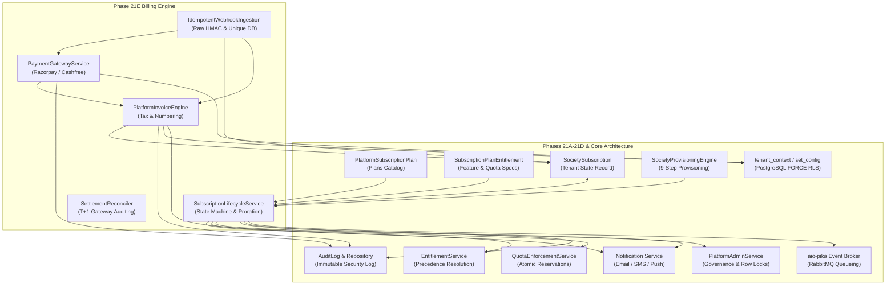
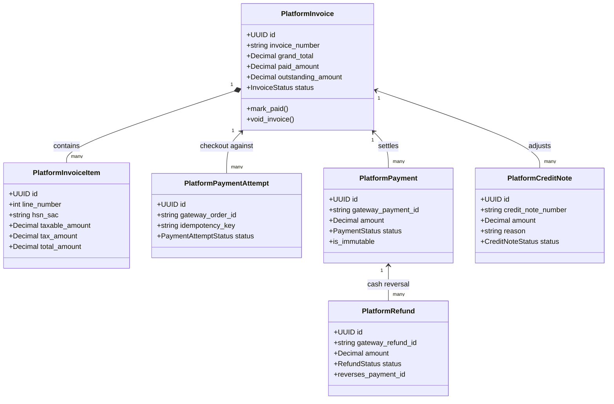
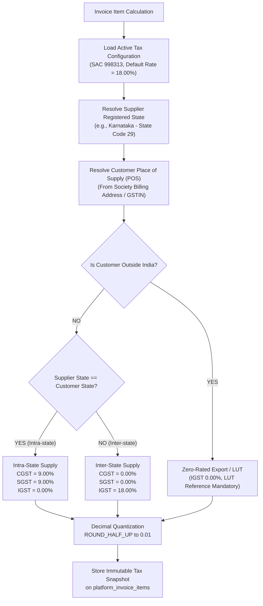
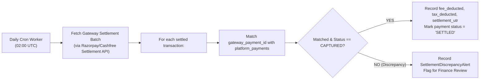
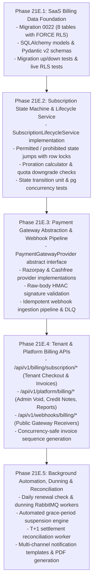

# SOCIETYSPHERE — PHASE 21E ARCHITECTURE SPECIFICATION (REFINED)
## SaaS Billing & Subscription Lifecycle Management: Production Architecture & Security Blueprint

**Project**: SocietySphere SaaS Enterprise Platform  
**Target Phase**: Phase 21E — SaaS Billing & Subscription Lifecycle Management  
**Role**: Principal SaaS Architect, FinTech Security Architect & Senior Database Architect  
**Status**: ARCHITECTURE SPECIFICATION (STRICTLY READ-ONLY REVIEW)  
**Date**: October 30, 2026  
**Document Ref**: `SOCIETYSPHERE_PHASE_21E_ARCHITECTURE_REFINED.md`  

---

## 1. Executive Summary

Phase 21E defines the production-grade **SaaS Billing and Subscription Lifecycle Management Engine** for SocietySphere. Following the successful delivery of Phases 21A–21D (commercial database models, entitlement evaluation, quota enforcement, atomic society provisioning, and platform administration APIs), Phase 21E provides the commercial revenue collection, recurring billing automation, Indian payment gateway integration, and financial governance infrastructure.

This refined architecture addresses all ten mandatory findings from the initial architectural evaluation, establishing:
1. A **formally verified subscription lifecycle transition matrix** with strict decoupling from tenant operational status (`Society.status`).
2. An **uncompromising PostgreSQL FORCE RLS architecture** where the application database user operates under `NOSUPERUSER` and `NOBYPASSRLS`, with zero platform-admin bypass policies.
3. An **idempotent, cryptographically verified payment webhook ingestion pipeline** resistant to replay attacks, network retries, and race conditions, anchored on database unique constraints and strict transaction boundaries.
4. An **accurate, enterprise-grade financial data model** that strictly segregates invoices, line items, payment attempts, captured settlements, refunds, credit notes, and adjustments—specifically guaranteeing that refunds and credit notes remain distinct accounting concepts.
5. A **configurable, decoupled Indian GST tax engine** (with SAC classification, place of supply rules, and intra/inter-state tax splitting) explicitly identifying items requiring formal Chartered Accountant (CA) review.
6. A **concurrency-safe, gapless, financial-year-based legal invoice numbering system**.
7. A **defense-in-depth payment security and gateway settlement reconciliation framework** adhering to RBI e-mandate guidelines and PCI-DSS SAQ A requirements.
8. A **deterministic proration and quota-validated subscription change engine**.
9. A **pragmatic, 5-stage implementation roadmap (Phases 21E.1–21E.5)** with verifiable acceptance criteria.

---

## 2. Existing Architecture Inspection & Reusable Components

The existing SocietySphere repository (`apps/api/src/`) and migrations (`0001`–`0021`) provide robust foundational services that Phase 21E builds upon without duplicating logic.



### 2.1 Reused Architecture Assets

1. **Plan & Entitlement Models (`apps/api/src/database/models/subscription.py`)**:
   - `PlatformSubscriptionPlan`: Provides standard billing rates (`monthly_price`, `annual_price`, `currency_code`, `trial_days`).
   - `SubscriptionPlanEntitlement`: Supplies feature keys and quota limits evaluated during plan changes.
2. **Subscription State Model (`SocietySubscription`)**:
   - Reused as the central stateful tenant entity. Existing columns (`status`, `starts_at`, `trial_ends_at`, `current_period_start`, `current_period_end`, `past_due_since`, `suspended_at`, `cancelled_at`) map directly to the Phase 21E state machine.
3. **Atomic Quota & Usage Services (`QuotaEnforcementService`)**:
   - Used during plan downgrade validations to verify that a tenant society’s current active units, residents, staff, and storage fit within the lower tier’s limits.
4. **Feature Gating Service (`EntitlementService`)**:
   - Automatically deactivates operational society features when `SocietySubscription.status` transitions to `PAST_DUE` (post-grace), `SUSPENDED`, or `CANCELLED`.
5. **Auditing & Correlation (`AuditLog`)**:
   - Captures immutable audit entries for all invoice generations, payment captures, refunds, credit note issuances, and subscription state jumps.
6. **Notification Subsystem (`apps/api/src/notifications/`)**:
   - Dispatches invoice notifications, payment confirmation receipts, dunning warnings, and grace-period countdown emails to the society’s primary administrator and treasurer.
7. **RabbitMQ Event Broker (`apps/api/src/events/broker.py`)**:
   - Drives background daily billing renewal checks, webhook retry queues, and asynchronous invoice PDF generation.

---

## 3. Subscription Lifecycle State Machine

### 3.1 Formal State Transition Matrix

The subscription state machine governs `SocietySubscription.status` across five discrete states:
- **`TRIAL`**: Society is evaluating the platform without financial obligation.
- **`ACTIVE`**: Society is in good commercial standing with paid licensing.
- **`PAST_DUE`**: Subscription renewal or initial payment failed; operating under a 7-day grace period.
- **`SUSPENDED`**: Grace period expired without payment; features blocked, access restricted to billing portal.
- **`CANCELLED`**: Commercial subscription permanently terminated.

| Current State | Target State | Trigger Event | Guards & Preconditions | Actions & Side Effects | Audit Action |
| :--- | :--- | :--- | :--- | :--- | :--- |
| **`TRIAL`** | **`ACTIVE`** | Initial checkout payment captured | Valid gateway webhook verified; payment amount $\ge$ invoice total. | Set `current_period_start = now()`, `current_period_end = now() + interval`, `trial_ends_at = NULL`. Full paid entitlements active. | `SUBSCRIPTION_ACTIVATED` |
| **`TRIAL`** | **`PAST_DUE`** | Trial period expired | `now() > trial_ends_at`; no paid invoice settled. | Set `past_due_since = now()`. 7-day grace period begins. Send dunning notification #1. | `TRIAL_EXPIRED` |
| **`TRIAL`** | **`CANCELLED`**| Voluntary abandonment | Society administrator confirms cancellation. | Set `cancelled_at = now()`, `cancellation_reason = reason`. Deactivate trial. | `TRIAL_ABANDONED` |
| **`ACTIVE`** | **`ACTIVE`** | Renewal payment captured | Verified payment for upcoming period invoice. | Advance `current_period_start = old_end`, `current_period_end = old_end + interval`. Clear `past_due_since = NULL`. | `SUBSCRIPTION_RENEWED` |
| **`ACTIVE`** | **`ACTIVE`** | Immediate plan upgrade | Upgrade invoice paid; new plan rate $>$ old rate. | Set `plan_id = new_plan_id`. Apply pro-rated credit. Recalculate entitlements immediately. | `PLAN_UPGRADED` |
| **`ACTIVE`** | **`ACTIVE`** | Scheduled downgrade queued | Target plan rate $<$ old rate; usage $\le$ target quotas. | Record `pending_downgrade_plan_id` in metadata. Takes effect at `current_period_end`. | `DOWNGRADE_QUEUED` |
| **`ACTIVE`** | **`PAST_DUE`** | Renewal payment failed/unpaid | `now() > current_period_end`; renewal invoice unpaid. | Set `past_due_since = now()`. Start 7-day grace period. Features remain active with warning banner. Dunning #1. | `RENEWAL_OVERDUE` |
| **`ACTIVE`** | **`CANCELLED`**| Voluntary cancellation | Society administrator cancels at period end or immediate. | Set `cancelled_at = now()`, `cancellation_reason = reason`. Features terminate at effective date. | `SUBSCRIPTION_CANCELLED` |
| **`PAST_DUE`** | **`ACTIVE`** | Overdue invoice paid | Verified payment settles all outstanding invoices. | Clear `past_due_since = NULL`. Restore full normal standing. | `DUNNING_RESOLVED` |
| **`PAST_DUE`** | **`SUSPENDED`**| Grace period expired | `now() > past_due_since + 7 days`; invoice unpaid. | Set `suspended_at = now()`. `EntitlementService` deactivates features. Billing portal remains accessible. Dunning #3. | `SUBSCRIPTION_SUSPENDED` |
| **`PAST_DUE`** | **`CANCELLED`**| Non-payment termination | Platform admin or automated policy (30 days overdue). | Set `cancelled_at = now()`. Outstanding invoices remain marked `OVERDUE`. | `SUBSCRIPTION_TERMINATED` |
| **`SUSPENDED`**| **`ACTIVE`** | Outstanding balance settled | Full payment captured via billing portal checkout. | Clear `suspended_at = NULL`, `past_due_since = NULL`. Advance period end. Instant feature reactivation. | `SUBSCRIPTION_REACTIVATED`|
| **`SUSPENDED`**| **`CANCELLED`**| Terminal abandonment | Inactive $> 60$ days post-suspension. | Set `cancelled_at = now()`. Contract terminated. | `SUBSCRIPTION_TERMINATED` |
| **`CANCELLED`**| *Any* | Any payment attempt | **PROHIBITED**. Cancelled subscriptions cannot be reactivated. | Payment rejected or held in suspense. Requires new society provisioning. | `REACTIVE_ATTEMPT_REJECTED` |

### 3.2 Invariant Guarantees & Prohibited Transitions

1. **Independent State Machines (`Society.status` vs `SocietySubscription.status`)**:
   - `Society.status` (`ACTIVE`, `SUSPENDED`) governs tenant governance and resident access.
   - `SocietySubscription.status` (`TRIAL`, `ACTIVE`, `PAST_DUE`, `SUSPENDED`, `CANCELLED`) governs commercial SaaS licensing.
   - **Crucial Invariant**: **Payment success must NEVER automatically reactivate an administratively suspended society.** If `Society.status == "SUSPENDED"` (e.g. frozen for legal fraud or compliance audit), a successful subscription renewal settles the commercial invoice, but `Society.status` **must remain `SUSPENDED`**. Only an authorized platform administrator calling `/api/v1/platform/societies/{society_id}/reactivate` can lift an administrative freeze.
2. **Prohibited Silent Reactivation of `CANCELLED` Subscriptions**:
   - Once a subscription transitions to `CANCELLED`, it is permanently terminated.
   - The state machine strictly prohibits any transition from `CANCELLED` to `ACTIVE`, `TRIAL`, or `PAST_DUE`.
   - Inbound webhooks matching an already `CANCELLED` subscription are rejected with HTTP `409 Conflict`, and funds are flagged for automated refund.
3. **Pessimistic Row Locking Concurrency Control**:
   - Every state machine transition must acquire a row-level lock:
     ```sql
     SELECT * FROM society_subscriptions WHERE society_id = :society_id FOR UPDATE;
     ```
   - Concurrent transition requests (e.g. simultaneous webhook delivery and admin override) serialize on the row lock. The second transaction re-reads the committed state and evaluates guard conditions against the updated status, preventing race-induced state corruption.

---

## 4. FORCE RLS and Platform Billing Access

### 4.1 Billing Tables Ownership and RLS Classification

To satisfy the mandatory requirement that the application database role remains `NOSUPERUSER` and `NOBYPASSRLS` with zero platform-admin bypass policies, all proposed billing tables are classified into **Tenant-Scoped** or **Global Platform** tables.

| Table Name | Scoping | `society_id` Column | FORCE RLS Required? | Tenant Access Pattern | Platform-Admin Access Pattern |
| :--- | :--- | :--- | :--- | :--- | :--- |
| `platform_invoices` | Tenant-Scoped | `UUID NOT NULL` | **YES** | Read-only access to own society invoices via `app.current_society_id`. | Explicit tenant context switch (`set_config('app.current_society_id', :id, true)`) for society-specific queries. Global reporting via trusted summary table or view. |
| `platform_invoice_items` | Tenant-Scoped | `UUID NOT NULL` | **YES** | Read-only access to own invoice line items. | Explicit tenant context switch. |
| `platform_payments` | Tenant-Scoped | `UUID NOT NULL` | **YES** | Read-only access to own payment receipts. | Explicit tenant context switch. |
| `platform_payment_attempts` | Tenant-Scoped | `UUID NOT NULL` | **YES** | Checkout creation and status polling for own society. | Explicit tenant context switch. |
| `platform_credit_notes` | Tenant-Scoped | `UUID NOT NULL` | **YES** | Read-only access to own credit notes. | Explicit tenant context switch. |
| `platform_subscription_history` | Tenant-Scoped | `UUID NOT NULL` | **YES** | Read-only view of own subscription history. | Explicit tenant context switch. |
| `platform_webhook_events` | Global Platform | None | **NO** | Zero access. Blocked by API layer. | Accessed exclusively by platform background workers and platform administrators. |
| `platform_payment_gateway_configs` | Global Platform | None | **NO** | Zero access. Blocked by API layer. | Restricted exclusively to platform `SUPER_ADMIN`. |
| `platform_invoice_sequences` | Global Platform | None | **NO** | Zero access. Blocked by API layer. | Invoked internally by invoice finalization service. |

### 4.2 Zero-Bypass Access Rules

1. **Least-Privilege Database Role**:
   - The application connects exclusively as `app_user` (`rolsuper = False`, `rolbypassrls = False`).
   - `ALTER TABLE platform_invoices ENABLE ROW LEVEL SECURITY;`
   - `ALTER TABLE platform_invoices FORCE ROW LEVEL SECURITY;`
2. **Canonical Tenant Isolation Policy**:
   ```sql
   CREATE POLICY platform_invoices_tenant_isolation ON platform_invoices
       FOR ALL TO public
       USING (society_id = (NULLIF(current_setting('app.current_society_id', true), ''))::uuid);
   ```
3. **Platform-Admin Access Pattern (No RLS Bypass)**:
   - When a platform super-admin inspects a specific society’s billing (`GET /api/v1/platform/societies/{society_id}/billing/invoices`), the endpoint enforces `require_role("SUPER_ADMIN")`, establishes transaction-local tenant context:
     ```python
     async with tenant_context(society_id):
         await set_db_tenant_context(session, society_id)
         # Query platform_invoices legally within the target tenant's RLS scope
     ```
   - When a platform super-admin requests **global multi-society revenue aggregates** (`GET /api/v1/platform/billing/revenue-summary`), the service queries a dedicated **Global Revenue Ledger** table (`platform_global_revenue_ledger`, which is not tenant-scoped) or executes a security-definer routine that aggregates financial totals without exposing raw cross-tenant rows. **No `BYPASSRLS` flag or bypass policy is ever created.**

---

## 5. Payment Webhook Processing

### 5.1 End-to-End Idempotent Ingestion Flow

```mermaid
sequenceDiagram
    autonumber
    participant GW as Payment Gateway (Razorpay / Cashfree)
    participant API as Webhook Endpoint (/webhooks/billing/*)
    participant DB as PostgreSQL 16 (app_user)
    participant Q as RabbitMQ Event Queue
    participant W as Webhook Worker

    GW->>API: POST /api/v1/webhooks/billing/razorpay (Raw Payload + Signature Header)
    
    Note over API: 1. Extract raw request bytes (before JSON parse)
    Note over API: 2. Verify HMAC-SHA256 signature using webhook secret
    alt Invalid Signature
        API-->>GW: HTTP 401 Unauthorized (Reject immediately)
    end

    Note over API: 3. Parse JSON & extract gateway event_id
    API->>DB: INSERT INTO platform_webhook_events (gateway_provider, event_id, payload, status='RECEIVED')
    alt Duplicate event_id (Unique Constraint Violation)
        DB-->>API: IntegrityError (uq_platform_webhook_events_gateway_event)
        API-->>GW: HTTP 200 OK (Idempotent acknowledge; skip re-execution)
    else First Delivery
        DB-->>API: Row Created
        API->>Q: Enqueue WebhookProcessingJob(event_id)
        API-->>GW: HTTP 200 OK (Fast acknowledgement < 200ms)
    end

    Q->>W: Consume WebhookProcessingJob
    W->>DB: BEGIN TRANSACTION
    W->>DB: SELECT * FROM platform_webhook_events WHERE event_id = :id FOR UPDATE
    W->>DB: SELECT * FROM platform_invoices WHERE id = :invoice_id FOR UPDATE
    W->>DB: SELECT * FROM society_subscriptions WHERE society_id = :society_id FOR UPDATE
    
    Note over W: 4. Verify payment with Gateway API (Double-check status)
    Note over W: 5. Execute state machine transition (TRIAL/PAST_DUE -> ACTIVE)
    
    W->>DB: INSERT INTO platform_payments (...)
    W->>DB: UPDATE platform_invoices SET status = 'PAID', paid_at = now()
    W->>DB: UPDATE society_subscriptions SET status = 'ACTIVE', current_period_end = ...
    W->>DB: UPDATE platform_webhook_events SET status = 'PROCESSED', processed_at = now()
    W->>DB: COMMIT TRANSACTION
    
    W->>Q: Enqueue InvoicePdfAndEmailJob(invoice_id)
```

### 5.2 Correctness & Security Invariants

1. **Original Raw-Body Signature Verification**:
   - Signature verification must operate on the **exact raw request byte string** received from the HTTP socket before any JSON decoding or dictionary parsing occurs.
   - FastAPI dependency:
     ```python
     raw_body = await request.body()
     is_valid = gateway_provider.verify_webhook_signature(raw_body, signature_header, secret)
     if not is_valid:
         raise WebhookAuthenticationException("Invalid cryptographic webhook signature.")
     ```
2. **Database Unique Constraints as Primary Correctness Mechanism**:
   - Reliance on advisory locks alone is insufficient because network partitions or worker restarts can lose in-memory locks.
   - Primary defense: `CONSTRAINT uq_platform_webhook_events_gateway_event UNIQUE (gateway_provider, event_id)`.
   - Secondary defense: `CONSTRAINT uq_platform_payments_gateway_id UNIQUE (gateway_provider, gateway_payment_id)`.
   - Even if two webhook workers process identical payloads concurrently, PostgreSQL’s unique constraint aborts the duplicate transaction with an `IntegrityError`, guaranteeing that an invoice is never paid twice.
3. **Dead-Letter Queue (DLQ) & Exponential Backoff Retry**:
   - If processing fails due to transient database disconnections, the job retries up to 5 times with exponential backoff ($2^n \times 15\text{ seconds}$).
   - If failure persists after 5 attempts, the event is marked `status = 'FAILED'`, moved to `platform_billing_webhook_dlq`, and triggers a high-severity alert to platform operations.
4. **Zero-Downtime Secret Rotation Protocol**:
   - Gateway configurations maintain `active_webhook_secret` and `previous_webhook_secret`.
   - Verification attempts validation against `active_webhook_secret`; if validation fails, it falls back to `previous_webhook_secret` (valid for a 24-hour transition window), enabling seamless key rotation without dropped events.

---

## 6. Financial Data Model

### 6.1 Entity Differentiation and Accounting Invariants

A critical requirement is the rigorous distinction between accounting and transactional entities.



### 6.2 Entity Definitions & Boundaries

1. **`PlatformInvoice`**:
   - The authoritative legal commercial demand for payment.
   - Statuses: `DRAFT`, `ISSUED`, `PAID`, `OVERDUE`, `VOID`, `CANCELLED`.
   - **Immutability**: Once an invoice transitions from `DRAFT` to `ISSUED`, all line items, tax calculations, customer address, and GSTIN become **strictly immutable**. No updates or deletes are permitted.
2. **`PlatformInvoiceItem`**:
   - Granular breakdown of individual billed components (e.g. Base Plan licensing, per-unit overages, SMS gateway add-ons).
   - Freezes the HSN/SAC code (`998313`), taxable value, tax rate, and tax split.
3. **`PlatformPaymentAttempt`**:
   - Ephemeral checkout tracking record created when a society clicks "Pay Now".
   - Maps to the gateway order (`order_id`) and preserves the caller’s idempotency key.
4. **`PlatformPayment` (Captured Settlement)**:
   - Authoritative record of funds received into SocietySphere's merchant account.
   - Linked to a specific invoice. Reduces `outstanding_amount` on `PlatformInvoice`.
   - Strictly immutable upon creation.
5. **`PlatformCreditNote` vs. `PlatformRefund` (Mandatory Separation)**:
   - **`PlatformCreditNote` (Receivable / Liability Adjustment)**:
     - Issued to correct overbilling, compensate for service outages, or apply pro-rated downgrade credits.
     - Adjusts the legal sales value and reduces GST output liability.
     - Does **not** move cash through the banking rails.
   - **`PlatformRefund` (Actual Cash Reversal)**:
     - An electronic banking transaction executed via the payment gateway that reverses a prior captured `PlatformPayment`.
     - Money leaves SocietySphere’s bank account and returns to the society’s source bank/card.
     - **Crucial Invariant**: **A refund is NOT automatically a credit note.** A refund reverses a payment; a credit note reduces invoice debt. A refund may be issued against an overpayment without a credit note, or a credit note may be issued to grant future billing credit without any cash refund.
6. **`PlatformBillingAdjustment`**:
   - Internal administrative adjustment (e.g. promotional waiver) applied to a `DRAFT` invoice before finalization.

---

## 7. GST and Tax Engine

### 7.1 Configurable Multi-Tier Tax Architecture

> [!CAUTION]
> **Professional Validation Required**: The classification of SaaS software subscriptions under HSN/SAC `998313` and the standard 18% GST rate represent baseline engineering assumptions. Formal review and sign-off by a qualified Indian Chartered Accountant / Indirect Tax Professional is mandatory prior to live production invoicing.

The tax engine must **never hardcode tax rates or state logic**. All parameters are loaded dynamically from database configuration.



### 7.2 Configurable Tax Rules & Place of Supply (POS) Logic

1. **Place of Supply (POS) Determination (Sections 12 & 13 of IGST Act)**:
   - **B2B Supply (Society has valid GSTIN)**: POS is the state of the registered recipient (`customer_gstin[:2]`).
   - **B2C Supply (Unregistered Society)**: POS is the state of the society’s physical premises address on record.
2. **Tax Split Logic**:
   $$\text{Taxable Base} = (\text{Quantity} \times \text{Unit Price}) - \text{Discount}$$
   - **Intra-State Supply** ($\text{Supplier State Code} == \text{POS State Code}$):
     $$\text{CGST} = (\text{Taxable Base} \times \frac{\text{Tax Rate}}{2 \times 100}).\text{quantize}(\text{Decimal}('0.01'))$$
     $$\text{SGST} = (\text{Taxable Base} \times \frac{\text{Tax Rate}}{2 \times 100}).\text{quantize}(\text{Decimal}('0.01'))$$
     $$\text{IGST} = \text{Decimal}('0.00')$$
   - **Inter-State Supply** ($\text{Supplier State Code} \ne \text{POS State Code}$):
     $$\text{CGST} = \text{Decimal}('0.00')$$
     $$\text{SGST} = \text{Decimal}('0.00')$$
     $$\text{IGST} = (\text{Taxable Base} \times \frac{\text{Tax Rate}}{100}).\text{quantize}(\text{Decimal}('0.01'))$$
3. **Immutable Invoice Snapshot**:
   - When an invoice transitions to `ISSUED`, the exact tax configuration is frozen onto the invoice item record:
     `{sac_code: "998313", tax_rate: 18.00, cgst_rate: 9.00, sgst_rate: 9.00, igst_rate: 0.00, supplier_gstin: "...", customer_gstin: "..."}`.
   - Future changes to tax rates in the catalog will never alter historical issued invoices.

---

## 8. Invoice Numbering

### 8.1 Concurrency-Safe Legal Sequence Architecture

To satisfy Rule 46 of the CGST Rules, 2017, invoice numbers must be:
- Unique across the entire platform.
- Consecutive and gapless within a financial year.
- Alphanumeric containing only letters, numbers, and hyphens (max 16 characters for GST portal compatibility).

**Format**: `SS-2627-00001` (13 characters)
- `SS`: Organization prefix (SocietySphere).
- `2627`: Indian Financial Year (FY 2026–2027: April 1, 2026 to March 31, 2027).
- `00001`: 5-digit monotonically increasing sequence counter, zero-padded.

### 8.2 Database Sequence Generation Mechanism

```sql
CREATE TABLE platform_invoice_sequences (
    financial_year VARCHAR(6) NOT NULL, -- e.g. '2627'
    document_type VARCHAR(10) NOT NULL,  -- 'INVOICE', 'CREDIT_NOTE'
    last_sequence_number BIGINT NOT NULL DEFAULT 0,
    created_at TIMESTAMP WITHOUT TIME ZONE NOT NULL DEFAULT (now() AT TIME ZONE 'UTC'),
    updated_at TIMESTAMP WITHOUT TIME ZONE NOT NULL DEFAULT (now() AT TIME ZONE 'UTC'),
    PRIMARY KEY (financial_year, document_type)
);
```

**Allocation Procedure**:
1. An invoice is drafted with status `DRAFT` and `invoice_number = NULL`. (Drafts do not consume legal sequence numbers, preventing gaps caused by abandoned checkouts).
2. Upon **invoice finalization** (when checkout is initiated or renewal triggers):
   ```sql
   INSERT INTO platform_invoice_sequences (financial_year, document_type, last_sequence_number)
   VALUES (:fy, 'INVOICE', 1)
   ON CONFLICT (financial_year, document_type)
   DO UPDATE SET last_sequence_number = platform_invoice_sequences.last_sequence_number + 1
   RETURNING last_sequence_number;
   ```
3. The atomic row lock in PostgreSQL serializes concurrent invoice finalizations, guaranteeing strictly monotonic, gapless numbering without race conditions.
4. If an issued invoice is cancelled or billing fails, it is formally marked `status = 'VOID'`. The number is preserved in the audit log; sequence numbers are **never reused or rolled back**.

---

## 9. Payment Security & Reconciliation

### 9.1 Zero Cardholder Data Exposure (PCI-DSS SAQ A)
- SocietySphere operates strictly within PCI-DSS Self-Assessment Questionnaire A (SAQ A) scope.
- **Strict Prohibition**: The backend must never accept, process, log, or store Primary Account Numbers (PAN), CVVs, or card PINs.
- All checkout flows use gateway-hosted checkout iframes or redirect URLs where card/UPI data is submitted directly from the resident's browser to the payment processor.

### 9.2 Gateway Credential Encryption & Key Rotation
- API secrets and webhook signing keys are encrypted at rest using AES-256-GCM authenticated encryption.
- Master encryption keys (`BILLING_ENCRYPTION_MASTER_KEY`) are loaded via environment variables / secrets manager, never hardcoded.

### 9.3 T+1 Automated Payment Gateway Settlement Reconciliation



- Every morning, a background reconciliation worker downloads the gateway’s settlement file for day $T-1$.
- Reconciles every captured fee against the bank payout UTR, ensuring gateway platform fee deductions (typically 1.5%–2% + GST) match contractual rates.

---

## 10. Subscription Proration

### 10.1 Plan Upgrade Policy (Immediate Pro-Rata)

When a tenant society upgrades from a lower plan (e.g. `STANDARD` at ₹1,999/mo) to a higher plan (e.g. `ENTERPRISE` at ₹4,999/mo) mid-cycle:

1. **Calculate Remaining Value of Current Plan**:
   $$\text{Days Remaining} = \max(0, (\text{current\_period\_end} - \text{now()}).\text{days})$$
   $$\text{Total Days in Period} = (\text{current\_period\_end} - \text{current\_period\_start}).\text{days}$$
   $$\text{Unused Credit} = (\text{Current Plan Price} \times \frac{\text{Days Remaining}}{\text{Total Days in Period}}).\text{quantize}(\text{Decimal}('0.01'))$$
2. **Calculate Cost of Target Plan for Remaining Days**:
   $$\text{Target Plan Cost} = (\text{New Plan Price} \times \frac{\text{Days Remaining}}{\text{Total Days in Period}}).\text{quantize}(\text{Decimal}('0.01'))$$
3. **Prorated Invoice Total**:
   $$\text{Prorated Net Charge} = \text{Target Plan Cost} - \text{Unused Credit}$$
   $$\text{Tax (GST 18%)} = (\text{Prorated Net Charge} \times 0.18).\text{quantize}(\text{Decimal}('0.01'))$$
   $$\text{Grand Total} = \text{Prorated Net Charge} + \text{Tax}$$
4. An immediate invoice is issued for the net difference. Upon payment capture, the subscription plan is switched immediately, and entitlements are refreshed in real time.

### 10.2 Plan Downgrade Policy (Scheduled at Period End)

1. **Scheduled Execution**: To eliminate complex negative billing and credit liabilities, downgrades do **not** take effect immediately.
2. **Quota Availability Pre-Check**:
   - The downgrade request invokes `QuotaEnforcementService` to inspect the society’s current active metrics against the target plan:
     - `current_units <= target_plan.units_max`
     - `current_staff <= target_plan.staff_max`
   - If current usage exceeds target limits, the downgrade is **rejected immediately** (`409 Conflict: Quota Exceeded for Target Plan`).
3. If usage satisfies target limits, the downgrade is queued (`pending_downgrade_plan_id`). The society enjoys their higher-tier plan until `current_period_end`, at which point the subscription renews at the lower plan rate.

---

## 11. Revised Implementation Phasing Strategy

Phase 21E is decomposed into **five strictly sequential, verifiable sub-phases**:



### Detailed Sub-Phase Specifications

| Sub-Phase | Scope & Deliverables | Database Changes | Services & APIs | Acceptance Criteria |
| :--- | :--- | :--- | :--- | :--- |
| **Phase 21E.1** | Billing Data Foundation | Migration `0022`: Creates 8 tables with `FORCE RLS`, indexes, constraints. | SQLAlchemy models in `apps/api/src/database/models/platform_billing.py`; Pydantic v2 schemas. | Alembic migration applies cleanly; rollback drops cleanly; live PG tests verify `FORCE RLS` under `app_user`. |
| **Phase 21E.2** | Lifecycle State Machine | None (reuses 21E.1 tables). | `SubscriptionLifecycleService` implementing state transitions, `SELECT FOR UPDATE` locking, audit logs. | 100% test coverage of transition matrix; zero decoupling breaks; proration math verified. |
| **Phase 21E.3** | Gateway Abstraction & Webhooks | None. | `PaymentGatewayProvider`, `RazorpayProvider`, `CashfreeProvider`, idempotent webhook ingestion service. | Raw HMAC signature tests pass; duplicate webhooks handled idempotently via DB constraints; mock checkout verified. |
| **Phase 21E.4** | Invoicing & Billing APIs | None. | Tenant billing routes (`/billing/subscription/*`), admin platform routes (`/platform/billing/*`), sequence generator. | Gapless invoice numbering verified under concurrent load; RBAC enforced (`SUPER_ADMIN` vs `SOCIETY_ADMIN`). |
| **Phase 21E.5** | Automation & Dunning | None. | RabbitMQ renewal billing worker, dunning sequence worker, settlement reconciler, notification listeners. | Automated T-7 renewal invoice generation verified; 7-day grace period suspension verified; full regression clean. |

---

## 12. Testing & Verification Strategy

### 12.1 Unit & Domain Tests
1. **State Machine Transition Permutations**: Exhaustive tests for every permitted jump in the matrix, verifying that prohibited transitions raise HTTP `409 Conflict`.
2. **Proration Mathematics**: Edge-case testing for mid-month upgrades, leap years, and fractional paise rounding (`ROUND_HALF_UP`).
3. **GST Tax Engine**: Validating intra-state (CGST+SGST) vs inter-state (IGST) split, zero-rated export handling, and GSTIN Luhn Mod 36 checksum validation.
4. **HMAC Signature Verifier**: Verifying that modified request body bytes or altered headers immediately fail validation.

### 12.2 Live PostgreSQL 16 Concurrency & RLS Tests
1. **Multi-Session Pessimistic Locking**: Concurrent payment webhooks for the same subscription serialize on `SELECT ... FOR UPDATE`; exactly one renewal occurs, the other is treated idempotently.
2. **Advisory Lock & DB Constraint Webhook Verification**: Concurrent identical webhook deliveries are rejected by `(gateway_provider, event_id)` constraint without duplicate payment records.
3. **FORCE RLS Verification under `app_user`**: Queries against `platform_invoices` without tenant context return 0 rows. Cross-tenant invoice inspection is physically blocked.
4. **Connection Pool Cleanup**: Transaction-local parameters (`app.current_society_id`) revert completely upon commit or rollback.

---

## 13. Risks and Unresolved Decisions

The following items represent operational and legal dependencies requiring formal stakeholder confirmation before production deployment:

1. **Indian Chartered Accountant (CA) Validation**:
   - Formal sign-off on SAC Code `998313` classification and the 18% standard GST rate for SocietySphere B2B SaaS licensing.
2. **Corporate Entity GST Registration State**:
   - The registered state of SocietySphere Platform Ltd. establishes the baseline for intra-state vs inter-state tax splits. (Assumed: Karnataka, State Code `29`).
3. **Primary Payment Gateway Selection**:
   - Razorpay vs. Cashfree commercial terms, transaction MDR rates, and recurring e-mandate onboarding approval.

---

## 14. Architecture Review Verdict & Next Steps

This refined architecture proposal resolves all mandatory review findings and establishes a secure, concurrency-safe, multi-tenant billing foundation.

### Immediate Next Step
Await user review and authorization of `SOCIETYSPHERE_PHASE_21E_ARCHITECTURE_REFINED.md`. Upon approval, proceed to author the Pre-Implementation Review for **Phase 21E.1: SaaS Billing Data Foundation (Migration 0022)**.

---
*Specification submitted by Principal SaaS Architect, FinTech Security Architect & Senior Database Architect.*
