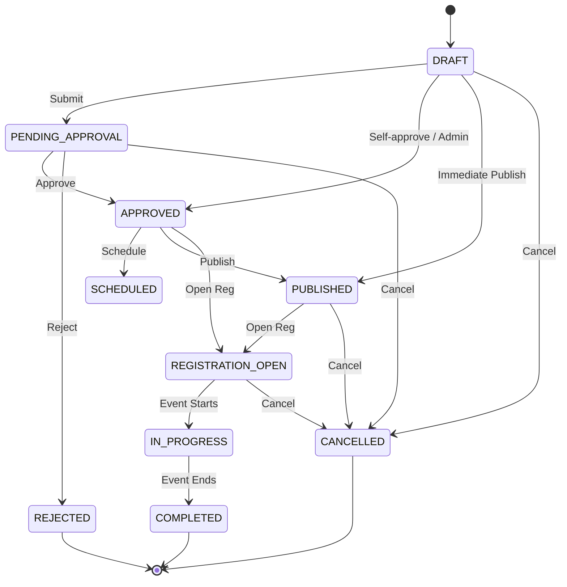

# Phase 17 — Events & Community Management Architecture

## Executive Architecture Summary

Phase 17 introduces the **Events & Community Management Foundation** module to SocietySphere. It provides a secure, tenant-isolated domain for managing society cultural events, sports tournaments, festivals, workshops, community gatherings, and awareness programs.

The implementation strictly maintains SocietySphere's **modular-monolith architecture** using Python + FastAPI on the backend, PostgreSQL + Alembic for database persistence with Row-Level Security (RLS), and Next.js + React + TypeScript + Tailwind on the frontend.

---

## Architecture Boundaries & Principles

1. **Reused Foundations**: Reuses identity hierarchies (`users`, `units`, `societies`), Phase 14 `Facility`, Phase 15 `FacilityBooking` service boundary, Phase 7 `ResidentDelegate`, and Phase 16 domain event hook patterns.
2. **Zero Model Duplication**: Does NOT create duplicate identity, facility, booking, or announcement engines.
3. **No Paid Events**: Fees, payment gateways, and event-specific accounting are OUT OF SCOPE.
4. **Decoupled Domain Events**: Emits domain events without coupling to external SMS, WhatsApp, or Push SDK providers.

---

## Entity-Relationship Diagram

```mermaid
erDiagram
    SOCIETY ||--o{ EVENT : "hosts"
    EVENT ||--o{ EVENT_PARTICIPANT : "has"
    EVENT ||--o{ EVENT_REGISTRATION : "tracks"
    EVENT ||--o{ EVENT_APPROVAL : "logs"
    EVENT ||--o{ EVENT_SCHEDULE : "defines"
    EVENT ||--o{ EVENT_ATTENDANCE : "records"
    EVENT ||--o{ EVENT_ATTACHMENT : "stores"
    EVENT ||--o{ EVENT_STATUS_HISTORY : "audits"

    USER ||--o{ EVENT : "organizes"
    FACILITY ||--o? EVENT : "hosts"
    USER ||--o{ EVENT_REGISTRATION : "registers"
    USER ||--o{ EVENT_ATTENDANCE : "attends"
```

---

## Domain Entities

| Entity | Table Name | Purpose |
|---|---|---|
| `Event` | `events` | Core event metadata, capacity, start/end dates, state |
| `EventParticipant` | `event_participants` | Resident participant association and unit context |
| `EventRegistration` | `event_registrations` | Registration status (`CONFIRMED`, `WAITLISTED`, `CANCELLED`) |
| `EventApproval` | `event_approvals` | Administrative approval / rejection records |
| `EventSchedule` | `event_schedules` | Event publication and registration window scheduling |
| `EventAttendance` | `event_attendances` | Check-in, attendance, and no-show records |
| `EventAttachment` | `event_attachments` | Circular, poster, and guidelines file metadata |
| `EventStatusHistory` | `event_status_histories` | Immutable status transition audit logs |

---

## Event Lifecycle State Machine



---

## Transactional Capacity & Waitlist Strategy

1. **Transactional Advisory Locking**: When registering participants, `acquire_event_capacity_lock` executes `pg_advisory_xact_lock` on the `event_id` hash.
2. **Deterministic Overflow**: Active confirmed registrations up to `capacity` are marked `CONFIRMED`. Subsequent registrations receive status `WAITLISTED` with sequential `waitlist_position`.
3. **Automatic Promotion**: When a confirmed registration is cancelled, the next waitlisted registration is automatically promoted to `CONFIRMED`.
