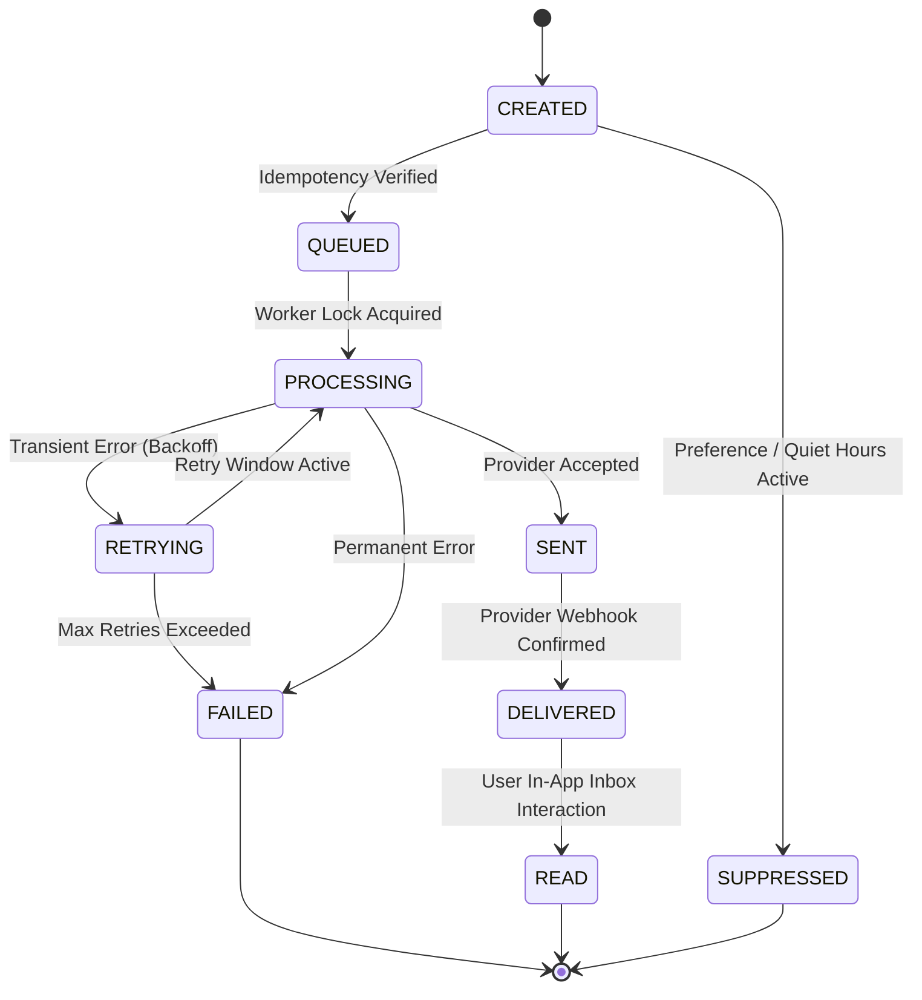

# Phase 20 — Notifications & Communication Delivery Foundation Architecture Specification

## 1. Architectural Overview

Phase 20 defines the central **Notifications & Communication Delivery Foundation** for SocietySphere. It provides an asynchronous, provider-neutral, multi-tenant notification engine that processes domain events from Phases 1–19 and routes messages across multiple channels (In-App, Email, SMS, WhatsApp, Push).

```mermaid
flowchart TD
    subgraph Business Domains [Locked Phases 1–19]
        PD1["Phase 16: Announcements"]
        PD2["Phase 17: Events"]
        PD3["Phase 18: Governance"]
        PD4["Phase 19: Emergency/Incidents"]
        PD5["Phases 4-6: Billing & Payments"]
        PD6["Phases 10-11: Complaints & Work Orders"]
    end

    subgraph Domain Event Hooks
        EH["Domain Event Logger / Event Hooks"]
    end

    subgraph Phase 20 Notification Orchestrator
        NO["Notification Orchestrator Service"]
        AR["Audience Resolver (Phase 16 Reuse)"]
        TR["Template Resolver (Jinja2 Allowlist)"]
        PE["Preference Evaluator (Quiet Hours & Override)"]
        DP["Delivery Planner & Idempotency Check"]
    end

    subgraph Channel Adapters [Provider-Neutral]
        C1["In-App Provider"]
        C2["Email Adapter"]
        C3["SMS Adapter"]
        C4["WhatsApp Adapter"]
        C5["Mobile Push Adapter"]
    end

    subgraph Storage & Audit
        DB[("PostgreSQL DB (RLS & FORCE RLS)")]
        LOG["Structured Audit Log"]
    end

    Business Domains --> EH
    EH --> NO
    NO --> AR
    NO --> TR
    NO --> PE
    AR & TR & PE --> DP
    DP --> C1 & C2 & C3 & C4 & C5
    DP --> DB
    C1 & C2 & C3 & C4 & C5 --> LOG
```

---

## 2. 10 Normalized Entity Schemas

1. **`Notification` (`notifications`)**: Master logical notification record.
2. **`NotificationRecipient` (`notification_recipients`)**: In-app inbox recipient record with read receipt tracking (`is_read`, `read_at`).
3. **`NotificationTemplate` (`notification_templates`)**: Category master catalog for notification templates.
4. **`NotificationTemplateVersion` (`notification_template_versions`)**: Immutable versioned content templates with channel, language (`en`, `ta`), title/body templates, and allowlisted variable definitions.
5. **`NotificationPreference` (`notification_preferences`)**: User-configured notification toggles, quiet-hour boundaries, and channel preferences.
6. **`NotificationChannelPreference` (`notification_channel_preferences`)**: Channel-specific opt-in/opt-out preferences per user.
7. **`NotificationDelivery` (`notification_deliveries`)**: Channel delivery execution task with status tracking (`QUEUED`, `PROCESSING`, `SENT`, `DELIVERED`, `READ`, `FAILED`, `SUPPRESSED`).
8. **`NotificationDeliveryAttempt` (`notification_delivery_attempts`)**: Detailed provider transmission log recording request IDs, response codes, latency, and error classification.
9. **`NotificationBatch` (`notification_batches`)**: Broadcast execution manager for mass notifications (e.g. 5,000-recipient announcements) with rate-limiting and progress tracking.
10. **`UserDeviceToken` (`user_device_tokens`)**: Multi-device registration for mobile push notifications (iOS APNs / Android FCM tokens).

---

## 3. Notification Lifecycle State Machine



---

## 4. Architectural Resolution of 25 Core Decisions

1. **In-App Notification Storage**: Central `notifications` and `notification_recipients` tables with spatial and tenant index.
2. **Notification vs. Communication Boundary**: Notification = logical user message; Delivery = channel transmission task.
3. **Orchestration Strategy**: Decoupled event listeners consuming domain event hooks without synchronous db blocking.
4. **Transactional Outbox**: Outbox pattern design ensuring domain mutations write outbox events in same DB transaction.
5. **Queue Boundary**: Background worker queue abstraction using Redis / RabbitMQ with exponential backoff.
6. **Retry Architecture**: Bounded retries (max 3 attempts) with jittered exponential backoff for transient provider failures.
7. **Delivery-Attempt Audit**: Detailed `NotificationDeliveryAttempt` table recording provider responses and request IDs.
8. **Provider Abstraction**: Abstract `CommunicationProvider` base class with concrete adapters for each channel.
9. **Failover Strategy**: Primary/secondary provider configuration with fallback upon provider HTTP 5xx errors.
10. **User Preference Model**: Per-category and per-channel user toggles with timezone-aware quiet hours.
11. **Emergency Priority Override**: `CRITICAL` priority notifications (Phase 19 emergency alerts) bypass quiet hours and channel opt-outs.
12. **Quiet Hours**: Time-window evaluation based on user/society timezone for `LOW` and `NORMAL` priority messages.
13. **Template Versioning**: Immutable `NotificationTemplateVersion` records ensuring historic delivery audits remain verifiable.
14. **Localization Fallback**: Language resolution chain: Recipient Language -> Society Default -> Platform Default (`en`).
15. **Template Variable Security**: Allowlisted variable substitution preventing Jinja2/code execution vulnerabilities.
16. **Webhook/Callback Security**: Mandatory HMAC-SHA256 signature validation and timestamp anti-replay verification.
17. **Provider Credential Security**: Secrets stored strictly in environment/vault configurations, never in plaintext DB columns.
18. **Data Retention**: 90-day active inbox retention; 1-year operational audit retention with archiving.
19. **Read Receipt Model**: `is_read` and `read_at` timestamps on `NotificationRecipient` records.
20. **Push-Token Model**: `UserDeviceToken` entity supporting multi-device push registration.
21. **Mass Broadcast**: Asynchronous 500-recipient batching with sliding window rate limiting.
22. **Rate Limiting**: Redis sliding-window rate limiters per user, per society, and per provider channel.
23. **Dead-Letter Handling**: Max-retry failures transition to `FAILED` status and log to dead-letter audit.
24. **Observability**: Prometheus metrics for delivery volume, success rate, latency, and provider error rates.
25. **Cross-Phase Matrix**: Integration across all 19 existing domain modules documented in pre-implementation specification.
