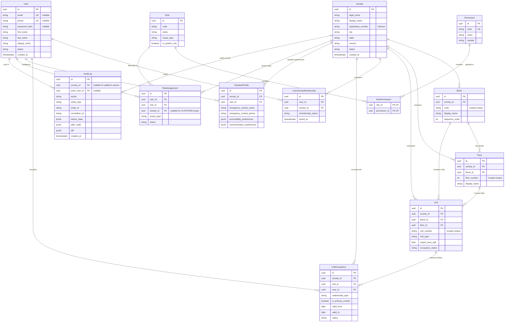

# SocietySphere Entity-Relationship Diagram (ERD)

## 1. High-Level Entity Relationship Diagram

The following Mermaid diagram models the relationships across all Phase 2 entities. 
Platform-level entities exist outside tenant boundaries, while Tenant-scoped entities are strictly partitioned by `society_id`.



---

## 2. Structural Isolation Boundaries

```
[PLATFORM SCOPE]
  └── users (Global Identity)
  └── permissions (Global Action Definitions)
  └── roles [scope_type='PLATFORM'] (Platform Super Admin)
  └── audit_logs [society_id IS NULL] (Platform operations)

[TENANT BOUNDARY: Society]
  ├── Physical Spatial Hierarchy
  │     └── blocks -> floors -> units
  ├── Identity Associations
  │     ├── user_society_memberships
  │     ├── unit_occupancies (historical & current)
  │     └── resident_profiles (preferences, emergency contacts)
  ├── Security & Authorization
  │     └── role_assignments [scope_type='SOCIETY', society_id=Society.id]
  └── Audit Records
        └── audit_logs [society_id=Society.id]
```
